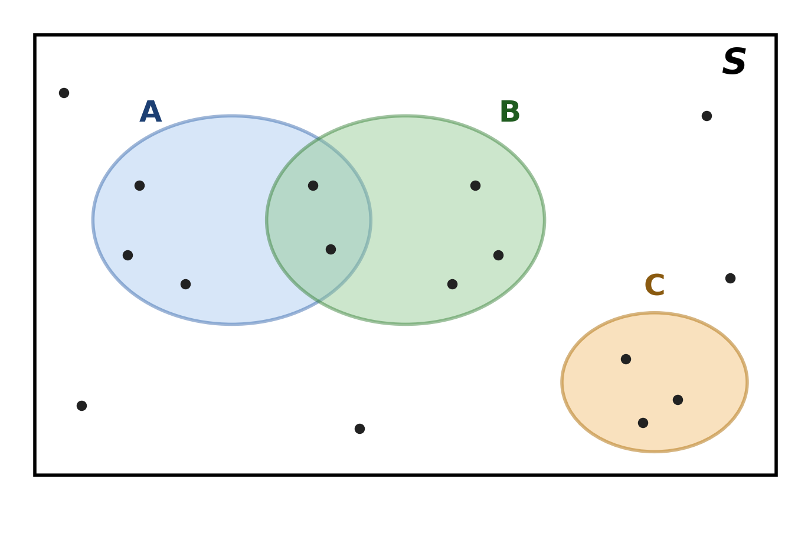

## Contents

::: {.cards .stack .toc}
::: {.box}
<a class="toc-hit" href="#/course-information" title="Go to section"></a>
<span class="tag">1 · Course Information</span>
People, textbooks, grading, attendance, studying, AI policy and course structure.
:::
::: {.box}
<a class="toc-hit" href="#/prerequisites" title="Go to section"></a>
<span class="tag">2 · Prerequisites</span>
Review questions on sets and calculus.
:::
::: {.box}
<a class="toc-hit" href="#/what-is-probability" title="Go to section"></a>
<span class="tag">3 · What Is Probability?</span>
Determinism vs. chance, and a coin-tossing simulation.
:::
::: {.box}
<a class="toc-hit" href="#/experiments-spaces-events" title="Go to section"></a>
<span class="tag">4 · Experiments, Spaces, Events</span>
Random experiments, sample spaces, events, and two coin tosses.
:::
::: {.box}
<a class="toc-hit" href="#/where-do-probabilities-come-from" title="Go to section"></a>
<span class="tag">5 · Where Do Probabilities Come From?</span>
The naive definition, when "equally likely" is reasonable, and two dice.
:::
:::

# Course Information {.section-slide}

Who, what, when, and how you are graded.

## Course Information

| | |
|---|---|
| **Instructor** | Prof. Vladyslav Nora |
| **Teaching Assistant** | TBA |
| **Class Hours** | T/Th, 16:30–17:45 |
| **Location** | Blue Hall |
| **Office Hours** | T/Th, 15:00–16:00 — register via [Google Calendar](https://calendar.app.google/sNK5oxu7GNkL82316) |
| **Announcements & materials** | Schedule, missing-class forms, exam samples — all on Moodle |

## Textbooks

::: {.box .key}
<span class="tag">Procure</span>
The following (not available in the library):
:::

| Code | Textbook |
|---|---|
| **BH** | *Introduction to Probability*, Blitzstein & Hwang, 2nd edition — free online version available; based on the authors' Harvard lectures |
| **K** | *Statistics for Management and Economics*, Gerald Keller, 11th edition |

## Assessment and Attendance

| Component | Weight / Rule |
|---|---|
| Problem sets (6) | Pass/Fail — must pass at least 4 of 6 to qualify for the final exam. Hand-written, scanned, submitted via Moodle by the due date. |
| Quizzes (2) | 35% total (Quiz 1: 15%, Quiz 2: 20%) |
| Midterm exam | 25% |
| Final exam | 40% |
| Attendance | Mandatory — at most 2 missed classes without penalty. Missing more than 20% of classes requires retaking the course. |

## Grading Curve

::: {.box .key}
<span class="tag">Grading Curve</span>
Grades are curved to roughly: 15% A/A-, 50% B+/B/B-, 20% C+/C/C-, 10% D+/D/F, with a median around B-.
:::

## How to Study

::: {.box .key}
<span class="tag">Key idea</span>
Practice is the single most important part of this course: **solve as many problems as you can** on your own.
:::

. . .

::: {.box}
<span class="tag">Sources of practice</span>
Problem sets (6, mandatory), exercises in BH and K after each chapter.
:::

. . .

::: {.box .warn}
**Believing you understand something is not the same as actually understanding it.** Only struggling with problems reliably measures comprehension.
:::

## AI Policy

::: {.box .good}
Outside of exams, you may use generative AI tools **without restriction and at no penalty**.
:::

. . .

::: {.box}
If you can't solve a problem, ask AI first only for **hints**, not the full solution.
:::

. . .

::: {.box .warn}
Any AI contribution must be **acknowledged** (extent of use + source). Unacknowledged AI use is treated as plagiarism.
:::

. . .

::: {.box .key}
Exams are closed-book: no notes, calculators, or electronic devices.
:::

## Course Structure

::: {.cards}
::: {.box}
<span class="tag">First three-quarters</span>
Probability theory: the mathematical tool for thinking about uncertainty.
:::
::: {.box .good}
<span class="tag">Last quarter</span>
Basic statistics: applying probability theory to analyze real-world data.
:::
:::

# Prerequisites {.section-slide}

Review before the next lecture.

## Prerequisites

::: {.box}
<span class="tag">Basic set theory</span>
Sets, unions, intersections, complements, Cartesian products.
:::

::: {.box}
<span class="tag">Calculus</span>
Derivatives, integrals, geometric series.
:::

## Review Question 1: What is a set?

::: {.box .key}
<span class="tag">Question</span>
The set of colors used in traffic lights:
$$C = \{\text{red}, \text{yellow}, \text{green}\}$$
:::

a) Is $\text{blue} \in C$?
b) Is $\{\text{red}, \text{green}, \text{yellow}\}$ the same set as $C$? Does order matter?
c) Is $C = \{\text{red}, \text{red}, \text{yellow}, \text{green}\}$ still a valid representation of $C$? Why?

## Solution to Question 1

::: {.box .good}
<span class="tag">a)</span>
No, $\text{blue} \notin C$ since blue is not listed as an element.
:::

. . .

::: {.box .good}
<span class="tag">b)</span>
Yes: sets are unordered, so $\{\text{red}, \text{green}, \text{yellow}\} = C$.
:::

. . .

::: {.box .good}
<span class="tag">c)</span>
Yes, same set. Sets do not count multiplicity: repeated elements are collapsed, so $\{\text{red}, \text{red}, \text{yellow}, \text{green}\} = \{\text{red}, \text{yellow}, \text{green}\} = C$.
:::

## Review Question 2: Set operations

::: {.box .key}
<span class="tag">Question</span>
$$A = \{1, 2, 3, 4, 5\}, \qquad B = \{2, 4, 6, 8\}$$
:::

Find:

a) $A \cup B$
b) $A \cap B$
c) $A \setminus B$ (elements in $A$ but not in $B$)
d) $|A \cup B|$ (the cardinality, i.e. number of elements)

## Solution to Question 2

::: {.cards}
::: {.box .good .c}
<span class="tag">a)</span>
$A \cup B = \{1, 2, 3, 4, 5, 6, 8\}$
:::
::: {.box .good .c}
<span class="tag">b)</span>
$A \cap B = \{2, 4\}$
:::
:::

. . .

::: {.cards}
::: {.box .good .c}
<span class="tag">c)</span>
$A \setminus B = \{1, 3, 5\}$
:::
::: {.box .good .c}
<span class="tag">d)</span>
$|A \cup B| = 7$
:::
:::

## Review Question 3: Venn diagrams

::: {.box .key}
<span class="tag">Question</span>
Each diagram shows two sets $A$, $B$ inside a universal set $S$, with one region shaded. Write the set expression (using $\cup$, $\cap$, $\setminus$, $\triangle$, or complement) for the shaded region.
:::

::: {.venn-row}
::: {.vn}
**a)**
```{=html}
<svg viewBox="0 0 300 200" xmlns="http://www.w3.org/2000/svg">
  <mask id="maskQ3a"><rect x="0" y="0" width="300" height="200" fill="white"/><circle cx="190" cy="100" r="80" fill="black"/></mask>
  <circle cx="110" cy="100" r="80" fill="#a8c8f0" mask="url(#maskQ3a)"/>
  <circle cx="110" cy="100" r="80" fill="none" stroke="black" stroke-width="1.5"/>
  <circle cx="190" cy="100" r="80" fill="none" stroke="black" stroke-width="1.5"/>
  <text x="55" y="25" font-size="16" font-weight="bold">A</text>
  <text x="245" y="25" font-size="16" font-weight="bold">B</text>
</svg>
```
:::
::: {.vn}
**b)**
```{=html}
<svg viewBox="0 0 300 200" xmlns="http://www.w3.org/2000/svg">
  <clipPath id="clipQ3b"><circle cx="110" cy="100" r="80"/></clipPath>
  <g clip-path="url(#clipQ3b)"><circle cx="190" cy="100" r="80" fill="#8ec98e"/></g>
  <circle cx="110" cy="100" r="80" fill="none" stroke="black" stroke-width="1.5"/>
  <circle cx="190" cy="100" r="80" fill="none" stroke="black" stroke-width="1.5"/>
  <text x="55" y="25" font-size="16" font-weight="bold">A</text>
  <text x="245" y="25" font-size="16" font-weight="bold">B</text>
</svg>
```
:::
::: {.vn}
**c)**
```{=html}
<svg viewBox="0 0 300 200" xmlns="http://www.w3.org/2000/svg">
  <circle cx="110" cy="100" r="80" fill="#f5c98a"/>
  <circle cx="190" cy="100" r="80" fill="#f5c98a"/>
  <circle cx="110" cy="100" r="80" fill="none" stroke="black" stroke-width="1.5"/>
  <circle cx="190" cy="100" r="80" fill="none" stroke="black" stroke-width="1.5"/>
  <text x="55" y="25" font-size="16" font-weight="bold">A</text>
  <text x="245" y="25" font-size="16" font-weight="bold">B</text>
</svg>
```
:::

::: {.vn}
**d)**
```{=html}
<svg viewBox="0 0 300 200" xmlns="http://www.w3.org/2000/svg">
  <mask id="maskQ3d"><rect x="0" y="0" width="300" height="200" fill="white"/><circle cx="110" cy="100" r="80" fill="black"/><circle cx="190" cy="100" r="80" fill="black"/></mask>
  <rect x="10" y="10" width="280" height="180" fill="#d0d0d0" mask="url(#maskQ3d)"/>
  <rect x="10" y="10" width="280" height="180" fill="none" stroke="black" stroke-width="1.5"/>
  <circle cx="110" cy="100" r="80" fill="none" stroke="black" stroke-width="1.5"/>
  <circle cx="190" cy="100" r="80" fill="none" stroke="black" stroke-width="1.5"/>
  <text x="55" y="30" font-size="16" font-weight="bold">A</text>
  <text x="245" y="30" font-size="16" font-weight="bold">B</text>
  <text x="270" y="25" font-size="16" font-style="italic">S</text>
</svg>
```
:::
::: {.vn}
**e)**
```{=html}
<svg viewBox="0 0 300 200" xmlns="http://www.w3.org/2000/svg">
  <mask id="maskQ3e1"><rect x="0" y="0" width="300" height="200" fill="white"/><circle cx="190" cy="100" r="80" fill="black"/></mask>
  <mask id="maskQ3e2"><rect x="0" y="0" width="300" height="200" fill="white"/><circle cx="110" cy="100" r="80" fill="black"/></mask>
  <circle cx="110" cy="100" r="80" fill="#c9a8e0" mask="url(#maskQ3e1)"/>
  <circle cx="190" cy="100" r="80" fill="#c9a8e0" mask="url(#maskQ3e2)"/>
  <circle cx="110" cy="100" r="80" fill="none" stroke="black" stroke-width="1.5"/>
  <circle cx="190" cy="100" r="80" fill="none" stroke="black" stroke-width="1.5"/>
  <text x="55" y="25" font-size="16" font-weight="bold">A</text>
  <text x="245" y="25" font-size="16" font-weight="bold">B</text>
</svg>
```
:::
:::

## Solution to Question 3

::: {.cards}
::: {.box .good}
<span class="tag">a)</span>
$A \setminus B$ (equivalently $A \cap B^c$): everything in $A$ that is not in $B$.
:::
::: {.box .good}
<span class="tag">b)</span>
$A \cap B$: only the overlap.
:::
:::

::: {.cards}
::: {.box .good}
<span class="tag">c)</span>
$A \cup B$: everything in at least one of $A$ or $B$.
:::
::: {.box .good}
<span class="tag">d)</span>
$(A \cup B)^c$: everything in $S$ but outside both circles.
:::
:::

::: {.box .good}
<span class="tag">e)</span>
$A \triangle B = (A \setminus B) \cup (B \setminus A)$: everything in exactly one of $A$ or $B$, not both.
:::

## Review Question 4: Calculus (a–b)

::: {.box .key}
<span class="tag">a) Derivative as slope</span>
Let $f(x) = x^2 - 4x + 3$. Find $f'(x)$, evaluate $f'(1)$, and interpret this value as the slope of the tangent line to $y = f(x)$ at $x = 1$.
:::

::: {.box .key}
<span class="tag">b) Integral as area</span>
Compute $\displaystyle\int_0^3 x^2\,dx$ and interpret the result as the area of the region under the curve $y = x^2$.
:::

## Review Question 4: Calculus (c–d)

::: {.box .key}
<span class="tag">c) Fundamental Theorem of Calculus</span>
Let $F(x) = \displaystyle\int_1^x (2t+1)\,dt$.
i. Use FTC Part 1 to find $F'(x)$ without computing the integral explicitly.
ii. Compute $F(x)$ explicitly and differentiate it to confirm (i).
:::

::: {.box .key}
<span class="tag">d) Basic rules with polynomials</span>
i. Differentiate $g(x) = 5x^4 - 3x^2 + 7x - 2$.
ii. Find the general antiderivative of $h(x) = 6x^2 - 4x + 1$.
:::

## Solution 4a: derivative as slope

::: {.box .good}
$f'(x) = 2x - 4$, so $f'(1) = 2(1) - 4 = -2$.
:::

. . .

::: {.box .good}
Since $f(1) = 1 - 4 + 3 = 0$, the tangent line passes through $(1,0)$ with slope $-2$:
$$y - 0 = -2(x-1) \;\Rightarrow\; y = -2x + 2.$$
:::

. . .

::: {.box}
The slope $-2$ means $f$ is decreasing at a rate of 2 units of $f$ per unit of $x$ at $x=1$.
:::

## Solution 4b: integral as area

::: {.box .good}
$$\int_0^3 x^2\,dx = \left[\frac{x^3}{3}\right]_0^3 = \frac{27}{3} - 0 = 9.$$
:::

. . .

::: {.box}
The region under $y=x^2$ from $x=0$ to $x=3$ has area $9$ square units.
:::

## Solution 4c: the FTC

::: {.box .good}
<span class="tag">i.</span>
By FTC Part 1, $F'(x) = 2x+1$ directly, with no need to integrate first.
:::

. . .

::: {.box .good}
<span class="tag">ii.</span>
$\displaystyle\int (2t+1)\,dt = t^2 + t + C$, so
$$F(x) = \left[t^2+t\right]_1^x = (x^2+x) - (1+1) = x^2 + x - 2.$$
Then $F'(x) = 2x+1$, confirming (i).
:::

. . .

::: {.box}
Check: $F(1) = 1+1-2=0$, consistent with $\int_1^1(\cdot)\,dt=0$.
:::

## Solution 4d: polynomials

::: {.box .good}
<span class="tag">i.</span>
$g'(x) = 20x^3 - 6x + 7$ (power rule term by term; the constant $-2$ drops out).
:::

. . .

::: {.box .good}
<span class="tag">ii.</span>
$H(x) = 2x^3 - 2x^2 + x + C$. Check: $H'(x) = 6x^2 - 4x + 1 = h(x)$. ✓
:::

# What Is Probability? {.section-slide}

Certainty, chance, and long-run frequencies.

## Deterministic view

::: {.box .key}
<span class="tag">Deterministic view of the world</span>
If we know the initial conditions and the rules of a system, we can predict the outcome of any experiment with certainty.
:::

| Action | Deterministic question | Sharper question |
|---|---|---|
| I let go of a coin | It will fall to the ground. | Will it land heads or tails? |
| I walk out the door upstairs | I will be in the hallway. | How many people will be there? |
| I submit problem sets in this class | Submitting none, I will fail the course. | Submitting all, will I pass? |

## Probabilistic view

::: {.box}
Some outcomes cannot be known in advance, no matter how much we know about initial conditions and rules. Determinism alone doesn't capture everything we want to explain, so a different perspective is useful.
:::

. . .

::: {.box .key}
<span class="tag">Probabilistic view of the world</span>
Some experiments have outcomes that are not knowable in advance, but we can still make useful statements about the *likelihood*, or *probability*, of different outcomes.
:::

## Probability

::: {.box .key}
<span class="tag">Definition</span>
The probability of an event is the proportion of times it would occur if the underlying experiment were repeated, under identical conditions, an indefinitely large number of times.
:::

## Tossing a coin

```{=html}
<div style="text-align:center;">
<svg width="380" height="250" viewBox="0 0 380 250" xmlns="http://www.w3.org/2000/svg" style="max-height:330px;width:auto;">
  <defs>
    <marker id="arrowCoinToss" markerWidth="10" markerHeight="10" refX="8" refY="3" orient="auto" markerUnits="strokeWidth">
      <path d="M0,0 L0,6 L9,3 z" fill="black"/>
    </marker>
  </defs>
  <circle cx="190" cy="45" r="34" fill="#f0c75e" stroke="black" stroke-width="2"/>
  <text x="190" y="51" font-size="14" text-anchor="middle" font-weight="bold">Toss</text>

  <path d="M170,72 Q110,130 82,165" stroke="black" fill="none" stroke-width="2" marker-end="url(#arrowCoinToss)"/>
  <path d="M210,72 Q270,130 298,165" stroke="black" fill="none" stroke-width="2" marker-end="url(#arrowCoinToss)"/>

  <rect x="20" y="170" width="125" height="60" fill="#a8c8f0" stroke="black" rx="6"/>
  <text x="82" y="197" text-anchor="middle" font-size="16" font-weight="bold">Heads</text>
  <text x="82" y="218" text-anchor="middle" font-size="13">P = 1/2</text>

  <rect x="235" y="170" width="125" height="60" fill="#f5a8a8" stroke="black" rx="6"/>
  <text x="298" y="197" text-anchor="middle" font-size="16" font-weight="bold">Tails</text>
  <text x="298" y="218" text-anchor="middle" font-size="13">P = 1/2</text>
</svg>
</div>
```

::: {.cap}
For a single toss, heads and tails are equally likely. That is a claim about the *rule*, not something we can see in one flip. Let's repeat the experiment many times.
:::

## Simulation: coin tosses

::: {.sim}
<div class="ctl">
<button class="act" id="cs1">Throw 1 coin</button>
<button class="act" id="cs100">Throw 100 coins</button>
<button class="act ghost" id="csR">Reset</button>
<span>Tosses: <b id="csN">0</b></span>
<span>Last: <b id="csLast">?</b></span>
<span>Empirical P(Heads) = <b id="csP">—</b></span>
</div>
<svg id="csSvg" viewBox="0 0 960 400" xmlns="http://www.w3.org/2000/svg"></svg>
<div class="cap">Left: counts of heads and tails. Right: running relative frequency of heads vs. number of tosses.</div>
:::

<script>
(function () {
  var NS = 'http://www.w3.org/2000/svg';
  var svg = document.getElementById('csSvg');
  var nH = 0, nT = 0, hist = [], last = null;
  function $(id) { return document.getElementById(id); }
  function mk(tag, a, txt) {
    var e = document.createElementNS(NS, tag);
    for (var k in a) e.setAttribute(k, a[k]);
    if (txt !== undefined) e.textContent = txt;
    svg.appendChild(e); return e;
  }
  function draw() {
    svg.innerHTML = '';
    var n = nH + nT;
    // bars panel
    var bx = 60, by = 40, bh = 300, bw = 90;
    mk('line', {x1: 20, x2: 280, y1: by + bh, y2: by + bh, stroke: '#9aa5b1'});
    [['Heads', nH, '#a8c8f0', bx], ['Tails', nT, '#f5a8a8', bx + 120]].forEach(function (d) {
      var h = n ? d[1] / n * bh : 0;
      mk('rect', {x: d[3], y: by + bh - h, width: bw, height: h, fill: d[2], stroke: '#333'});
      mk('text', {x: d[3] + bw / 2, y: by + bh + 28, 'text-anchor': 'middle', 'font-size': 22, 'font-weight': 700, fill: '#1f2933'}, d[0]);
      mk('text', {x: d[3] + bw / 2, y: by + bh - h - 8, 'text-anchor': 'middle', 'font-size': 20, fill: '#1f2933'}, d[1]);
    });
    // chart panel
    var pl = 360, pr = 940, pt = 40, pb = 340, w = pr - pl, h = pb - pt;
    [0, 0.5, 1].forEach(function (v) {
      var y = pb - v * h;
      mk('line', {x1: pl, x2: pr, y1: y, y2: y, stroke: v === 0.5 ? '#999' : '#dde1ea', 'stroke-dasharray': v === 0.5 ? '6 5' : ''});
      mk('text', {x: pl - 8, y: y + 6, 'text-anchor': 'end', 'font-size': 18, fill: '#52606d'}, v.toFixed(1));
    });
    if (hist.length) {
      var maxN = hist[hist.length - 1].n;
      var pts = hist.map(function (p) { return (pl + p.n / maxN * w) + ',' + (pb - p.p * h); }).join(' ');
      mk('polyline', {points: pts, fill: 'none', stroke: '#2b6cb0', 'stroke-width': 2.5});
      mk('text', {x: pr, y: pb + 28, 'text-anchor': 'end', 'font-size': 18, fill: '#52606d'}, 'n = ' + maxN);
      mk('text', {x: pl, y: pb + 28, 'font-size': 18, fill: '#52606d'}, '0');
    }
    $('csN').textContent = n;
    $('csLast').textContent = last === null ? '?' : (last ? 'H' : 'T');
    $('csP').textContent = n ? (nH / n).toFixed(4) : '—';
  }
  function toss() {
    var h = Math.random() < 0.5;
    if (h) nH++; else nT++;
    last = h;
    hist.push({n: nH + nT, p: nH / (nH + nT)});
    if (hist.length > 3000) hist = hist.filter(function (_, i) { return i % 2 === 0; });
  }
  $('cs1').onclick = function () { toss(); draw(); };
  $('cs100').onclick = function () { for (var i = 0; i < 100; i++) toss(); draw(); };
  $('csR').onclick = function () { nH = nT = 0; hist = []; last = null; draw(); };
  draw();
})();
</script>

## The Big Idea

::: {.box .key}
<span class="tag">Big idea</span>
We can't predict the outcome of a single trial of a random experiment with certainty. But across many repeated trials, the **relative frequencies** of outcomes settle into a stable, predictable pattern.
:::

. . .

::: {.box}
**Probability theory is the study of these long-run relative frequencies, their properties, and relationships.**
:::

# Experiments, Spaces, Events {.section-slide}

The basic vocabulary of probability.

## Random experiment and sample space

::: {.box .key}
<span class="tag">Definition · Random Experiment</span>
A **random experiment** is a procedure that

1. can (at least conceptually) be repeated under the same conditions,
2. has a well-defined set of possible outcomes (the sample space), and
3. has an outcome of any particular trial that cannot be predicted with certainty in advance, even though the set of possible outcomes is known.
:::

. . .

::: {.box .key}
<span class="tag">Definition · Sample Space</span>
The **sample space** $S$ is the set of *all* possible outcomes of a random experiment.
:::

## Examples of sample spaces

| Experiment example | Its sample space $S$ |
|---|---|
| Roll a six-sided die | $\{1,2,3,4,5,6\}$ |
| Draw a card from a standard deck | $\{A\heartsuit, 2\heartsuit, \dots, K\spadesuit\}$ (52 outcomes) |
| Toss a coin | $\{H, T\}$ |
| Roll two six-sided dice | $\{(i,j) : i,j \in \{1,\dots,6\}\}$ (36 outcomes) |
| Toss a coin three times | $\{H,T\}^3 = \{HHH, HHT, HTH, HTT, THH, THT, TTH, TTT\}$ (8 outcomes) |
| Roll a die *and* toss a coin | $\{1,\dots,6\} \times \{H,T\} = \{(1,H), (1,T), \dots, (6,T)\}$ (12 outcomes) |

## Events

::: {.box .key}
<span class="tag">Definition · Event</span>
An **event** is any subset $E \subseteq S$ of the sample space. The event $E$ **occurs** if the outcome of the experiment is an element of $E$.
:::

. . .

::: {.cards}
::: {.box}
<span class="tag">Simple event</span>
A single outcome $\{s\}$, $s \in S$.
:::
::: {.box}
<span class="tag">Any other event</span>
Built by collecting several outcomes together.
:::
:::

## Events as regions

::: {.figure-slide}
{fig-align="center"}
:::

::: {.cap}
A single outcome is represented by a point; events are represented by circles; if an outcome inside an event is chosen as a result of the experiment then we say the event occurred.
:::

## Example: two coin tosses

::: {.box}
Experiment: toss a coin twice, record the ordered sequence of results. Sample space: $S = \{HH, HT, TH, TT\}$ (4 outcomes).
:::

| Verbal description of an event | Event in set notation |
|---|---|
| Exactly one head | $E_1 = \{HT, TH\}$ |
| At least one head | $E_2 = \{HH, HT, TH\}$ |
| Both tosses land the same | $E_3 = \{HH, TT\}$ |
| First toss is heads | $E_4 = \{HH, HT\}$ |
| No heads at all | $E_5 = \{TT\}$ |
| Three heads (impossible here) | $E_6 = \varnothing$ |
| Some outcome occurs (certain event) | $S = \{HH, HT, TH, TT\}$ |

## Where we're headed

::: {.box .key}
<span class="tag">Goal</span>
We already know how to combine events using $\cup$, $\cap$, $\setminus$, and complements: that's just set theory. The real question is: if we know the probability of each **individual outcome** in $S$, how do we get the probability of a **more complicated event**, like $E_1$ or $E_2$ above?
:::

. . .

::: {.box}
Understanding that relationship is our goal in this course.
:::

## Skill to master here

::: {.box .warn}
<span class="tag">Skill</span>
**Translate fluently between plain-language descriptions of events and set notation, in both directions.**
:::

. . .

::: {.cards}
::: {.box}
Given a sentence ("at least one head," "the two tosses differ"), write down the corresponding subset of $S$.
:::
::: {.box}
Given a set expression ($E_1 \cup E_3$, $E_2^c$, $E_1 \cap E_4$), describe in words what event it represents.
:::
:::

. . .

::: {.cap}
Every probability rule we derive will be stated in set notation, but every real question will arrive in words.
:::

# Where Do Probabilities Come From? {.section-slide}

From symmetry to counting.

## Naive probability

::: {.box .key}
<span class="tag">Definition · Naive Probability</span>
Suppose $S$ is a finite sample space for some experiment. Then the probability of an event $E \subseteq S$ is
$$P(E) = \frac{|E|}{|S|} = \frac{\text{number of outcomes in } E}{\text{total number of outcomes in } S}$$
:::

## Naive probability: two coin tosses

::: {.cap}
Sample space: $S = \{HH, HT, TH, TT\}$, so $|S|=4$.
:::

| Event | Set | $\lvert E\rvert$ | $P(E) = \lvert E\rvert/\lvert S\rvert$ |
|---|---|---|---|
| Exactly one head | $E_1 = \{HT, TH\}$ | 2 | $1/2$ |
| At least one head | $E_2 = \{HH, HT, TH\}$ | 3 | $3/4$ |
| Both tosses land the same | $E_3 = \{HH, TT\}$ | 2 | $1/2$ |
| First toss is heads | $E_4 = \{HH, HT\}$ | 2 | $1/2$ |
| No heads at all | $E_5 = \{TT\}$ | 1 | $1/4$ |
| Three heads (impossible) | $E_6 = \varnothing$ | 0 | $0$ |
| Some outcome occurs | $S$ | 4 | $1$ |

## Where this definition breaks down

::: {.box .warn}
<span class="tag">Warning</span>
This approach only works when every outcome in $S$ is **equally likely**: a symmetry **assumption**, not something we can always take for granted.
:::

## When is "equally likely" reasonable?

| Experiment | Why we believe outcomes are symmetric | How exact is it? |
|---|---|---|
| Coin toss | physical/geometric symmetry of the coin | Very close to exact, for a fair coin fairly tossed |
| Die roll | geometric symmetry of a cube | Very close to exact, for a fair die |
| Card draw from a shuffled deck | every ordering of the deck is equally likely $\Rightarrow$ every card is equally likely to be on top | Exact, assuming a truly random shuffle |

## When is "equally likely" reasonable? (2)

| Experiment | Why we believe outcomes are symmetric | How exact is it? |
|---|---|---|
| Roulette spin | mechanical symmetry of the wheel | Close, but real wheels can carry small manufacturing biases |
| Sex of a newborn child | outcome of a roughly symmetric biological process | Only approximate: empirically closer to about 105 boys per 100 girls, not exactly 1:1 |

## The point of the last row

::: {.box .warn}
Coins, dice, and cards are the "clean" cases: the symmetry is essentially built into the object by construction, so $P(E) = |E|/|S|$ is close to exact.
:::

. . .

::: {.box}
Child sex is symmetric *enough* that people often model it as $\approx 1/2$, but the physical process isn't perfectly symmetric: the true long-run frequency deviates slightly from $1/2$.
:::

. . .

::: {.box .key}
This is exactly why we ultimately need probability defined more generally, via long-run frequency, rather than relying on equal-likelihood every time.
:::

## Sum of two dice: sample space

::: {.cap}
Experiment: roll two (distinguishable) six-sided dice.
:::

| Die 1 \ Die 2 | 1 | 2 | 3 | 4 | 5 | 6 |
|---|---|---|---|---|---|---|
| **1** | (1,1) | (1,2) | (1,3) | (1,4) | (1,5) | (1,6) |
| **2** | (2,1) | (2,2) | (2,3) | (2,4) | (2,5) | (2,6) |
| **3** | (3,1) | (3,2) | (3,3) | (3,4) | (3,5) | (3,6) |
| **4** | (4,1) | (4,2) | (4,3) | (4,4) | (4,5) | (4,6) |
| **5** | (5,1) | (5,2) | (5,3) | (5,4) | (5,5) | (5,6) |
| **6** | (6,1) | (6,2) | (6,3) | (6,4) | (6,5) | (6,6) |

## Sum of two dice: events

::: {.box}
$$S = \{(i,j) : i,j \in \{1,\dots,6\}\}, \qquad |S| = 36$$
:::

::: {.box .good}
Dice are physically symmetric, so each of the 36 outcomes is equally likely. Then the naive definition applies.
:::

. . .

::: {.box .key}
For each possible sum $x \in \{2,3,\dots,12\}$, define the event
$$A_x = \{(i,j) \in S : i+j = x\}$$
:::

## Example 1: find $P(A_3)$

::: {.box .key}
List all pairs summing to 3: $(1,2)$ and $(2,1)$. So
$$A_3 = \{(1,2),(2,1)\}, \qquad |A_3| = 2, \qquad P(A_3) = \frac{|A_3|}{|S|} = \frac{2}{36} = \frac{1}{18}$$
:::

## Practice Question 1

::: {.box .key}
<span class="tag">Practice</span>
Find $A_6$ and $A_7$, then compute $P(A_6)$ and $P(A_7)$ using the naive definition.
:::

. . .

::: {.box .good}
<span class="tag">Solution</span>
$A_6 = \{(1,5),(2,4),(3,3),(4,2),(5,1)\}$, $\quad |A_6| = 5, \quad P(A_6) = \dfrac{5}{36}$

$A_7 = \{(1,6),(2,5),(3,4),(4,3),(5,2),(6,1)\}$, $\quad |A_7| = 6, \quad P(A_7) = \dfrac{6}{36} = \dfrac{1}{6}$
:::

## Simulation: sum of two dice

::: {.sim}
<div class="ctl">
<button class="act" id="ds1">Roll once</button>
<button class="act" id="ds100">Roll 100×</button>
<button class="act ghost" id="dsR">Reset</button>
<span>Rolls: <b id="dsN">0</b></span>
<span>Last: <b id="dsLast">—</b></span>
</div>
<svg id="dsSvg" viewBox="0 0 960 400" xmlns="http://www.w3.org/2000/svg"></svg>
<div class="cap"><span style="color:#2b6cb0;font-weight:700;">Blue bars</span>: observed relative frequency. <span style="color:#c53030;font-weight:700;">Red dots</span>: theoretical probability.</div>
:::

<script>
(function () {
  var NS = 'http://www.w3.org/2000/svg';
  var svg = document.getElementById('dsSvg');
  var sums = [2,3,4,5,6,7,8,9,10,11,12], counts = {}, n = 0, busy = false;
  sums.forEach(function (s) { counts[s] = 0; });
  var theo = {};
  sums.forEach(function (s) { theo[s] = (6 - Math.abs(s - 7)) / 36; });
  var faces = ['', '⚀', '⚁', '⚂', '⚃', '⚄', '⚅'];
  function $(id) { return document.getElementById(id); }
  function mk(tag, a, txt) {
    var e = document.createElementNS(NS, tag);
    for (var k in a) e.setAttribute(k, a[k]);
    if (txt !== undefined) e.textContent = txt;
    svg.appendChild(e); return e;
  }
  function draw() {
    svg.innerHTML = '';
    var W = 960, pl = 70, pr = 20, pt = 20, pb = 350;
    var cw = W - pl - pr, ch = pb - pt, gw = cw / 11, bw = gw * 0.55;
    var mo = n ? Math.max.apply(null, sums.map(function (s) { return counts[s] / n; })) : 0;
    var ymax = Math.max(Math.max(mo, 1 / 6) * 1.2, 0.05);
    function ys(v) { return pb - v / ymax * ch; }
    function xc(i) { return pl + i * gw + gw / 2; }
    for (var t = 0; t <= 4; t++) {
      var v = ymax / 4 * t, y = ys(v);
      mk('line', {x1: pl, x2: W - pr, y1: y, y2: y, stroke: '#dde1ea', 'stroke-dasharray': t ? '4 4' : ''});
      mk('text', {x: pl - 10, y: y + 6, 'text-anchor': 'end', 'font-size': 18, fill: '#52606d'}, v.toFixed(2));
    }
    sums.forEach(function (s, i) {
      var f = n ? counts[s] / n : 0;
      mk('rect', {x: xc(i) - bw / 2, y: ys(f), width: bw, height: pb - ys(f), rx: 3, fill: '#2b6cb0'});
      mk('text', {x: xc(i), y: pb + 30, 'text-anchor': 'middle', 'font-size': 22, 'font-weight': 700, fill: '#1f2933'}, s);
    });
    mk('polyline', {points: sums.map(function (s, i) { return xc(i) + ',' + ys(theo[s]); }).join(' '), fill: 'none', stroke: '#c53030', 'stroke-width': 2.5});
    sums.forEach(function (s, i) { mk('circle', {cx: xc(i), cy: ys(theo[s]), r: 5, fill: '#c53030'}); });
    $('dsN').textContent = n;
  }
  function roll() {
    var a = 1 + Math.floor(Math.random() * 6), b = 1 + Math.floor(Math.random() * 6);
    counts[a + b]++; n++;
    $('dsLast').textContent = faces[a] + ' ' + faces[b] + ' = ' + (a + b);
    draw();
  }
  function lock(d) { ['ds1', 'ds100', 'dsR'].forEach(function (id) { $(id).disabled = d; }); }
  $('ds1').onclick = function () { if (!busy) roll(); };
  $('ds100').onclick = function () {
    if (busy) return;
    busy = true; lock(true);
    var done = 0;
    (function tick() {
      for (var i = 0; i < 2 && done < 100; i++, done++) roll();
      if (done < 100) setTimeout(tick, 16); else { busy = false; lock(false); }
    })();
  };
  $('dsR').onclick = function () {
    if (busy) return;
    sums.forEach(function (s) { counts[s] = 0; }); n = 0;
    $('dsLast').textContent = '—'; draw();
  };
  draw();
})();
</script>

## The Big Idea: counting

::: {.box .key}
<span class="tag">Big idea</span>
The naive definition reduces every probability calculation to **counting**: $P(E) = |E|/|S|$.
:::

. . .

::: {.box}
In more complex experiments, like two dice, the events we care about (such as $A_x$, "the sum equals $x$") are just sets of outcomes, and finding their probability means counting how many outcomes belong to that set.
:::

. . .

::: {.box .good}
As experiments grow more complex, counting itself becomes the hard part. That is why our next topic is **systematic counting techniques**.
:::

<script>
(function () {
  function setup() {
    var r = document.querySelector('.reveal'); if (!r || r.querySelector('.toc-back')) return;
    var a = document.createElement('a'); a.className = 'toc-back hide'; a.href = '#/contents'; a.textContent = '\u2261 Contents';
    r.appendChild(a);
    function upd() { var s = Reveal.getCurrentSlide(); a.classList.toggle('hide', !s || s.id === 'contents' || Reveal.getIndices().h === 0); }
    Reveal.on('slidechanged', upd); Reveal.on('ready', upd); upd();
  }
  if (window.Reveal && Reveal.isReady && Reveal.isReady()) setup(); else document.addEventListener('DOMContentLoaded', function () { if (window.Reveal) Reveal.on('ready', setup); });
})();
</script>
