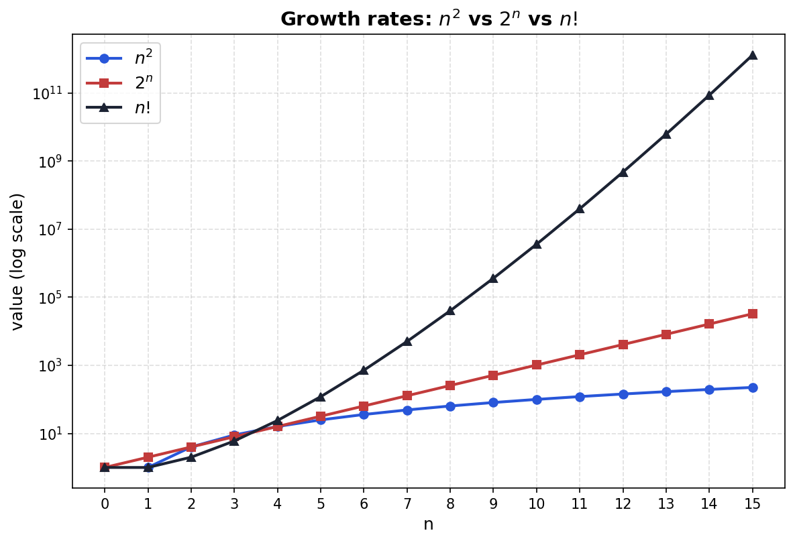
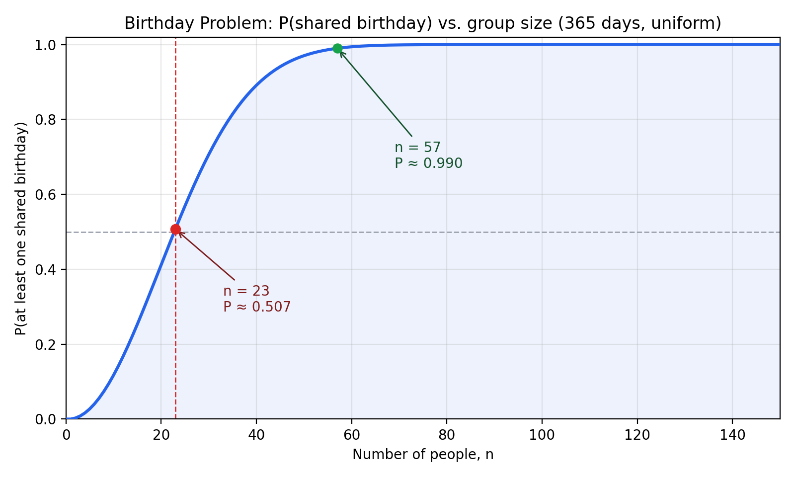

## Contents

::: {.cards .stack .toc}
::: {.box}

1 · Counting Basics
Multiplication rule, permutations, factorial, repeated letters.
:::
::: {.box}

2 · Binomial Coefficient
Teams, binary sequences, bijections and $\binom{n}{k}$.
:::
::: {.box}

3 · Sampling Table
Order vs. replacement: four counting scenarios, stars and bars.
:::
::: {.box}

4 · Story Proofs
Identities proved by counting one set in two ways.
:::
::: {.box}

5 · Combinatorics in Probability
Groups, poker hands, random walk, birthday problem.
:::
::: {.box}

6 · Probability Spaces
Axioms, properties, inclusion-exclusion, four couples.
:::
:::

# Counting Basics {.section-slide}

Counting without listing every possibility.

## What is combinatorics?

::: {.box .key}
Definition
**Combinatorics** is the branch of mathematics concerned with counting: determining the number of ways objects can be selected, arranged, or grouped according to given rules, without listing every possibility one by one.
:::

. . .

::: {.box}
For us, it is the toolbox for computing $|E|$ and $|S|$ in the naive definition of probability, once listing outcomes by hand (as we did for $A_3$) stops being practical.
:::

## The multiplication rule

::: {.box .key}
Definition · Rule of product
An experiment has $k$ stages. Stage 1 has $n_1$ outcomes, stage 2 has $n_2$ outcomes (regardless of stage 1), ..., stage $k$ has $n_k$ outcomes. The total number of outcomes is
$$n_1 \times n_2 \times \cdots \times n_k$$
:::

## Two dice

::: {.box}
**Stage 1:** first die, 6 outcomes. **Stage 2:** second die, 6 outcomes, regardless of the first.
$$|S| = 6 \times 6 = 36$$
:::

. . .

::: {.cap}
Matches what we counted directly earlier.
:::

## Two coin tosses as a tree

::: {.svgfig}
<svg width="420" height="260" viewBox="0 0 420 260" xmlns="http://www.w3.org/2000/svg" font-family="sans-serif">
<circle cx="210.0" cy="25" r="4" fill="#333"/>
<text x="210.0" y="13" font-size="13" text-anchor="middle" font-weight="bold">Toss 1</text>
<line x1="210.0" y1="30" x2="130" y2="87" stroke="#555" stroke-width="1.3"/>
<circle cx="130" cy="95" r="13" fill="#f5e6b0" stroke="#555"/>
<text x="130" y="99.5" font-size="13" text-anchor="middle" font-weight="bold">H</text>
<text x="130" y="117" font-size="10" text-anchor="middle" fill="#555">Toss 2</text>
<line x1="130" y1="123" x2="102.5" y2="166" stroke="#555" stroke-width="1"/>
<circle cx="102.5" cy="175" r="11" fill="#cfe3f7" stroke="#555"/>
<text x="102.5" y="179" font-size="11" text-anchor="middle" font-weight="bold">H</text>
<text x="102.5" y="199" font-size="11" text-anchor="middle">HH</text>
<line x1="130" y1="123" x2="157.5" y2="166" stroke="#555" stroke-width="1"/>
<circle cx="157.5" cy="175" r="11" fill="#cfe3f7" stroke="#555"/>
<text x="157.5" y="179" font-size="11" text-anchor="middle" font-weight="bold">T</text>
<text x="157.5" y="199" font-size="11" text-anchor="middle">HT</text>
<line x1="210.0" y1="30" x2="290" y2="87" stroke="#555" stroke-width="1.3"/>
<circle cx="290" cy="95" r="13" fill="#f5e6b0" stroke="#555"/>
<text x="290" y="99.5" font-size="13" text-anchor="middle" font-weight="bold">T</text>
<text x="290" y="117" font-size="10" text-anchor="middle" fill="#555">Toss 2</text>
<line x1="290" y1="123" x2="262.5" y2="166" stroke="#555" stroke-width="1"/>
<circle cx="262.5" cy="175" r="11" fill="#cfe3f7" stroke="#555"/>
<text x="262.5" y="179" font-size="11" text-anchor="middle" font-weight="bold">H</text>
<text x="262.5" y="199" font-size="11" text-anchor="middle">TH</text>
<line x1="290" y1="123" x2="317.5" y2="166" stroke="#555" stroke-width="1"/>
<circle cx="317.5" cy="175" r="11" fill="#cfe3f7" stroke="#555"/>
<text x="317.5" y="179" font-size="11" text-anchor="middle" font-weight="bold">T</text>
<text x="317.5" y="199" font-size="11" text-anchor="middle">TT</text>
<text x="210.0" y="245" font-size="14" text-anchor="middle" font-weight="bold">Total outcomes = 2 &#215; 2 = 4</text>
</svg>
:::

::: {.cap}
Every path from root to leaf is one outcome.
:::

. . .

::: {.box}
$2 \times 2 = 4$ matches the sample space $S = \{HH, HT, TH, TT\}$ from our very first coin-toss example.
:::

## Example 2: Choosing courses

::: {.box .good}
Example 2
There are 5 math courses and 6 economics courses on offer.

a) Choose **one** math and **one** economics course. In how many ways?

b) Choose **two** math courses (of 5) and **two** economics courses (of 6). In how many ways?
:::

## Example 2: solving

::: {.box}
**(a)** Two independent stages: pick the math course, then the econ course.
$$5 \times 6 = 30 \text{ ways}$$
:::

. . .

::: {.box .warn}
Part (b) is harder
The multiplication rule does not directly count "2 courses out of 5": order does not matter, and we have no tool yet for choosing a subset (as opposed to filling ordered stages). We come back to it once we do.
:::

## Permutations

::: {.box}
Line up $n$ people in $n$ positions (position 1, 2, ..., $n$).
:::

. . .

::: {.box}
This is an $n$-stage experiment, so the multiplication rule applies, with a twist: **the number of choices shrinks at each stage**, because whoever fills an earlier position is no longer available.
:::

## Shrinking choices

| Position | Who's available | Choices |
|---|---|---|
| 1st | all $n$ people | $n$ |
| 2nd | anyone except the person already placed | $n-1$ |
| 3rd | anyone except the two already placed | $n-2$ |
| $\vdots$ | $\vdots$ | $\vdots$ |
| $n$-th (last) | only one person left | $1$ |

. . .

$$n \times (n-1) \times (n-2) \times \cdots \times 2 \times 1$$

## Example: 4 people in a line

::: {.box}
People A, B, C, D. Position 1: 4 choices. Position 2: 3 choices. Position 3: 2 choices. Position 4: 1 choice (whoever is left).
$$4 \times 3 \times 2 \times 1 = 24$$
:::

. . .

::: {.box .warn}
Contrast with dice and coins
For dice or coins every stage had the *same* full set of choices ($n, n, \dots, n$). Here each position **uses up** one person, so the factors decrease: $n, n-1, \dots, 1$.
:::

## Factorial

::: {.box .key}
Definition
For a positive integer $n$,
$$n! = n \times (n-1) \times (n-2) \times \cdots \times 2 \times 1$$
By convention, $0! = 1$.
:::

## Growth of $n!$

::: {.figure-slide}
{fig-align="center"}
:::

## Combinatorial meaning of $n!$

::: {.box .key}
Interpretation
$n!$ is the number of **permutations** of $n$ distinct objects: the number of ways to arrange all $n$ of them in a sequence (a line, an order, a ranking, ...).
:::

## Rearranging the letters of CAT

How many words can you make by rearranging the letters of "CAT"?

. . .

::: {.box}
6 words: CAT, CTA, TCA, ATC, TAC, ACT
:::

. . .

::: {.box}
How to count them systematically? All three letters are distinct: imagine each as a person. This is exactly the "$n$ people in a line" problem: $3! = 6$.
:::

. . .

::: {.stmt}
We reduced the new problem to a previously solved one.
:::

## How about BOB?

::: {.box}
Naive instinct: 3 letters, so $3! = 6$ arrangements?
:::

. . .

::: {.box .warn}
But we only get BOB, BBO, OBB. The two B's are **indistinguishable**: when they switch places the word looks the same, so we are overcounting.
:::

. . .

::: {.stmt}
We need to fix the overcount.
:::

## Fixing the overcount

Label the B's as $B_1, B_2$ (as if distinguishable): $3!=6$ arrangements.

$$B_1OB_2,\; B_1B_2O,\; OB_1B_2,\; OB_2B_1,\; B_2OB_1,\; B_2B_1O$$

. . .

Drop the labels and see what collapses:

::: {.cards}
::: {.box .c}
$B_1OB_2$, $B_2OB_1$ $\to$ **BOB**
:::
::: {.box .c}
$B_1B_2O$, $B_2B_1O$ $\to$ **BBO**
:::
::: {.box .c}
$OB_1B_2$, $OB_2B_1$ $\to$ **OBB**
:::
:::

. . .

::: {.box}
Every real word shows up **exactly 2 times**: once for each way of permuting the two identical B's.
:::

## Dividing by 2!

Each word is counted $2!$ times, so divide:

$$\text{\# of distinct arrangements of BOB} = \frac{3!}{2!} = \frac{6}{2} = 3$$

## Strategy and general formula

::: {.box .good}
Strategy
Reduce to a previously solved problem, then introduce a correction factor for overcounting.
:::

. . .

::: {.box .key}
Arrangements of a word
$$\frac{n!}{k_1!\,k_2!\cdots k_m!}$$
$n$ is the total number of letters; $k_1, \dots, k_m$ are the counts of each repeated letter.
:::

## Explore: repeated letters

  
<label for="pw-input">word (letters only, max 6)</label><input type="text" id="pw-input" value="BOB" maxlength="6">

  
B×2, O×1

  <button class="act" id="pw-all">Highlight all clusters</button>
  <button class="act ghost" id="pw-clear">Clear</button>

  
<small>n! (labeled arrangements)</small><b id="pw-nf">6</b>

  
<small>distinct words</small><b id="pw-dist">3</b>

  
<small>cluster size (k₁!k₂!…)</small><b id="pw-cl">2</b>

3! = 3 × 2!

Click a labeled word to see which labeled arrangements collapse onto the same real word, or highlight all clusters at once.

## Practice Question 2

::: {.box .warn}
Practice Question 2
Consider the word **MISSISSIPPI**.

a) How many distinct arrangements of its letters are there?

b) *(Bonus)* How many of these arrangements have all four I's together, as a single block?
:::

## Solution to Practice Question 2

::: {.box}
**a)** 11 letters with $M{=}1$, $I{=}4$, $S{=}4$, $P{=}2$ (check: $1+4+4+2=11$).
$$\frac{11!}{1!\,4!\,4!\,2!} = \frac{39{,}916{,}800}{1{,}152} = 34{,}650$$
:::

. . .

::: {.box}
**b)** Glue the four I's into one block. Now arrange 8 units: $M$, [IIII], four $S$, two $P$.
$$\frac{8!}{1!\,1!\,4!\,2!} = \frac{40{,}320}{48} = 840$$
The block has no internal arrangements ($4!/4!=1$).
:::

# Binomial Coefficient {.section-slide}

Choosing a subset: teams, binary sequences, bijections.

## Counting ones and zeros

::: {.box}
A binary sequence of length $n$ is a string of $n$ digits, each $0$ or $1$.
:::

. . .

::: {.box .good}
**How many sequences of length $n$?** Each digit has 2 choices, so by the multiplication rule $2\times2\times\cdots\times2 = 2^n$.
:::

. . .

::: {.box}
**How many have exactly $k$ ones?** For $n=3$, $k=2$: $110, 101, 011$, so 3 sequences. How to count systematically? Reduce to a solved problem.
:::

## Reduce to a solved problem

::: {.box}
A sequence with exactly $k$ ones is a string of $n$ symbols: $k$ of one type (1's) and $n-k$ of another (0's).
:::

. . .

::: {.box}
This is the "distinct arrangements of a word" problem we already solved:
$$\frac{n!}{k!\,(n-k)!}$$
:::

## Choosing a team

::: {.box .good}
Problem
From a group of $130$ people, how many different teams of size $5$ can be formed? Order does not matter: a team is a subset of people.
:::

## Small numbers first

::: {.box}
Take $n=3$, $k=2$, people $A, B, C$. Teams: $\{A,B\}, \{A,C\}, \{B,C\}$, so 3 teams.
:::

. . .

::: {.box}
To count systematically, decide for each person whether they are on the team or not.
:::

## Encoding teams as sequences

::: {.box}
Line up all $n$ people in a fixed order. For any team write $1$ under each member and $0$ under each non-member.
:::

. . .

::: {.box}
Every team becomes a binary sequence of length $n$, and every such sequence decodes back into exactly one team: a **bijection**.
:::

. . .

::: {.stmt}
If we know how to count the sequences, we know how to count the teams.
:::

## Encoding: the small case

| Team | $A$ | $B$ | $C$ |
|:---:|:---:|:---:|:---:|
| $\{A,B\}$ | $1$ | $1$ | $0$ |
| $\{A,C\}$ | $1$ | $0$ | $1$ |
| $\{B,C\}$ | $0$ | $1$ | $1$ |

## Teams of 5 from 130

::: {.box}
By the encoding, this equals the number of binary sequences of length $130$ with exactly $5$ ones:
$$\frac{130!}{5!\,125!} = \frac{130 \cdot 129 \cdot 128 \cdot 127 \cdot 126}{5 \cdot 4 \cdot 3 \cdot 2 \cdot 1} = 286{,}243{,}776$$
:::

. . .

::: {.box .key}
Over 286 million different teams from just 130 people. In general: teams of size $k$ from $n$ people number $\dfrac{n!}{k!\,(n-k)!}$.
:::

## Bijection

::: {.box .key}
Definition
A function $f: A \to B$ is a **bijection** if it pairs every element of $A$ with exactly one element of $B$, and every element of $B$ with exactly one element of $A$: nothing is left out or used twice.
:::

## Bijection: picture

::: {.figure-slide}
{fig-align="center"}
:::

## Our encoding is a bijection

::: {.box}
It pairs teams of size $k$ from $n$ people with binary sequences of length $n$ having exactly $k$ ones.
:::

. . .

::: {.box .key}
Key counting principle
If a bijection exists between finite sets $A$ and $B$, then $|A| = |B|$. To count an awkward set, find *any* bijection to a set we know how to count.
:::

## Practice Question 3

::: {.box .warn}
Practice Question 3
Let $A$ and $B$ each have 4 elements.

a) How many bijections exist from $A$ to $B$?

b) How many bijections from $A$ to itself have no element mapping to itself? (This is called a **derangement**.)
:::

## Binomial coefficient

::: {.box .key}
Definition
For integers $n \geq 0$ and $0 \leq k \leq n$,
$$\binom{n}{k} = \frac{n!}{k!\,(n-k)!}$$
Read "$n$ choose $k$."
:::

## Meaning of "n choose k"

::: {.box .key}
Interpretation
$\binom{n}{k}$ is the number of ways to choose a subset of size $k$ from $n$ distinct objects. It is the same quantity in three disguises:
:::

. . .

::: {.cards}
::: {.box .c}
teams of size $k$ from $n$ people
:::
::: {.box .c}
binary sequences of length $n$ with exactly $k$ ones
:::
::: {.box .c}
arrangements of $n$ symbols, $k$ of one type and $n-k$ of another
:::
:::

## Revisiting: choosing courses

::: {.box .good}
Example 2, redone
5 math courses, 6 econ courses.

a) Choose 1 math and 1 econ course.

b) **Choose 2 math and 2 econ courses.** (Set aside earlier.)
:::

## Solving part (b)

Break it into parts:

. . .

::: {.box}
Choose 2 of 5 math courses: $\dbinom{5}{2} = \dfrac{5!}{2!\,3!} = \dfrac{120}{2 \cdot 6} = 10$
:::

. . .

::: {.box}
Choose 2 of 6 econ courses: $\dbinom{6}{2} = \dfrac{6!}{2!\,4!} = \dfrac{720}{2 \cdot 24} = 15$
:::

. . .

::: {.box .key}
Combine the independent stages: $\dbinom{5}{2} \times \dbinom{6}{2} = 10 \times 15 = 150$
:::

## Three problem-solving techniques

::: {.cards .stack}
::: {.box}
**1. Count by hand with small numbers first.** Work out a tiny case (two dice summing to 3, BOB, 3 people choosing 2): it builds intuition and gives a number to check the formula against.
:::
::: {.box}
**2. Reduce to a problem you can solve.** Temporarily simplify an assumption (BOB's B's distinguishable, then correct) or *encode* it as an equivalent object (team $\leftrightarrow$ binary sequence).
:::
::: {.box}
**3. Break into independent stages and multiply.** Each decision has its own count regardless of the others: two dice, coin tosses, "math courses, then econ courses".
:::
:::

## Practice Question 4

::: {.box .warn}
Practice 4 · Count by hand (manual enumeration)
Ann, Ben, and Cleo sit in a row of 3 seats. By listing all seating arrangements, count how many have **Ann not in the middle seat**.
:::

## Practice Question 5

::: {.box .warn}
Practice 5 · Reduce to a known problem (encoding)
On a city grid you can only move **right** (R) or **up** (U), one block at a time. To get from $A$ to $B$ you need exactly 4 moves right and 3 moves up (7 moves total). How many different shortest paths are there?
:::

## Practice Question 6

::: {.box .warn}
Practice 6 · Independent stages (multiplication rule)
A committee needs 2 faculty members chosen from 5 eligible faculty, and 3 student representatives chosen from 8 eligible students. Afterward, one of the two chosen faculty members must be designated chair. How many different committees (including the chair designation) can be formed?
:::

# Sampling Table {.section-slide}

Four ways to choose $k$ objects from $n$.

## General approach

::: {.box}
Different-sounding problems can share one counting structure. Imagine choosing (sampling) $k$ objects from $n$ distinct objects, one by one. Two key questions:
:::

. . .

::: {.cards}
::: {.box .c}
**Order:** does the order of selection matter?
:::
::: {.box .c}
**Replacement:** with or without? Can the same object be chosen more than once?
:::
:::

. . .

::: {.stmt}
We count the choices in each of the four resulting scenarios.
:::

## The sampling table

<table class="stbl">
<tr><th></th><th>Order matters</th><th>Order doesn't matter</th></tr>
<tr><td class="rh">With replacement</td><td></td><td></td></tr>
<tr><td class="rh">Without replacement</td><td></td><td></td></tr>
</table>

## Distributing medals

How many ways to distribute certain medals to a class of $n$ students?

::: {.cards .stack}
::: {.box}
Math and Econ medal
:::
::: {.box}
Gold and Silver Math medals (one per person at most)
:::
::: {.box}
Two Math medals (at most one per person)
:::
::: {.box}
Two Math medals (can give more than one per person)
:::
:::

## Which corner is which?

::: {.cards}
::: {.box}
**Problems**

1. Math and Econ medal
2. Gold and Silver medals
3. Two Math medals
4. Two Math medals, repeats allowed
:::
::: {.box}
**Categories**

- (a) Without replacement, unordered
- (b) With replacement, ordered
- (c) With replacement, unordered
- (d) Without replacement, ordered
:::
:::

## Math and Econ medals

::: {.box}
Distribute one by one: the first chosen student gets Math, the second gets Econ.
$n$ choices for Math, $n$ choices for Econ, so $$n^2$$
:::

. . .

::: {.box .key}
**Order matters** (first got Math, second got Econ) and we choose **with replacement** (the same student can be chosen twice). With $n$ students and $k$ distinct medals: $$n^k$$
:::

## Table: first cell

<table class="stbl">
<tr><th></th><th>Order matters</th><th>Order doesn't matter</th></tr>
<tr><td class="rh">With replacement</td><td class="c1">$n^k$<small>Math and Econ medals</small></td><td></td></tr>
<tr><td class="rh">Without replacement</td><td></td><td></td></tr>
</table>

## Gold and Silver medals

::: {.box}
Gold, then Silver, at most one per person. $n$ choices for Gold, but $n-1$ for Silver:
$$n(n-1)=\frac{n!}{(n-2)!}$$
:::

. . .

::: {.box .key}
**Order matters** and we choose **without replacement** (the same student cannot be chosen twice). With $n$ students and $k$ distinct medals: $$\frac{n!}{(n-k)!}$$
:::

## Table: second cell

<table class="stbl">
<tr><th></th><th>Order matters</th><th>Order doesn't matter</th></tr>
<tr><td class="rh">With replacement</td><td class="c1">$n^k$</td><td></td></tr>
<tr><td class="rh">Without replacement</td><td class="c2">$\dfrac{n!}{(n-k)!}$</td><td></td></tr>
</table>

## Two Math medals, no repeats

::: {.box}
Same setup, but the two medals are identical. This is the same as choosing a team of 2 out of $n$ people: $$\binom{n}{2}$$
:::

. . .

::: {.box .key}
**Order doesn't matter** (identical medals) and **without replacement**. With $n$ students and $k$ identical medals: $$\binom{n}{k} = \frac{n!}{k!\,(n-k)!}$$
:::

## Table: third cell

<table class="stbl">
<tr><th></th><th>Order matters</th><th>Order doesn't matter</th></tr>
<tr><td class="rh">With replacement</td><td class="c1">$n^k$</td><td></td></tr>
<tr><td class="rh">Without replacement</td><td class="c2">$\dfrac{n!}{(n-k)!}$</td><td class="c3">$\dbinom{n}{k}$</td></tr>
</table>

## Two Math medals, repeats allowed

Simplify: three students (Alice, Bob, Carol). A student may receive 0, 1, or both medals.

| # | Alice | Bob | Carol |
|:-:|:-:|:-:|:-:|
| 1 | •• | | |
| 2 | | •• | |
| 3 | | | •• |
| 4 | • | • | |
| 5 | • | | • |
| 6 | | • | • |

. . .

::: {.stmt}
6 ways to distribute 2 identical medals among 3 students.
:::

## Strategy: encoding

Two dividers split the row into 3 groups (Alice | Bob | Carol); two dots mark the medals. Let **0** = a medal, **1** = a divider.

| # | Alice | Bob | Carol | Encoding |
|:-:|:-:|:-:|:-:|:-:|
| 1 | •• | | | $0\,0\,1\,1$ |
| 2 | | •• | | $1\,0\,0\,1$ |
| 3 | | | •• | $1\,1\,0\,0$ |
| 4 | • | • | | $0\,1\,0\,1$ |
| 5 | • | | • | $0\,1\,1\,0$ |
| 6 | | • | • | $1\,0\,1\,0$ |

## Counting the encodings

::: {.box}
Every sequence has exactly $k=2$ zeros and $n-1=2$ ones, in $n+k-1=4$ slots. Choosing **which** $k$ of the 4 positions are zeros fixes the whole sequence:
$$\binom{n+k-1}{k} = \binom{4}{2} = 6$$
:::

## The full sampling table

<table class="stbl">
<tr><th></th><th>Order matters</th><th>Order doesn't matter</th></tr>
<tr><td class="rh">With replacement</td><td class="c1">$n^k$</td><td class="c4">$\dbinom{n+k-1}{k}$</td></tr>
<tr><td class="rh">Without replacement</td><td class="c2">$\dfrac{n!}{(n-k)!}$</td><td class="c3">$\dbinom{n}{k}$</td></tr>
</table>

# Story Proofs {.section-slide}

Interpret combinatorial expressions.

## Symmetry of binomials

Prove that $$\binom{n}{k}=\binom{n}{n-k}$$

. . .

::: {.box}
**Algebraic proof:** $\dbinom{n}{n-k} = \dfrac{n!}{(n-k)!\,(n-(n-k))!} = \dfrac{n!}{(n-k)!\,k!} = \dbinom{n}{k}$
:::

. . .

::: {.box .good}
**Story proof:** choosing a team of $k$ from $n$ is the same as choosing the $n-k$ people to *leave out*, so both sides count the teams of size $k$.
:::

## The idea behind a story proof

::: {.box .key}
To show $A = B$, find a single set of objects and **count it two different ways**: one way gives $A$, another gives $B$. Since both count the same objects, $A = B$.
:::

. . .

::: {.box}
No algebra required, and often more insightful: it explains *why* the identity holds, not just *that* it holds.
:::

## Sum of binomial coefficients

Prove that $$\sum_{k=0}^{n} \binom{n}{k} = \binom{n}{0}+\binom{n}{1}+\ldots+\binom{n}{n} \overset{?}{=} 2^n$$

. . .

::: {.box}
**Algebraic proof:** ????
:::

. . .

::: {.box .good}
**Story proof:** both sides count the number of binary sequences of length $n$.
:::

## Counting sequences by number of ones

$$\binom{n}{0}+\binom{n}{1}+\ldots+\binom{n}{n}$$

::: {.box}
Only 0's ($k=0$ ones): $\binom{n}{0}$. Exactly one 1: $\binom{n}{1}$. Exactly two 1's: $\binom{n}{2}$. $\dots$ Only 1's ($k=n$): $\binom{n}{n}$.
:::

. . .

::: {.box .good}
Every sequence has *some* number of 1's between $0$ and $n$, and none is counted twice, so the sum counts every sequence exactly once:
$$\sum_{k=0}^n \binom{n}{k} = \underbrace{2^n}_{\text{total sequences}}$$
:::

## Practice: Pascal's rule

::: {.box .warn}
Practice Question
Give a story proof of Pascal's rule: for $1 \le k \le n$,
$$\binom{n}{k} = \binom{n-1}{k-1} + \binom{n-1}{k}.$$
*Hint:* choose a committee of size $k$ from $n$ people, one of whom is Nurlan. Split into cases by whether Nurlan is on the committee.
:::

## Practice: committee and chair

::: {.box .warn}
Practice Question
Give a story proof that, for $1 \le k \le n$,
$$k\binom{n}{k} = n\binom{n-1}{k-1}.$$
*Hint:* choose a committee of size $k$ from $n$ people, one of whom is designated chair. Count two ways: chair first vs. committee first.
:::

# Combinatorics in Probability {.section-slide}

Counting $|A|$ and $|S|$ for the naive definition.

## Naive definition = counting

::: {.box}
If the problem fits the naive definition (typically some symmetry), start by recalling the formula:
$$P(A)=\frac{|A|}{|S|}.$$
:::

. . .

::: {.box}
Usually $|S|$ is easy: count it first. $A$ is always a subset of $S$: count it next (typically the hard part).
:::

## Problem 1: girls and boys

::: {.box .good}
Problem 1
A class has 70 girls and 60 boys. Randomly choose 5 people (what does "randomly" mean?). What is the probability that all 5 chosen are girls?
:::

## Approach 1: unordered

::: {.box}
**Randomly:** a group of 5 people is chosen so that each possible 5-person group is equally likely.
:::

. . .

::: {.box}
**Sample space:** all 5-person groups out of 130 (order does not matter, no replacement): $\binom{130}{5}$ equally likely outcomes. **Event $A$:** 5 people from the 70 girls: $\binom{70}{5}$.
:::

. . .

::: {.box .key}
$$P(A) = \frac{\binom{70}{5}}{\binom{130}{5}} \approx 0.042282$$
:::

## Approach 2: ordered

::: {.box}
**Randomly:** a line of 5 people is formed so that each possible 5-person line is equally likely.
:::

. . .

::: {.box}
**Sample space:** lines of 5 out of 130 (order matters, no replacement): $130\cdot129\cdot128\cdot127\cdot126$. **Event $A$:** all 5 from the girls: $70\cdot69\cdot68\cdot67\cdot66$.
:::

. . .

::: {.box .key}
$$P(A) = \frac{70\cdot69\cdot68\cdot67\cdot66}{130\cdot129\cdot128\cdot127\cdot126} \approx 0.042282$$
:::

## Same answer either way

::: {.box .good}
Imposing an order on the selection multiplies both $|S|$ and $|A|$ by the same $5!$, so it cancels out of the ratio.
:::

## Problem 2: two pairs

::: {.box .good}
Problem 2
A 5-card hand is dealt from a standard 52-card deck (13 ranks, 4 suits). What is the probability of **exactly two pairs**: two cards of one rank, two of another rank, and one card of a third rank?
:::

::: {.figure-slide .small}
{fig-align="center"}
:::

## Two pairs: sample space

::: {.box}
**Experiment:** choose a 5-card hand so that all hands are equally likely.
:::

. . .

::: {.box}
**Sample space:** all possible hands, $|S|=\dbinom{52}{5}=2{,}598{,}960$.
:::

. . .

::: {.box .key}
Then count the event $A$: hands, out of $2{,}598{,}960$, with exactly two pairs.
:::

## Building a two-pair hand

Three ranks are involved: two ranks give **2 cards each**, one rank gives **1 card** ($2+2+1=5$). We build the hand in 4 independent choices:

. . .

::: {.cards .stack}
::: {.box}
**1. Which 2 ranks** form the pairs: $\binom{13}{2}$
:::
::: {.box}
**2. Which 2 suits** for each pair-rank, chosen independently: $\binom{4}{2}^2$
:::
::: {.box}
**3. Which rank** for the 5th card (differs from the pair-ranks): $\binom{11}{1}$
:::
::: {.box}
**4. Which suit** for the 5th card: $\binom{4}{1}$
:::
:::

## Two pairs: the answer

$$|A| = \binom{13}{2}\binom{4}{2}^2\binom{11}{1}\binom{4}{1} = 78 \cdot 36 \cdot 11 \cdot 4 = 123{,}552$$

. . .

$$P(\text{two pair}) = \frac{123{,}552}{\binom{52}{5}} = \frac{123{,}552}{2{,}598{,}960} \approx 0.0475$$

## Problem: random binary price walk

::: {.box .good}
Problem
A share starts at \$100. Each day the price randomly moves up \$1 or down \$1.
:::

. . .

::: {.cards .stack}
::: {.box}
What is the probability that after 10 days the price is unchanged (event $A_{100}$)?
:::
::: {.box}
What is the probability that after 10 days the price is at least \$105 (event $A_{\geq 105}$)?
:::
:::

## Random price walk

  Start 100; each of 10 steps is +1 or &minus;1, equally likely.
  Trajectories: <b id="rw-n">0</b>
  Mean final: <b id="rw-mean">&mdash;</b>
  Std. dev.: <b id="rw-sd">&mdash;</b>

  <button class="act" id="rw-add">Add trajectory</button>
  <button class="act ghost" id="rw-add10">Add 10</button>
  <button class="act ghost" id="rw-reset">Reset</button>

  <i style="background:#16a34a"></i>ended above 100
  <i style="background:#dc2626"></i>ended below 100
  <i style="background:#6b7280"></i>ended at 100

<svg id="rw-svg" viewBox="0 0 820 270"></svg>

The right panel accumulates the final price of every trajectory; its shape approaches Binomial(10, ½) shifted to mean 100.

## Setting up the walk

::: {.box}
A price trajectory lists the move on each of the 10 days: a sequence of 10 letters, e.g. $(U, U, \dots, U)$.
:::

. . .

::: {.box}
**Experiment:** a trajectory is chosen at random, each equally likely. **Sample space:** all trajectories, $|S| = 2^{10}$. **Event $A_x$:** the trajectory ends at price $x$.
:::

## $P(A_{100})$

::: {.box}
$A_{100}$ occurs iff Ups $-$ Downs $=0$, i.e. Ups $-(10-\text{Ups})=0$, so Ups $=5$: five ups and five downs.
:::

. . .

::: {.box}
It does not matter *when* the price moved, only the total number of ups. Count sequences with exactly 5 ups: $\binom{10}{5}$.
:::

. . .

::: {.box .key}
$$P(A_{100})=\frac{\binom{10}{5}}{2^{10}}\approx 0.25$$
:::

## $P(A_{\geq 105})$

::: {.box}
$A_{\geq105}$ occurs iff Ups $-$ Downs $\geq 5$, hence Ups $\geq 7.5$: at least 8 ups. Count trajectories with 8, 9, or 10 ups: $\binom{10}{8}, \binom{10}{9}, \binom{10}{10}$.
:::

. . .

::: {.box .key}
$$P(A_{\geq105})=\frac{\binom{10}{8}+ \binom{10}{9}+\binom{10}{10}}{2^{10}}\approx 0.05$$
:::

## Practice: all final prices

::: {.box .warn}
Practice Question
For the same random walk ($n=10$ steps, start 100, each step $\pm1$ equally likely), compute the probability of **every** possible final price. There are 11 reachable values.
:::

| Final price | 90 | 92 | 94 | 96 | 98 | 100 | 102 | 104 | 106 | 108 | 110 |
|---|---|---|---|---|---|---|---|---|---|---|---|
| $P(\text{price})$ | | | | | | | | | | | |

## Birthday problem

::: {.box .good}
Problem
There are 130 students. What is the probability that at least two were born on the same day?
:::

## Birthday: sample space

::: {.box}
**Assumption:** every date is equally likely, 365 days in a year. **Outcome:** a birthday sequence records a date for each person.
:::

. . .

::: {.box}
**Experiment:** a random birthday sequence, all equally likely. How many are there?
$$|S|=365^{130}$$
:::

. . .

::: {.box .key}
Event $A$: the sequence contains at least two equal dates.
:::

## Count the complement

::: {.box}
Every sequence either has at least two equal dates or has all dates different. The latter is easier to count!
:::

. . .

::: {.box .key}
$S=A\cup A^c$, so $|A|=|S|-|A^c|$, hence by the naive definition
$$P(A)=1-\frac{|A^c|}{|S|}$$
:::

## Sequences with no repeated date

Choose the birthday sequence person by person:

. . .

::: {.cards}
::: {.box .c}
1st student: 365
:::
::: {.box .c}
2nd student: 364
:::
::: {.box .c}
3rd student: 363
:::
::: {.box .c}
130th student: $365-129=236$
:::
:::

. . .

$$|A^c|=365\times364\times\dots\times 236$$

## Birthday: the answer

$$P(A)=1-\frac{365\times364\times\dots\times 236}{365^{130}}\approx 0.99999999999624$$

## Birthday probability curve

::: {.figure-slide}
{fig-align="center"}
:::

# Probability Spaces {.section-slide}

Beyond equally likely outcomes.

## Why go beyond the naive definition?

::: {.box}
Naive definition = **a way to assign probabilities to outcomes of an experiment**.
:::

. . .

::: {.box .warn}
But many experiments we care about have asymmetric outcomes, so the naive approach does not apply.
:::

. . .

::: {.box}
We want to think about *any* experiment, so we need a way to assign non-equal probabilities to outcomes. Example: a "biased" coin with unequal probabilities of Heads and Tails.
:::

## Modeling a biased coin

::: {.box}
We can simply **assume** $P(H)=0.8$. But this restricts $P(T)$: $P(T)=0.2$.
:::

. . .

::: {.box}
There are only two outcomes, $P(T)$ is the long-run proportion of T, and probabilities of all outcomes must sum to 1 by definition.
:::

. . .

::: {.box .warn}
It would make no sense to assume $P(H)=0.8$ and $P(T)=0.5$: the assumed probabilities **must satisfy constraints**.
:::

## Probability space

::: {.box .key}
Definition
A **probability space** consists of a **sample space** $S$ (all possible outcomes) and a **probability function** $P$ that takes an event $A \subseteq S$ and returns $P(A) \in [0,1]$, satisfying two axioms:
:::

. . .

::: {.cards .stack}
::: {.box}
**1.** $P(\emptyset) = 0, \quad P(S) = 1$.
:::
::: {.box}
**2.** If $A_1, A_2, \dots$ are **disjoint** ($A_i \cap A_j = \emptyset$ for $i \ne j$), then
$$P\left(\bigcup_{j=1}^{\infty} A_j\right) = \sum_{j=1}^{\infty} P(A_j).$$
:::
:::

## What the axioms do and don't say

::: {.box}
Any $P$ satisfying the axioms is **valid**; the axioms say nothing about whether $(S,P)$ correctly describes reality.
:::

. . .

::: {.box}
Every problem in this course fixes a probability space for some experiment. $S$ is suggested by the problem; $P$ is not given in full: we are told some probabilities or properties and must derive the rest.
:::

. . .

::: {.box .key}
The game for most of the semester: **given partial information about $P$, use the axioms to find what is asked.** Later, if we do not know $P$ at all, only data generated by it, we move to **statistics**.
:::

## Naive vs. general

::: {.cards}
::: {.box .c}
**Naive:** every outcome in $S$ has the same probability $1/|S|$.
:::
::: {.box .c}
**General:** outcomes can have **different probabilities**: non-negative, summing to 1.
:::
:::

## Example: two fair coins

How do we build a probability model of this experiment?

. . .

::: {.box}
**Sample space** $\{HH, HT, TH, TT\}$, **ordered**: the coins are physically distinguishable (name them, flip sequentially).
:::

. . .

::: {.box}
Outcomes are **physically symmetric**: the sides are not really different, and the tosses do not influence each other. So assume the naive definition applies, and find the probability of each outcome.
:::

## Example: two magic coins

Now we want special properties.

. . .

::: {.box}
**Sample space** $\{HH, HT, TH, TT\}$: still ordered, but no longer symmetric (magic coins!). Naive no longer applies.
:::

. . .

::: {.box .key}
We specify instead: $P(\text{first toss is H}) = 1/2$, $P(\text{second toss is H}) = 1/2$, $P(TT)=0$. Find the probability of each outcome in $S$.
:::

## Properties of probability

From the axioms, for any events $A, B \subseteq S$:

::: {.cards .stack}
::: {.box}
**1.** $P(A^c) = 1 - P(A)$ (complement)
:::
::: {.box}
**2.** If $A \subseteq B$, then $P(A) \le P(B)$ (monotonicity)
:::
::: {.box}
**3.** $P(A \cup B) = P(A) + P(B) - P(A \cap B)$
:::
:::

. . .

::: {.cap}
See the formal derivations in the book.
:::

## Complement: direct count

Throw a die 3 times. What is the probability that at least one 6 appears (event $A$)?

::: {.box}
$A$ is complex: exactly one 6, two 6's, or three 6's. Count directly:
$$|A|=\binom{3}{1}5^2+\binom{3}{2}5+\binom{3}{3}=75+15+1=91$$
:::

. . .

$$P(A)=\frac{91}{6^3}\approx 0.42$$

## Complement: the shortcut

::: {.box}
$A^c$ is simpler: no 6's at all. There are $5^3$ such outcomes (drop 6 from the feasible choices).
:::

. . .

::: {.box .key}
$$P(A)=1-P(A^c)=1-\frac{5^3}{6^3}=\frac{91}{6^3}\approx 0.42$$
:::

## Monotonicity: a lower bound

::: {.box .good}
Problem
Throw 3 dice. Find a lower bound on the probability that the sum is at least 8 (event $B$).
:::

. . .

::: {.box}
$P(B)$ is hard to compute (many cases), and the complement also has many cases. But if $A$ (at least one 6) happens, the lowest possible sum is 8, so $A\subseteq B$.
:::

. . .

::: {.box .key}
By monotonicity, $P(A)\approx 0.42 \leq P(B)$. The actual probability is $P(B)\approx 0.84$.
:::

## Inclusion-exclusion: two events

::: {.box .good}
Problem
Throw three dice. What is the probability that either 6 does not appear, or 5 does not appear?
:::

. . .

Let $E_x$ be the event that $x$ does not appear. We want $P(E_5\cup E_6)$:

$$P(E_5\cup E_6)=P(E_5)+P(E_6)-P(E_5 \cap E_6)$$

. . .

$$P(E_5)=P(E_6)=\frac{5^3}{6^3}, \qquad P(E_5 \cap E_6)=\frac{4^3}{6^3}$$

## Two events: the answer

$$
\begin{aligned}
P(E_5\cup E_6) &= \frac{5^3}{6^3}+\frac{5^3}{6^3}-\frac{4^3}{6^3}\\
&= \frac{125+125-64}{216}=\frac{186}{216}=\frac{31}{36}\approx 0.861
\end{aligned}
$$

## Inclusion-exclusion: three events

::: {.box .good}
Problem
Throw three dice. What is the probability that 6, or 5, or 4 does not appear?
:::

$$
\begin{aligned}
P(E_4\cup E_5\cup E_6) &= P(E_4)+P(E_5)+P(E_6)\\
&\quad -P(E_4\cap E_5)-P(E_4\cap E_6)-P(E_5\cap E_6)\\
&\quad +P(E_4\cap E_5\cap E_6)
\end{aligned}
$$

## Three events: the pieces

::: {.cards .stack}
::: {.box}
$P(E_4)=P(E_5)=P(E_6)=\dfrac{5^3}{6^3}$
:::
::: {.box}
$P(E_4\cap E_5)=P(E_4\cap E_6)=P(E_5\cap E_6)=\dfrac{4^3}{6^3}$
:::
::: {.box}
$P(E_4\cap E_5\cap E_6)=\dfrac{3^3}{6^3}$
:::
:::

. . .

$$
P(E_4\cup E_5\cup E_6) = 3\cdot\frac{125}{216}-3\cdot\frac{64}{216}+\frac{27}{216}= \frac{375-192+27}{216}=\frac{210}{216}=\frac{35}{36}\approx 0.972
$$

## Problem: four couples in a row

::: {.box .good}
Problem
Four couples are seated randomly in a row of 8 chairs at a wedding banquet. All $8!$ seatings are equally likely. What is the probability that **no one sits next to their partner**?
:::

## Couples: setup

::: {.box}
**Experiment:** seat all 8 people in a row, all $8!$ orderings equally likely. **Sample space:** $|S| = 8! = 40{,}320$.
:::

. . .

::: {.box}
Event $A$: seatings where no one sits next to their partner.
:::

## Couples: strategy

::: {.box}
Formulate in terms of a union. $A^c$: at least one person sits next to their partner, i.e. at least one couple together.
:::

. . .

::: {.box .key}
Let $A_i$ be the event that couple $i$ is together. Then $A^c=A_1\cup A_2 \cup A_3 \cup A_4$. Apply inclusion-exclusion: find the probabilities of all intersections, then combine.
:::

## $P(A_i)$: one couple together

::: {.box}
Fix couple $i$ and glue them into one block: arrange **7 units** (the block + the other 6 people). Arrangements of units: $7!$; orderings inside the block: $2$.
$$P(A_i) = \frac{2 \cdot 7!}{8!} = \frac{2 \cdot 5040}{40320} = \frac{1}{4}$$
:::

## $P(A_i \cap A_j)$: two couples

::: {.box}
Glue **both** couples: **6 units** (2 blocks + 4 people). Arrangements: $6!$; orderings inside the 2 blocks: $2^2$.
$$P(A_i \cap A_j) = \frac{2^2 \cdot 6!}{8!} = \frac{4 \cdot 720}{40320} = \frac{1}{14}$$
:::

## Three couples

::: {.box}
Glue all three: **5 units** (3 blocks + 2 people). Arrangements: $5!$; orderings inside the 3 blocks: $2^3$.
$$P(A_i \cap A_j \cap A_k) = \frac{2^3 \cdot 5!}{8!} = \frac{8 \cdot 120}{40320} = \frac{1}{42}$$
:::

## All four couples

::: {.box}
All four glued: **4 units**, nothing left ungrouped. Arrangements: $4!$; orderings inside each block: $2^4$.
$$P(A_1\cap A_2\cap A_3\cap A_4) = \frac{2^4 \cdot 4!}{8!} = \frac{16 \cdot 24}{40320} = \frac{1}{105}$$
:::

## Combining the levels

Every specific choice of $j$ couples gives the *same* probability, so each level is $\binom{4}{j}$ copies:

| together | count | probability |
|---|---|---|
| 1 couple | $\binom{4}{1}=4$ | $1/4$ |
| 2 couples | $\binom{4}{2}=6$ | $1/14$ |
| 3 couples | $\binom{4}{3}=4$ | $1/42$ |
| 4 couples | $\binom{4}{4}=1$ | $1/105$ |

## Couples: the answer

$$P(A^c) = 4\cdot\tfrac14 - 6\cdot\tfrac{1}{14} + 4\cdot\tfrac{1}{42} - 1\cdot\tfrac{1}{105} = 1 - \tfrac37 + \tfrac{2}{21} - \tfrac{1}{105} = \frac{23}{35}$$

. . .

::: {.box .good}
So the probability that nobody sits next to their partner is $P(A)=1-\frac{23}{35}=\frac{12}{35}\approx 0.343$.
:::

