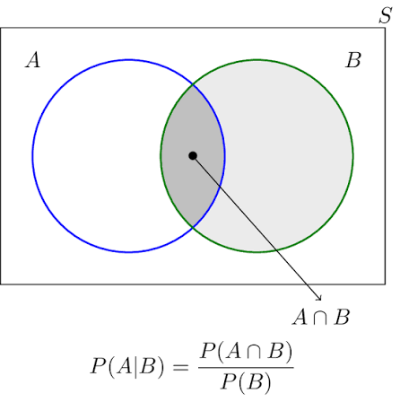
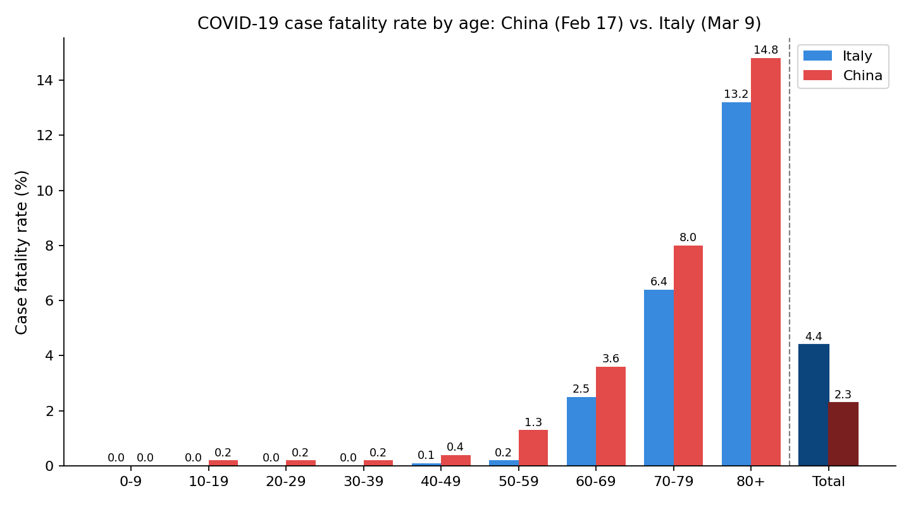

## Contents

::: {.cards .stack .toc}
::: {.box}
<span class="tag">1 · Conditional Probability</span>
Updating a probability with new information: definition and examples.
:::
::: {.box}
<span class="tag">2 · Bayes' Rule & Total Probability</span>
Flipping a conditional; the two-bins example.
:::
::: {.box}
<span class="tag">3 · Testing for a Disease</span>
Sensitivity, specificity and what a positive test really says.
:::
::: {.box}
<span class="tag">4 · Independence</span>
When information does not change a probability.
:::
::: {.box}
<span class="tag">5 · The Monty Hall Problem</span>
Should you switch? A game and a proof.
:::
::: {.box}
<span class="tag">6 · Simpson's Paradox</span>
COVID-19 fatality rates: better in every group, worse overall.
:::
::: {.box}
<span class="tag">7 · Sequential Battle</span>
Conditioning on the first step as a problem-solving tool.
:::
:::

# Conditional Probability {.section-slide}

How do we account for new information?

## Accounting for information

::: {.cards}
::: {.box}
<span class="tag">Chances to pass this course</span>
- given that I am a math major?
- given that I am retaking it?
- given that I am Aries?
:::
::: {.box}
<span class="tag">Worker earns over 1 mln KZT</span>
- given she works in Astana?
- given she is in Finance?
- given she is an NU graduate?
:::
:::

## Two-children family

::: {.box .key}
<span class="tag">Example</span>
A family has two children.
:::

. . .

::: {.cards .stack}
::: {.box}
What is the probability that it has <span class="hl">at least one boy</span> (event $A$)?
:::
::: {.box}
What is the probability that it has at least one boy, **given** that it has <span class="hl">at least one girl</span> (event $B$)?
:::
:::

## Two-children family: 1,000 families

```{=html}
<div class="wrow">
  <canvas id="fam2c-canvas" width="700" height="420" style="width:600px;height:auto;"></canvas>
  <div class="wcol">
    <div class="winfo" id="fam2c-info"></div>
    <div class="wbtns v">
      <button id="fam2c-btn-clusters" class="act ghost">Show the 4 outcomes</button>
      <button id="fam2c-btn-boy" class="act ghost">Circle A: at least one boy</button>
      <button id="fam2c-btn-girl" class="act ghost">Circle B: at least one girl</button>
    </div>
  </div>
</div>
<script>
(function(){
  function mulberry32(a){
    return function(){
      a |= 0; a = a + 0x6D2B79F5 | 0;
      let t = Math.imul(a ^ a>>>15, 1 | a);
      t = t + Math.imul(t ^ t>>>7, 61 | t) ^ t;
      return ((t ^ t>>>14)>>>0)/4294967296;
    };
  }
  const rng = mulberry32(42);
  const blockW = 150, gap = 14, x0 = 29;
  const blocks = [
    {cat:'BB', x:x0,                    color:'#2980b9'},
    {cat:'BG', x:x0+blockW+gap,         color:'#16a085'},
    {cat:'GB', x:x0+2*(blockW+gap),     color:'#f39c12'},
    {cat:'GG', x:x0+3*(blockW+gap),     color:'#c0392b'}
  ];
  const yTop = 100, yBot = 370;
  const cols = 10, rows = 25;
  const innerPad = 20, innerW = blockW - 2*innerPad;
  const cellW = innerW/cols, cellH = (yBot-yTop)/rows;
  const pileCx = x0 + (3*(blockW+gap)+blockW)/2;
  const pileCy = (yTop+yBot)/2;
  const pileRx = 150, pileRy = 110;
  let points = [];
  blocks.forEach(b=>{
    for(let r=0;r<rows;r++){
      for(let c=0;c<cols;c++){
        const jx = (rng()-0.5)*cellW*0.7;
        const jy = (rng()-0.5)*cellH*0.7;
        const homeX = b.x+innerPad + c*cellW + cellW/2 + jx;
        const homeY = yTop + r*cellH + cellH/2 + jy;
        const ang = rng()*Math.PI*2;
        const rad = Math.sqrt(rng());
        points.push({ homeX, homeY, pileX: pileCx + Math.cos(ang)*pileRx*rad, pileY: pileCy + Math.sin(ang)*pileRy*rad, cat: b.cat });
      }
    }
  });
  const canvas = document.getElementById('fam2c-canvas');
  const ctx = canvas.getContext('2d');
  const clusterColor = {BB:'#2980b9', BG:'#16a085', GB:'#f39c12', GG:'#c0392b'};
  const capY = 80, capH = 310;
  const boyCap  = {x:9,   y:capY, w:518, h:capH};
  const girlCap = {x:173, y:capY, w:518, h:capH};
  const state = {clusters:false, boy:false, girl:false};
  let clusterT = 0, animFrame = null, animStartTime = null, animStartT = 0, animTargetT = 0;
  const ANIM_DURATION = 800;
  function ease(t){ return t<0.5 ? 4*t*t*t : 1-Math.pow(-2*t+2,3)/2; }
  function animateClusterTo(target){
    animTargetT = target; animStartT = clusterT; animStartTime = null;
    if(animFrame) cancelAnimationFrame(animFrame);
    function step(ts){
      if(!animStartTime) animStartTime = ts;
      const raw = Math.min((ts-animStartTime)/ANIM_DURATION, 1);
      clusterT = animStartT + (animTargetT-animStartT)*ease(raw);
      draw();
      if(raw<1){ animFrame = requestAnimationFrame(step); }
      else { clusterT = animTargetT; animFrame = null; draw(); }
    }
    animFrame = requestAnimationFrame(step);
  }
  function capsulePath(x,y,w,h){
    const r = Math.min(h/2, w/2);
    ctx.beginPath();
    ctx.moveTo(x+r,y); ctx.lineTo(x+w-r,y); ctx.arcTo(x+w,y,x+w,y+r,r);
    ctx.lineTo(x+w,y+h-r); ctx.arcTo(x+w,y+h,x+w-r,y+h,r);
    ctx.lineTo(x+r,y+h); ctx.arcTo(x,y+h,x,y+h-r,r);
    ctx.lineTo(x,y+r); ctx.arcTo(x,y,x+r,y,r); ctx.closePath();
  }
  function draw(){
    ctx.clearRect(0,0,canvas.width,canvas.height);
    if(state.boy){ capsulePath(boyCap.x,boyCap.y,boyCap.w,boyCap.h); ctx.globalAlpha=0.14; ctx.fillStyle='#2980b9'; ctx.fill(); ctx.globalAlpha=1; }
    if(state.girl){ capsulePath(girlCap.x,girlCap.y,girlCap.w,girlCap.h); ctx.globalAlpha=0.14; ctx.fillStyle='#c0392b'; ctx.fill(); ctx.globalAlpha=1; }
    points.forEach(p=>{
      const px = p.pileX + (p.homeX - p.pileX)*clusterT;
      const py = p.pileY + (p.homeY - p.pileY)*clusterT;
      ctx.globalAlpha = state.clusters ? 0.85 : 0.5;
      ctx.fillStyle = state.clusters ? clusterColor[p.cat] : '#999999';
      ctx.beginPath(); ctx.arc(px,py,4.2,0,Math.PI*2); ctx.fill();
    });
    ctx.globalAlpha = 1;
    if(state.boy){ capsulePath(boyCap.x,boyCap.y,boyCap.w,boyCap.h); ctx.strokeStyle='#2980b9'; ctx.lineWidth=2.5; ctx.setLineDash([7,5]); ctx.stroke(); ctx.setLineDash([]); }
    if(state.girl){ capsulePath(girlCap.x,girlCap.y,girlCap.w,girlCap.h); ctx.strokeStyle='#c0392b'; ctx.lineWidth=2.5; ctx.setLineDash([7,5]); ctx.stroke(); ctx.setLineDash([]); }
    if(state.clusters && clusterT > 0.9){
      ctx.font='bold 15px Arial'; ctx.textAlign='left';
      ctx.globalAlpha = (clusterT-0.9)/0.1;
      blocks.forEach(b=>{ ctx.fillStyle=b.color; ctx.fillText(b.cat, b.x+innerPad, 68); });
      ctx.globalAlpha = 1;
    }
    if(state.boy && state.girl){
      const bx1=193, bx2=507, by=400;
      ctx.strokeStyle='#7d3c98'; ctx.lineWidth=2;
      ctx.beginPath(); ctx.moveTo(bx1,by-8); ctx.lineTo(bx1,by); ctx.lineTo(bx2,by); ctx.lineTo(bx2,by-8); ctx.stroke();
    }
  }
  function updateInfo(){
    const info = document.getElementById('fam2c-info');
    if(state.boy && state.girl){
      info.innerHTML = 'Families in <b>both</b> regions satisfy both conditions: {BG, GB}, 500/1000.<br>This is the numerator we need for P(A | B).';
    } else if(state.boy){
      info.innerHTML = 'A = at least one boy = {BB, BG, GB}<br>750/1000, P(A) = 3/4';
    } else if(state.girl){
      info.innerHTML = 'B = at least one girl = {BG, GB, GG}<br>750/1000, P(B) = 3/4';
    } else if(state.clusters){
      info.innerHTML = 'Four equally likely outcomes, 250 families each: '
        + '<span style="color:#2980b9">BB</span>, <span style="color:#16a085">BG</span>, '
        + '<span style="color:#f39c12">GB</span>, <span style="color:#c0392b">GG</span>';
    } else {
      info.innerHTML = '1,000 families, each with two children (in birth order)';
    }
  }
  function updateButtons(){
    document.getElementById('fam2c-btn-clusters').classList.toggle('sel', state.clusters);
    document.getElementById('fam2c-btn-boy').classList.toggle('sel', state.boy);
    document.getElementById('fam2c-btn-girl').classList.toggle('sel', state.girl);
  }
  document.getElementById('fam2c-btn-clusters').addEventListener('click', ()=>{ state.clusters=!state.clusters; animateClusterTo(state.clusters ? 1 : 0); updateInfo(); updateButtons(); });
  document.getElementById('fam2c-btn-boy').addEventListener('click', ()=>{ state.boy=!state.boy; draw(); updateInfo(); updateButtons(); });
  document.getElementById('fam2c-btn-girl').addEventListener('click', ()=>{ state.girl=!state.girl; draw(); updateInfo(); updateButtons(); });
  draw(); updateInfo(); updateButtons();
})();
</script>
```

## Reading off the counts

::: {.box}
$P(A)=750/1000=0.75$
:::

. . .

::: {.box}
$P(A \text{ given } B)=500/750$
:::

. . .

::: {.box .key}
<span class="tag">Name</span>
The second probability is the **conditional probability of $A$ given $B$**. Here the event $B$ is the new information we condition upon.
:::

## Conditional probability

::: {.box .key}
<span class="tag">Definition</span>
For events $A$ and $B$ with $P(B) > 0$, the **conditional probability of $A$ given $B$** is
$$P(A \mid B) = \frac{P(A \cap B)}{P(B)}.$$
:::

. . .

::: {.cards .stack}
::: {.box}
$A$: the event whose probability we are updating
:::
::: {.box}
$B$: the evidence, what we observe or treat as given
:::
::: {.box}
Requires $P(B) > 0$: we cannot condition on an impossible event
:::
:::

## Prior and posterior

::: {.cards}
::: {.box .c}
<span class="tag">Prior</span>
$P(A)$
:::
::: {.box .c}
<span class="tag">Posterior</span>
$P(A \mid B)$
:::
:::

. . .

::: {.box .good}
<span class="tag">Matches what we just found</span>
$$P(A \mid B) = \frac{500/1000}{750/1000} = \frac{500}{750}$$
:::

## The picture to keep in mind

{fig-align="center" height="470"}

::: {.cap}
Figure to always keep in mind when thinking about conditional probability.
:::

## Example: two dice

::: {.box .key}
<span class="tag">Problem</span>
Roll two fair dice. Let

- $A$ = at least one die shows 6
- $B$ = the sum is 8

Find $P(A\mid B)$ and $P(B\mid A)$, and interpret.
:::

## Plan: start from the definition

$$P(A \mid B) = \frac{P(A \cap B)}{P(B)} \qquad P(B \mid A) = \frac{P(A \cap B)}{P(A)}$$

. . .

::: {.box}
We use the definition. We need to count:

- $|S|$
- $|A \cap B|$
- $|B|$ and $|A|$
:::

. . .

::: {.box .good}
Sample space: $S = \{(i,j) : i,j \in \{1,\dots,6\}\}$, 36 equally likely outcomes.
:::

## Listing $A$

$$A = \{(1,6),(2,6),(3,6),(4,6),(5,6),\dots\}$$

. . .

$$|A| = 11 \qquad P(A) = \frac{11}{36}$$

. . .

::: {.box .key}
How to count quickly?
:::

## Listing $B$

$$B = \{(2,6),(3,5),(4,4),(5,3),(6,2)\}$$

. . .

$$|B| = 5 \qquad P(B) = \frac{5}{36}$$

## Finding $A \cap B$

Scan $B$'s five outcomes for the ones that also have a 6:

$$B = \{\color{#2980b9}{(2,6)},(3,5),(4,4),(5,3),\color{#2980b9}{(6,2)}\}$$

. . .

$$A \cap B = \{(2,6),(6,2)\} \qquad |A\cap B| = 2 \qquad P(A\cap B) = \frac{2}{36}$$

## $P(A \mid B)$: given the sum is 8

$$P(A\mid B) = \frac{P(A\cap B)}{P(B)} = \frac{2/36}{5/36} = \frac{2}{5}$$

. . .

::: {.box .good}
Same thing directly: restrict to $B$'s 5 equally likely outcomes, 2 of them are also in $A$, so $\dfrac{2}{5}$.
:::

## $P(B \mid A)$: given at least one 6

$$P(B\mid A) = \frac{P(A\cap B)}{P(A)} = \frac{2/36}{11/36} = \frac{2}{11}$$

. . .

::: {.box .good}
Restrict to $A$'s 11 equally likely outcomes, 2 of them also sum to 8, so $\dfrac{2}{11}$.
:::

. . .

::: {.box .warn}
<span class="tag">Warning</span>
$P(A\mid B) \neq P(B\mid A)$ in general. The event you condition on determines which sample space you restrict to.
:::

## Two dice: the sample space

```{=html}
<div class="wrow">
  <canvas id="dice2-canvas" width="560" height="490" style="width:450px;height:auto;"></canvas>
  <div class="wcol">
    <div class="winfo" id="dice2-info"></div>
    <div class="wbtns v">
      <button id="dice2-btn-a" class="act ghost">Circle A: at least one 6</button>
      <button id="dice2-btn-b" class="act ghost">Circle B: sum is 8</button>
    </div>
  </div>
</div>
<script>
(function(){
  const cellSize = 62, gridOriginX = 122, gridOriginY = 100, gap = 3;
  const canvas = document.getElementById('dice2-canvas');
  const ctx = canvas.getContext('2d');
  let cells = [];
  for(let i=1;i<=6;i++){
    for(let j=1;j<=6;j++){
      cells.push({ i:i, j:j, x: gridOriginX + (i-1)*cellSize + gap, y: gridOriginY + (j-1)*cellSize + gap,
        w: cellSize - 2*gap, h: cellSize - 2*gap, inA: (i===6 || j===6), inB: (i+j===8) });
    }
  }
  const state = {A:false, B:false};
  function roundRect(x,y,w,h,r){
    ctx.beginPath();
    ctx.moveTo(x+r,y); ctx.lineTo(x+w-r,y); ctx.arcTo(x+w,y,x+w,y+r,r);
    ctx.lineTo(x+w,y+h-r); ctx.arcTo(x+w,y+h,x+w-r,y+h,r);
    ctx.lineTo(x+r,y+h); ctx.arcTo(x,y+h,x,y+h-r,r);
    ctx.lineTo(x,y+r); ctx.arcTo(x,y,x+r,y,r); ctx.closePath();
  }
  function draw(){
    ctx.clearRect(0,0,canvas.width,canvas.height);
    ctx.font = 'bold 15px Arial'; ctx.textAlign='center'; ctx.fillStyle='#333333';
    ctx.fillText('Die 1 (i)', gridOriginX + 3*cellSize, 30);
    ctx.save(); ctx.translate(30, gridOriginY + 3*cellSize); ctx.rotate(-Math.PI/2); ctx.fillText('Die 2 (j)', 0, 0); ctx.restore();
    ctx.font = '13px Arial'; ctx.fillStyle = '#555555';
    for(let k=1;k<=6;k++){
      ctx.textAlign='center'; ctx.fillText(k, gridOriginX + (k-0.5)*cellSize, gridOriginY - 14);
      ctx.textAlign='right'; ctx.fillText(k, gridOriginX - 14, gridOriginY + (k-0.5)*cellSize + 5);
    }
    cells.forEach(c=>{ roundRect(c.x, c.y, c.w, c.h, 6); ctx.fillStyle = '#ffffff'; ctx.fill(); });
    if(state.A){
      ctx.fillStyle = '#2980b9'; ctx.globalAlpha = 0.18;
      roundRect(gridOriginX + 5*cellSize + 4, gridOriginY + 4, cellSize - 8, 6*cellSize - 8, 14); ctx.fill();
      roundRect(gridOriginX + 4, gridOriginY + 5*cellSize + 4, 6*cellSize - 8, cellSize - 8, 14); ctx.fill();
      ctx.globalAlpha = 1;
    }
    if(state.B){
      ctx.fillStyle = '#c0392b'; ctx.globalAlpha = 0.22;
      cells.filter(c=>c.inB).forEach(c=>{ roundRect(c.x-2, c.y-2, c.w+4, c.h+4, 8); ctx.fill(); });
      ctx.globalAlpha = 1;
    }
    ctx.font = 'bold 13px Arial'; ctx.textAlign='center';
    cells.forEach(c=>{
      roundRect(c.x, c.y, c.w, c.h, 6);
      ctx.strokeStyle = '#cccccc'; ctx.lineWidth = 1; ctx.stroke();
      ctx.fillStyle = '#222222'; ctx.fillText('('+c.i+','+c.j+')', c.x + c.w/2, c.y + c.h/2 + 4);
    });
    if(state.A){
      ctx.strokeStyle = '#2980b9'; ctx.lineWidth = 2.5; ctx.setLineDash([7,5]);
      roundRect(gridOriginX + 5*cellSize + 4, gridOriginY + 4, cellSize - 8, 6*cellSize - 8, 14); ctx.stroke();
      roundRect(gridOriginX + 4, gridOriginY + 5*cellSize + 4, 6*cellSize - 8, cellSize - 8, 14); ctx.stroke();
      ctx.setLineDash([]);
    }
    if(state.B){
      ctx.strokeStyle = '#c0392b'; ctx.lineWidth = 2.5; ctx.setLineDash([5,4]);
      cells.filter(c=>c.inB).forEach(c=>{ roundRect(c.x-2, c.y-2, c.w+4, c.h+4, 8); ctx.stroke(); });
      ctx.setLineDash([]);
    }
  }
  function updateInfo(){
    const info = document.getElementById('dice2-info');
    const A = cells.filter(c=>c.inA), B = cells.filter(c=>c.inB), AB = cells.filter(c=>c.inA && c.inB);
    if(state.A && state.B){
      const list = AB.map(c=>'('+c.i+','+c.j+')').join(', ');
      info.innerHTML = 'A ∩ B = {'+list+'}: '+AB.length+'/36 outcomes, P(A∩B) = '+AB.length+'/36.<br>This is the numerator for both P(A|B) and P(B|A).';
    } else if(state.A){ info.innerHTML = 'A = at least one die shows 6: '+A.length+'/36 outcomes, P(A) = '+A.length+'/36'; }
    else if(state.B){ info.innerHTML = 'B = sum is 8: '+B.length+'/36 outcomes, P(B) = '+B.length+'/36'; }
    else { info.innerHTML = '36 equally likely outcomes (i, j): i = first die, j = second die'; }
  }
  function updateButtons(){
    document.getElementById('dice2-btn-a').classList.toggle('sel', state.A);
    document.getElementById('dice2-btn-b').classList.toggle('sel', state.B);
  }
  document.getElementById('dice2-btn-a').addEventListener('click', ()=>{ state.A=!state.A; draw(); updateInfo(); updateButtons(); });
  document.getElementById('dice2-btn-b').addEventListener('click', ()=>{ state.B=!state.B; draw(); updateInfo(); updateButtons(); });
  draw(); updateInfo(); updateButtons();
})();
</script>
```

## Another example: the fire alarm

::: {.box}
An alarm is so sensitive that it goes off often. If there is a fire, the alarm rings, but it also often rings when there is no fire.
:::

. . .

::: {.box .good}
Here $P(F \mid A)$ can be low, but $P(A \mid F)$ is high.
:::

. . .

::: {.box .key}
<span class="tag">Question</span>
Cook up numbers to demonstrate this. What must be the condition for this to be true?
:::

# Bayes' Rule & Total Probability {.section-slide}

Flipping a conditional, and splitting a probability into pieces.

## Bayes' rule

::: {.box .key}
<span class="tag">Theorem</span>
For events $A, B$ with $P(A), P(B) > 0$:
$$P(A \mid B) = \frac{P(B \mid A)\, P(A)}{P(B)}$$
:::

. . .

::: {.box}
Bayes' rule connects two conditional probabilities. It is useful when you know one, but not the other.
:::

## Derivation of Bayes' rule

::: {.box}
Apply the definition of conditional probability twice to the same intersection:
$$P(A \cap B) = P(A \mid B)\,P(B) = P(B \mid A)\,P(A)$$
:::

. . .

::: {.box .good}
Divide through by $P(B)$ (or by $P(A)$ for the reverse direction).
:::

## Law of Total Probability

::: {.box .key}
<span class="tag">Theorem</span>
Let $A_1, \dots, A_n$ be a **partition** of the sample space $S$ (disjoint events with $A_1\cup\cdots\cup A_n = S$), each with $P(A_i) > 0$. Then for any event $B$:
$$P(B) = \sum_{i=1}^n P(B \mid A_i)\,P(A_i)$$
:::

## LOTP: the idea

::: {.box}
$P(B)$ is a **weighted average** of $B$'s conditional probabilities given the $A_i$'s. The weights are the probabilities of the corresponding partitioning sets.
:::

. . .

::: {.box .good}
Often paired with Bayes' rule: LOTP builds the denominator $P(B)$ that Bayes' rule needs.
:::

## Proof of LOTP ($n=2$): step 1

Partition: $A_1$ and $A_2 = A_1^c$, so $A_1\cap A_2=\varnothing$ and $A_1\cup A_2 = S$.

. . .

::: {.box}
<span class="tag">Step 1</span>
Express $B$ as a union of its pieces inside each $A_i$. Every outcome in $B$ lies in exactly one of $A_1$, $A_2$:
$$B = (B \cap A_1) \cup (B \cap A_2)$$
:::

## Proof of LOTP ($n=2$): step 2

::: {.box}
$B\cap A_1$ and $B\cap A_2$ are **disjoint**, so by the second axiom of probability:
$$P(B) = P(B\cap A_1) + P(B\cap A_2)$$
:::

. . .

::: {.box}
<span class="tag">Step 2</span>
Use $P(B\cap A_i) = P(B\mid A_i)\,P(A_i)$:
$$P(B) = P(B\mid A_1)P(A_1) + P(B\mid A_2)P(A_2)$$
:::

## $B$ splits along the partition

::: {.wrow .mid}
::: {.wcol style="flex:0.8 1 0;"}
```{=html}
<svg viewBox="0 0 600 340" style="width:100%;height:auto;" xmlns="http://www.w3.org/2000/svg">
  <rect x="20" y="20" width="560" height="280" fill="#ffffff" stroke="#333333" stroke-width="2"/>
  <line x1="300" y1="20" x2="300" y2="300" stroke="#333333" stroke-width="2" stroke-dasharray="6,5"/>
  <defs>
    <clipPath id="leftHalf"><rect x="20" y="20" width="280" height="280"/></clipPath>
    <clipPath id="rightHalf"><rect x="300" y="20" width="280" height="280"/></clipPath>
  </defs>
  <ellipse cx="300" cy="160" rx="170" ry="105" fill="#2980b9" opacity="0.35" clip-path="url(#leftHalf)"/>
  <ellipse cx="300" cy="160" rx="170" ry="105" fill="#f39c12" opacity="0.35" clip-path="url(#rightHalf)"/>
  <ellipse cx="300" cy="160" rx="170" ry="105" fill="none" stroke="#222222" stroke-width="2.5"/>
  <text x="45" y="50" font-size="20" font-weight="700" fill="#2980b9">A&#8321;</text>
  <text x="535" y="50" font-size="20" font-weight="700" fill="#f39c12" text-anchor="end">A&#8322;</text>
  <text x="300" y="45" font-size="18" font-weight="700" fill="#222222" text-anchor="middle">B</text>
  <text x="215" y="170" font-size="16" font-weight="600" fill="#1a5276" text-anchor="middle">B &#8745; A&#8321;</text>
  <text x="385" y="170" font-size="16" font-weight="600" fill="#9c640c" text-anchor="middle">B &#8745; A&#8322;</text>
  <text x="30" y="290" font-size="14" fill="#555555">S</text>
</svg>
```
:::
::: {.wcol style="flex:1.2 1 0;"}
::: {.box}
The dashed line is the $A_1/A_2$ partition boundary. The two shaded lobes of $B$ are disjoint by construction, so their probabilities add:
$$P(B) = P(B\cap A_1)+P(B\cap A_2)$$
Each equals $P(B\mid A_i)P(A_i)$ by the definition of conditional probability.
:::
:::
:::

## Example: two bins

::: {.cards}
::: {.box .c}
<span class="tag">Bin 1</span>
2 red balls, 1 blue ball
:::
::: {.box .c}
<span class="tag">Bin 2</span>
2 red balls, 2 blue balls
:::
:::

. . .

::: {.box}
Pick one of the two bins **uniformly at random**, then draw **one ball uniformly at random** from the chosen bin.
:::

. . .

::: {.box .key}
<span class="tag">Questions</span>
- What is the probability that the ball drawn is **blue**?
- Given that the ball is blue, what is the probability that Bin 1 was chosen?
:::

## Two bins: try it

```{=html}
<div class="binx-row">
  <div class="binx-cell"><div id="binx-bin1" class="binx-bin"></div><div class="cap">Bin 1</div></div>
  <div class="binx-cell"><div id="binx-bin2" class="binx-bin"></div><div class="cap">Bin 2</div></div>
  <div class="binx-cell binx-fade" id="binx-mystery-slot"><div id="binx-mystery" class="binx-bin binx-mystery"></div><div class="cap">chosen bin</div></div>
  <div class="binx-cell binx-fade" id="binx-drawn-slot"><div class="binx-slot"><div id="binx-drawn-ball" class="binx-ball"></div></div><div class="cap">drawn ball</div></div>
</div>
<div class="winfo" id="binx-info" style="text-align:center;min-height:1.6em;font-size:0.85em;"></div>
<div class="wbtns" style="justify-content:center;">
  <button id="binx-btn-next" class="act">Choose a bin &rarr;</button>
  <button id="binx-btn-reset" class="act ghost">&#8634; Reset</button>
</div>
<script>
(function(){
  const bins = { bin1: {balls:['red','red','blue']}, bin2: {balls:['red','red','blue','blue']} };
  const binEls = { bin1: document.getElementById('binx-bin1'), bin2: document.getElementById('binx-bin2') };
  const mysterySlot = document.getElementById('binx-mystery-slot');
  const drawnSlot = document.getElementById('binx-drawn-slot');
  const info = document.getElementById('binx-info');
  const nextBtn = document.getElementById('binx-btn-next');
  const resetBtn = document.getElementById('binx-btn-reset');
  const drawnBall = document.getElementById('binx-drawn-ball');
  let phase = 0, chosenBinKey = null, flick = null, tmo = null;
  function renderSourceBins(){
    Object.keys(bins).forEach(key=>{
      const el = binEls[key]; el.innerHTML = '';
      bins[key].balls.forEach(color=>{ const b = document.createElement('div'); b.className = 'binx-ball ' + color; el.appendChild(b); });
    });
  }
  function phase0(){
    clearInterval(flick); clearTimeout(tmo);
    phase = 0; chosenBinKey = null;
    renderSourceBins();
    Object.keys(binEls).forEach(k=>binEls[k].style.boxShadow='none');
    mysterySlot.style.opacity = 0; mysterySlot.style.transform = 'scale(0.85)';
    drawnSlot.style.opacity = 0; drawnSlot.style.transform = 'scale(0.85)';
    drawnBall.className = 'binx-ball'; drawnBall.style.opacity = 0; drawnBall.style.transform = 'scale(0.3)';
    info.innerHTML = '';
    nextBtn.innerHTML = 'Choose a bin &rarr;'; nextBtn.disabled = false;
  }
  function phase1(){
    phase = 1; nextBtn.disabled = true;
    const keys = ['bin1','bin2']; let ticks = 0;
    flick = setInterval(()=>{
      keys.forEach(k=>binEls[k].style.boxShadow = 'none');
      binEls[keys[ticks % 2]].style.boxShadow = '0 0 0 4px rgba(39,174,96,0.35)';
      ticks++;
    }, 140);
    tmo = setTimeout(()=>{
      clearInterval(flick);
      keys.forEach(k=>binEls[k].style.boxShadow = 'none');
      chosenBinKey = Math.random() < 0.5 ? 'bin1' : 'bin2';
      mysterySlot.style.opacity = 1; mysterySlot.style.transform = 'scale(1)';
      info.innerHTML = 'A bin has been chosen at random.';
      nextBtn.innerHTML = 'Take a ball &rarr;'; nextBtn.disabled = false;
    }, 1100);
  }
  function phase2(){
    phase = 2;
    const balls = bins[chosenBinKey].balls;
    const color = balls[Math.floor(Math.random()*balls.length)];
    drawnSlot.style.opacity = 1; drawnSlot.style.transform = 'scale(1)';
    drawnBall.className = 'binx-ball ' + color;
    requestAnimationFrame(()=>{ drawnBall.style.opacity = 1; drawnBall.style.transform = 'scale(1)'; });
    info.innerHTML = 'Drawn ball: <span style="color:' + (color === 'blue' ? '#2980b9' : '#c0392b') + '">' + color.toUpperCase() + '</span>';
    nextBtn.disabled = true;
  }
  nextBtn.addEventListener('click', ()=>{ if(phase===0) phase1(); else if(phase===1) phase2(); });
  resetBtn.addEventListener('click', phase0);
  phase0();
})();
</script>
```

## Two bins: the given probabilities

::: {.box}
$A_1$ = "Bin 1 chosen", $A_2$ = "Bin 2 chosen", $B$ = "ball drawn is blue".
:::

. . .

::: {.cards}
::: {.box .c}
<span class="tag">Bin choice</span>
$P(A_1) = P(A_2) = \frac12$
:::
::: {.box .c}
<span class="tag">Blue, given the bin</span>
$P(B\mid A_1) = \frac13$, $P(B\mid A_2) = \frac{2}{4} = \frac12$
:::
:::

## Two bins: $P(\text{blue})$ by LOTP

$$
\begin{aligned}
P(B) &= P(B\mid A_1)P(A_1) + P(B\mid A_2)P(A_2) \\
     &= \frac13\cdot\frac12 + \frac12\cdot\frac12 \\
     &= \frac{5}{12} \approx 0.417
\end{aligned}
$$

## $P(\text{blue})$ as a tree of 120 trials

```{=html}
<div class="wrow mid" style="margin:0 0 0.2em 0;">
  <button id="tr-next" class="act">Split by bin &rarr;</button>
  <div class="winfo" id="tr-title" style="min-height:0;font-size:0.8em;">120 independent trials</div>
</div>
<svg class="tree" id="tr-svg" viewBox="0 0 1000 480">
  <g id="tr-bg"></g><g id="tr-dots"></g><g id="tr-labels"></g>
</svg>
<div class="readout" id="tr-formula" style="min-height:1.4em;font-weight:700;color:var(--navy);"></div>
<script>
(function () {
  const RED = "#C0392B", BLUE = "#2E5C8A", GREY = "#B9B9B9", INK = "#2B2B2B";
  const N = 120, N_BIN1 = 60, N_BIN1_RED = 40, N_BIN2_RED = 30;
  const N_BLUE = 20 + 30, N_RED = 40 + 30;
  function groupOf(i) { if (i < 40) return "b1r"; if (i < 60) return "b1b"; if (i < 90) return "b2r"; return "b2b"; }
  function binOf(i) { return i < N_BIN1 ? 1 : 2; }
  function ballOf(i) { return groupOf(i).endsWith("b") ? "blue" : "red"; }
  const GOLDEN = 2.399963229728653, K = 6.0;
  const radiusFor = n => K * Math.sqrt(n);
  function sunflower(indices, cx, cy) {
    const n = indices.length, R = radiusFor(n), out = {};
    indices.forEach((idx, k) => { const r = R * Math.sqrt((k + 0.5) / n), th = k * GOLDEN; out[idx] = { x: cx + r * Math.cos(th), y: cy + r * Math.sin(th) }; });
    return out;
  }
  const all = Array.from({ length: N }, (_, i) => i);
  const sel = f => all.filter(f);
  const NODE = { root:{x:110,y:240}, bin1:{x:340,y:120}, bin2:{x:340,y:365}, b1r:{x:560,y:55}, b1b:{x:560,y:170}, b2r:{x:560,y:315}, b2b:{x:560,y:425}, red:{x:850,y:120}, blue:{x:850,y:365} };
  const pos0 = sunflower(all, NODE.root.x, NODE.root.y);
  const pos1 = Object.assign({}, sunflower(sel(i=>binOf(i)===1), NODE.bin1.x, NODE.bin1.y), sunflower(sel(i=>binOf(i)===2), NODE.bin2.x, NODE.bin2.y));
  const pos2 = {};
  ["b1r","b1b","b2r","b2b"].forEach(g => Object.assign(pos2, sunflower(sel(i=>groupOf(i)===g), NODE[g].x, NODE[g].y)));
  const pos3 = Object.assign({}, sunflower(sel(i=>ballOf(i)==="red"), NODE.red.x, NODE.red.y), sunflower(sel(i=>ballOf(i)==="blue"), NODE.blue.x, NODE.blue.y));
  const svgNS = "http://www.w3.org/2000/svg";
  function mk(tag, attrs, parent) { const e = document.createElementNS(svgNS, tag); for (const k in attrs) e.setAttribute(k, attrs[k]); parent.appendChild(e); return e; }
  const bg = document.getElementById("tr-bg");
  [["root","bin1"],["root","bin2"],["bin1","b1r"],["bin1","b1b"],["bin2","b2r"],["bin2","b2b"]].forEach(([a,b]) =>
    mk("line", {x1:NODE[a].x,y1:NODE[a].y,x2:NODE[b].x,y2:NODE[b].y,stroke:"#C9CDD2","stroke-width":2}, bg));
  const edgeLabels = [
    [235,170,"P(Bin 1) = 1/2","end"], [235,330,"P(Bin 2) = 1/2","end"],
    [440,78,"P(Red | Bin 1) = 2/3","middle"], [440,162,"P(Blue | Bin 1) = 1/3","middle"],
    [440,320,"P(Red | Bin 2) = 1/2","middle"], [440,412,"P(Blue | Bin 2) = 1/2","middle"]
  ];
  edgeLabels.forEach(([x,y,t,a]) => { const e = mk("text", {x, y, "text-anchor":a, "font-size":17, fill:"#4b5563", "paint-order":"stroke", stroke:"#fff", "stroke-width":4}, bg); e.textContent = t; });
  const dotsG = document.getElementById("tr-dots"), dots = [];
  for (let i = 0; i < N; i++) { const c = mk("circle", {r:3.6, class:"tr-dot", fill:GREY, cx:pos0[i].x, cy:pos0[i].y}, dotsG); dots.push({el:c,x:pos0[i].x,y:pos0[i].y}); }
  const rB = radiusFor(60), rRM = radiusFor(N_RED), rBM = radiusFor(N_BLUE);
  const stages = [
    { pos:pos0, title:"120 independent trials", btn:"Split by bin →", labels:[], formula:"" },
    { pos:pos1, title:"Stage 1: choose a bin", btn:"Draw a ball from each bin →", formula:"",
      labels:[ [NODE.bin1.x, NODE.bin1.y+rB+22, "Bin 1 (n=60)", INK, "middle"], [NODE.bin2.x, NODE.bin2.y+rB+22, "Bin 2 (n=60)", INK, "middle"] ] },
    { pos:pos2, title:"Stage 2: draw one ball", btn:"Pool same-colour outcomes →", formula:"",
      labels:[ [NODE.b1r.x+radiusFor(40)+10, NODE.b1r.y+5, "Red: 40", RED, "start"], [NODE.b1b.x+radiusFor(20)+10, NODE.b1b.y+5, "Blue: 20", BLUE, "start"],
               [NODE.b2r.x+radiusFor(30)+10, NODE.b2r.y+5, "Red: 30", RED, "start"], [NODE.b2b.x+radiusFor(30)+10, NODE.b2b.y+5, "Blue: 30", BLUE, "start"] ] },
    { pos:pos3, title:"P(Blue) via the Law of Total Probability", btn:"Restart ↺", formula:"P(Blue) = ½·⅓ + ½·½ = 50/120 = 5/12 ≈ 0.417",
      labels:[ [NODE.red.x, NODE.red.y-rRM-14, "Red: 40+30 = 70", RED, "middle"], [NODE.blue.x, NODE.blue.y-rBM-14, "Blue: 20+30 = 50", BLUE, "middle"] ] }
  ];
  const labelsG = document.getElementById("tr-labels");
  const ease = t => t < 0.5 ? 4*t*t*t : 1 - Math.pow(-2*t+2, 3)/2;
  let animId = null;
  function animateTo(target, colorFn, dur) {
    if (animId) cancelAnimationFrame(animId);
    const start = performance.now(), from = dots.map(d => ({x:d.x,y:d.y}));
    dots.forEach((d,i) => d.el.setAttribute("fill", colorFn(i)));
    function frame(now) {
      const t = dur ? Math.min(1, (now-start)/dur) : 1, e = ease(t);
      dots.forEach((d,i) => {
        const nx = from[i].x + (target[i].x-from[i].x)*e, ny = from[i].y + (target[i].y-from[i].y)*e;
        d.el.setAttribute("cx", nx); d.el.setAttribute("cy", ny);
        if (t === 1) { d.x = target[i].x; d.y = target[i].y; }
      });
      if (t < 1) animId = requestAnimationFrame(frame);
    }
    animId = requestAnimationFrame(frame);
  }
  let stage = 0, lt = null;
  function render(first) {
    const s = stages[stage];
    animateTo(s.pos, i => stage < 2 ? GREY : (ballOf(i) === "blue" ? BLUE : RED), first ? 0 : 950);
    document.getElementById("tr-title").textContent = s.title;
    document.getElementById("tr-next").textContent = s.btn;
    document.getElementById("tr-formula").textContent = "";
    labelsG.innerHTML = "";
    clearTimeout(lt);
    lt = setTimeout(() => {
      s.labels.forEach(([x,y,t,c,a]) => { const e = mk("text", {x, y, "text-anchor":a, "font-size":20, "font-weight":700, fill:c}, labelsG); e.textContent = t; });
      document.getElementById("tr-formula").textContent = s.formula;
    }, first ? 0 : 550);
  }
  document.getElementById("tr-next").addEventListener("click", () => { stage = (stage + 1) % stages.length; render(false); });
  render(true);
})();
</script>
```

## Two bins: Bin 1 given blue

::: {.box}
We know $P(B\mid A_1)$ and want the reverse, $P(A_1\mid B)$:
$$P(A_1 \mid B) = \dfrac{P(B\mid A_1)\,P(A_1)}{P(B)}$$
:::

. . .

::: {.cards}
::: {.box .c}
$P(B\mid A_1)=\dfrac13$
:::
::: {.box .c}
$P(A_1)=\dfrac12$
:::
::: {.box .c}
$P(B)=\dfrac{5}{12}$
:::
:::

. . .

$$\color{red}{P(A_1\mid B)= \dfrac{\frac13\cdot\frac12}{\frac{5}{12}} = 0.4}$$

## Prior vs. posterior

::: {.box .key}
After observing a blue ball, the prior $P(A_1)=0.5$ dropped to the posterior $P(A_1\mid B)=0.4$.
:::

. . .

::: {.box}
Seeing a blue ball is evidence *against* Bin 1. Why? Bin 1 has a smaller share of blue balls than Bin 2 does.
:::

## Two bins: questions

::: {.box .key}
<span class="tag">Question 1</span>
Can you guess how things change upon observing a red ball instead? Explain the intuition and do the computations.
:::

. . .

::: {.box .key}
<span class="tag">Question 2</span>
Imagine drawing two balls instead, with replacement (draw once, put back, draw again).

- What is the probability that both are blue?
- Given both are blue, what is the probability that Bin 1 was chosen?
:::

# Testing for a Disease {.section-slide}

A noisy signal about the truth.

## A noisy test

::: {.box}
A patient is tested for some disease. Let

- $D$ = the patient **has** the disease, $D^c$ = does not have it
- $T$ = the test is **positive**, $T^c$ = the test is **negative**
:::

. . .

::: {.box .key}
The test is a **noisy signal** about $D$: it does not perfectly reveal the truth, and it can be wrong in two different ways. **Which ways?**
:::

## Two ways a test can be wrong

::: {.cards}
::: {.box .warn}
<span class="tag">False positive</span>
Test says positive, but no disease: event $T \cap D^c$.
:::
::: {.box .warn}
<span class="tag">False negative</span>
Test says negative, but the patient has the disease: event $T^c \cap D$.
:::
:::

. . .

|              | $D$ (disease) | $D^c$ (no disease) |
|:------------:|:---:|:---:|
| $T$ (test +)  | correct | **false positive** |
| $T^c$ (test −) | **false negative** | correct |

## Sensitivity & specificity

::: {.cards}
::: {.box}
<span class="tag">Sensitivity (true positive rate)</span>
$P(T \mid D)$: chance of testing positive *given* disease
:::
::: {.box}
<span class="tag">Specificity (true negative rate)</span>
$P(T^c \mid D^c)$: chance of testing negative *given* no disease
:::
:::

. . .

::: {.box .key}
<span class="tag">Example</span>
COVID-19 rapid antigen test, symptomatic patients (Cochrane meta-analysis, ~150,000 samples):
$$\text{Sensitivity} \approx 0.73 \ (73.0\%), \qquad \text{Specificity} \approx 0.99 \ (99.1\%)$$
:::

. . .

::: {.stmt}
Accuracy is two numbers, not one!
:::

## What the patient wants to know

::: {.box}
Sensitivity and specificity answer: *given the true disease status, what does the test say?* But a patient only sees the **test result**.
:::

. . .

::: {.box .key}
<span class="tag">The reverse question</span>
Given a positive test, what is the probability of actually having the disease?
$$P(D \mid T) = \, ?$$
:::

. . .

::: {.box .warn}
This is *not* the sensitivity: $P(D\mid T) \neq P(T\mid D)$. We need to flip the conditioning.
:::

## Steps 1 and 2

::: {.box}
<span class="tag">Step 1 · Bayes' rule</span>
$$P(D\mid T) = \frac{P(T\mid D)\,P(D)}{P(T)}$$
:::

. . .

::: {.box}
<span class="tag">Step 2 · LOTP on $D, D^c$</span>
$$P(T) = P(T\mid D)P(D) + P(T\mid D^c)P(D^c)$$
:::

. . .

::: {.box .good}
Note $P(T\mid D^c) = 1-\text{specificity}$, the false-positive rate.
:::

## Step 3: combine

$$P(D\mid T) = \frac{\text{sens}\cdot P(D)}{\text{sens}\cdot P(D) + (1-\text{spec})\cdot P(D^c)}$$

. . .

::: {.box .key}
Three ingredients: sensitivity, specificity, and $P(D)$, the disease's **prevalence**. Same formula for any test, any disease.
:::

## Numerical example

::: {.box}
Take $P(D) = 0.01$, sensitivity $= 0.73$, specificity $= 0.99$.
:::

. . .

$$
\begin{aligned}
P(D\mid T) &= \frac{0.73 \times 0.01}{0.73\times 0.01 + 0.01\times 0.99} \\[4pt]
&= \frac{0.0073}{0.0073+0.0099} = \frac{0.0073}{0.0172} \approx 0.424
\end{aligned}
$$

. . .

::: {.box .warn}
Even with a positive test, there is only about a **42%** chance of actually having COVID.
:::

## Try it: prior, sensitivity, specificity

```{=html}
<div class="wrow" id="bayes-demo">
  <div style="width:360px;flex:none;white-space:nowrap;" class="wsm">
    <div style="display:grid;grid-template-columns:1fr;gap:6px;">
      <div>Prior &pi; = P(disease): <b id="prior-out">1%</b><br><input type="range" min="1" max="50" value="1" step="1" id="prior" style="width:100%;"></div>
      <div>Sensitivity Se: <b id="se-out">73%</b><br><input type="range" min="50" max="100" value="73" step="1" id="se" style="width:100%;"></div>
      <div>Specificity Sp: <b id="sp-out">99%</b><br><input type="range" min="50" max="100" value="99" step="1" id="sp" style="width:100%;"></div>
    </div>
    <div style="display:flex;gap:14px;margin-top:10px;font-size:0.9em;">
      <div>
        <label><input type="checkbox" id="g-diseased"> <b>diseased</b></label><br>
        <label style="margin-left:18px;"><input type="checkbox" id="s-tp"> true positive</label><br>
        <label style="margin-left:18px;"><input type="checkbox" id="s-fn"> false negative</label>
      </div>
      <div>
        <label><input type="checkbox" id="g-healthy"> <b>healthy</b></label><br>
        <label style="margin-left:18px;"><input type="checkbox" id="s-fp"> false positive</label><br>
        <label style="margin-left:18px;"><input type="checkbox" id="s-tn"> true negative</label>
      </div>
    </div>
    <div style="margin-top:8px;"><button id="reset-btn" class="act ghost">Reset colours</button></div>
  </div>
  <div class="wcol">
    <div class="tiles">
      <div class="tile"><small>P(disease | test +)</small><b id="posterior">16.1%</b></div>
      <div class="tile"><small>Test + total</small><b id="pos-total">59</b></div>
      <div class="tile"><small>Of those, false alarms</small><b id="fp-share">50 of 59</b></div>
    </div>
    <svg id="grid" viewBox="0 0 480 300" style="width:100%;max-width:520px;display:block;"></svg>
    <div class="wsm" style="font-size:0.5em;color:var(--muted);margin-top:4px;">
      <span><i style="display:inline-block;width:10px;height:10px;background:#BA7517;margin-right:4px;"></i>diseased</span> &nbsp;
      <span><i style="display:inline-block;width:10px;height:10px;background:#378ADD;margin-right:4px;"></i>healthy</span> &nbsp;
      <span><i style="display:inline-block;width:10px;height:10px;background:#0F6E56;margin-right:4px;"></i>true pos.</span> &nbsp;
      <span><i style="display:inline-block;width:10px;height:10px;background:#7F77DD;margin-right:4px;"></i>false neg.</span> &nbsp;
      <span><i style="display:inline-block;width:10px;height:10px;background:#D85A30;margin-right:4px;"></i>false pos.</span> &nbsp;
      <span><i style="display:inline-block;width:10px;height:10px;background:#B4B2A9;margin-right:4px;"></i>true neg.</span>
    </div>
  </div>
</div>
<script>
(function() {
  const N = 1000, svg = document.getElementById('grid'), cells = [];
  for (let i = 0; i < N; i++) {
    const r = document.createElementNS('http://www.w3.org/2000/svg', 'rect');
    r.setAttribute('x', (i % 40) * 12); r.setAttribute('y', Math.floor(i / 40) * 12);
    r.setAttribute('width', 11); r.setAttribute('height', 11); r.setAttribute('rx', 2);
    r.setAttribute('stroke', '#ddd'); r.setAttribute('stroke-width', 0.5);
    svg.appendChild(r); cells.push(r);
  }
  const $ = id => document.getElementById(id);
  const priorEl = $('prior'), seEl = $('se'), spEl = $('sp'), gDis = $('g-diseased'), gHea = $('g-healthy'),
        sTP = $('s-tp'), sFN = $('s-fn'), sFP = $('s-fp'), sTN = $('s-tn');
  function largestRemainder(counts, total) {
    const floors = counts.map(c => Math.floor(c));
    let remainder = total - floors.reduce((a,b) => a+b, 0);
    const rema = counts.map((c,i) => ({i, r: c - floors[i]})).sort((a,b) => b.r - a.r);
    for (let k = 0; k < remainder; k++) floors[rema[k].i]++;
    return floors;
  }
  const EMPTY = 'transparent', DIS = '#BA7517', HEA = '#378ADD', TP = '#0F6E56', FN = '#7F77DD', FP = '#D85A30', TN = '#B4B2A9';
  function update() {
    const prior = +priorEl.value / 100, se = +seEl.value / 100, sp = +spEl.value / 100;
    $('prior-out').textContent = priorEl.value + '%'; $('se-out').textContent = seEl.value + '%'; $('sp-out').textContent = spEl.value + '%';
    const [tp, fn, fp, tn] = largestRemainder([N*prior*se, N*prior*(1-se), N*(1-prior)*(1-sp), N*(1-prior)*sp], N);
    $('posterior').textContent = ((tp / (tp + fp)) * 100).toFixed(1) + '%';
    $('pos-total').textContent = (tp + fp).toString();
    $('fp-share').textContent = fp + ' of ' + (tp + fp);
    const cols = [[tp, sTP.checked ? TP : (gDis.checked ? DIS : EMPTY)], [fn, sFN.checked ? FN : (gDis.checked ? DIS : EMPTY)],
                  [fp, sFP.checked ? FP : (gHea.checked ? HEA : EMPTY)], [tn, sTN.checked ? TN : (gHea.checked ? HEA : EMPTY)]];
    let idx = 0;
    cols.forEach(([c, col]) => { for (let k = 0; k < c; k++) cells[idx++].setAttribute('fill', col); });
  }
  [priorEl, seEl, spEl, gDis, gHea, sTP, sFN, sFP, sTN].forEach(el => el.addEventListener('input', update));
  $('reset-btn').addEventListener('click', () => { [gDis, gHea, sTP, sFN, sFP, sTN].forEach(el => el.checked = false); update(); });
  update();
})();
</script>
```

# Independence {.section-slide}

When information does not change a probability.

## Does information change our beliefs?

::: {.box}
**Flip a fair coin 100 times, get 100 heads.** What is the probability the next flip is heads?
:::

. . .

::: {.box}
**Two bins, draw a ball.** The ball is blue. Does that change your belief about which bin was chosen?
:::

. . .

::: {.box}
**COVID test.** The result is positive. Does that change your belief about having the disease?
:::

. . .

::: {.box .key}
Events are **independent** if knowing one does not change our estimate of the probability of the other.
:::

## Independence

::: {.box .key}
<span class="tag">Definition</span>
Events $A$ and $B$ are **independent** if
$$P(A \cap B) = P(A)\,P(B)$$
If $P(A)>0$ and $P(B)>0$, this is equivalent to each of
$$P(A \mid B) = P(A) \qquad \Longleftrightarrow \qquad P(B \mid A) = P(B)$$
:::

. . .

::: {.cards}
::: {.box .c}
Multiply probabilities
:::
::: {.box .c}
Posterior = prior
:::
:::

## Two cards

::: {.box .key}
<span class="tag">Problem</span>
Draw two cards without replacement from a standard 52-card deck. Let $A$ = "first card is an ace" and $B$ = "second card is an ace". Independent?
:::

. . .

::: {.box}
**Intuition: no.** If the first is an ace, there is one fewer ace left in the pile, so the second does not have the same probability.
:::

. . .

::: {.box .good}
To check formally, use the definition.
:::

## Two cards: the formal check

We check if $P(A\cap B)=P(A)P(B)$. By the naive definition, and by symmetry:

$$P(A) = \frac{4}{52} = P(B)$$

. . .

$$P(A \cap B) = \frac{\binom{4}{2}}{\binom{52}{2}} = \frac{4\times 3}{52 \times 51}$$

. . .

::: {.box .warn}
Not independent:
$$\frac{4 \times 3}{52 \times 51} \neq \left(\frac{4}{52}\right)^2$$
:::

## Two cards: a question

::: {.box .key}
<span class="tag">Question</span>
Check that the independence definition using conditional probability also does not hold:
$$P(A \mid B) \neq P(A)$$
:::

## Independence as an assumption

::: {.cards}
::: {.box .good}
<span class="tag">Often reasonable</span>
**Coin flips** are assumed independent: there is no physical reason for one flip to affect the next.
:::
::: {.box .good}
<span class="tag">Often reasonable</span>
**Sexes of children** are often assumed independent. In reality a child is slightly more likely to share its preceding sibling's sex, but the effect is small.
:::
:::

. . .

::: {.cards}
::: {.box .warn}
<span class="tag">Not always</span>
**Possibly biased coin:** if the coin might be biased, the flips are not independent!
:::
::: {.box .warn}
<span class="tag">Not always</span>
**Hot hand:** do basketball players have "hot streaks", or is a made shot independent of the shots before it? An empirical question.
:::
:::

## Question: virus transmission

::: {.box .key}
<span class="tag">Question</span>
During a single contact a virus is transmitted from an infected to a healthy person with probability $p>0$. Transmissions are independent across contacts.
:::

. . .

::: {.box}
What is the probability of getting infected after 3 contacts with infected individuals?
:::

## Question: virus transmission, continued

::: {.box}
What is the probability of getting infected after 3 contacts, where each contact is with an individual who is infected with probability $q>0$, independently, and transmission occurs with probability $p$ if the contact is infected?
:::

. . .

::: {.box}
Suppose that after 3 such contacts Alice is not infected. Given that, what is the probability that none of Alice's contacts was infected?
:::

# The Monty Hall Problem {.section-slide}

Should you switch?

## The setup

::: {.box}
**Setup.** Three doors. One hides a car, two hide goats. You pick a door. The host, who **knows** what is behind every door, opens one of the *other two*, always revealing a goat, and offers you the chance to switch to the remaining closed door.
:::

. . .

::: {.box .key}
<span class="tag">Question</span>
Should you switch?
:::

. . .

::: {.box}
<span class="tag">Precise assumptions (they matter)</span>
- The car is placed uniformly at random among the 3 doors.
- The host always opens a door you did not pick, and it always has a goat.
- The host always offers the switch, regardless of what you chose.
:::

## Play it

```{=html}
<div class="wrow">
  <div class="wcol" style="flex:1.1 1 0;">
    <div id="mh-status" style="font-size:0.8em;min-height:1.5em;font-weight:600;">Pick a door.</div>
    <div class="mh-doors" id="mh-doors">
      <div class="mh-door-col"><div class="mh-door" data-door="0"></div><div class="mh-door-tag" data-tag="0"></div></div>
      <div class="mh-door-col"><div class="mh-door" data-door="1"></div><div class="mh-door-tag" data-tag="1"></div></div>
      <div class="mh-door-col"><div class="mh-door" data-door="2"></div><div class="mh-door-tag" data-tag="2"></div></div>
    </div>
    <div id="mh-decision" style="display:none;">
      <div class="wbtns"><button id="mh-switch" class="act">Switch</button><button id="mh-keep" class="act" style="background:#dd6b20;">Keep</button></div>
    </div>
    <div id="mh-again-wrap" style="display:none;"><div class="wbtns"><button id="mh-again" class="act ghost">Play again</button></div></div>
  </div>
  <div class="wcol">
    <table class="mh-res">
      <thead><tr><th>Strategy</th><th>Games</th><th>Wins</th><th>Win rate</th></tr></thead>
      <tbody>
        <tr><td>Switched</td><td id="mh-switch-n">0</td><td id="mh-switch-w">0</td><td id="mh-switch-r">–</td></tr>
        <tr><td>Kept</td><td id="mh-keep-n">0</td><td id="mh-keep-w">0</td><td id="mh-keep-r">–</td></tr>
        <tr style="font-weight:700;"><td>Total</td><td id="mh-total-n">0</td><td id="mh-total-w">0</td><td id="mh-total-r">–</td></tr>
      </tbody>
    </table>
    <div style="margin-top:6px;"><button id="mh-reset" class="act ghost" style="font-size:0.6em;">Reset stats</button></div>
    <div id="mh-log" class="mh-log"></div>
  </div>
</div>
<script>
(function() {
  var state = { car: -1, chosen: -1, opened: -1, finalChoice: -1, phase: 'pick' };
  var stats = { switchN: 0, switchW: 0, keepN: 0, keepW: 0 };
  var doorsEl = document.querySelectorAll('#mh-doors .mh-door');
  var tagsEl = document.querySelectorAll('#mh-doors .mh-door-tag');
  var statusEl = document.getElementById('mh-status');
  var decisionEl = document.getElementById('mh-decision');
  var againWrapEl = document.getElementById('mh-again-wrap');
  var logEl = document.getElementById('mh-log');
  function renderDoors() {
    doorsEl.forEach(function(d, i) {
      d.innerHTML = '<span class="mh-door-num">' + (i + 1) + '</span><span class="mh-door-knob"></span>';
      d.classList.remove('mh-open', 'mh-initial', 'mh-final', 'mh-disabled');
    });
    tagsEl.forEach(function(t) { t.innerHTML = ''; });
  }
  function renderTags() {
    tagsEl.forEach(function(t, i) {
      var parts = [];
      if (i === state.chosen) parts.push('<span class="mh-tag-initial">Your pick</span>');
      if (i === state.finalChoice) parts.push('<span class="mh-tag-final">Final answer</span>');
      t.innerHTML = parts.join(' / ');
    });
  }
  function resetRound() {
    state.car = Math.floor(Math.random() * 3); state.chosen = -1; state.opened = -1; state.finalChoice = -1; state.phase = 'pick';
    renderDoors(); statusEl.textContent = 'Pick a door.'; decisionEl.style.display = 'none'; againWrapEl.style.display = 'none';
  }
  function openHostDoor() {
    var c = [0, 1, 2].filter(function(i) { return i !== state.chosen && i !== state.car; });
    state.opened = c[Math.floor(Math.random() * c.length)];
  }
  function revealDoor(index, isCar) {
    var d = doorsEl[index]; d.classList.add('mh-open');
    d.innerHTML = '<span class="mh-door-num">' + (index + 1) + '</span>' + (isCar ? '\u{1F697}' : '\u{1F410}');
  }
  function pct(w, n) { return n ? Math.round(100 * w / n) + '%' : '–'; }
  function updateStats() {
    document.getElementById('mh-switch-n').textContent = stats.switchN;
    document.getElementById('mh-switch-w').textContent = stats.switchW;
    document.getElementById('mh-switch-r').textContent = pct(stats.switchW, stats.switchN);
    document.getElementById('mh-keep-n').textContent = stats.keepN;
    document.getElementById('mh-keep-w').textContent = stats.keepW;
    document.getElementById('mh-keep-r').textContent = pct(stats.keepW, stats.keepN);
    var tn = stats.switchN + stats.keepN, tw = stats.switchW + stats.keepW;
    document.getElementById('mh-total-n').textContent = tn;
    document.getElementById('mh-total-w').textContent = tw;
    document.getElementById('mh-total-r').textContent = pct(tw, tn);
  }
  function logRound(switched, won) {
    var line = document.createElement('div');
    line.textContent = (switched ? 'Switched' : 'Kept') + ' → ' + (won ? 'Win' : 'Loss');
    logEl.insertBefore(line, logEl.firstChild);
  }
  doorsEl.forEach(function(d, i) {
    d.addEventListener('click', function() {
      if (state.phase !== 'pick') return;
      state.chosen = i; openHostDoor(); revealDoor(state.opened, false);
      d.classList.add('mh-initial');
      doorsEl.forEach(function(dd) { dd.classList.add('mh-disabled'); });
      renderTags(); state.phase = 'decide';
      statusEl.textContent = 'Door ' + (state.opened + 1) + ' had a goat. Switch or keep?';
      decisionEl.style.display = 'block';
    });
  });
  function finishRound(switched) {
    state.finalChoice = switched ? [0, 1, 2].filter(function(i) { return i !== state.chosen && i !== state.opened; })[0] : state.chosen;
    var won = state.finalChoice === state.car;
    [0, 1, 2].forEach(function(i) { if (i !== state.opened) revealDoor(i, i === state.car); });
    doorsEl[state.finalChoice].classList.add('mh-final');
    renderTags();
    if (switched) { stats.switchN++; if (won) stats.switchW++; } else { stats.keepN++; if (won) stats.keepW++; }
    updateStats(); logRound(switched, won);
    statusEl.textContent = (won ? 'You won! ' : 'You lost. ') + 'The car was behind door ' + (state.car + 1) + '.';
    decisionEl.style.display = 'none'; againWrapEl.style.display = 'block'; state.phase = 'done';
  }
  document.getElementById('mh-switch').addEventListener('click', function() { finishRound(true); });
  document.getElementById('mh-keep').addEventListener('click', function() { finishRound(false); });
  document.getElementById('mh-again').addEventListener('click', resetRound);
  document.getElementById('mh-reset').addEventListener('click', function() {
    stats = { switchN: 0, switchW: 0, keepN: 0, keepW: 0 }; updateStats(); logEl.innerHTML = '';
  });
  resetRound(); updateStats();
})();
</script>
```

## The answer

::: {.stmt}
Switching wins the car with probability $2/3$, keeping wins with probability $1/3$.
:::

## Brief history

::: {.box}
The problem is named after **Monty Hall**, longtime host of *Let's Make a Deal*, though the idealized "always reveal a goat, always offer a switch" rule is not quite how the real show worked. Hall noted he could choose *not* to offer the switch, as a psychological tool against contestants who seemed to have guessed right.
:::

. . .

::: {.box}
The puzzle exploded into public view when **Marilyn vos Savant** answered a reader's letter in her *Parade* column (Sept. 9, 1990): switch, and you double your odds.
:::

. . .

::: {.box .warn}
The reaction: an estimated **10,000+ letters**, many from PhDs and professional mathematicians, confidently telling her she was wrong.
:::

## Solving it with LOTP

::: {.box}
WLOG say you pick **Door 1**. Let $W$ = you win the car *by switching*, and $A_i$ = car is behind Door $i$.
:::

. . .

::: {.box}
$\{A_1, A_2, A_3\}$ partitions the sample space, with $P(A_i) = 1/3$ each. By LOTP:
$$P(W) = \sum_{i=1}^{3} P(W\mid A_i)\,P(A_i)$$
:::

## Computing $P(W \mid A_i)$

::: {.box}
**$A_1$** (you were already right): switching moves you *off* the car. $P(W\mid A_1) = 0$.
:::

. . .

::: {.box}
**$A_2$**: the host cannot open Door 1 (your pick) or Door 2 (the car), so he must open Door 3. Switching takes you to Door 2. $P(W\mid A_2) = 1$.
:::

. . .

::: {.box}
**$A_3$**: symmetric. The host must open Door 2, and switching takes you to Door 3. $P(W\mid A_3) = 1$.
:::

. . .

$$P(W) = 0\cdot\frac13 + 1\cdot\frac13 + 1\cdot\frac13 = \boxed{\frac23}$$

## Same question, 1000 doors

::: {.box}
You pick **1 door out of 1000**. The host, who knows where the car is, opens **998** of the other 999 doors, every one revealing a goat, leaving exactly one other door closed. Switch?
:::

. . .

::: {.box}
Same argument, same partition. Either your pick hides the car (probability $\frac{1}{1000}$) or it does not (probability $\frac{999}{1000}$).
:::

## 1000 doors: the answer

::: {.cards}
::: {.box .warn}
<span class="tag">Right initially: $\frac{1}{1000}$</span>
Switching loses.
:::
::: {.box .good}
<span class="tag">Wrong initially: $\frac{999}{1000}$</span>
The host had to open every wrong door *except one*, leaving the car behind that survivor. Switching wins.
:::
:::

. . .

$$P(W) = 0\cdot\frac{1}{1000} + 1\cdot\frac{999}{1000} = \boxed{\frac{999}{1000}}$$

. . .

::: {.box .key}
Your first pick was almost certainly wrong. The host, forced to avoid the car while emptying 998 doors, has **filtered 999 doors down to the one most likely to hide the car** and handed it to you.
:::

# Simpson's Paradox {.section-slide}

Better in every group, worse overall.

## COVID-19 case fatality rates

{fig-align="center" height="440"}

::: {.cap}
CFR is the proportion of **confirmed cases** of a disease that result in death.
:::

## China vs. Italy

::: {.box}
Early COVID-19 CFR: China (Feb 17, 2020) vs. Italy (Mar 9, 2020), von Kügelgen, Gresele & Schölkopf (2021).
:::

. . .

::: {.cards}
::: {.box .good}
**In every single age group**, Italy's CFR is lower than China's.
:::
::: {.box .warn}
**Overall**, Italy's CFR (4.4%) is *higher* than China's (2.3%).
:::
:::

. . .

::: {.stmt}
How can this be?
:::

## Italy's population is older

::: {.box}
Italy is one of the world's oldest populations: a quarter of Italians are already 65+, while in China this fraction is below 15%.
:::

. . .

::: {.box .key}
Older people are more likely to die from COVID-19, so Italy's overall CFR is higher even though its age-specific CFRs are lower.
:::

## The paradox in conditional probability

::: {.box}
Let $D$ = case results in death, $Y$ = patient is young, $C$ = patient is in China.
:::

. . .

::: {.box .good}
<span class="tag">Within each age group, Italy does better</span>
$$P(D \mid Y, C^c) < P(D \mid Y, C) \qquad P(D \mid Y^c, C^c) < P(D \mid Y^c, C)$$
:::

. . .

::: {.box .warn}
<span class="tag">Yet overall, Italy does worse</span>
$$P(D \mid C^c) > P(D \mid C)$$
:::

## Abstract numerical example

```{=html}
<div style="font-size:0.7em;text-align:center;" class="scb-leg">
  <i style="background:#3a6bc9;margin-left:0;"></i>Recovered <i style="background:#d64545;"></i>Not recovered &nbsp;&middot;&nbsp; each table holds 100 cases <span id="scb-status" style="color:#888;margin-left:10px;"></span>
</div>
<div class="scb-tables">
  <div class="scb-table">
    <div class="scb-title" style="color:#c53030;">China</div>
    <div class="scb-row scb-header-row"><div class="scb-row-label"></div><div class="scb-jar-spacer"></div><div class="scb-cfr">CFR</div></div>
    <div class="scb-row"><div class="scb-row-label">Young</div><div class="scb-jar" id="scb-jar-china-young"></div><div class="scb-cfr" id="scb-cfr-china-young"></div></div>
    <div class="scb-row"><div class="scb-row-label">Old</div><div class="scb-jar" id="scb-jar-china-old"></div><div class="scb-cfr" id="scb-cfr-china-old"></div></div>
    <div class="scb-row scb-total-row"><div class="scb-row-label">Total</div><div class="scb-jar scb-jar-total" id="scb-jar-china-total"></div><div class="scb-cfr" id="scb-cfr-china-total">—</div></div>
  </div>
  <div class="scb-table">
    <div class="scb-title" style="color:#2b6cb0;">Italy</div>
    <div class="scb-row scb-header-row"><div class="scb-row-label"></div><div class="scb-jar-spacer"></div><div class="scb-cfr">CFR</div></div>
    <div class="scb-row"><div class="scb-row-label">Young</div><div class="scb-jar" id="scb-jar-italy-young"></div><div class="scb-cfr" id="scb-cfr-italy-young"></div></div>
    <div class="scb-row"><div class="scb-row-label">Old</div><div class="scb-jar" id="scb-jar-italy-old"></div><div class="scb-cfr" id="scb-cfr-italy-old"></div></div>
    <div class="scb-row scb-total-row"><div class="scb-row-label">Total</div><div class="scb-jar scb-jar-total" id="scb-jar-italy-total"></div><div class="scb-cfr" id="scb-cfr-italy-total">—</div></div>
  </div>
</div>
<div class="wbtns" style="justify-content:center;">
  <button id="scb-combine" class="act">Combine into totals</button>
  <button id="scb-reset" class="act ghost">Reset</button>
</div>
<div id="scb-verdict" style="text-align:center;margin-top:6px;font-size:0.7em;line-height:1.5;min-height:4.5em;"></div>
<script>
(function() {
  var groups = { 'china-young': { n: 95, red: 5 }, 'china-old': { n: 5, red: 5 }, 'italy-young': { n: 40, red: 0 }, 'italy-old': { n: 60, red: 20 } };
  function fmtPct(red, n) { return n > 0 ? (100 * red / n).toFixed(1) + '%' : '—'; }
  function fillJar(id, n, red) {
    var el = document.getElementById(id); el.innerHTML = '';
    for (var i = 0; i < n - red; i++) { var b = document.createElement('div'); b.className = 'scb-ball scb-ball-blue'; el.appendChild(b); }
    for (var j = 0; j < red; j++) { var r = document.createElement('div'); r.className = 'scb-ball scb-ball-red'; el.appendChild(r); }
  }
  function renderInitial() {
    Object.keys(groups).forEach(function(key) {
      var g = groups[key]; fillJar('scb-jar-' + key, g.n, g.red);
      document.getElementById('scb-cfr-' + key).textContent = fmtPct(g.red, g.n);
    });
  }
  function combineCountry(country, onDone) {
    var youngJar = document.getElementById('scb-jar-' + country + '-young');
    var oldJar = document.getElementById('scb-jar-' + country + '-old');
    var totalJar = document.getElementById('scb-jar-' + country + '-total');
    var allSource = Array.prototype.slice.call(youngJar.children).concat(Array.prototype.slice.call(oldJar.children));
    var isBlue = function(b) { return b.className.indexOf('scb-ball-blue') > -1; };
    var sourceOrder = allSource.filter(isBlue).concat(allSource.filter(function(b) { return !isBlue(b); }));
    var firstRects = sourceOrder.map(function(b) { return b.getBoundingClientRect(); });
    totalJar.innerHTML = '';
    var newBalls = sourceOrder.map(function(s) { var nb = document.createElement('div'); nb.className = s.className; totalJar.appendChild(nb); return nb; });
    var lastRects = newBalls.map(function(b) { return b.getBoundingClientRect(); });
    newBalls.forEach(function(nb, i) {
      nb.style.transition = 'none';
      nb.style.transform = 'translate(' + (firstRects[i].left - lastRects[i].left) + 'px,' + (firstRects[i].top - lastRects[i].top) + 'px)';
    });
    totalJar.offsetHeight;
    requestAnimationFrame(function() {
      newBalls.forEach(function(nb) { nb.style.transition = 'transform 0.7s cubic-bezier(.3,.7,.4,1)'; nb.style.transform = 'translate(0,0)'; });
    });
    setTimeout(function() {
      newBalls.forEach(function(nb) { nb.style.transition = ''; nb.style.transform = ''; });
      var y = groups[country + '-young'], o = groups[country + '-old'];
      document.getElementById('scb-cfr-' + country + '-total').textContent = fmtPct(y.red + o.red, y.n + o.n);
      if (onDone) onDone();
    }, 750);
  }
  function combine() {
    document.getElementById('scb-combine').disabled = true;
    document.getElementById('scb-status').textContent = 'Combining...';
    var done = 0;
    function one() { done++; if (done === 2) finish(); }
    combineCountry('china', one); combineCountry('italy', one);
  }
  function finish() {
    document.getElementById('scb-combine').disabled = false;
    document.getElementById('scb-status').textContent = '';
    var cy = groups['china-young'], co = groups['china-old'], iy = groups['italy-young'], io = groups['italy-old'];
    document.getElementById('scb-verdict').innerHTML =
      '<b>Young:</b> Italy ' + fmtPct(iy.red, iy.n) + ' vs China ' + fmtPct(cy.red, cy.n) + ' &rarr; Italy lower &nbsp;&middot;&nbsp; ' +
      '<b>Old:</b> Italy ' + fmtPct(io.red, io.n) + ' vs China ' + fmtPct(co.red, co.n) + ' &rarr; Italy lower &nbsp;&middot;&nbsp; ' +
      '<b>Total:</b> Italy ' + fmtPct(iy.red + io.red, iy.n + io.n) + ' vs China ' + fmtPct(cy.red + co.red, cy.n + co.n) + ' &rarr; Italy higher' +
      '<br><span style="color:#c53030;font-weight:700;">Italy has a lower CFR in both age groups, yet a higher overall CFR.</span>';
  }
  function reset() {
    ['china','italy'].forEach(function(c) {
      document.getElementById('scb-jar-' + c + '-total').innerHTML = '';
      document.getElementById('scb-cfr-' + c + '-total').textContent = '—';
    });
    document.getElementById('scb-verdict').innerHTML = ''; document.getElementById('scb-status').textContent = '';
    renderInitial();
  }
  document.getElementById('scb-combine').addEventListener('click', combine);
  document.getElementById('scb-reset').addEventListener('click', reset);
  renderInitial();
})();
</script>
```

# Sequential Battle {.section-slide}

Using conditioning as a tool.

## Alice vs. Bob

::: {.box}
Alice has 2 soldiers, Bob 1 soldier. Each round they toss a coin and the winner of the toss takes **one soldier** from the loser. Rounds are independent and repeat until one player has no soldiers left.
:::

. . .

::: {.box .key}
<span class="tag">Question</span>
What is the probability that Alice wins the game?
:::

## Play the battle

```{=html}
<div class="wrow">
  <div class="wcol" style="flex:none;width:400px;">
    <div class="bg-setup wsm" style="text-align:center;">
      Alice starts with <input type="number" id="bg-init-a" value="2" min="1" max="30">
      &middot; Bob with <input type="number" id="bg-init-b" value="1" min="1" max="30">
      <button id="bg-newgame" class="act ghost" style="margin-left:6px;">New game</button>
    </div>
    <div class="bg-arena" id="bg-arena">
      <div id="bg-fly-layer" style="position:absolute;top:0;left:0;width:100%;height:100%;pointer-events:none;z-index:50;"></div>
      <div class="bg-side"><div class="bg-side-label">Alice</div><div class="bg-soldiers" id="bg-soldiers-alice"></div><div class="bg-count" id="bg-count-alice">2</div></div>
      <div class="bg-vs">VS</div>
      <div class="bg-side"><div class="bg-side-label">Bob</div><div class="bg-soldiers" id="bg-soldiers-bob"></div><div class="bg-count" id="bg-count-bob">1</div></div>
    </div>
    <div id="bg-status" class="wsm" style="text-align:center;min-height:1.5em;font-weight:600;"></div>
    <div class="wbtns" style="justify-content:center;">
      <button id="bg-round" class="act">Next round</button>
      <button id="bg-sim100" class="act" style="background:#7a4fc2;">Simulate 100 games</button>
    </div>
  </div>
  <div class="wcol">
    <div id="bg-tally" class="wsm" style="min-height:2.8em;">Games played: 0</div>
    <div class="cap" style="margin:0;text-align:left;">P(Alice wins) as more games are played</div>
    <canvas id="bg-chart" width="580" height="240" style="width:100%;height:auto;"></canvas>
    <div style="margin-top:6px;"><button id="bg-tally-reset" class="act ghost" style="font-size:0.6em;">Reset tally &amp; graph</button></div>
  </div>
</div>
<script>
(function() {
  var state = { a: 2, b: 1, over: false };
  var tally = { games: 0, aWins: 0, bWins: 0, history: [] };
  function renderSoldiers(side, n) {
    var el = document.getElementById('bg-soldiers-' + side); el.innerHTML = '';
    for (var i = 0; i < n; i++) { var s = document.createElement('div'); s.className = 'bg-soldier'; el.appendChild(s); }
  }
  function render() {
    renderSoldiers('alice', state.a); renderSoldiers('bob', state.b);
    document.getElementById('bg-count-alice').textContent = state.a;
    document.getElementById('bg-count-bob').textContent = state.b;
  }
  function updateTally() {
    var aPct = tally.games > 0 ? (100 * tally.aWins / tally.games).toFixed(1) + '%' : '—';
    var bPct = tally.games > 0 ? (100 * tally.bWins / tally.games).toFixed(1) + '%' : '—';
    document.getElementById('bg-tally').innerHTML = 'Games played: ' + tally.games + '<br>Alice wins: ' + tally.aWins + ' (' + aPct + ') &middot; Bob wins: ' + tally.bWins + ' (' + bPct + ')';
    drawChart();
  }
  function recordGame(w) { tally.games++; if (w) tally.aWins++; else tally.bWins++; tally.history.push(w); }
  function initVals() {
    return [Math.max(1, parseInt(document.getElementById('bg-init-a').value) || 1), Math.max(1, parseInt(document.getElementById('bg-init-b').value) || 1)];
  }
  function newGame() {
    var v = initVals(); state = { a: v[0], b: v[1], over: false };
    render(); document.getElementById('bg-status').textContent = ''; document.getElementById('bg-round').disabled = false; drawChart();
  }
  function endIfOver() {
    if (state.a === 0 || state.b === 0) {
      state.over = true; recordGame(state.b === 0);
      document.getElementById('bg-status').textContent = (state.b === 0 ? 'Alice' : 'Bob') + ' wins the game!';
      document.getElementById('bg-round').disabled = true; updateTally(); return true;
    }
    return false;
  }
  function flyTransfer(loserSide, winnerSide, cb) {
    var arena = document.getElementById('bg-arena'), layer = document.getElementById('bg-fly-layer');
    var loserEl = document.getElementById('bg-soldiers-' + loserSide), winnerEl = document.getElementById('bg-soldiers-' + winnerSide);
    var last = loserEl.lastElementChild; if (!last) { cb(); return; }
    var ar = arena.getBoundingClientRect(), fr = last.getBoundingClientRect(), tr = winnerEl.getBoundingClientRect();
    var sc = ar.width / arena.offsetWidth || 1;
    last.style.visibility = 'hidden';
    var clone = document.createElement('div'); clone.className = 'bg-fly-soldier';
    clone.style.left = ((fr.left - ar.left) / sc) + 'px'; clone.style.top = ((fr.top - ar.top) / sc) + 'px';
    clone.style.transition = 'left 0.55s cubic-bezier(.3,.6,.4,1), top 0.55s cubic-bezier(.3,.6,.4,1)';
    layer.appendChild(clone);
    requestAnimationFrame(function() {
      clone.style.left = ((tr.left - ar.left + tr.width / 2) / sc - 8) + 'px';
      clone.style.top = ((tr.top - ar.top + tr.height / 2) / sc - 8) + 'px';
    });
    setTimeout(function() { layer.removeChild(clone); cb(); }, 600);
  }
  function fight() {
    if (state.over) return;
    document.getElementById('bg-round').disabled = true;
    var aw = Math.random() < 0.5;
    document.getElementById('bg-status').textContent = aw ? 'Alice wins the battle: takes a soldier from Bob.' : 'Bob wins the battle: takes a soldier from Alice.';
    flyTransfer(aw ? 'bob' : 'alice', aw ? 'alice' : 'bob', function() {
      if (aw) { state.a += 1; state.b -= 1; } else { state.b += 1; state.a -= 1; }
      render(); if (!endIfOver()) document.getElementById('bg-round').disabled = false;
    });
  }
  function simOne(a, b) { while (a > 0 && b > 0) { if (Math.random() < 0.5) { a++; b--; } else { b++; a--; } } return a > 0; }
  function sim100() {
    var v = initVals();
    for (var i = 0; i < 100; i++) recordGame(simOne(v[0], v[1]));
    updateTally(); document.getElementById('bg-status').textContent = 'Simulated 100 games (' + v[0] + ' vs ' + v[1] + ').';
  }
  function drawChart() {
    var canvas = document.getElementById('bg-chart'), ctx = canvas.getContext('2d');
    var W = canvas.width, H = canvas.height, padL = 42, padR = 16, padT = 14, padB = 30, plotW = W - padL - padR, plotH = H - padT - padB;
    ctx.clearRect(0, 0, W, H);
    var v = initVals(), theoP = v[0] / (v[0] + v[1]);
    var n = tally.history.length, maxX = Math.max(n, 10);
    function xPix(i) { return padL + (plotW * i) / maxX; }
    function yPix(p) { return padT + plotH * (1 - p); }
    ctx.strokeStyle = '#ccc'; ctx.lineWidth = 1; ctx.beginPath(); ctx.moveTo(padL, padT); ctx.lineTo(padL, padT + plotH); ctx.lineTo(padL + plotW, padT + plotH); ctx.stroke();
    ctx.fillStyle = '#888'; ctx.font = '12px sans-serif'; ctx.textAlign = 'right';
    [0, 0.5, 1].forEach(function(t) { var y = yPix(t); ctx.fillText(t.toFixed(1), padL - 6, y + 3); ctx.strokeStyle = '#eee'; ctx.beginPath(); ctx.moveTo(padL, y); ctx.lineTo(padL + plotW, y); ctx.stroke(); });
    ctx.textAlign = 'center'; ctx.fillText('Games played', padL + plotW / 2, H - 6);
    ctx.save(); ctx.strokeStyle = '#e24b4a'; ctx.setLineDash([6, 4]); ctx.lineWidth = 1.5;
    var yT = yPix(theoP); ctx.beginPath(); ctx.moveTo(padL, yT); ctx.lineTo(padL + plotW, yT); ctx.stroke(); ctx.restore();
    ctx.fillStyle = '#e24b4a'; ctx.textAlign = 'left'; ctx.fillText('theoretical: ' + theoP.toFixed(3), padL + 6, yT - 5);
    if (n > 0) {
      var wins = 0; ctx.strokeStyle = '#2b6cb0'; ctx.lineWidth = 2; ctx.beginPath();
      for (var i = 0; i < n; i++) { if (tally.history[i]) wins++; var x = xPix(i + 1), y = yPix(wins / (i + 1)); if (i === 0) ctx.moveTo(x, y); else ctx.lineTo(x, y); }
      ctx.stroke(); ctx.fillStyle = '#2b6cb0'; ctx.beginPath(); ctx.arc(xPix(n), yPix(wins / n), 3, 0, 2 * Math.PI); ctx.fill();
    }
  }
  document.getElementById('bg-newgame').addEventListener('click', newGame);
  document.getElementById('bg-round').addEventListener('click', fight);
  document.getElementById('bg-sim100').addEventListener('click', sim100);
  document.getElementById('bg-init-a').addEventListener('input', drawChart);
  document.getElementById('bg-init-b').addEventListener('input', drawChart);
  document.getElementById('bg-tally-reset').addEventListener('click', function() { tally = { games: 0, aWins: 0, bWins: 0, history: [] }; updateTally(); });
  render(); updateTally();
})();
</script>
```

## States and transitions

::: {.box}
Each state is a pair $(a,b)$: the soldiers Alice and Bob have. From $(a,b)$ the next state is $(a+1,b-1)$ or $(a-1,b+1)$ with equal probability (the probability could depend on the state).
:::

```{=html}
<div class="wsm" id="mc-status" style="min-height:1.3em;color:var(--muted);"></div>
<svg id="mc-svg" viewBox="0 0 620 170" style="width:620px;max-width:100%;display:block;margin:0 auto;">
  <defs><marker id="mc-arrow" markerWidth="8" markerHeight="8" refX="6" refY="3" orient="auto" markerUnits="userSpaceOnUse"><path d="M0,0 L6,3 L0,6 Z" fill="#999"></path></marker></defs>
</svg>
<div class="wbtns" style="justify-content:center;">
  <button id="mc-play" class="act">Play next sequence</button>
  <button id="mc-reset" class="act ghost">Reset</button>
</div>
<div class="mc-log wsm" id="mc-log" style="font-size:0.55em;margin-top:4px;"></div>
<script>
(function() {
  var svg = document.getElementById('mc-svg'), NS = 'http://www.w3.org/2000/svg';
  var centers = { '0,3': {x:70,y:85}, '1,2': {x:230,y:85}, '2,1': {x:390,y:85}, '3,0': {x:550,y:85} };
  var R = 32;
  function mk(tag, attrs) { var e = document.createElementNS(NS, tag); for (var k in attrs) e.setAttribute(k, attrs[k]); svg.appendChild(e); return e; }
  var edgeDefs = [ {from:'1,2',to:'0,3',label:'2/3',arc:'down'}, {from:'1,2',to:'2,1',label:'1/3',arc:'up'}, {from:'2,1',to:'1,2',label:'1/3',arc:'down'}, {from:'2,1',to:'3,0',label:'2/3',arc:'up'} ];
  var pathsByEdge = {};
  edgeDefs.forEach(function(e) {
    var a = centers[e.from], b = centers[e.to], dir = b.x > a.x ? 1 : -1;
    var sx = a.x + dir*R, ex = b.x - dir*R, midX = (sx + ex)/2, ctrlY = e.arc === 'up' ? 85 - 48 : 85 + 48;
    pathsByEdge[e.from + '->' + e.to] = mk('path', { d: 'M '+sx+' 85 Q '+midX+' '+ctrlY+' '+ex+' 85', fill:'none', stroke:'#999', 'stroke-width':1.6, 'marker-end':'url(#mc-arrow)' });
    var t = mk('text', { x: midX, y: e.arc === 'up' ? ctrlY + 2 : ctrlY + 16, 'text-anchor':'middle', 'font-size':13, fill:'#666' }); t.textContent = e.label;
  });
  var circ = {}, txt = {};
  Object.keys(centers).forEach(function(k) {
    var c = centers[k], absorbing = (k === '0,3' || k === '3,0');
    circ[k] = mk('circle', { cx:c.x, cy:c.y, r:R, class:'mc-c' });
    if (absorbing) mk('circle', { cx:c.x, cy:c.y, r:R-5, fill:'none', stroke:'#666', 'stroke-width':1.5 });
    txt[k] = mk('text', { x:c.x, y:c.y, class:'mc-t' }); txt[k].textContent = '(' + k + ')';
  });
  var token = mk('circle', { r:6, fill:'#2f855a', stroke:'#fff', 'stroke-width':1.5 }); token.style.display = 'none';
  function clearHighlights() { Object.keys(circ).forEach(function(k) { circ[k].setAttribute('class','mc-c'); txt[k].setAttribute('class','mc-t'); }); }
  function setActive(k) { circ[k].setAttribute('class','mc-c active'); txt[k].setAttribute('class','mc-t active'); }
  function setVisited(k) { circ[k].setAttribute('class','mc-c visited'); txt[k].setAttribute('class','mc-t'); }
  function animateAlong(path, ms, cb) {
    var total = path.getTotalLength(), start = null; token.style.display = 'block';
    function frame(ts) {
      if (start === null) start = ts;
      var t = Math.min(1, (ts - start) / ms), p = path.getPointAtLength(t * total);
      token.setAttribute('cx', p.x); token.setAttribute('cy', p.y);
      if (t < 1) requestAnimationFrame(frame); else cb();
    }
    requestAnimationFrame(frame);
  }
  var sequences = [
    ['2,1','3,0'], ['2,1','1,2','2,1','3,0'], ['2,1','1,2','2,1','1,2','2,1','3,0'],
    ['2,1','1,2','2,1','1,2','2,1','1,2','2,1','3,0'], ['2,1','1,2','2,1','1,2','2,1','1,2','2,1','1,2','2,1','3,0']
  ];
  var seqIndex = 0, playing = false;
  function logSequence(seq) {
    var line = document.createElement('div');
    line.innerHTML = '(' + seq.join(') &rarr; (') + ') &mdash; <b>' + (seq[seq.length-1] === '3,0' ? 'Alice wins' : 'Bob wins') + '</b>';
    document.getElementById('mc-log').appendChild(line);
  }
  function playSequence(seq, onDone) {
    clearHighlights(); setActive(seq[0]);
    token.setAttribute('cx', centers[seq[0]].x); token.setAttribute('cy', centers[seq[0]].y); token.style.display = 'block';
    var i = 0;
    function step() {
      if (!playing) return;
      if (i >= seq.length - 1) { token.style.display = 'none'; onDone(); return; }
      var from = seq[i], to = seq[i+1];
      setVisited(from);
      animateAlong(pathsByEdge[from + '->' + to], 500, function() { setActive(to); i++; setTimeout(step, 250); });
    }
    setTimeout(step, 300);
  }
  function setPlayBtn() { document.getElementById('mc-play').disabled = playing || seqIndex >= sequences.length; }
  function playNext() {
    if (seqIndex >= sequences.length || playing) return;
    playing = true; setPlayBtn();
    var seq = sequences[seqIndex];
    document.getElementById('mc-status').textContent = 'Playing sequence ' + (seqIndex + 1) + ' of ' + sequences.length + '...';
    playSequence(seq, function() {
      playing = false; logSequence(seq); seqIndex++; setPlayBtn();
      document.getElementById('mc-status').textContent = seqIndex < sequences.length ? 'Click "Play next sequence" to continue.' : 'All predetermined sequences played.';
    });
  }
  function reset() {
    playing = false; seqIndex = 0; clearHighlights(); token.style.display = 'none';
    document.getElementById('mc-log').innerHTML = ''; document.getElementById('mc-status').textContent = ''; setPlayBtn();
  }
  document.getElementById('mc-play').addEventListener('click', playNext);
  document.getElementById('mc-reset').addEventListener('click', reset);
})();
</script>
```

## Brute force: enumerate sequences

::: {.box}
Alice can win in many ways, each corresponding to a sequence of round outcomes. $P(\text{Alice wins})$ = sum of the probabilities of all winning sequences.
:::

. . .

::: {.box}
Rounds are independent, so **multiply the probabilities of individual round outcomes** along a sequence.
:::

. . .

::: {.box .key}
<span class="tag">Way 1 · win immediately: $(2,1)\to(3,0)$</span>
$$P = \frac{1}{2}$$
:::

## Brute force: more ways to win

::: {.box}
<span class="tag">Way 2 · one bounce: $(2,1)\to(1,2)\to(2,1)\to(3,0)$</span>
$$P = \underbrace{\frac12}_{\text{Bob wins}}\cdot\underbrace{\frac12}_{\text{Alice wins}}\cdot\underbrace{\frac12}_{\text{Alice wins}} = \frac{1}{8}$$
:::

. . .

::: {.box}
<span class="tag">Way 3 · two bounces</span>
$$P = \left(\frac12\cdot\frac12\right)^2\cdot\frac12 = \frac{1}{32}$$
:::

## Summing the series

Each extra bounce multiplies the probability by $\frac14$:

$$P(\text{Alice wins}) = \frac12\sum_{n=0}^{\infty}\left(\frac14\right)^n = \frac12\cdot\frac{1}{1-\frac14} = \frac12\cdot\frac43 = \frac23$$

## Sum of a geometric series

Let $S = \displaystyle\sum_{n=0}^{\infty} r^n = 1 + r + r^2 + \cdots$, for $|r|<1$.

. . .

Multiply both sides by $r$: $\;rS = r + r^2 + r^3 + \cdots$

. . .

Subtract; everything but the leading $1$ cancels:
$$S - rS = 1 \quad\Longrightarrow\quad S(1-r) = 1$$

. . .

$$\boxed{S = \sum_{n=0}^{\infty} r^n = \frac{1}{1-r}}$$

## Conditioning: a system of equations

::: {.box}
Let $p(s)$ = probability Alice wins given she currently has $s$ soldiers (total $=3$). Condition on the outcome of the next round:
$$p(1) = \frac12\, p(2) + \frac12\, p(0) \qquad\qquad p(2) = \frac12\, p(3) + \frac12\, p(1)$$
:::

. . .

::: {.box}
Using the boundary values $p(0)=0$, $p(3)=1$:
$$p(1) = \frac12\, p(2) \qquad\qquad p(2) = \frac12 + \frac12\, p(1)$$
:::

## Solving the system

Substitute the first equation into the second:
$$p(2) = \frac12 + \frac12\left(\frac12\, p(2)\right) = \frac12 + \frac14\, p(2)$$

. . .

$$\frac34\, p(2) = \frac12 \quad\Longrightarrow\quad p(2) = \frac{2}{3}, \qquad p(1) = \frac12\, p(2) = \frac{1}{3}$$

. . .

::: {.box .good}
Same answer as the geometric series, no infinite sum needed: two unknowns, two linear equations. Conditioning on one step turns an infinite-path problem into a small system of linear equations.
:::

## Practice: change the numbers

::: {.box .key}
<span class="tag">Question (a)</span>
Alice starts with 3 soldiers, Bob with 1 ($N=4$). Each round is a fair coin flip. First see that enumerating all ways to win is more difficult. Then set up the system by conditioning on the first step, and solve for $P(\text{Alice wins})$.
:::

. . .

::: {.box .key}
<span class="tag">Question (b)</span>
Assume a player with $k$ soldiers beats an opponent with $\ell$ soldiers with probability $\dfrac{k}{k+\ell}$. With the same $3$ vs. $1$ start, set up and solve the corresponding system for $P(\text{Alice wins})$.
:::
