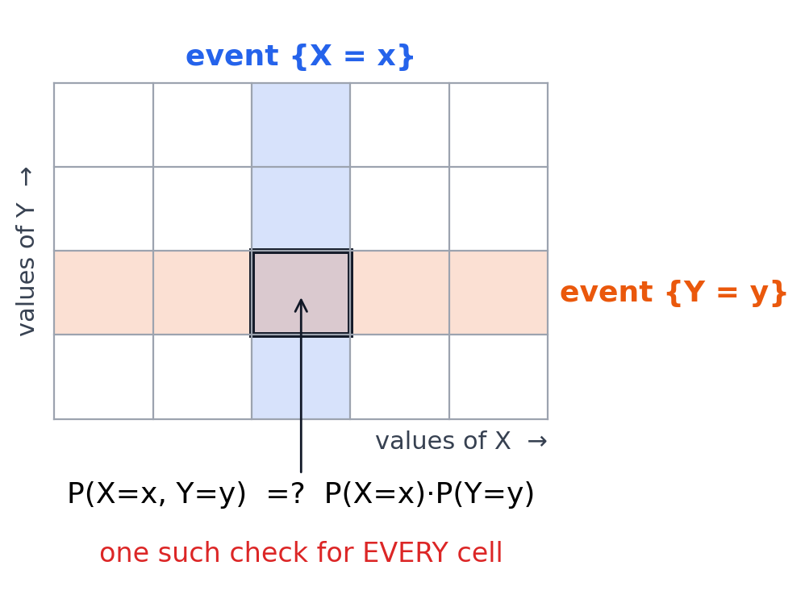
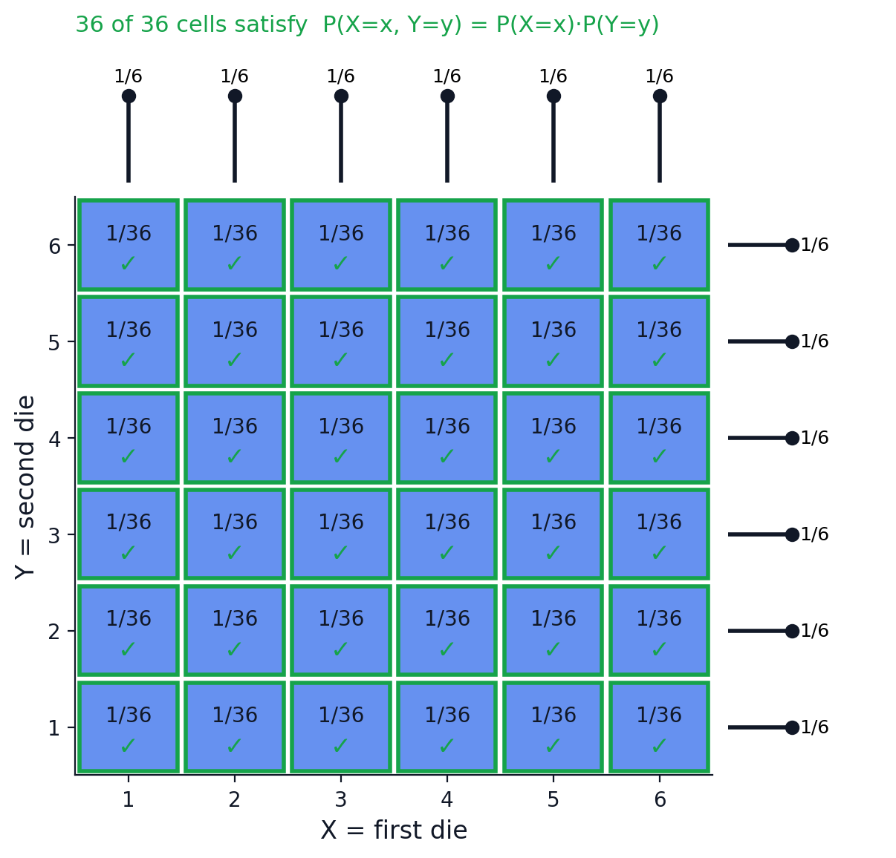
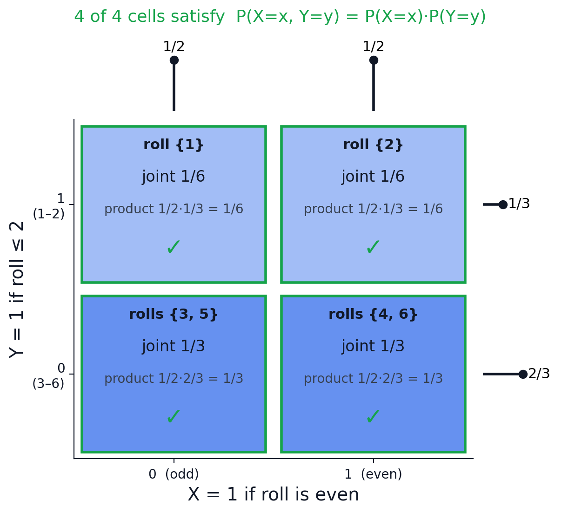
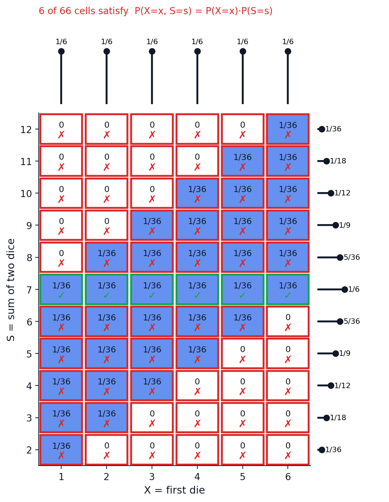

## Contents

::: {.cards .stack .toc}
::: {.box}
1 · Random Variables & PMFs
From outcomes to numbers; PMF, CDF, support, valid PMFs.
:::
::: {.box}
2 · Bernoulli & Binomial
Two named families, defined by a story.
:::
::: {.box}
3 · Hypergeometric
Sampling without replacement; why the PMFs sum to one.
:::
::: {.box}
4 · Functions of One R.V.
The distribution of $g(X)$.
:::
::: {.box}
5 · Functions of Several R.V.s
$X+Y$, $\max$, $\min$, $|X-Y|$ and the dice duel.
:::
::: {.box}
6 · Independence
Independent random variables: one equation per cell.
:::
:::

# Random Variables & PMFs {.section-slide}

From outcomes to numbers, and their distribution.

## Why random variables?

::: {.box}
So far we reasoned about **events**: subsets of the sample space $S$. Often we care only about a **number** attached to the outcome.
:::

. . .

::: {.box .key}
Example
Toss a fair coin twice. We might ask:
:::

::: {.cards}
::: {.box .c}
How many **Heads**?
:::
::: {.box .c}
How many more **Heads** than **Tails**?
:::
::: {.box .c}
How many **Tails**?
:::
:::

. . .

::: {.box .good}
Each question turns an outcome $s\in S$ into a **number**. That is the idea we formalize today.
:::

## From outcomes to numbers

Press a button: each outcome is sent to a number.

<button class="tg" data-fn="heads">X = Number of Heads</button><button class="tg" data-fn="tails">Y = Number of Tails</button><button class="tg" data-fn="diff">D = Heads − Tails</button>

<svg id="rv-svg" class="wplot" viewBox="0 -5 900 305" style="max-height:340px"></svg>

Choose a random variable above.

## Definition: random variable

::: {.box .key}
Definition
Given an experiment with sample space $S$, a **random variable** (r.v.) is a function
$$X:S\to\mathbb{R}$$
It assigns a real number $X(s)$ to every outcome $s\in S$.
:::

. . .

::: {.box}
Two-coin example: $X$ counts Heads, $Y$ counts Tails, $D=$ Heads $-$ Tails.
:::

## Same outcomes, three r.v.s

| $s$ | $X(s)$ (H) | $Y(s)$ (T) | $D(s)$ (H $-$ T) |
|:-:|:-:|:-:|:-:|
| $HH$ | 2 | 0 | 2 |
| $HT$ | 1 | 1 | 0 |
| $TH$ | 1 | 1 | 0 |
| $TT$ | 0 | 2 | $-2$ |

. . .

::: {.box .good}
Same sample space, same outcomes: three different functions, three different r.v.s.
:::

## Why "random", why "variable"?

::: {.box}
Random
Before the experiment we do not know which $s$ occurs, so we do not know $X(s)$.
:::

. . .

::: {.box}
Variable
The value changes depending on which outcome occurs.
:::

. . .

::: {.box .key}
Crystallizes
Once $s$ is realized, $X$ **crystallizes** into the number $X(s)$. The mapping is not random, only the outcome fed into it.
:::

. . .

::: {.box}
Convention
Capital letters ($X,Y,D,\dots$) for r.v.s; the lowercase letter ($x,y,d,\dots$) for a value it might take.
:::

## More examples of r.v.s

::: {.cards}
::: {.box}
- Number of aces in a 5-card hand
- Sum of two dice rolls
- Number of Tails before the first Head
- Number of students at a lecture
:::
::: {.box}
- Number of years a person will live
- Your income after graduating from NU
- Tomorrow's KZT/USD exchange rate
:::
:::

. . .

::: {.box}
Some r.v.s come from simple experiments (dice, cards); others from complex ones that are hard even to describe.
:::

## Simplifying the picture

::: {.box .key}
Key idea
Once $X$ is defined, we can reason **directly about $X$**: its possible values and their probabilities, without the structure of the probability space.
:::

. . .

::: {.box}
Questions like $P(X=2)$ or "the average value of $X$" are questions about $X$ itself.
:::

. . .

::: {.box .good}
Random variables let us **abstract away** from the sample space and work with numbers.
:::

## Distribution of a r.v.

::: {.box}
$X$ counts Heads in two flips. What values can it take, and with what **probabilities**?
:::

. . .

::: {.cards}
::: {.box .c}
$P(X=0)=P(TT)=\frac14$
:::
::: {.box .c}
$P(X=1)=P(HT)+P(TH)=\frac12$
:::
::: {.box .c}
$P(X=2)=P(HH)=\frac14$
:::
:::

. . .

| $x$ | 0 | 1 | 2 | any other $x$ |
|:-:|:-:|:-:|:-:|:-:|
| $P(X=x)$ | $1/4$ | $1/2$ | $1/4$ | $0$ |

## Support and PMF

::: {.box .key}
Definition
The **support** of $X$ is the set of values $x$ with $P(X=x)>0$. Here $\operatorname{supp}(X)=\{0,1,2\}$.
:::

::: {.box .key}
Definition
The **probability mass function (PMF)** is $p_X(x)=P(X=x)$, defined for every $x\in\mathbb{R}$ (and $0$ outside the support).
:::

. . .

::: {.box}
The PMF is one way to describe **the distribution** of a r.v.: it contains all the information about the probabilities of the values it can take.
:::

## Empirical interpretation of the PMF

Repeat the experiment many times: the histogram approaches the PMF.

<button class="act ghost" id="pc-r1">Run 1 trial</button><button class="act ghost" id="pc-r100">Run 100 trials</button><button class="act ghost" id="pc-rs">Reset</button>

<svg id="pc-svg" class="wplot" viewBox="0 0 900 335" style="max-height:340px"></svg>

## PMF of $Y$ (Tails)

::: {.box}
$Y=2-X$, so $Y$ has the same distribution shape as $X$.
:::

| $y$ | 0 | 1 | 2 | other |
|:-:|:-:|:-:|:-:|:-:|
| $P(Y=y)$ | $1/4$ | $1/2$ | $1/4$ | $0$ |

. . .

::: {.box .c}
$P(Y=0)=P(HH)=\frac14,\quad P(Y=1)=P(HT)+P(TH)=\frac12,\quad P(Y=2)=P(TT)=\frac14$
:::

## PMF of $D$ (Heads $-$ Tails)

::: {.box}
$D=X-Y=2X-2$: the support shifts and stretches.
:::

| $d$ | $-2$ | 0 | 2 | other |
|:-:|:-:|:-:|:-:|:-:|
| $P(D=d)$ | $1/4$ | $1/2$ | $1/4$ | $0$ |

. . .

::: {.box .c}
$P(D=-2)=P(TT)=\frac14,\quad P(D=0)=P(HT)+P(TH)=\frac12,\quad P(D=2)=P(HH)=\frac14$
:::

## Cumulative distribution function

::: {.box .key}
Definition
The **CDF** of a r.v. $X$ is
$$F_X(x)=P(X\le x),\qquad x\in\mathbb{R}$$
:::

. . .

::: {.box}
An **alternative, fully equivalent** description of the distribution of $X$.

- From the PMF, build $F_X$ by summing probabilities up to $x$
- From $F_X$, recover the PMF from its jumps
:::

## Deriving the CDF of $X$

::: {.cap}
Recall $\operatorname{supp}(X)=\{0,1,2\}$ with $P(X=0)=\frac14$, $P(X=1)=\frac12$, $P(X=2)=\frac14$.
:::

::: {.box}
$F_X(x)=0$ for $x<0$. No value of $X$ is negative.
:::

. . .

::: {.box}
$F_X(x)=P(X=0)=\frac14$ for $0\le x<1$
:::

. . .

::: {.box}
$F_X(x)=P(X=0)+P(X=1)=\frac14+\frac12=\frac34$ for $1\le x<2$
:::

. . .

::: {.box}
$F_X(x)=P(X=0)+P(X=1)+P(X=2)=1$ for $x\ge2$
:::

## Graph of the CDF of $X$

<svg class="wplot" viewBox="0 0 900 340" style="max-height:330px">
<line x1="60" y1="290" x2="840" y2="290" stroke="#52606d" stroke-width="2"/>
<line x1="275" y1="310" x2="275" y2="15" stroke="#52606d" stroke-width="2"/>
<line x1="275" y1="215" x2="810" y2="215" stroke="#d9e2ec" stroke-dasharray="5 5"/>
<line x1="275" y1="140" x2="810" y2="140" stroke="#d9e2ec" stroke-dasharray="5 5"/>
<line x1="275" y1="65" x2="810" y2="65" stroke="#d9e2ec" stroke-dasharray="5 5"/>
<line x1="275" y1="30" x2="810" y2="30" stroke="#d9e2ec" stroke-dasharray="5 5"/>
<text x="840" y="276" text-anchor="end" class="sv-l">x</text>
<text x="285" y="26" class="sv-l">F(x)</text>
<text x="262" y="220" text-anchor="end" class="sv-t">1/4</text>
<text x="262" y="145" text-anchor="end" class="sv-t">1/2</text>
<text x="262" y="70" text-anchor="end" class="sv-t">3/4</text>
<text x="262" y="35" text-anchor="end" class="sv-t" style="display:none">1</text>
<text x="262" y="294" text-anchor="end" class="sv-t">0</text>
<text x="275" y="312" text-anchor="middle" class="sv-t">0</text>
<text x="450" y="312" text-anchor="middle" class="sv-t">1</text>
<text x="625" y="312" text-anchor="middle" class="sv-t">2</text>
<line x1="100" y1="290" x2="275" y2="290" stroke="#2b6cb0" stroke-width="4"/>
<line x1="275" y1="215" x2="450" y2="215" stroke="#2b6cb0" stroke-width="4"/>
<line x1="450" y1="65" x2="625" y2="65" stroke="#2b6cb0" stroke-width="4"/>
<line x1="625" y1="30" x2="810" y2="30" stroke="#2b6cb0" stroke-width="4"/>
<line x1="275" y1="290" x2="275" y2="215" stroke="#9aa5b1" stroke-width="2" stroke-dasharray="5 4"/>
<line x1="450" y1="215" x2="450" y2="65" stroke="#9aa5b1" stroke-width="2" stroke-dasharray="5 4"/>
<line x1="625" y1="65" x2="625" y2="30" stroke="#9aa5b1" stroke-width="2" stroke-dasharray="5 4"/>
<circle cx="275" cy="290" r="7" fill="#fff" stroke="#2b6cb0" stroke-width="3"/>
<circle cx="450" cy="215" r="7" fill="#fff" stroke="#2b6cb0" stroke-width="3"/>
<circle cx="625" cy="65" r="7" fill="#fff" stroke="#2b6cb0" stroke-width="3"/>
<circle cx="275" cy="215" r="7" fill="#2b6cb0"/>
<circle cx="450" cy="65" r="7" fill="#2b6cb0"/>
<circle cx="625" cy="30" r="7" fill="#2b6cb0"/>
<text x="262" y="35" text-anchor="end" class="sv-t">1</text>
</svg>

. . .

::: {.box .key}
$F_X$ is a **step function** with jumps at $x=0,1,2$. The **size of each jump at $x$ is exactly $P(X=x)$**. Closed dot: the value $F_X$ takes there (right-continuous); open dot: the limit from the left.
:::

## Discrete vs. continuous

::: {.box .key}
Definition
$X$ is **discrete** if there is a finite or infinite list $a_1,a_2,\dots$ with $P(X\in\{a_1,a_2,\dots\})=1$. It takes values only in a countable set: its **support**.
:::

. . .

::: {.box}
Continuous
$X$ can take *any* value in an interval (a height, a duration). Uncountably many values, and typically $P(X=x)=0$ for every single $x$.
:::

. . .

::: {.box .good}
Key contrast
A discrete r.v.'s CDF is a **step function**. A continuous r.v.'s CDF has no jumps: it rises smoothly.
:::

## Properties of PMFs

::: {.box .key}
Properties
Every PMF $p_X$ of a discrete r.v. satisfies:

1. **Nonnegativity:** $p_X(x)\ge0$ for all $x\in\mathbb{R}$
2. **Sums to one:** $\displaystyle\sum_x p_X(x)=1$, over the support of $X$
:::

. . .

::: {.box .good}
These two properties **fully characterize** valid PMFs: any $p(x)$ satisfying (1) and (2) on a countable set is the PMF of *some* discrete r.v. Nothing else about the experiment matters.
:::

## Example: is this a valid PMF?

::: {.box}
Let
$$p(x)=k^x,\qquad x=1,2,3,\dots$$
for some constant $k$. Is there a $k$ that makes $p$ a valid PMF? If so, find it.
:::

. . .

::: {.box .key}
We need to check that both properties hold.
:::

## Solving for $k$

::: {.box}
**Nonnegativity:** requires $k\ge0$, so that $k^x\ge0$ for every integer $x\ge1$.
:::

. . .

::: {.box}
**Sums to one:** $\displaystyle\sum_{x=1}^\infty k^x=1$. A **geometric series** starting at $x=1$, convergent only for $|k|<1$:
$$\sum_{x=1}^\infty k^x=\frac{k}{1-k}$$
:::

. . .

::: {.box .key}
$\dfrac{k}{1-k}=1\;\Longrightarrow\;k=1-k\;\Longrightarrow\;k=\tfrac12$
:::

## Checking the answer

::: {.box .good}
$k=\tfrac12$ satisfies both $k\ge0$ and $|k|<1$. So
$$p(x)=(1/2)^x,\qquad x=1,2,3,\dots$$
**is** a valid PMF.
:::

# Bernoulli & Binomial {.section-slide}

Some r.v.s are so common that they have names.

## Bernoulli distribution

::: {.box .key}
Definition
$X\sim\text{Bern}(p)$ if it takes only the values $0$ and $1$:
$$P(X=1)=p,\quad P(X=0)=1-p,\quad 0<p<1$$
:::

::: {.scatter-row}
<svg viewBox="0 0 500 260" class="star">
<circle cx="250" cy="45" r="30" fill="#1b3a5c"/>
<text x="250" y="52" text-anchor="middle" class="sv-p" style="font-size:20px">X</text>
<line x1="232" y1="72" x2="156" y2="184" stroke="#52606d" stroke-width="3"/>
<line x1="268" y1="72" x2="344" y2="184" stroke="#52606d" stroke-width="3"/>
<polygon points="146,197 150,181 161,189" fill="#52606d"/>
<polygon points="354,197 339,189 350,181" fill="#52606d"/>
<text x="170" y="120" text-anchor="middle" class="sv-l">1−p</text>
<text x="335" y="120" text-anchor="middle" class="sv-l">p</text>
<circle cx="130" cy="225" r="28" fill="#e4e7eb" stroke="#52606d" stroke-width="2.5"/>
<text x="130" y="232" text-anchor="middle" class="sv-l">0</text>
<circle cx="370" cy="225" r="28" fill="#eef4fb" stroke="#2b6cb0" stroke-width="2.5"/>
<text x="370" y="232" text-anchor="middle" class="sv-l">1</text>
</svg>
::: {.box}
$\text{Bern}(p)$ is not one distribution but a **family**, indexed by $p\in(0,1)$. Different $p$, different distribution.
:::
:::

## Bernoulli trials

::: {.box}
***Bernoulli trials*** are experiments with exactly two outcomes, success and failure, with success probability $p$. The Bernoulli distribution describes a single trial.
:::

. . .

::: {.cards}
::: {.box}
Coin toss
$X=1$ if Heads: $\text{Bern}(1/2)$ for a fair coin
:::
::: {.box}
Die roll
$X=1$ if a 6 comes up: $\text{Bern}(1/6)$
:::
::: {.box}
Attendance
$X=1$ if a student comes to class: $\text{Bern}(p)$
:::
:::

## Binomial distribution

::: {.box .key}
Definition
Perform $n$ **independent** $\text{Bern}(p)$ trials and let $X$ be the **number of successes**. Then
$$X\sim\text{Bin}(n,p)$$
:::

. . .

::: {.box}
Again a **family**, now indexed by *two* parameters: $n$ (number of trials) and $p$ (success probability per trial).
:::

. . .

::: {.box .good}
We defined it by a **story**. This is often more useful than giving the PMF: you can recognize the distribution in new problems without rederiving the PMF.
:::

## Example: tossing a coin

::: {.box}
Toss a fair coin $n$ times. Let $X$ = number of Heads.
:::

. . .

::: {.box .key}
Each toss is a $\text{Bern}(1/2)$ trial, and the tosses are independent: exactly the Binomial story. So
$$X\sim\text{Bin}(n,1/2)$$
:::

. . .

::: {.box .good}
Our very first example (two tosses, $X$ = number of Heads) was $\text{Bin}(2,1/2)$ all along.
:::

## PMF of the Binomial

::: {.box}
If $X\sim\text{Bin}(n,p)$, the support is $\{0,1,\dots,n\}$: anywhere from $0$ to $n$ successes.
:::

. . .

::: {.box .key}
PMF
$$P(X=k)=\binom nk p^k(1-p)^{n-k},\qquad k=0,1,\dots,n$$
:::

. . .

::: {.cap}
Where does the PMF come from? Let us derive it.
:::

## Deriving it: $k=0$ and $k=1$

::: {.cap}
Deriving the PMF means finding $P(X=k)$ for $k=0,1,\dots,n$.
:::

::: {.box}
$P(X=0)$
Only one way: every trial fails, each with probability $1-p$. By independence, $P(X=0)=(1-p)^n$.
:::

. . .

::: {.box}
$P(X=1)$
The success can occur in any of the $n$ trials. Each specific sequence has probability $p(1-p)^{n-1}$, and there are $n$ of them:
$$P(X=1)=np(1-p)^{n-1}$$
:::

## Deriving it: general $k$

::: {.box}
$\{X=k\}$: exactly $k$ of the $n$ trials are successes. Its probability is the sum over all sequences with exactly $k$ successes.
:::

. . .

::: {.box}
By independence, each such sequence has probability $p^k(1-p)^{n-k}$.
:::

. . .

::: {.box}
There are $\binom nk$ such sequences (choose which $k$ trials succeed).
:::

. . .

::: {.box .key}
$$P(X=k)=\binom nk p^k(1-p)^{n-k}$$
:::

## Two ways to define a r.v.

::: {.box}
By distribution
Give the PMF (or CDF) directly, as a formula.
:::

. . .

::: {.box}
By story
Describe the generative process, e.g. "count successes in $n$ independent trials".
:::

. . .

::: {.box .key}
**Recognizing the distribution from the story** is a key skill here.
:::

## More Binomial examples

::: {.cards}
::: {.box}
- 6 dice, number of 6s: $\text{Bin}(6,1/6)$
- A monkey guesses $n$ four-option questions, number correct: $\text{Bin}(n,1/4)$
- Likes on a post from $n$ viewers, each liking independently with probability $p$: $\text{Bin}(n,p)$
:::
::: {.box}
- Loans repaid out of $n$, each independently with probability $p$: $\text{Bin}(n,p)$
- Airline sells $n$ tickets, each passenger shows up with probability $p$; no-shows: $\text{Bin}(n,1-p)$ (basis of overbooking)
- Firm sends $n$ job offers, acceptances: $\text{Bin}(n,p)$
:::
:::

. . .

::: {.cap}
The last few are simplifications: real likes, repayments and no-shows are rarely *exactly* independent with identical probabilities. But Binomial is often a reasonable first model.
:::

## The Binomial CDF

::: {.box}
Unlike the PMF, there is **no simple closed form** for the Binomial CDF. We are stuck with the sum:
$$F_X(x)=P(X\le x)=\sum_{k=0}^{\lfloor x\rfloor}\binom nk p^k(1-p)^{n-k}$$
:::

. . .

::: {.cap}
In practice it is computed numerically (software, tables) rather than simplified algebraically.
:::

## Comparing Binomial PMFs

Toggle each distribution to see how $n$ and $p$ shape the PMF.

<button class="tg" data-k="0" style="--c:#2b6cb0">Bin(10, 0.2)</button><button class="tg" data-k="1" style="--c:#2f855a">Bin(10, 0.5)</button><button class="tg" data-k="2" style="--c:#dd6b20">Bin(20, 0.5)</button>

<svg id="bc-svg" class="wplot" viewBox="0 0 900 335" style="max-height:340px"></svg>

## What the comparison shows

::: {.box}
Larger $n$ spreads the distribution out; $p$ shifts where its mass is centered. All three still sum to $1$.
:::

## Another example: aces

::: {.box}
Deal a $4$-card hand from a standard $52$-card deck. Let $X$ = number of aces.
:::

. . .

::: {.box .key}
This *looks* like counting successes in $4$ trials. Is $X\sim\text{Bin}(4,4/52)$?
:::

. . .

::: {.box}
Each card is "ace or not", which matches the Binomial story. What might break down?
:::

## Why Binomial fails here

::: {.box}
Binomial requires the trials to be **independent**, each with the *same* success probability $p$.
:::

. . .

::: {.box .warn}
Cards are dealt **without replacement**. After the first card:

- first card an ace: $3$ aces left in $51$ cards
- otherwise: $4$ aces left in $51$ cards
:::

. . .

::: {.box .key}
The probability of "ace" on draw 2 **depends on draw 1**: the trials are not independent and $p$ is not fixed. The Binomial model does not apply.
:::

# Hypergeometric {.section-slide}

Sampling without replacement; why the PMFs sum to one.

## Hypergeometric distribution

::: {.box .key}
Story definition
An urn has $w$ white (success) and $b$ black (failure) balls, $N=w+b$. Draw $n$ balls **without replacement**; $X$ = number of white balls. Then
$$X\sim\text{HGeom}(w,b,n)$$
:::

. . .

::: {.box}
A family indexed by **three** parameters: $w$, $b$ and $n$.
:::

. . .

::: {.box .good}
Our aces problem: $w=4$, $b=48$, $n=4$, so $X\sim\text{HGeom}(4,48,4)$.
:::

## Simulating the urn

Draw 3 balls from an urn of 4 red (success) and 6 gray (failure), without replacement.

<button class="act" id="un-draw">Draw 3 balls</button><button class="act ghost" id="un-reset">Reset</button>

<svg id="un-svg" class="wplot" viewBox="0 0 820 235" style="max-height:260px"></svg>

## Hypergeometric PMF

::: {.box .key}
Definition
If $X\sim\text{HGeom}(w,b,n)$, then
$$P(X=k)=\frac{\binom wk\binom b{n-k}}{\binom{w+b}n}$$
for integers $k$ with $0\le k\le w$ and $0\le n-k\le b$.
:::

. . .

::: {.box}
Numerator: choose $k$ white and $n-k$ black. Denominator: all ways to choose any $n$ from $N=w+b$.
:::

## Hypergeometric examples

::: {.box}
Aces in a 4-card hand: $w=4,\ b=48,\ n=4$
$$P(X=2)=\frac{\binom42\binom{48}2}{\binom{52}4}=\frac{6\times1128}{270725}=0.025$$
:::

. . .

::: {.box}
Quality control
A batch of $20$ items has $3$ defective. Inspect $5$ at random without replacement: defectives found $\sim\text{HGeom}(3,17,5)$.
:::

. . .

::: {.box}
Committee
A class has $12$ economics and $8$ other majors. A random committee of $6$: economics majors $\sim\text{HGeom}(12,8,6)$.
:::

## Deriving the PMF: $k=0,1$

::: {.cap}
Urn: $w$ white, $b$ black, draw $n$ without replacement. All $\binom{w+b}{n}$ samples of size $n$ are equally likely.
:::

::: {.box}
$\{X=0\}$: none white, all $n$ black
$$P(X=0)=\frac{\binom w0\binom bn}{\binom{w+b}n}$$
:::

. . .

::: {.box}
$\{X=1\}$: exactly one white
$$P(X=1)=\frac{\binom w1\binom b{n-1}}{\binom{w+b}n}$$
:::

## Deriving the PMF: general $k$

::: {.box .key}
The pattern is clear: for any valid $k$, choose $k$ white and $n-k$ black.
$$P(X=k)=\frac{\binom wk\binom b{n-k}}{\binom{w+b}n}$$
:::

. . .

::: {.box}
Same reasoning as $k=0,1$, with the fixed small number replaced by the general $k$.
:::

## With or without replacement

::: {.box}
Same urn story (white/black balls, count successes), but:
:::

::: {.cards}
::: {.box .c}
With replacement
Each draw independent, same composition: $\text{Bin}(n,p)$ with $p=\frac{w}{w+b}$
:::
::: {.box .c .key}
Without replacement
Composition changes after each draw: $\text{HGeom}(w,b,n)$
:::
:::

. . .

::: {.box .good}
As $N=w+b$ grows large relative to $n$, removing a few balls barely changes the composition: $\text{HGeom}$ starts to look like $\text{Bin}$.
:::

## Comparing Hypergeometric PMFs

Same $n=5$, different urns. Dashed gray: Binomial with $p=\frac{w}{w+b}$ (the same urn **with** replacement).

<button class="tg" data-k="0" style="--c:#2b6cb0">HGeom(10, 10, 5)</button><button class="tg" data-k="1" style="--c:#dd6b20">HGeom(5, 15, 5)</button><button class="tg" data-k="2" style="--c:#2f855a">HGeom(50, 50, 5)</button><button class="tg" data-k="3" style="--c:#52606d">Bin(5, 0.5)</button>

<svg id="hc-svg" class="wplot" viewBox="0 0 900 335" style="max-height:330px"></svg>

## Reading the comparison

::: {.box}
$\text{HGeom}(10,10,5)$ is **symmetric**: half the urn is white, so $k$ and $5-k$ are equally likely.
:::

. . .

::: {.box}
Shrinking $w$ to $5$ out of $20$ shifts the mass left: the white fraction $\frac{w}{w+b}$ plays the role of $p$ in the Binomial.
:::

## Hypergeometric vs. Binomial

All three have white fraction $1/2$.

| $k$ | 0 | 1 | 2 | 3 | 4 | 5 |
|:--|:-:|:-:|:-:|:-:|:-:|:-:|
| $\text{HGeom}(10,10,5)$ | $.016$ | $.135$ | $.348$ | $.348$ | $.135$ | $.016$ |
| $\text{HGeom}(50,50,5)$ | $.028$ | $.153$ | $.319$ | $.319$ | $.153$ | $.028$ |
| $\text{Bin}(5,0.5)$ | $.031$ | $.156$ | $.312$ | $.312$ | $.156$ | $.031$ |

. . .

::: {.box}
Largest gap from the Binomial: $0.036$ when $N=20$, only $0.006$ when $N=100$.
:::

## Why they differ

::: {.box .good}
Why
Drawing $5$ from an urn of $100$ barely changes its composition: the draws are *almost* independent with a fixed $p$. Drawing $5$ from $20$ removes a quarter of it: the dependence is visible.
:::

. . .

::: {.box .warn}
Direction of the difference
Without replacement the extremes are **less** likely: $P(X=0)$ drops from $.031$ to $.016$. Each white ball drawn makes the next harder to get, pulling samples toward the middle.
:::

## Are these really valid PMFs?

::: {.box}
For $\text{Bern}(p)$, $p_X(x)\ge0$ and $\sum p_X(x)=p+(1-p)=1$ are immediate.
:::

. . .

::: {.box}
But $\text{Bin}(n,p)$ and $\text{HGeom}(w,b,n)$ are more complicated sums. Are we *sure* they sum to $1$?
:::

. . .

::: {.box .key}
Nonnegativity is clear for both. The real question is **sum to one**.
:::

## Binomial: Newton's theorem

::: {.box}
**Binomial theorem:** for any $a,b$ and integer $n\ge0$,
$$(a+b)^n=\sum_{k=0}^n\binom nk a^kb^{n-k}$$
:::

. . .

::: {.box}
Set $a=p$, $b=1-p$:
$$\sum_{k=0}^n\binom nk p^k(1-p)^{n-k}=(p+(1-p))^n=1^n=1$$
:::

. . .

::: {.box .good}
This is exactly $\sum_kP(X=k)$ for $X\sim\text{Bin}(n,p)$: confirmed valid.
:::

## Hypergeometric: Vandermonde

::: {.box .key}
Vandermonde's identity
For nonnegative integers $m,l,r$,
$$\sum_{k=0}^r\binom mk\binom l{r-k}=\binom{m+l}r$$
:::

. . .

::: {.box}
With $m=w$, $l=b$, $r=n$, and dividing by $\binom{w+b}n$:
$$\sum_kP(X=k)=\sum_k\frac{\binom wk\binom b{n-k}}{\binom{w+b}n}=\frac{\binom{w+b}n}{\binom{w+b}n}=1$$
:::

## Proving Vandermonde: a story

::: {.box}
$m$ men and $l$ women. Count the committees of $r$ people in **two ways**.
:::

. . .

::: {.cards}
::: {.box}
Directly
Choose any $r$ of the $m+l$ people: $\binom{m+l}r$ ways.
:::
::: {.box}
Split on $k$ = men
For $k=0,\dots,r$: $\binom mk\binom l{r-k}$ ways. Summing counts every committee exactly once.
:::
:::

. . .

::: {.box .good}
Same count, two expressions
$$\sum_{k=0}^r\binom mk\binom l{r-k}=\binom{m+l}r$$
:::

# Functions of One R.V. {.section-slide}

The distribution of $g(X)$.

## Functions of a r.v.

::: {.box}
We are often interested in quantities that are **functions** of random variables.
:::

. . .

::: {.box}
Let $X$ be the number of H after two coin tosses:

- $2-X$ is the number of T
- $|2-2X|$ is the absolute difference between H and T
:::

. . .

::: {.box .key}
Today's question
Each is a new random quantity built from $X$. If we know the distribution of $X$, can we get the distribution of $g(X)$?
:::

## Illustration of the two functions

<button class="tg" data-g="minus">g(x) = 2 − x</button><button class="tg" data-g="absd">g(x) = |2 − 2x|</button>

<svg id="fm-svg" class="wplot" viewBox="0 0 900 355" style="max-height:360px"></svg>

P(X=0) = 1/4, P(X=1) = 1/2, P(X=2) = 1/4. Pick a function g to apply on top of X.

## Definition: $g(X)$

::: {.box .key}
Definition
For an r.v. $X$ and a function $g:\mathbb{R}\to\mathbb{R}$, the random variable $g(X)$ is the function that maps
$$s\;\longmapsto\;g(X(s))\qquad\text{for all }s\in S$$
:::

. . .

::: {.box .good}
Key point
$g(X)$ is a function from $S$ to $\mathbb{R}$, so it is a random variable in its own right.
:::

## Why is $g(X)$ random?

::: {.box}
The function $g$ is **not random**.
:::

. . .

::: {.box}
What is random is the **input**: we do not know which $s$ occurs, so we do not know $X(s)$, the input into $g$.
:::

. . .

::: {.box .key}
Once the experiment runs and $X$ **crystallizes** to a number, $g(X)$ crystallizes too.
:::

## One-to-one transformations

::: {.box}
$g(x)=2-x$ maps each $x$ into a distinct $g(x)$: it is **one-to-one**.
:::

::: {.box .key}
Rule for one-to-one functions
The support of $Y=g(X)$ is $\{g(x):x\in\operatorname{supp}(X)\}$ and
$$P\big(Y=g(x)\big)=P(X=x)$$
:::

. . .

| $x$ | 0 | 1 | 2 |
|:-:|:-:|:-:|:-:|
| $P(X=x)$ | $1/4$ | $1/2$ | $1/4$ |

| $y$ | 2 | 1 | 0 |
|:-:|:-:|:-:|:-:|
| $P(Y=y)$ | $1/4$ | $1/2$ | $1/4$ |

## Your turn: Question 1

::: {.box .key}
Question 1
With $X\sim\text{Bin}(5,0.4)$ and $R=300X+100$, find the PMF of $R$.
:::

## When $g$ is not one-to-one

::: {.box}
$g(x)=|2-2x|$ is not one-to-one: both $0$ and $2$ map to the output $2$.
:::

. . .

::: {.box .warn}
So $P(g(X)=2)$ cannot be the probability of one $x$: **two** values produce that output.
:::

. . .

::: {.box .key}
The fix
When several $x$'s map to the same $y$, $\{g(X)=y\}$ is the **union** of the disjoint events $\{X=x\}$. Add their probabilities:
$$P(g(X)=2)=P(X=0)+P(X=2)=1/2$$
:::

## Theorem: PMF of $g(X)$

::: {.box .key}
Theorem
Let $X$ be a discrete r.v. and $g:\mathbb{R}\to\mathbb{R}$. The support of $g(X)$ is the set of all $y$ with $g(x)=y$ for at least one $x$ in $\operatorname{supp}(X)$, and
$$P\big(g(X)=y\big)=\sum_{x:\,g(x)=y}P(X=x)$$
:::

. . .

::: {.box}
One-to-one is just the special case where every group has size one.
:::

## Recipe

::: {.box .warn}
Recipe

1. List the support of $X$ and its probabilities
2. Compute $g(x)$ for each $x$ in the support
3. **Group** the $x$'s that share the same value of $g(x)$
4. **Add** the probabilities inside each group
:::

## Watch the PMF transform

$X\sim\text{Bin}(4,1/2)$ on top. Pick a transformation and watch where the mass goes.

<button class="tg" data-g="id">Y = X</button><button class="tg" data-g="sh">Y = X + 2</button><button class="tg" data-g="db">Y = 2X</button><button class="tg" data-g="abs">Y = |X − 2|</button><button class="tg" data-g="sq">Y = (X − 2)²</button><button class="tg" data-g="ind">Y = I(X ≥ 3)</button>

<svg id="pt-svg" class="wplot" viewBox="0 0 900 420" style="max-height:400px"></svg>

Colours track where each value of X ends up. Stacked colours = merged mass.

## What the animation shows

::: {.cards .stack}
::: {.box}
$Y=X+2$: the picture **slides right**. Nothing merges.
:::
::: {.box}
$Y=2X$: **stretches horizontally**. The gaps are real: $2X$ can never be odd.
:::
::: {.box}
$Y=|X-2|$: bars fold. $x=1$ and $x=3$ **merge**: $\frac4{16}+\frac4{16}=\frac8{16}$.
:::
::: {.box}
$Y=I(X\ge3)$: five bars collapse into two.
:::
:::

## Big idea

::: {.box .key}
Big idea
A transformation moves probability mass **sideways** along the axis. Mass is never created or destroyed: only relocated, and sometimes piled up.
:::

# Functions of Several R.V.s {.section-slide}

The machine now takes **two** inputs.

## Several random inputs

::: {.box}
Most interesting quantities depend on **more than one** random input.
:::

. . .

::: {.cards .stack}
::: {.box}
Total revenue of two shops: $X+Y$
:::
::: {.box}
The winner of a two-player game: $\max(X,Y)$
:::
::: {.box}
The bottleneck of a two-stage process: $\min(X,Y)$
:::
::: {.box}
The gap between two exam scores: $|X-Y|$
:::
::: {.box}
A portfolio of two KASE stocks: $w_1X+w_2Y$
:::
:::

## Definition: function of two r.v.s

::: {.box .key}
Definition
If $X$ and $Y$ are r.v.s mapping $s\in S$ to $X(s)$ and $Y(s)$, then $g(X,Y)$ is the r.v. that maps
$$s\;\longmapsto\;g\big(X(s),Y(s)\big)$$
:::

. . .

::: {.box}
Same interpretation as always: **if we observe $X=x$ and $Y=y$, then $g(X,Y)$ crystallizes to $g(x,y)$.**
:::

. . .

::: {.box .good}
$\max(X,Y)$ feels stranger than $X+Y$, but it is no different: observe $X=3$, $Y=5$, and $\max(X,Y)$ crystallizes to $5$.
:::

## One sample space for both

::: {.box .warn}
Requirement
$X$ and $Y$ must be defined on the **same** sample space $S$. Otherwise $g(X(s),Y(s))$ is meaningless.
:::

. . .

::: {.box}
This is never a real restriction: we build $S$ rich enough. **Example.** $X$ from a coin flip, $Y$ from a die roll, with $S_1=\{H,T\}$ and $S_2=\{1,\dots,6\}$.
:::

. . .

::: {.box .key}
Redefine both on the product space
$$S=S_1\times S_2=\{(s_1,s_2):s_1\in S_1,\,s_2\in S_2\}$$
with $X$ depending only on $s_1$ and $Y$ only on $s_2$. Now $X+Y$, $XY$, $\max(X,Y)$ all make sense.
:::

## Example: the dice duel

::: {.box}
At the NU board-game club, Aigerim and Nurlan each roll a fair die: $X$ is Aigerim's roll, $Y$ is Nurlan's. $S$ has $36$ equally likely outcomes $(x,y)$; here are $7$:
:::

| $s$ | $X$ | $Y$ | $\max(X,Y)$ | $\lvert X-Y\rvert$ |
|:-:|:-:|:-:|:-:|:-:|
| $(1,2)$ | 1 | 2 | 2 | 1 |
| $(1,6)$ | 1 | 6 | 6 | 5 |
| $(2,5)$ | 2 | 5 | 5 | 3 |
| $(3,1)$ | 3 | 1 | 3 | 2 |
| $(4,3)$ | 4 | 3 | 4 | 1 |
| $(5,4)$ | 5 | 4 | 5 | 1 |
| $(6,6)$ | 6 | 6 | 6 | 0 |

. . .

::: {.cap}
Each column is a random variable: a number attached to every outcome.
:::

## The 36-cell grid

Every outcome is one cell. To get a PMF, **count the cells**. Click a cell or a bar to isolate one value.

<button class="tg on" data-g="sum">X + Y</button><button class="tg" data-g="max">max(X, Y)</button><button class="tg" data-g="min">min(X, Y)</button><button class="tg" data-g="dif">|X − Y|</button>

<svg id="dg-svg" class="wplot" viewBox="0 0 920 372" style="max-height:370px"></svg>

## Reading the grid: $\max(X,Y)$

::: {.box}
From counting cells:
$$P(\max=1)=\tfrac1{36},\;P(\max=2)=\tfrac3{36},\;\dots,\;P(\max=6)=\tfrac{11}{36}$$
The counts $1,3,5,7,9,11$: each new value adds an **L-shaped** strip.
:::

. . .

::: {.box}
Directly, without the picture:
$$\begin{aligned}P(\max=5)&=P(X{=}5,Y{\le}4)+P(X{\le}4,Y{=}5)+P(X{=}5,Y{=}5)\\&=2\cdot\tfrac4{36}+\tfrac1{36}=\tfrac9{36}\end{aligned}$$
:::

## Why three terms?

::: {.box .warn}
The two "one is 5, the other is smaller" cases are disjoint, but neither includes the corner cell $(5,5)$, so it must be added separately. Splitting a max/min event into disjoint pieces is a standard trap.
:::

## Your turn: Question 3

::: {.box .key}
Question 3
Dice duel, $X$ and $Y$ independent fair dice.

(a) $P(\min(X,Y)\ge3)$: try to *see* it in the grid first.

(b) $P(|X-Y|\le1)$.

(c) Aigerim wins if $X>Y$: $P(\text{Aigerim wins})$ by symmetry, not counting.
:::

## Answers

::: {.box}
**(a)** $\min\ge3$ means **both** dice $\ge3$: a $4\times4$ block, so $\frac{16}{36}=\frac49$.
:::

. . .

::: {.box}
**(b)** $|X-Y|=0$ gives $6$ cells, $|X-Y|=1$ gives $10$. Total $\frac{16}{36}=\frac49$.
:::

. . .

::: {.box}
**(c)** $P(X>Y)=P(Y>X)$ by symmetry, $P(X=Y)=\frac6{36}$. So
$$P(X>Y)=\tfrac12\left(1-\tfrac16\right)=\tfrac5{12}$$
:::

# Independence {.section-slide}

One equation per cell of the table.

## Independence of r.v.s

::: {.box .key}
Definition
$X$ and $Y$ are **independent** if
$$P(X\le x,\,Y\le y)=P(X\le x)\,P(Y\le y)\quad\text{for all }x,y\in\mathbb{R}$$
For **discrete** $X,Y$ this is equivalent to
$$P(X=x,\,Y=y)=P(X=x)\,P(Y=y)\quad\text{for all }x,y$$
:::

## Independence: intuition

::: {.box}
Learning about $X$ tells you **nothing** about $Y$.
:::

. . .

::: {.box}
$X_1,\dots,X_n$ independent: $P(X_1=x_1,\dots,X_n=x_n)=P(X_1=x_1)\cdots P(X_n=x_n)$ for **all** $x_1,\dots,x_n$.
:::

. . .

::: {.box .good}
**i.i.d.** = independent + identically distributed, e.g. the $n$ Bernoulli trials behind $\text{Bin}(n,p)$.
:::

## From events to random variables

::: {.scatter-row}
::: {.box}
- Each pair $(x,y)$ gives two events: $\{X=x\}$ and $\{Y=y\}$
- $X,Y$ independent $\iff$ these are independent **for every** pair $(x,y)$
- Via conditioning: $P(Y=y\mid X=x)=P(Y=y)$ for all $y$, whenever $P(X=x)>0$
:::

:::

. . .

::: {.box .key}
Two events: **one** equation. Two r.v.s: **one equation per cell** of the table.
:::

## Checking = many conditions

::: {.box}
$X$ takes $m$ values, $Y$ takes $n$ values $\Rightarrow$ $m\times n$ equations.
:::

. . .

::: {.box}
Two dice: $6\times6=36$ equations; first die and sum: $6\times11=66$.
:::

. . .

::: {.box .warn}
Some cells can satisfy the product rule even when $X,Y$ are **dependent** (Example 3).
:::

## Example 1: two dice

::: {.box}
Roll two fair dice. $X$ = first die, $Y$ = second die.
:::

::: {.scatter-row}
::: {.box}
- $P(X=x)=P(Y=y)=\frac16$
- 36 equally likely outcomes
- $\frac1{36}=\frac16\cdot\frac16$ in **all 36** cells
- $\Rightarrow$ **independent** (in fact i.i.d.)
:::

:::

## Example 2: one die

::: {.box}
Roll **one** fair die. $X=1$ if the roll is even, $Y=1$ if the roll is $\le2$ ($0$ otherwise).
:::

::: {.scatter-row}
::: {.box}
- $P(X=1)=\frac12$, $P(Y=1)=\frac13$
- $P(X=1,Y=1)=P(\text{roll}=2)=\frac16=\frac12\cdot\frac13$
- All **4** cells pass $\Rightarrow$ **independent**
:::

:::

## Example 2: a variation

::: {.box .key}
Change $Y=1$ to mean "roll $\le3$" (otherwise $0$). Then
$$P(X=1,Y=1)=\tfrac16\ne\tfrac12\cdot\tfrac12$$
$\Rightarrow$ **dependent**.
:::

## Example 3: first die and sum

::: {.box}
Roll two fair dice. $X$ = first die, $S$ = sum of both dice.
:::

::: {.scatter-row}
::: {.box}
- Zero cell: $P(X=1,S=12)=0$, but $P(X=1)P(S=12)=\frac16\cdot\frac1{36}=\frac1{216}$
- $\Rightarrow$ **dependent**: one failure is enough
- 30 of the 66 cells are zero cells
:::

:::

## Example 3: the trap

::: {.box .warn}
Trap
The whole row $S=7$ passes: $P(X=x,S=7)=\frac1{36}=\frac16\cdot\frac16$ for every $x$. Checking only $S=7$ gives the **wrong** answer.
:::

## Independent or dependent?

::: {.box}
1. Last digit of your student ID and your ECON211 final score [— **independent**: nothing links them]{.fragment}
2. Your Quiz 1 score and your Quiz 2 score [— **dependent**: same student, same study habits]{.fragment}
3. Your die roll at one Nauryz fair booth and your friend's roll at the next booth [— **independent**: separate physical mechanisms]{.fragment}
4. Minutes late to a 9:00 class: you and your roommate [— **dependent**: same bus, same −30°C buran morning]{.fragment}
5. USD/KZT rate next month and the tenge price of a new iPhone [— **dependent**: imports are priced off the dollar]{.fragment}
:::

## Shared causes

::: {.box .key}
Most real-world dependence comes from a **shared cause**: weather, the economy, ability. Variables that are independent **given** the cause are dependent once the cause is unknown.
:::
