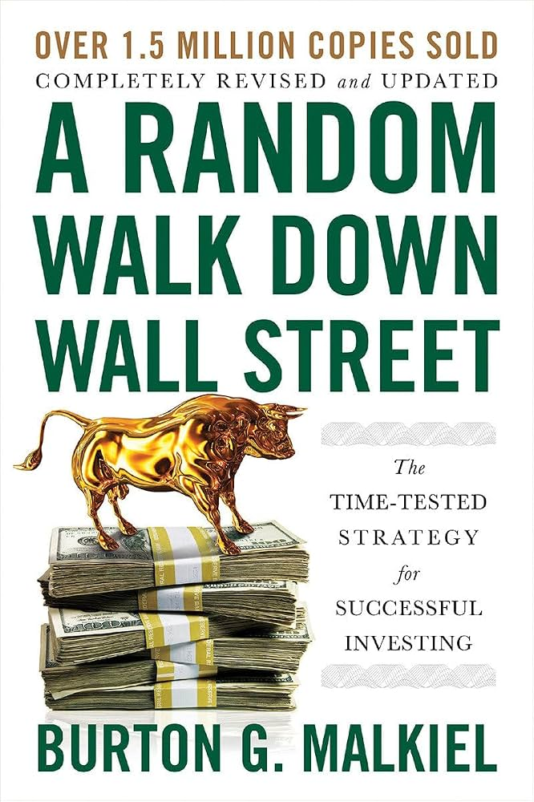

<!-- slide fragment: generated by build/gen.py -->

---

{fig-align="center"}

---

```{=html}
<div id="bm-root"></div>
<style>
  #bm-root { max-width:780px; margin:0 auto; padding:2px 0; color:#1f2933; text-align:left;
             font-family: system-ui, -apple-system, "Segoe UI", Roboto, sans-serif; font-size:16px; line-height:1.3; }
  #bm-root .bm-row { display:flex; flex-wrap:wrap; gap:10px; align-items:center; justify-content:space-between; margin-bottom:6px; }
  #bm-root .bm-seg { display:inline-flex; flex-wrap:wrap; background:#eef1f4; border-radius:9px; padding:3px; }
  #bm-root .bm-seg button { border:0; margin:0; background:transparent; padding:5px 12px; border-radius:7px; cursor:pointer;
                font-family:inherit; font-size:15px; line-height:1.2; color:#7b8794; text-transform:none; letter-spacing:normal;
                transition:background .25s, color .25s, box-shadow .25s; }
  #bm-root .bm-seg button.bm-on { background:#ffffff; color:#1f2933; box-shadow:0 1px 3px rgba(0,0,0,.14); }
  #bm-root .bm-act { display:flex; gap:10px; align-items:center; }
  #bm-root .bm-act button { border:0; margin:0; border-radius:9px; padding:8px 18px; cursor:pointer; font-family:inherit; font-size:16px;
                font-weight:600; line-height:1.2; text-transform:none; letter-spacing:normal; transition:opacity .2s, filter .2s; }
  #bm-root .bm-buy { background:#2f855a; color:#fff; }
  #bm-root .bm-skip { background:#e4e7eb; color:#323f4b; }
  #bm-root .bm-flip { background:#2b6cb0; color:#fff; }
  #bm-root .bm-again { background:#e4e7eb; color:#323f4b; }
  #bm-root .bm-act button:hover { filter:brightness(.94); }
  #bm-root .bm-act button:disabled { opacity:.35; cursor:default; filter:none; }
  #bm-root .bm-status { font-size:15px; color:#52606d; }
  #bm-root svg { width:100%; height:auto; display:block; margin:0; max-height:none; }
  #bm-root .bm-tick { font-size:12.5px; fill:#7b8794; }
  #bm-root .bm-lab { font-size:13.5px; fill:#52606d; }
  #bm-root .bm-tiles { display:flex; gap:10px; margin:4px 0; }
  #bm-root .bm-tile { flex:1; background:#f5f7fa; border-radius:9px; padding:6px 12px; }
  #bm-root .bm-tile .bm-k { font-size:13px; color:#7b8794; }
  #bm-root .bm-tile .bm-v { font-size:22px; font-weight:600; }
  #bm-root .bm-pips { display:flex; gap:6px; margin:2px 0 0; }
  #bm-root .bm-pip { flex:1; text-align:center; font-size:12.5px; border-radius:6px; padding:3px 0; background:#f5f7fa; color:#9aa5b1; }
  #bm-root .bm-note { font-size:14.5px; color:#323f4b; margin:2px 2px 0; min-height:38px; }
</style>
<script>
(function () {
  const CFG = {"assets": [{"key": "TSLA", "label": "Tesla", "name": "Tesla (TSLA)", "cur": "$", "step": 1000, "pcur": "$", "pdec": 2, "dates": ["2025-11-03", "2025-11-10", "2025-11-17", "2025-11-24", "2025-12-01", "2025-12-08", "2025-12-15", "2025-12-22", "2025-12-29", "2026-01-05", "2026-01-12", "2026-01-19", "2026-01-26", "2026-02-02", "2026-02-09", "2026-02-16", "2026-02-23", "2026-03-02", "2026-03-09", "2026-03-16", "2026-03-23", "2026-03-30", "2026-04-06", "2026-04-13", "2026-04-20", "2026-04-27", "2026-05-04", "2026-05-11", "2026-05-18", "2026-05-25", "2026-06-01", "2026-06-08", "2026-06-15", "2026-06-22", "2026-06-29", "2026-07-06", "2026-07-13", "2026-07-20", "2026-07-27", "2026-08-03", "2026-08-10", "2026-08-17", "2026-08-24", "2026-08-31", "2026-09-07", "2026-09-14", "2026-09-21", "2026-09-28", "2026-10-05", "2026-10-12"], "prices": [429.52, 404.35, 391.09, 430.17, 455.0, 458.96, 481.2, 475.19, 438.07, 445.01, 437.5, 449.06, 430.41, 411.11, 417.44, 411.82, 402.51, 396.73, 391.2, 367.96, 361.83, 360.59, 348.95, 400.62, 376.3, 390.82, 428.35, 422.24, 426.01, 435.79, 391.0, 406.43, 400.49, 379.71, 393.45, 407.76, 380.84, 313.03, 311.21, 328.58, 342.27, 362.86, 348.75, 354.08, 365.44, 364.27, 372.11, 370.59, 382.7, 354.72]}, {"key": "BTC", "label": "Bitcoin", "name": "Bitcoin (BTC-USD)", "cur": "$", "step": 1000, "pcur": "$", "pdec": 0, "dates": ["2025-11-03", "2025-11-10", "2025-11-17", "2025-11-24", "2025-12-01", "2025-12-08", "2025-12-15", "2025-12-22", "2025-12-29", "2026-01-05", "2026-01-12", "2026-01-19", "2026-01-26", "2026-02-02", "2026-02-09", "2026-02-16", "2026-02-23", "2026-03-02", "2026-03-09", "2026-03-16", "2026-03-23", "2026-03-30", "2026-04-06", "2026-04-13", "2026-04-20", "2026-04-27", "2026-05-04", "2026-05-11", "2026-05-18", "2026-05-25", "2026-06-01", "2026-06-08", "2026-06-15", "2026-06-22", "2026-06-29", "2026-07-06", "2026-07-13", "2026-07-20", "2026-07-27", "2026-08-03", "2026-08-10", "2026-08-17", "2026-08-24", "2026-08-31", "2026-09-07", "2026-09-14", "2026-09-21", "2026-09-28", "2026-10-05", "2026-10-12"], "prices": [104719.6406, 94177.0781, 86805.0078, 90394.3125, 90405.6406, 88175.1797, 88621.75, 87835.8359, 91413.4922, 90827.4609, 93634.4297, 86572.2188, 76974.4453, 70264.7266, 68788.1875, 67659.3906, 65738.1016, 65969.7812, 72789.9141, 67845.2109, 65954.9219, 68981.8984, 70753.4062, 73856.3516, 78657.5391, 78538.2266, 82138.9297, 77429.3516, 76981.125, 73579.6875, 63239.5195, 65710.3984, 63237.5391, 59532.3398, 63547.8828, 63758.2188, 64690.8047, 65340.3008, 63482.0, 64844.8867, 62818.6523, 77755.2656, 77667.5703, 80350.0469, 76838.1562, 81142.6094, 84458.0859, 86480.3047, 83679.4688, 82017.6016]}, {"key": "GOLD", "label": "Gold", "name": "Gold (futures)", "cur": "$", "step": 1000, "pcur": "$", "pdec": 0, "dates": ["2025-11-03", "2025-11-10", "2025-11-17", "2025-11-24", "2025-12-01", "2025-12-08", "2025-12-15", "2025-12-22", "2025-12-29", "2026-01-05", "2026-01-12", "2026-01-19", "2026-01-26", "2026-02-02", "2026-02-09", "2026-02-16", "2026-02-23", "2026-03-02", "2026-03-09", "2026-03-16", "2026-03-23", "2026-03-30", "2026-04-06", "2026-04-13", "2026-04-20", "2026-04-27", "2026-05-04", "2026-05-11", "2026-05-18", "2026-05-25", "2026-06-01", "2026-06-08", "2026-06-15", "2026-06-22", "2026-06-29", "2026-07-06", "2026-07-13", "2026-07-20", "2026-07-27", "2026-08-03", "2026-08-10", "2026-08-17", "2026-08-24", "2026-08-31", "2026-09-07", "2026-09-14", "2026-09-21", "2026-09-28", "2026-10-05", "2026-10-12"], "prices": [4009.8, 4094.2, 4079.5, 4254.8999, 4243.0, 4328.2998, 4387.2998, 4552.7002, 4329.6001, 4500.8999, 4595.3999, 4979.7002, 4745.1001, 4979.7998, 5046.2998, 5080.8999, 5247.8999, 5158.7002, 5061.7002, 4574.8999, 4492.5, 4679.7002, 4787.3999, 4879.6001, 4740.8999, 4644.5, 4730.7002, 4561.8999, 4523.2002, 4593.0, 4365.2998, 4238.7998, 4172.8999, 4096.2998, 4187.2998, 4113.7002, 4018.8, 4070.8, 4107.0, 4399.7002, 4437.2998, 4680.6001, 4529.8999, 4476.6001, 4408.8999, 4424.8999, 4321.2002, 4162.2998, 4216.2998, 4181.1001]}, {"key": "SPX", "label": "S&P 500", "name": "S&P 500 index", "cur": "$", "step": 1000, "pcur": "", "pdec": 0, "dates": ["2025-11-03", "2025-11-10", "2025-11-17", "2025-11-24", "2025-12-01", "2025-12-08", "2025-12-15", "2025-12-22", "2025-12-29", "2026-01-05", "2026-01-12", "2026-01-19", "2026-01-26", "2026-02-02", "2026-02-09", "2026-02-16", "2026-02-23", "2026-03-02", "2026-03-09", "2026-03-16", "2026-03-23", "2026-03-30", "2026-04-06", "2026-04-13", "2026-04-20", "2026-04-27", "2026-05-04", "2026-05-11", "2026-05-18", "2026-05-25", "2026-06-01", "2026-06-08", "2026-06-15", "2026-06-22", "2026-06-29", "2026-07-06", "2026-07-13", "2026-07-20", "2026-07-27", "2026-08-03", "2026-08-10", "2026-08-17", "2026-08-24", "2026-08-31", "2026-09-07", "2026-09-14", "2026-09-21", "2026-09-28", "2026-10-05", "2026-10-12"], "prices": [6728.7998, 6734.1099, 6602.9902, 6849.0898, 6870.3999, 6827.4102, 6834.5, 6929.9399, 6858.4702, 6966.2798, 6940.0098, 6915.6099, 6939.0298, 6932.2998, 6836.1699, 6909.5098, 6878.8799, 6740.02, 6632.1899, 6506.48, 6368.8501, 6582.6899, 6816.8901, 7126.0601, 7165.0801, 7230.1201, 7398.9302, 7408.5, 7473.4702, 7580.0601, 7383.7402, 7431.46, 7500.5801, 7354.02, 7483.2402, 7575.3901, 7457.6899, 7411.98, 7489.7202, 7757.6401, 7785.7598, 7674.3701, 7711.7598, 7718.6001, 7656.98, 7650.5, 7743.4102, 7722.7202, 7811.54, 7659.4399]}, {"key": "KZT", "label": "USD/KZT", "name": "USD/KZT exchange rate", "cur": "₸", "step": 100000, "pcur": "₸", "pdec": 1, "dates": ["2025-11-03", "2025-11-10", "2025-11-17", "2025-11-24", "2025-12-01", "2025-12-08", "2025-12-15", "2025-12-22", "2025-12-29", "2026-01-05", "2026-01-12", "2026-01-19", "2026-01-26", "2026-02-02", "2026-02-09", "2026-02-16", "2026-02-23", "2026-03-02", "2026-03-09", "2026-03-16", "2026-03-23", "2026-03-30", "2026-04-06", "2026-04-13", "2026-04-20", "2026-04-27", "2026-05-04", "2026-05-11", "2026-05-18", "2026-05-25", "2026-06-01", "2026-06-08", "2026-06-15", "2026-06-22", "2026-06-29", "2026-07-06", "2026-07-13", "2026-07-20", "2026-07-27", "2026-08-03", "2026-08-10", "2026-08-17", "2026-08-24", "2026-08-31", "2026-09-07", "2026-09-14", "2026-09-21", "2026-09-28", "2026-10-05", "2026-10-12"], "prices": [523.5279, 521.3105, 517.865, 509.2124, 503.1383, 518.1559, 514.9738, 506.6951, 504.6672, 508.3737, 509.3964, 496.9945, 504.3075, 490.7945, 492.3641, 495.4678, 494.7248, 491.5555, 487.1466, 478.0513, 480.883, 471.3328, 469.298, 466.3332, 461.1985, 460.7624, 459.5725, 467.0869, 469.7963, 480.7295, 482.7868, 474.0109, 472.7685, 470.1353, 458.2164, 456.7701, 456.9381, 460.4156, 457.4351, 452.3116, 448.5155, 445.5028, 451.0379, 440.5361, 435.7066, 431.4576, 427.9721, 432.95, 439.0007, 437.1588]}], "nHist": 40, "rounds": 10};
  const P = 'bm', root = document.getElementById(P + '-root');
  const NH = CFG.nHist, NR = CFG.rounds, NT = NH + NR;
  const W = 760, H = 340, m = { l: 66, r: 16, t: 12, b: 30 };
  const pw = W - m.l - m.r, ph = H - m.t - m.b;
  const NS = 'http://www.w3.org/2000/svg';
  const el = (t, a, p) => { const e = document.createElementNS(NS, t);
    for (const k in a) e.setAttribute(k, a[k]); if (p) p.appendChild(e); return e; };
  const ease = t => t < .5 ? 4 * t * t * t : 1 - Math.pow(-2 * t + 2, 3) / 2;
  const MON = ['Jan','Feb','Mar','Apr','May','Jun','Jul','Aug','Sep','Oct','Nov','Dec'];
  const fdate = s => { const d = s.split('-'); return MON[+d[1] - 1] + ' ' + (+d[2]) + ', ' + d[0]; };
  const fmtN = (v, dec) => v.toLocaleString('en-US', { minimumFractionDigits: dec, maximumFractionDigits: dec });
  const money = (v, A) => (v < 0 ? '−' : '') + A.cur + fmtN(Math.abs(v), 0);

  let A = CFG.assets[0], k = 0, dec = [], view = 'price', busy = false, coin = null, raf = 0;

  // ---------- controls ----------
  const r1 = document.createElement('div'); r1.className = P + '-row'; root.appendChild(r1);
  const sgA = document.createElement('div'); sgA.className = P + '-seg'; r1.appendChild(sgA);
  const bA = {};
  CFG.assets.forEach(a => { const b = document.createElement('button'); b.textContent = a.label;
    b.onclick = () => { A = a; reset(); }; bA[a.key] = b; sgA.appendChild(b); });
  const sgV = document.createElement('div'); sgV.className = P + '-seg'; r1.appendChild(sgV);
  const bV = {};
  [['price', 'Price'], ['ret', 'Weekly % change']].forEach(([key, lab]) => {
    const b = document.createElement('button'); b.textContent = lab;
    b.onclick = () => { view = key; paint(); }; bV[key] = b; sgV.appendChild(b); });

  const r2 = document.createElement('div'); r2.className = P + '-row'; root.appendChild(r2);
  const st = document.createElement('div'); st.className = P + '-status'; r2.appendChild(st);
  const act = document.createElement('div'); act.className = P + '-act'; r2.appendChild(act);
  const mk = (cls, txt, fn) => { const b = document.createElement('button'); b.className = P + '-' + cls; b.textContent = txt;
    b.onclick = fn; act.appendChild(b); return b; };
  const btnBuy = mk('buy', '', () => decide(1));
  const btnSkip = mk('skip', 'Skip', () => decide(0));
  const btnFlip = mk('flip', 'Flip a coin', () => flipCoin());
  const btnAgain = mk('again', 'Play again', () => reset());

  const svg = el('svg', { viewBox: `0 0 ${W} ${H}`, role: 'img', 'aria-label': 'Weekly price chart' }, root);
  const gStatic = el('g', {}, svg), gDyn = el('g', {}, svg);

  const tiles = document.createElement('div'); tiles.className = P + '-tiles'; root.appendChild(tiles);
  const tile = (name) => { const d = document.createElement('div'); d.className = P + '-tile';
    d.innerHTML = '<div class="bm-k">' + name + '</div><div class="bm-v">–</div>'; tiles.appendChild(d); return d.querySelector('.bm-v'); };
  const tInv = tile('Invested'), tVal = tile('Worth now'), tPnl = tile('Profit');
  const pips = document.createElement('div'); pips.className = P + '-pips'; root.appendChild(pips);
  const hsvg = el('svg', { viewBox: '0 0 ' + W + ' 150', role: 'img', 'aria-label': 'Distribution of coin-flip strategies' }, root);
  const note = document.createElement('div'); note.className = P + '-note'; root.appendChild(note);

  // ---------- helpers ----------
  const P_ = i => A.prices[i];
  const pnl = (nVis, d) => { let inv = 0, val = 0;
    d.forEach((b, j) => { if (b) { inv += A.step; val += A.step * P_(nVis - 1) / P_(NH - 1 + j); } });
    return { inv, val, pnl: val - inv }; };
  // exact enumeration of all 2^NR buy/skip strategies (= every outcome of NR fair coin flips)
  function allProfits() {
    const out = new Float64Array(1 << NR), g = [];
    for (let j = 0; j < NR; j++) g.push(A.step * (P_(NT - 1) / P_(NH - 1 + j) - 1));
    for (let s = 0; s < (1 << NR); s++) { let t = 0; for (let j = 0; j < NR; j++) if (s >> j & 1) t += g[j]; out[s] = t; }
    return out;
  }
  const xOf = i => m.l + i / (NT - 1) * pw;

  // y-domain of current view for k revealed rounds
  function domain(kk) {
    const n = NH + kk;
    if (view === 'price') {
      let lo = Infinity, hi = -Infinity;
      for (let i = 0; i < n; i++) { lo = Math.min(lo, P_(i)); hi = Math.max(hi, P_(i)); }
      const pad = (hi - lo) * 0.12 || 1; return [lo - pad, hi + pad];
    }
    let mx = 0; for (let i = 1; i < n; i++) mx = Math.max(mx, Math.abs(P_(i) / P_(i - 1) - 1));
    mx = Math.max(mx * 1.15, 0.02); return [-mx, mx];
  }
  function niceTicks(lo, hi, cnt) {
    const raw = (hi - lo) / cnt, mag = Math.pow(10, Math.floor(Math.log10(raw))), r = raw / mag;
    const step = (r < 1.5 ? 1 : r < 3.5 ? 2 : r < 7.5 ? 5 : 10) * mag, out = [];
    for (let v = Math.ceil(lo / step) * step; v <= hi + 1e-9; v += step) out.push(+v.toFixed(10));
    return { ticks: out, step };
  }

  // ---------- chart ----------
  // draws the chart with kk rounds revealed; frac in [0,1] is the progress of drawing the newest week
  function draw(dom, kk, frac) {
    gDyn.innerHTML = '';
    const sy = v => m.t + ph - (v - dom[0]) / (dom[1] - dom[0]) * ph;
    // grid + y ticks
    const nt = niceTicks(dom[0], dom[1], 5);
    nt.ticks.forEach(v => {
      el('line', { x1: m.l, x2: m.l + pw, y1: sy(v), y2: sy(v), stroke: v === 0 && view === 'ret' ? '#9aa5b1' : '#edf0f3' }, gDyn);
      const lab = view === 'price' ? (A.step >= 1000 && v >= 1000 ? fmtN(v, 0) : fmtN(v, nt.step < 1 ? 1 : 0)) : (v * 100).toFixed(0) + '%';
      el('text', { x: m.l - 8, y: sy(v) + 4, 'text-anchor': 'end', class: P + '-tick' }, gDyn).textContent = lab;
    });
    const n = NH + kk;                       // visible weeks
    const lastI = n - 1 + (frac < 1 && kk > 0 ? frac - 1 : 0);   // x-index of the drawing head
    // unknown future
    el('rect', { x: xOf(lastI), y: m.t, width: m.l + pw - xOf(lastI), height: ph, fill: '#f5f7fa' }, gDyn);
    if (kk < NR) el('text', { x: (xOf(lastI) + m.l + pw) / 2, y: m.t + ph / 2, 'text-anchor': 'middle', class: P + '-lab', fill: '#9aa5b1',
      style: 'font-size:34px;fill:#cbd2d9;font-weight:600' }, gDyn).textContent = '?';
    // start-of-game line
    el('line', { x1: xOf(NH - 1), x2: xOf(NH - 1), y1: m.t, y2: m.t + ph, stroke: '#9aa5b1', 'stroke-dasharray': '4 4' }, gDyn);
    el('text', { x: xOf(NH - 1) - 6, y: m.t + 12, 'text-anchor': 'end', class: P + '-tick' }, gDyn).textContent = 'history';
    el('text', { x: xOf(NH - 1) + 6, y: m.t + 12, class: P + '-tick' }, gDyn).textContent = 'game';
    if (view === 'price') {
      const pts = [];
      for (let i = 0; i < n; i++) {
        const isHead = i === n - 1 && frac < 1 && kk > 0;
        const x = isHead ? xOf(i - 1 + frac) : xOf(i);
        const v = isHead ? P_(i - 1) + (P_(i) - P_(i - 1)) * frac : P_(i);
        pts.push([x, sy(v)]);
      }
      const hist = pts.slice(0, Math.min(n, NH)), play = pts.slice(NH - 1);
      el('polyline', { points: hist.map(p => p.join(',')).join(' '), fill: 'none', stroke: '#2b6cb0', 'stroke-width': 2.2, 'stroke-linejoin': 'round' }, gDyn);
      if (play.length > 1) el('polyline', { points: play.map(p => p.join(',')).join(' '), fill: 'none', stroke: '#1a365d', 'stroke-width': 2.8, 'stroke-linejoin': 'round' }, gDyn);
      // decision markers
      dec.forEach((b, j) => { const p = pts[NH - 1 + j];
        if (b) el('path', { d: `M${p[0]},${p[1] - 11} l7,13 h-14 z`, fill: '#2f855a', stroke: '#fff', 'stroke-width': 1 }, gDyn);
        else { el('line', { x1: p[0] - 5, x2: p[0] + 5, y1: p[1] - 5, y2: p[1] + 5, stroke: '#7b8794', 'stroke-width': 2.2 }, gDyn);
               el('line', { x1: p[0] - 5, x2: p[0] + 5, y1: p[1] + 5, y2: p[1] - 5, stroke: '#7b8794', 'stroke-width': 2.2 }, gDyn); } });
      const hd = pts[pts.length - 1];
      if (kk < NR && frac >= 1) el('circle', { cx: hd[0], cy: hd[1], r: 7, fill: 'none', stroke: '#c05621', 'stroke-width': 2.5 }, gDyn);
      else el('circle', { cx: hd[0], cy: hd[1], r: 3.5, fill: '#1a365d' }, gDyn);
    } else {
      const bw = Math.max(3, pw / NT * 0.7);
      for (let i = 1; i < n; i++) {
        const grow = (i === n - 1 && frac < 1 && kk > 0) ? frac : 1;
        const r = (P_(i) / P_(i - 1) - 1) * grow, y0 = sy(0), y1 = sy(r);
        el('rect', { x: xOf(i) - bw / 2, y: Math.min(y0, y1), width: bw, height: Math.max(1, Math.abs(y1 - y0)),
          fill: r >= 0 ? (i >= NH ? '#1a365d' : '#2b6cb0') : (i >= NH ? '#9c4221' : '#dd8a5a'), opacity: i >= NH ? 1 : 0.8 }, gDyn);
      }
    }
    // x ticks: a label every 8 weeks
    for (let i = 0; i < NT; i += 8) {
      const d = A.dates[i].split('-');
      el('text', { x: xOf(i), y: m.t + ph + 18, 'text-anchor': 'middle', class: P + '-tick' }, gDyn).textContent = MON[+d[1] - 1] + " '" + d[0].slice(2);
    }
    el('line', { x1: m.l, x2: m.l + pw, y1: m.t + ph, y2: m.t + ph, stroke: '#9aa5b1' }, gDyn);
  }

  let curDom = null;
  function paint() {
    for (const key in bV) bV[key].classList.toggle(P + '-on', key === view);
    curDom = domain(k); draw(curDom, k, 1); panels();
  }

  // ---------- ledger / pips / end screen ----------
  function panels() {
    for (const key in bA) bA[key].classList.toggle(P + '-on', key === A.key);
    const done = k >= NR, nVis = NH + k, L = pnl(nVis, dec);
    tInv.textContent = money(L.inv, A);
    tVal.textContent = money(L.val, A);
    tPnl.textContent = (L.pnl > 0.5 ? '+' : '') + money(L.pnl, A);
    tPnl.style.color = L.pnl > 0.5 ? '#2f855a' : L.pnl < -0.5 ? '#c05621' : '#1f2933';
    btnBuy.textContent = 'Buy ' + A.cur + fmtN(A.step, 0);
    btnBuy.style.display = btnSkip.style.display = done ? 'none' : '';
    btnFlip.style.display = btnAgain.style.display = done ? '' : 'none';
    btnBuy.disabled = btnSkip.disabled = busy;
    st.innerHTML = done ? '<b>' + A.name + '</b> · week of ' + fdate(A.dates[NT - 1])
      : '<b>' + A.name + '</b> · week of ' + fdate(A.dates[nVis - 1]) + ' · price <b>' + A.pcur + fmtN(P_(nVis - 1), A.pdec) + '</b>'
        + ' · round ' + (k + 1) + ' of ' + NR;
    pips.innerHTML = '';
    for (let j = 0; j < NR; j++) {
      const d = document.createElement('div'); d.className = P + '-pip';
      if (j < k) { const r = P_(NH + j) / P_(NH - 1 + j) - 1;
        d.textContent = (dec[j] ? 'bought ' : 'skipped ') + (r >= 0 ? '+' : '−') + Math.abs(r * 100).toFixed(1) + '%';
        d.style.background = dec[j] ? (r >= 0 ? '#c6f6d5' : '#fed7c3') : '#e4e7eb';
        d.style.color = '#1f2933';
      } else d.textContent = 'week ' + (j + 1);
      pips.appendChild(d);
    }
    pips.style.display = done ? 'none' : 'flex';
    hsvg.style.display = done ? '' : 'none';
    if (done) endScreen(L); else {
      hsvg.innerHTML = '';
      note.textContent = k === 0 ? 'Looking at the last 40 weeks, would you put ' + A.cur + fmtN(A.step, 0) + ' into ' + A.name + ' this week?'
        : 'Each week you either buy a fixed amount at the current price or skip. Next week’s price is revealed after you decide.';
    }
  }

  function endScreen(L) {
    const prof = allProfits(), N = prof.length;
    let lo = Infinity, hi = -Infinity, sum = 0;
    for (const v of prof) { lo = Math.min(lo, v); hi = Math.max(hi, v); sum += v; }
    const mean = sum / N;
    let less = 0, eq = 0; for (const v of prof) { if (v < L.pnl - 1e-9) less++; else if (Math.abs(v - L.pnl) <= 1e-9) eq++; }
    const pct = (less + eq / 2) / N * 100;
    // histogram
    const HW = 760, HH = 150, hm = { l: 16, r: 16, t: 20, b: 34 };
    const span = (hi - lo) || 1, NB = 26, cnt = new Array(NB).fill(0);
    for (const v of prof) cnt[Math.min(NB - 1, Math.floor((v - lo) / span * NB))]++;
    const cm = Math.max(...cnt), hx = v => hm.l + (v - lo) / span * (HW - hm.l - hm.r),
          hy = c => HH - hm.b - c / cm * (HH - hm.b - hm.t);
    hsvg.innerHTML = '';
    cnt.forEach((c, i) => el('rect', { x: hm.l + i / NB * (HW - hm.l - hm.r) + 1, y: hy(c), width: (HW - hm.l - hm.r) / NB - 2,
      height: HH - hm.b - hy(c), fill: '#cbd5e0' }, hsvg));
    el('line', { x1: hm.l, x2: HW - hm.r, y1: HH - hm.b, y2: HH - hm.b, stroke: '#9aa5b1' }, hsvg);
    niceTicks(lo, hi, 5).ticks.forEach(v => { if (v < lo || v > hi) return;
      el('text', { x: hx(v), y: HH - hm.b + 14, 'text-anchor': 'middle', class: P + '-tick' }, hsvg).textContent = (v > 0 ? '+' : '') + money(v, A).replace('−', '−'); });
    el('text', { x: HW / 2, y: HH - 4, 'text-anchor': 'middle', class: P + '-lab' }, hsvg).textContent =
      'Profit of each of the ' + N.toLocaleString('en-US') + ' possible coin-flip strategies';
    const mark = (v, col, lab, dash, dy, anchor) => {
      el('line', { x1: hx(v), x2: hx(v), y1: hm.t - 4, y2: HH - hm.b, stroke: col, 'stroke-width': 2.6, 'stroke-dasharray': dash || '' }, hsvg);
      el('text', { x: hx(v) + (anchor === 'end' ? -4 : 4), y: hm.t + dy, 'text-anchor': anchor || 'start', style: 'font-size:13px;font-weight:600;fill:' + col }, hsvg).textContent = lab; };
    const left = hx(L.pnl) < hx(mean);
    mark(mean, '#52606d', 'average coin-flipper', '5 4', 4, left ? 'start' : 'end');
    mark(L.pnl, '#c05621', 'you', '', 4, left ? 'end' : 'start');
    if (coin !== null) mark(coin, '#2b6cb0', 'coin flip', '2 3', 18, coin < L.pnl ? 'end' : 'start');
    let buyAll = 0; for (let j = 0; j < NR; j++) buyAll += A.step * (P_(NT - 1) / P_(NH - 1 + j) - 1);
    const nb = dec.reduce((a, b) => a + b, 0);
    note.innerHTML = 'You bought in <b>' + nb + '</b> of ' + NR + ' weeks and made <b>' + (L.pnl > 0.5 ? '+' : '') + money(L.pnl, A) + '</b>. '
      + 'Buying every week would have made ' + (buyAll > 0 ? '+' : '') + money(buyAll, A) + '. '
      + 'You did better than <b>' + pct.toFixed(0) + '%</b> of coin-flip strategies'
      + (coin !== null ? '; this flip made ' + (coin > 0 ? '+' : '') + money(coin, A) + '.' : '.');
  }

  function flipCoin() {
    const g = []; for (let j = 0; j < NR; j++) g.push(A.step * (P_(NT - 1) / P_(NH - 1 + j) - 1));
    coin = 0; for (let j = 0; j < NR; j++) if (Math.random() < 0.5) coin += g[j];
    panels();
  }

  // ---------- game flow ----------
  function decide(b) {
    if (busy || k >= NR) return;
    dec.push(b); busy = true;
    const from = curDom, to = domain(k + 1), t0 = performance.now(), dur = 650;
    cancelAnimationFrame(raf);
    const step = now => {
      const u = Math.min(1, (now - t0) / dur), e = ease(u);
      const dm = [from[0] + (to[0] - from[0]) * e, from[1] + (to[1] - from[1]) * e];
      draw(dm, k + 1, e);
      if (u < 1) raf = requestAnimationFrame(step);
      else { k++; busy = false; curDom = to; coin = null; draw(curDom, k, 1); panels(); }
    };
    btnBuy.disabled = btnSkip.disabled = true;
    raf = requestAnimationFrame(step);
  }
  function reset() { cancelAnimationFrame(raf); k = 0; dec = []; busy = false; coin = null; paint(); }

  // static axis title
  el('text', { x: 14, y: m.t + ph / 2, 'text-anchor': 'middle', class: P + '-lab',
    transform: `rotate(-90 14 ${m.t + ph / 2})` }, gStatic).textContent = '';
  reset();
})();
</script>
```

---

```{=html}
<div id="st-root"></div>
<style>
  #st-root { max-width:780px; margin:0 auto; padding:2px 0; color:#1f2933; text-align:left;
             font-family: system-ui, -apple-system, "Segoe UI", Roboto, sans-serif; font-size:16px; line-height:1.3; }
  #st-root .st-row { display:flex; flex-wrap:wrap; gap:10px; align-items:center; justify-content:space-between; margin-bottom:8px; }
  #st-root .st-seg { display:inline-flex; flex-wrap:wrap; background:#eef1f4; border-radius:9px; padding:3px; }
  #st-root .st-seg button { border:0; margin:0; background:transparent; padding:5px 12px; border-radius:7px; cursor:pointer;
                font-family:inherit; font-size:15px; line-height:1.2; color:#7b8794; text-transform:none; letter-spacing:normal;
                transition:background .25s, color .25s, box-shadow .25s; }
  #st-root .st-seg button.st-on { background:#ffffff; color:#1f2933; box-shadow:0 1px 3px rgba(0,0,0,.14); }
  #st-root .st-chk { font-size:14.5px; color:#52606d; display:flex; align-items:center; gap:6px; cursor:pointer; user-select:none; }
  #st-root .st-body { display:flex; gap:14px; align-items:flex-start; }
  #st-root .st-chart { flex:1.75; min-width:0; }
  #st-root .st-side { flex:1; min-width:0; }
  #st-root svg { width:100%; height:auto; display:block; margin:0; max-height:none; }
  #st-root .st-tick { font-size:12.5px; fill:#7b8794; }
  #st-root .st-lab { font-size:13.5px; fill:#52606d; }
  #st-root table { border-collapse:collapse; width:100%; font-size:14px; margin:0; }
  #st-root th { font-weight:500; color:#7b8794; text-align:right; padding:2px 4px; border:0; font-size:13px; background:none; }
  #st-root td { text-align:right; padding:4px; border:0; border-top:1px solid #edf0f3; background:none; white-space:nowrap; }
  #st-root th:first-child, #st-root td:first-child { text-align:left; }
  #st-root .st-sw { display:inline-block; width:11px; height:11px; border-radius:3px; margin-right:6px; vertical-align:-1px; }
  #st-root .st-note { font-size:14.5px; color:#323f4b; margin:8px 2px 0; min-height:40px; }
  #st-root .st-sub { font-size:12px; color:#9aa5b1; }
</style>
<script>
(function () {
  const CFG = {"assets": [{"key": "TSLA", "label": "Tesla", "name": "Tesla (TSLA)", "cur": "$", "step": 1000, "pcur": "$", "pdec": 2, "dates": ["2021-10-18", "2021-10-25", "2021-11-01", "2021-11-08", "2021-11-15", "2021-11-22", "2021-11-29", "2021-12-06", "2021-12-13", "2021-12-20", "2021-12-27", "2022-01-03", "2022-01-10", "2022-01-17", "2022-01-24", "2022-01-31", "2022-02-07", "2022-02-14", "2022-02-21", "2022-02-28", "2022-03-07", "2022-03-14", "2022-03-21", "2022-03-28", "2022-04-04", "2022-04-11", "2022-04-18", "2022-04-25", "2022-05-02", "2022-05-09", "2022-05-16", "2022-05-23", "2022-05-30", "2022-06-06", "2022-06-13", "2022-06-20", "2022-06-27", "2022-07-04", "2022-07-11", "2022-07-18", "2022-07-25", "2022-08-01", "2022-08-08", "2022-08-15", "2022-08-22", "2022-08-29", "2022-09-05", "2022-09-12", "2022-09-19", "2022-09-26", "2022-10-03", "2022-10-10", "2022-10-17", "2022-10-24", "2022-10-31", "2022-11-07", "2022-11-14", "2022-11-21", "2022-11-28", "2022-12-05", "2022-12-12", "2022-12-19", "2022-12-26", "2023-01-02", "2023-01-09", "2023-01-16", "2023-01-23", "2023-01-30", "2023-02-06", "2023-02-13", "2023-02-20", "2023-02-27", "2023-03-06", "2023-03-13", "2023-03-20", "2023-03-27", "2023-04-03", "2023-04-10", "2023-04-17", "2023-04-24", "2023-05-01", "2023-05-08", "2023-05-15", "2023-05-22", "2023-05-29", "2023-06-05", "2023-06-12", "2023-06-19", "2023-06-26", "2023-07-03", "2023-07-10", "2023-07-17", "2023-07-24", "2023-07-31", "2023-08-07", "2023-08-14", "2023-08-21", "2023-08-28", "2023-09-04", "2023-09-11", "2023-09-18", "2023-09-25", "2023-10-02", "2023-10-09", "2023-10-16", "2023-10-23", "2023-10-30", "2023-11-06", "2023-11-13", "2023-11-20", "2023-11-27", "2023-12-04", "2023-12-11", "2023-12-18", "2023-12-25", "2024-01-01", "2024-01-08", "2024-01-15", "2024-01-22", "2024-01-29", "2024-02-05", "2024-02-12", "2024-02-19", "2024-02-26", "2024-03-04", "2024-03-11", "2024-03-18", "2024-03-25", "2024-04-01", "2024-04-08", "2024-04-15", "2024-04-22", "2024-04-29", "2024-05-06", "2024-05-13", "2024-05-20", "2024-05-27", "2024-06-03", "2024-06-10", "2024-06-17", "2024-06-24", "2024-07-01", "2024-07-08", "2024-07-15", "2024-07-22", "2024-07-29", "2024-08-05", "2024-08-12", "2024-08-19", "2024-08-26", "2024-09-02", "2024-09-09", "2024-09-16", "2024-09-23", "2024-09-30", "2024-10-07", "2024-10-14", "2024-10-21", "2024-10-28", "2024-11-04", "2024-11-11", "2024-11-18", "2024-11-25", "2024-12-02", "2024-12-09", "2024-12-16", "2024-12-23", "2024-12-30", "2025-01-06", "2025-01-13", "2025-01-20", "2025-01-27", "2025-02-03", "2025-02-10", "2025-02-17", "2025-02-24", "2025-03-03", "2025-03-10", "2025-03-17", "2025-03-24", "2025-03-31", "2025-04-07", "2025-04-14", "2025-04-21", "2025-04-28", "2025-05-05", "2025-05-12", "2025-05-19", "2025-05-26", "2025-06-02", "2025-06-09", "2025-06-16", "2025-06-23", "2025-06-30", "2025-07-07", "2025-07-14", "2025-07-21", "2025-07-28", "2025-08-04", "2025-08-11", "2025-08-18", "2025-08-25", "2025-09-01", "2025-09-08", "2025-09-15", "2025-09-22", "2025-09-29", "2025-10-06", "2025-10-13", "2025-10-20", "2025-10-27", "2025-11-03", "2025-11-10", "2025-11-17", "2025-11-24", "2025-12-01", "2025-12-08", "2025-12-15", "2025-12-22", "2025-12-29", "2026-01-05", "2026-01-12", "2026-01-19", "2026-01-26", "2026-02-02", "2026-02-09", "2026-02-16", "2026-02-23", "2026-03-02", "2026-03-09", "2026-03-16", "2026-03-23", "2026-03-30", "2026-04-06", "2026-04-13", "2026-04-20", "2026-04-27", "2026-05-04", "2026-05-11", "2026-05-18", "2026-05-25", "2026-06-01", "2026-06-08", "2026-06-15", "2026-06-22", "2026-06-29", "2026-07-06", "2026-07-13", "2026-07-20", "2026-07-27", "2026-08-03", "2026-08-10", "2026-08-17", "2026-08-24", "2026-08-31", "2026-09-07", "2026-09-14", "2026-09-21", "2026-09-28", "2026-10-05", "2026-10-12"], "prices": [303.2267, 371.3333, 407.3633, 344.4733, 379.02, 360.64, 338.3233, 339.01, 310.8567, 355.6667, 352.26, 342.32, 349.87, 314.6333, 282.1167, 307.7733, 286.6667, 285.66, 269.9567, 279.43, 265.1167, 301.7967, 336.88, 361.53, 341.83, 328.3333, 335.0167, 290.2533, 288.55, 256.53, 221.3, 253.21, 234.5167, 232.23, 216.76, 245.7067, 227.2633, 250.7633, 240.0667, 272.2433, 297.15, 288.17, 300.03, 296.6667, 288.09, 270.21, 299.68, 303.35, 275.33, 265.25, 223.07, 204.99, 214.44, 228.52, 207.47, 195.97, 180.19, 182.86, 194.86, 179.05, 150.23, 123.15, 123.18, 113.06, 122.4, 133.42, 177.9, 189.98, 196.89, 208.31, 196.88, 197.79, 173.44, 180.13, 190.41, 207.46, 185.06, 185.0, 165.08, 164.31, 170.06, 167.98, 180.14, 193.17, 213.97, 244.4, 260.54, 256.6, 261.77, 274.43, 281.38, 260.02, 266.44, 253.86, 242.65, 215.49, 238.59, 245.01, 248.5, 274.39, 244.88, 250.22, 260.53, 251.12, 211.99, 207.3, 219.96, 214.65, 234.3, 235.45, 238.83, 243.84, 253.5, 252.54, 248.48, 237.49, 218.89, 212.19, 183.25, 187.91, 193.57, 199.95, 191.97, 202.64, 175.34, 163.57, 170.83, 175.79, 164.9, 171.05, 147.05, 168.29, 181.19, 168.47, 177.46, 179.24, 178.08, 177.48, 178.01, 183.01, 197.88, 251.52, 248.23, 239.2, 219.8, 207.67, 200.0, 216.12, 220.32, 214.11, 210.73, 230.29, 238.25, 260.46, 250.08, 217.8, 220.7, 269.19, 248.98, 321.22, 320.72, 352.56, 345.16, 389.22, 436.23, 421.06, 431.66, 410.44, 394.74, 426.5, 406.58, 404.6, 361.62, 355.84, 337.8, 292.98, 262.67, 249.98, 248.71, 263.55, 239.43, 252.31, 241.37, 284.95, 287.21, 298.26, 349.98, 339.34, 346.46, 295.14, 325.31, 322.16, 323.63, 315.35, 313.51, 329.65, 316.06, 302.63, 329.65, 330.56, 340.01, 333.87, 350.84, 395.94, 426.07, 440.4, 429.83, 413.49, 439.31, 433.72, 456.56, 429.52, 404.35, 391.09, 430.17, 455.0, 458.96, 481.2, 475.19, 438.07, 445.01, 437.5, 449.06, 430.41, 411.11, 417.44, 411.82, 402.51, 396.73, 391.2, 367.96, 361.83, 360.59, 348.95, 400.62, 376.3, 390.82, 428.35, 422.24, 426.01, 435.79, 391.0, 406.43, 400.49, 379.71, 393.45, 407.76, 380.84, 313.03, 311.21, 328.58, 342.27, 362.86, 348.75, 354.08, 365.44, 364.27, 372.11, 370.59, 382.7, 354.72]}, {"key": "BTC", "label": "Bitcoin", "name": "Bitcoin (BTC-USD)", "cur": "$", "step": 1000, "pcur": "$", "pdec": 0, "dates": ["2021-10-18", "2021-10-25", "2021-11-01", "2021-11-08", "2021-11-15", "2021-11-22", "2021-11-29", "2021-12-06", "2021-12-13", "2021-12-20", "2021-12-27", "2022-01-03", "2022-01-10", "2022-01-17", "2022-01-24", "2022-01-31", "2022-02-07", "2022-02-14", "2022-02-21", "2022-02-28", "2022-03-07", "2022-03-14", "2022-03-21", "2022-03-28", "2022-04-04", "2022-04-11", "2022-04-18", "2022-04-25", "2022-05-02", "2022-05-09", "2022-05-16", "2022-05-23", "2022-05-30", "2022-06-06", "2022-06-13", "2022-06-20", "2022-06-27", "2022-07-04", "2022-07-11", "2022-07-18", "2022-07-25", "2022-08-01", "2022-08-08", "2022-08-15", "2022-08-22", "2022-08-29", "2022-09-05", "2022-09-12", "2022-09-19", "2022-09-26", "2022-10-03", "2022-10-10", "2022-10-17", "2022-10-24", "2022-10-31", "2022-11-07", "2022-11-14", "2022-11-21", "2022-11-28", "2022-12-05", "2022-12-12", "2022-12-19", "2022-12-26", "2023-01-02", "2023-01-09", "2023-01-16", "2023-01-23", "2023-01-30", "2023-02-06", "2023-02-13", "2023-02-20", "2023-02-27", "2023-03-06", "2023-03-13", "2023-03-20", "2023-03-27", "2023-04-03", "2023-04-10", "2023-04-17", "2023-04-24", "2023-05-01", "2023-05-08", "2023-05-15", "2023-05-22", "2023-05-29", "2023-06-05", "2023-06-12", "2023-06-19", "2023-06-26", "2023-07-03", "2023-07-10", "2023-07-17", "2023-07-24", "2023-07-31", "2023-08-07", "2023-08-14", "2023-08-21", "2023-08-28", "2023-09-04", "2023-09-11", "2023-09-18", "2023-09-25", "2023-10-02", "2023-10-09", "2023-10-16", "2023-10-23", "2023-10-30", "2023-11-06", "2023-11-13", "2023-11-20", "2023-11-27", "2023-12-04", "2023-12-11", "2023-12-18", "2023-12-25", "2024-01-01", "2024-01-08", "2024-01-15", "2024-01-22", "2024-01-29", "2024-02-05", "2024-02-12", "2024-02-19", "2024-02-26", "2024-03-04", "2024-03-11", "2024-03-18", "2024-03-25", "2024-04-01", "2024-04-08", "2024-04-15", "2024-04-22", "2024-04-29", "2024-05-06", "2024-05-13", "2024-05-20", "2024-05-27", "2024-06-03", "2024-06-10", "2024-06-17", "2024-06-24", "2024-07-01", "2024-07-08", "2024-07-15", "2024-07-22", "2024-07-29", "2024-08-05", "2024-08-12", "2024-08-19", "2024-08-26", "2024-09-02", "2024-09-09", "2024-09-16", "2024-09-23", "2024-09-30", "2024-10-07", "2024-10-14", "2024-10-21", "2024-10-28", "2024-11-04", "2024-11-11", "2024-11-18", "2024-11-25", "2024-12-02", "2024-12-09", "2024-12-16", "2024-12-23", "2024-12-30", "2025-01-06", "2025-01-13", "2025-01-20", "2025-01-27", "2025-02-03", "2025-02-10", "2025-02-17", "2025-02-24", "2025-03-03", "2025-03-10", "2025-03-17", "2025-03-24", "2025-03-31", "2025-04-07", "2025-04-14", "2025-04-21", "2025-04-28", "2025-05-05", "2025-05-12", "2025-05-19", "2025-05-26", "2025-06-02", "2025-06-09", "2025-06-16", "2025-06-23", "2025-06-30", "2025-07-07", "2025-07-14", "2025-07-21", "2025-07-28", "2025-08-04", "2025-08-11", "2025-08-18", "2025-08-25", "2025-09-01", "2025-09-08", "2025-09-15", "2025-09-22", "2025-09-29", "2025-10-06", "2025-10-13", "2025-10-20", "2025-10-27", "2025-11-03", "2025-11-10", "2025-11-17", "2025-11-24", "2025-12-01", "2025-12-08", "2025-12-15", "2025-12-22", "2025-12-29", "2026-01-05", "2026-01-12", "2026-01-19", "2026-01-26", "2026-02-02", "2026-02-09", "2026-02-16", "2026-02-23", "2026-03-02", "2026-03-09", "2026-03-16", "2026-03-23", "2026-03-30", "2026-04-06", "2026-04-13", "2026-04-20", "2026-04-27", "2026-05-04", "2026-05-11", "2026-05-18", "2026-05-25", "2026-06-01", "2026-06-08", "2026-06-15", "2026-06-22", "2026-06-29", "2026-07-06", "2026-07-13", "2026-07-20", "2026-07-27", "2026-08-03", "2026-08-10", "2026-08-17", "2026-08-24", "2026-08-31", "2026-09-07", "2026-09-14", "2026-09-21", "2026-09-28", "2026-10-05", "2026-10-12"], "prices": [60930.8359, 61318.957, 63326.9883, 65466.8398, 58730.4766, 57248.457, 49368.8477, 50098.3359, 46707.0156, 50809.5156, 47345.2188, 41911.6016, 43113.8789, 36276.8047, 37917.6016, 42412.4336, 42197.5156, 38431.3789, 37709.7852, 38419.9844, 37849.6641, 41247.8242, 46820.4922, 46453.5664, 42207.6719, 39716.9531, 39469.293, 38469.0938, 34059.2656, 31305.1133, 30323.7227, 29445.957, 29906.6621, 26762.6484, 20553.2715, 21027.2949, 19297.0762, 20860.4492, 20779.3438, 22609.1641, 23336.8965, 23175.8906, 24319.334, 21534.1211, 19616.8145, 19986.7129, 21769.2559, 19419.5059, 18802.0977, 19044.1074, 19446.4258, 19268.0938, 19567.0078, 20635.6035, 20926.4863, 16353.3652, 16291.832, 16444.627, 17130.4863, 17104.1934, 16757.9766, 16841.9863, 16625.0801, 17091.1445, 20880.7988, 22720.416, 23774.5664, 22955.666, 21788.2031, 24327.6426, 23561.2129, 22435.5137, 22163.9492, 28038.6758, 27994.3301, 28199.3086, 28333.0508, 30315.3555, 27591.3848, 29268.8066, 28454.9785, 26930.6387, 26753.8262, 28085.6465, 27119.0664, 25940.168, 26336.2129, 30480.2617, 30620.7695, 30171.2344, 30249.1328, 30084.5391, 29275.3086, 29041.8555, 29282.9141, 26189.584, 26089.6934, 25969.5664, 25832.2266, 26534.1875, 26256.8262, 27983.75, 27935.0898, 27159.6523, 29993.8965, 34538.4805, 35049.3555, 37054.5195, 37386.5469, 37479.1211, 39978.3906, 43779.6992, 41364.6641, 43016.1172, 42265.1875, 43943.0977, 41796.2695, 41545.7852, 42035.5938, 42583.582, 48293.918, 52122.5469, 51733.2383, 63167.3711, 69019.7891, 68390.625, 67234.1719, 71333.6484, 69362.5547, 65738.7266, 64926.6445, 63113.2305, 64031.1328, 61448.3945, 66278.3672, 68518.0938, 67751.6016, 69647.9922, 66639.0469, 63180.7969, 62678.293, 55849.1094, 60787.793, 68154.5234, 68255.8672, 58116.9766, 58719.4844, 58483.9648, 64333.543, 57325.4883, 54841.5664, 59182.8359, 63648.7109, 65635.3047, 62818.9531, 62851.375, 69001.7031, 67929.2969, 68741.1172, 80474.1875, 89845.8516, 98013.8203, 97279.7891, 101236.0156, 104298.6953, 95104.9375, 93530.2266, 98314.9609, 94488.4375, 101089.6094, 102682.5, 97688.9766, 96500.0938, 96175.0312, 96273.9219, 94248.3516, 80601.0391, 82579.6875, 86054.375, 82334.5234, 78214.4844, 83684.9766, 85174.3047, 93754.8438, 94315.9766, 104106.3594, 106446.0078, 109035.3906, 105652.1016, 105793.6484, 105552.0234, 100987.1406, 108385.5703, 109232.0703, 119116.1172, 117300.7891, 119448.4922, 114217.6719, 119306.7578, 117453.0625, 113458.4297, 108236.7109, 111167.6172, 115407.6562, 115306.0938, 112122.6406, 123513.4766, 115169.7656, 108666.7109, 114472.4453, 110639.625, 104719.6406, 94177.0781, 86805.0078, 90394.3125, 90405.6406, 88175.1797, 88621.75, 87835.8359, 91413.4922, 90827.4609, 93634.4297, 86572.2188, 76974.4453, 70264.7266, 68788.1875, 67659.3906, 65738.1016, 65969.7812, 72789.9141, 67845.2109, 65954.9219, 68981.8984, 70753.4062, 73856.3516, 78657.5391, 78538.2266, 82138.9297, 77429.3516, 76981.125, 73579.6875, 63239.5195, 65710.3984, 63237.5391, 59532.3398, 63547.8828, 63758.2188, 64690.8047, 65340.3008, 63482.0, 64844.8867, 62818.6523, 77755.2656, 77667.5703, 80350.0469, 76838.1562, 81142.6094, 84458.0859, 86480.3047, 83679.4688, 82017.6016]}, {"key": "GOLD", "label": "Gold", "name": "Gold (futures)", "cur": "$", "step": 1000, "pcur": "$", "pdec": 0, "dates": ["2021-10-18", "2021-10-25", "2021-11-01", "2021-11-08", "2021-11-15", "2021-11-22", "2021-11-29", "2021-12-06", "2021-12-13", "2021-12-20", "2021-12-27", "2022-01-03", "2022-01-10", "2022-01-17", "2022-01-24", "2022-01-31", "2022-02-07", "2022-02-14", "2022-02-21", "2022-02-28", "2022-03-07", "2022-03-14", "2022-03-21", "2022-03-28", "2022-04-04", "2022-04-11", "2022-04-18", "2022-04-25", "2022-05-02", "2022-05-09", "2022-05-16", "2022-05-23", "2022-05-30", "2022-06-06", "2022-06-13", "2022-06-20", "2022-06-27", "2022-07-04", "2022-07-11", "2022-07-18", "2022-07-25", "2022-08-01", "2022-08-08", "2022-08-15", "2022-08-22", "2022-08-29", "2022-09-05", "2022-09-12", "2022-09-19", "2022-09-26", "2022-10-03", "2022-10-10", "2022-10-17", "2022-10-24", "2022-10-31", "2022-11-07", "2022-11-14", "2022-11-21", "2022-11-28", "2022-12-05", "2022-12-12", "2022-12-19", "2022-12-26", "2023-01-02", "2023-01-09", "2023-01-16", "2023-01-23", "2023-01-30", "2023-02-06", "2023-02-13", "2023-02-20", "2023-02-27", "2023-03-06", "2023-03-13", "2023-03-20", "2023-03-27", "2023-04-03", "2023-04-10", "2023-04-17", "2023-04-24", "2023-05-01", "2023-05-08", "2023-05-15", "2023-05-22", "2023-05-29", "2023-06-05", "2023-06-12", "2023-06-19", "2023-06-26", "2023-07-03", "2023-07-10", "2023-07-17", "2023-07-24", "2023-07-31", "2023-08-07", "2023-08-14", "2023-08-21", "2023-08-28", "2023-09-04", "2023-09-11", "2023-09-18", "2023-09-25", "2023-10-02", "2023-10-09", "2023-10-16", "2023-10-23", "2023-10-30", "2023-11-06", "2023-11-13", "2023-11-20", "2023-11-27", "2023-12-04", "2023-12-11", "2023-12-18", "2023-12-25", "2024-01-01", "2024-01-08", "2024-01-15", "2024-01-22", "2024-01-29", "2024-02-05", "2024-02-12", "2024-02-19", "2024-02-26", "2024-03-04", "2024-03-11", "2024-03-18", "2024-03-25", "2024-04-01", "2024-04-08", "2024-04-15", "2024-04-22", "2024-04-29", "2024-05-06", "2024-05-13", "2024-05-20", "2024-05-27", "2024-06-03", "2024-06-10", "2024-06-17", "2024-06-24", "2024-07-01", "2024-07-08", "2024-07-15", "2024-07-22", "2024-07-29", "2024-08-05", "2024-08-12", "2024-08-19", "2024-08-26", "2024-09-02", "2024-09-09", "2024-09-16", "2024-09-23", "2024-09-30", "2024-10-07", "2024-10-14", "2024-10-21", "2024-10-28", "2024-11-04", "2024-11-11", "2024-11-18", "2024-11-25", "2024-12-02", "2024-12-09", "2024-12-16", "2024-12-23", "2024-12-30", "2025-01-06", "2025-01-13", "2025-01-20", "2025-01-27", "2025-02-03", "2025-02-10", "2025-02-17", "2025-02-24", "2025-03-03", "2025-03-10", "2025-03-17", "2025-03-24", "2025-03-31", "2025-04-07", "2025-04-14", "2025-04-21", "2025-04-28", "2025-05-05", "2025-05-12", "2025-05-19", "2025-05-26", "2025-06-02", "2025-06-09", "2025-06-16", "2025-06-23", "2025-06-30", "2025-07-07", "2025-07-14", "2025-07-21", "2025-07-28", "2025-08-04", "2025-08-11", "2025-08-18", "2025-08-25", "2025-09-01", "2025-09-08", "2025-09-15", "2025-09-22", "2025-09-29", "2025-10-06", "2025-10-13", "2025-10-20", "2025-10-27", "2025-11-03", "2025-11-10", "2025-11-17", "2025-11-24", "2025-12-01", "2025-12-08", "2025-12-15", "2025-12-22", "2025-12-29", "2026-01-05", "2026-01-12", "2026-01-19", "2026-01-26", "2026-02-02", "2026-02-09", "2026-02-16", "2026-02-23", "2026-03-02", "2026-03-09", "2026-03-16", "2026-03-23", "2026-03-30", "2026-04-06", "2026-04-13", "2026-04-20", "2026-04-27", "2026-05-04", "2026-05-11", "2026-05-18", "2026-05-25", "2026-06-01", "2026-06-08", "2026-06-15", "2026-06-22", "2026-06-29", "2026-07-06", "2026-07-13", "2026-07-20", "2026-07-27", "2026-08-03", "2026-08-10", "2026-08-17", "2026-08-24", "2026-08-31", "2026-09-07", "2026-09-14", "2026-09-21", "2026-09-28", "2026-10-05", "2026-10-12"], "prices": [1796.3, 1783.9, 1816.8, 1868.5, 1851.6, 1785.5, 1783.9, 1784.8, 1804.9, 1811.7, 1828.6, 1797.4, 1816.5, 1831.8, 1784.9, 1807.8, 1842.1, 1899.8, 1887.6, 1966.6, 1985.0, 1929.3, 1954.2, 1923.7, 1945.6, 1974.9, 1934.3, 1911.7, 1882.8, 1808.2, 1842.1, 1851.3, 1850.2, 1875.5, 1840.6, 1830.3, 1801.5, 1742.3, 1703.6, 1727.4, 1762.9, 1791.2, 1815.5, 1762.9, 1749.8, 1722.6, 1728.6, 1683.5, 1655.6, 1672.0, 1709.3, 1648.9, 1656.3, 1644.8, 1676.6, 1769.4, 1754.4, 1754.0, 1809.6, 1810.7, 1800.2, 1804.2, 1826.2, 1869.7, 1921.7, 1928.2, 1929.4, 1876.6, 1874.5, 1850.2, 1817.1, 1854.6, 1867.2, 1973.5, 1983.8, 1969.0, 2026.4, 2015.8, 1990.5, 1999.1, 2024.8, 2019.8, 1981.6, 1944.3, 1969.6, 1977.2, 1971.2, 1929.6, 1929.4, 1932.5, 1964.4, 1966.6, 1960.4, 1976.1, 1946.6, 1916.5, 1939.9, 1967.1, 1942.7, 1946.2, 1945.6, 1866.1, 1845.2, 1941.5, 1994.4, 1998.5, 1999.2, 1937.7, 1984.7, 2003.0, 2089.7, 2014.5, 2035.7, 2069.1001, 2071.8, 2049.8, 2051.6001, 2029.3, 2017.3, 2053.7, 2038.7, 2024.1, 2049.3999, 2095.7, 2185.5, 2161.5, 2160.0, 2217.3999, 2345.3999, 2374.1001, 2413.8, 2347.2, 2308.6001, 2375.0, 2417.3999, 2334.5, 2322.8999, 2325.0, 2349.1001, 2331.2, 2339.6001, 2397.7, 2420.7, 2399.1001, 2381.0, 2469.8, 2473.3999, 2537.8, 2546.3, 2527.6001, 2524.6001, 2610.7, 2646.2, 2668.1001, 2667.8, 2676.3, 2730.0, 2754.6001, 2749.2, 2694.8, 2570.1001, 2712.2, 2657.0, 2659.6001, 2675.8, 2645.1001, 2631.8999, 2654.7, 2715.0, 2748.7, 2778.8999, 2812.5, 2887.6001, 2900.7, 2953.2, 2848.5, 2914.1001, 3001.1001, 3021.3999, 3086.5, 3035.3999, 3244.6001, 3328.3999, 3298.3999, 3243.3, 3344.0, 3187.2, 3365.8, 3288.8999, 3346.6001, 3452.8, 3385.7, 3287.6001, 3346.5, 3364.0, 3358.3, 3335.6001, 3399.8, 3491.3, 3382.6001, 3418.5, 3516.1001, 3653.3, 3686.3999, 3705.8, 3809.0, 3908.8999, 4000.3999, 4213.2998, 4137.7998, 3996.5, 4009.8, 4094.2, 4079.5, 4254.8999, 4243.0, 4328.2998, 4387.2998, 4552.7002, 4329.6001, 4500.8999, 4595.3999, 4979.7002, 4745.1001, 4979.7998, 5046.2998, 5080.8999, 5247.8999, 5158.7002, 5061.7002, 4574.8999, 4492.5, 4679.7002, 4787.3999, 4879.6001, 4740.8999, 4644.5, 4730.7002, 4561.8999, 4523.2002, 4593.0, 4365.2998, 4238.7998, 4172.8999, 4096.2998, 4187.2998, 4113.7002, 4018.8, 4070.8, 4107.0, 4399.7002, 4437.2998, 4680.6001, 4529.8999, 4476.6001, 4408.8999, 4424.8999, 4321.2002, 4162.2998, 4216.2998, 4181.1001]}, {"key": "SPX", "label": "S&P 500", "name": "S&P 500 index", "cur": "$", "step": 1000, "pcur": "", "pdec": 0, "dates": ["2021-10-18", "2021-10-25", "2021-11-01", "2021-11-08", "2021-11-15", "2021-11-22", "2021-11-29", "2021-12-06", "2021-12-13", "2021-12-20", "2021-12-27", "2022-01-03", "2022-01-10", "2022-01-17", "2022-01-24", "2022-01-31", "2022-02-07", "2022-02-14", "2022-02-21", "2022-02-28", "2022-03-07", "2022-03-14", "2022-03-21", "2022-03-28", "2022-04-04", "2022-04-11", "2022-04-18", "2022-04-25", "2022-05-02", "2022-05-09", "2022-05-16", "2022-05-23", "2022-05-30", "2022-06-06", "2022-06-13", "2022-06-20", "2022-06-27", "2022-07-04", "2022-07-11", "2022-07-18", "2022-07-25", "2022-08-01", "2022-08-08", "2022-08-15", "2022-08-22", "2022-08-29", "2022-09-05", "2022-09-12", "2022-09-19", "2022-09-26", "2022-10-03", "2022-10-10", "2022-10-17", "2022-10-24", "2022-10-31", "2022-11-07", "2022-11-14", "2022-11-21", "2022-11-28", "2022-12-05", "2022-12-12", "2022-12-19", "2022-12-26", "2023-01-02", "2023-01-09", "2023-01-16", "2023-01-23", "2023-01-30", "2023-02-06", "2023-02-13", "2023-02-20", "2023-02-27", "2023-03-06", "2023-03-13", "2023-03-20", "2023-03-27", "2023-04-03", "2023-04-10", "2023-04-17", "2023-04-24", "2023-05-01", "2023-05-08", "2023-05-15", "2023-05-22", "2023-05-29", "2023-06-05", "2023-06-12", "2023-06-19", "2023-06-26", "2023-07-03", "2023-07-10", "2023-07-17", "2023-07-24", "2023-07-31", "2023-08-07", "2023-08-14", "2023-08-21", "2023-08-28", "2023-09-04", "2023-09-11", "2023-09-18", "2023-09-25", "2023-10-02", "2023-10-09", "2023-10-16", "2023-10-23", "2023-10-30", "2023-11-06", "2023-11-13", "2023-11-20", "2023-11-27", "2023-12-04", "2023-12-11", "2023-12-18", "2023-12-25", "2024-01-01", "2024-01-08", "2024-01-15", "2024-01-22", "2024-01-29", "2024-02-05", "2024-02-12", "2024-02-19", "2024-02-26", "2024-03-04", "2024-03-11", "2024-03-18", "2024-03-25", "2024-04-01", "2024-04-08", "2024-04-15", "2024-04-22", "2024-04-29", "2024-05-06", "2024-05-13", "2024-05-20", "2024-05-27", "2024-06-03", "2024-06-10", "2024-06-17", "2024-06-24", "2024-07-01", "2024-07-08", "2024-07-15", "2024-07-22", "2024-07-29", "2024-08-05", "2024-08-12", "2024-08-19", "2024-08-26", "2024-09-02", "2024-09-09", "2024-09-16", "2024-09-23", "2024-09-30", "2024-10-07", "2024-10-14", "2024-10-21", "2024-10-28", "2024-11-04", "2024-11-11", "2024-11-18", "2024-11-25", "2024-12-02", "2024-12-09", "2024-12-16", "2024-12-23", "2024-12-30", "2025-01-06", "2025-01-13", "2025-01-20", "2025-01-27", "2025-02-03", "2025-02-10", "2025-02-17", "2025-02-24", "2025-03-03", "2025-03-10", "2025-03-17", "2025-03-24", "2025-03-31", "2025-04-07", "2025-04-14", "2025-04-21", "2025-04-28", "2025-05-05", "2025-05-12", "2025-05-19", "2025-05-26", "2025-06-02", "2025-06-09", "2025-06-16", "2025-06-23", "2025-06-30", "2025-07-07", "2025-07-14", "2025-07-21", "2025-07-28", "2025-08-04", "2025-08-11", "2025-08-18", "2025-08-25", "2025-09-01", "2025-09-08", "2025-09-15", "2025-09-22", "2025-09-29", "2025-10-06", "2025-10-13", "2025-10-20", "2025-10-27", "2025-11-03", "2025-11-10", "2025-11-17", "2025-11-24", "2025-12-01", "2025-12-08", "2025-12-15", "2025-12-22", "2025-12-29", "2026-01-05", "2026-01-12", "2026-01-19", "2026-01-26", "2026-02-02", "2026-02-09", "2026-02-16", "2026-02-23", "2026-03-02", "2026-03-09", "2026-03-16", "2026-03-23", "2026-03-30", "2026-04-06", "2026-04-13", "2026-04-20", "2026-04-27", "2026-05-04", "2026-05-11", "2026-05-18", "2026-05-25", "2026-06-01", "2026-06-08", "2026-06-15", "2026-06-22", "2026-06-29", "2026-07-06", "2026-07-13", "2026-07-20", "2026-07-27", "2026-08-03", "2026-08-10", "2026-08-17", "2026-08-24", "2026-08-31", "2026-09-07", "2026-09-14", "2026-09-21", "2026-09-28", "2026-10-05", "2026-10-12"], "prices": [4544.8999, 4605.3799, 4697.5298, 4682.8501, 4697.96, 4594.6201, 4538.4302, 4712.02, 4620.6401, 4725.79, 4766.1802, 4677.0298, 4662.8501, 4397.9399, 4431.8501, 4500.5298, 4418.6401, 4348.8701, 4384.6499, 4328.8701, 4204.3101, 4463.1201, 4543.0601, 4545.8599, 4488.2798, 4392.5898, 4271.7798, 4131.9302, 4123.3398, 4023.8899, 3901.3601, 4158.2402, 4108.54, 3900.8601, 3674.8401, 3911.74, 3825.3301, 3899.3799, 3863.1599, 3961.6299, 4130.29, 4145.1899, 4280.1499, 4228.48, 4057.6599, 3924.26, 4067.3601, 3873.3301, 3693.23, 3585.6201, 3639.6599, 3583.0701, 3752.75, 3901.0601, 3770.55, 3992.9299, 3965.3401, 4026.1201, 4071.7, 3934.3799, 3852.3601, 3844.8201, 3839.5, 3895.0801, 3999.0901, 3972.6101, 4070.5601, 4136.48, 4090.46, 4079.0901, 3970.04, 4045.6399, 3861.5901, 3916.6399, 3970.99, 4109.3101, 4105.02, 4137.6401, 4133.52, 4169.48, 4136.25, 4124.0801, 4191.98, 4205.4502, 4282.3701, 4298.8599, 4409.5898, 4348.3301, 4450.3799, 4398.9502, 4505.4199, 4536.3398, 4582.23, 4478.0298, 4464.0498, 4369.71, 4405.71, 4515.77, 4457.4902, 4450.3198, 4320.0601, 4288.0498, 4308.5, 4327.7798, 4224.1602, 4117.3701, 4358.3398, 4415.2402, 4514.02, 4559.3398, 4594.6299, 4604.3701, 4719.1899, 4754.6299, 4769.8301, 4697.2402, 4783.8301, 4839.8101, 4890.9702, 4958.6099, 5026.6099, 5005.5698, 5088.7998, 5137.0801, 5123.6899, 5117.0898, 5234.1802, 5254.3501, 5204.3398, 5123.4102, 4967.23, 5099.96, 5127.79, 5222.6802, 5303.27, 5304.7202, 5277.5098, 5346.9902, 5431.6001, 5464.6201, 5460.48, 5567.1899, 5615.3501, 5505.0, 5459.1001, 5346.5601, 5344.1602, 5554.25, 5634.6099, 5648.3999, 5408.4199, 5626.02, 5702.5498, 5738.1699, 5751.0698, 5815.0298, 5864.6699, 5808.1201, 5728.7998, 5995.54, 5870.6201, 5969.3398, 6032.3799, 6090.27, 6051.0898, 5930.8501, 5970.8398, 5942.4702, 5827.04, 5996.6602, 6101.2402, 6040.5298, 6025.9902, 6114.6299, 6013.1299, 5954.5, 5770.2002, 5638.9399, 5667.5601, 5580.9399, 5074.0801, 5363.3599, 5282.7002, 5525.21, 5686.6699, 5659.9102, 5958.3799, 5802.8198, 5911.6899, 6000.3599, 5976.9702, 5967.8398, 6173.0698, 6279.3501, 6259.75, 6296.79, 6388.6401, 6238.0098, 6389.4502, 6449.7998, 6466.9102, 6460.2598, 6481.5, 6584.29, 6664.3599, 6643.7002, 6715.79, 6552.5098, 6664.0098, 6791.6899, 6840.2002, 6728.7998, 6734.1099, 6602.9902, 6849.0898, 6870.3999, 6827.4102, 6834.5, 6929.9399, 6858.4702, 6966.2798, 6940.0098, 6915.6099, 6939.0298, 6932.2998, 6836.1699, 6909.5098, 6878.8799, 6740.02, 6632.1899, 6506.48, 6368.8501, 6582.6899, 6816.8901, 7126.0601, 7165.0801, 7230.1201, 7398.9302, 7408.5, 7473.4702, 7580.0601, 7383.7402, 7431.46, 7500.5801, 7354.02, 7483.2402, 7575.3901, 7457.6899, 7411.98, 7489.7202, 7757.6401, 7785.7598, 7674.3701, 7711.7598, 7718.6001, 7656.98, 7650.5, 7743.4102, 7722.7202, 7811.54, 7659.4399]}, {"key": "KZT", "label": "USD/KZT", "name": "USD/KZT exchange rate", "cur": "₸", "step": 100000, "pcur": "₸", "pdec": 1, "dates": ["2021-10-18", "2021-10-25", "2021-11-01", "2021-11-08", "2021-11-15", "2021-11-22", "2021-11-29", "2021-12-06", "2021-12-13", "2021-12-20", "2021-12-27", "2022-01-03", "2022-01-10", "2022-01-17", "2022-01-24", "2022-01-31", "2022-02-07", "2022-02-14", "2022-02-21", "2022-02-28", "2022-03-07", "2022-03-14", "2022-03-21", "2022-03-28", "2022-04-04", "2022-04-11", "2022-04-18", "2022-04-25", "2022-05-02", "2022-05-09", "2022-05-16", "2022-05-23", "2022-05-30", "2022-06-06", "2022-06-13", "2022-06-20", "2022-06-27", "2022-07-04", "2022-07-11", "2022-07-18", "2022-07-25", "2022-08-01", "2022-08-08", "2022-08-15", "2022-08-22", "2022-08-29", "2022-09-05", "2022-09-12", "2022-09-19", "2022-09-26", "2022-10-03", "2022-10-10", "2022-10-17", "2022-10-24", "2022-10-31", "2022-11-07", "2022-11-14", "2022-11-21", "2022-11-28", "2022-12-05", "2022-12-12", "2022-12-19", "2022-12-26", "2023-01-02", "2023-01-09", "2023-01-16", "2023-01-23", "2023-01-30", "2023-02-06", "2023-02-13", "2023-02-20", "2023-02-27", "2023-03-06", "2023-03-13", "2023-03-20", "2023-03-27", "2023-04-03", "2023-04-10", "2023-04-17", "2023-04-24", "2023-05-01", "2023-05-08", "2023-05-15", "2023-05-22", "2023-05-29", "2023-06-05", "2023-06-12", "2023-06-19", "2023-06-26", "2023-07-03", "2023-07-10", "2023-07-17", "2023-07-24", "2023-07-31", "2023-08-07", "2023-08-14", "2023-08-21", "2023-08-28", "2023-09-04", "2023-09-11", "2023-09-18", "2023-09-25", "2023-10-02", "2023-10-09", "2023-10-16", "2023-10-23", "2023-10-30", "2023-11-06", "2023-11-13", "2023-11-20", "2023-11-27", "2023-12-04", "2023-12-11", "2023-12-18", "2023-12-25", "2024-01-01", "2024-01-08", "2024-01-15", "2024-01-22", "2024-01-29", "2024-02-05", "2024-02-12", "2024-02-19", "2024-02-26", "2024-03-04", "2024-03-11", "2024-03-18", "2024-03-25", "2024-04-01", "2024-04-08", "2024-04-15", "2024-04-22", "2024-04-29", "2024-05-06", "2024-05-13", "2024-05-20", "2024-05-27", "2024-06-03", "2024-06-10", "2024-06-17", "2024-06-24", "2024-07-01", "2024-07-08", "2024-07-15", "2024-07-22", "2024-07-29", "2024-08-05", "2024-08-12", "2024-08-19", "2024-08-26", "2024-09-02", "2024-09-09", "2024-09-16", "2024-09-23", "2024-09-30", "2024-10-07", "2024-10-14", "2024-10-21", "2024-10-28", "2024-11-04", "2024-11-11", "2024-11-18", "2024-11-25", "2024-12-02", "2024-12-09", "2024-12-16", "2024-12-23", "2024-12-30", "2025-01-06", "2025-01-13", "2025-01-20", "2025-01-27", "2025-02-03", "2025-02-10", "2025-02-17", "2025-02-24", "2025-03-03", "2025-03-10", "2025-03-17", "2025-03-24", "2025-03-31", "2025-04-07", "2025-04-14", "2025-04-21", "2025-04-28", "2025-05-05", "2025-05-12", "2025-05-19", "2025-05-26", "2025-06-02", "2025-06-09", "2025-06-16", "2025-06-23", "2025-06-30", "2025-07-07", "2025-07-14", "2025-07-21", "2025-07-28", "2025-08-04", "2025-08-11", "2025-08-18", "2025-08-25", "2025-09-01", "2025-09-08", "2025-09-15", "2025-09-22", "2025-09-29", "2025-10-06", "2025-10-13", "2025-10-20", "2025-10-27", "2025-11-03", "2025-11-10", "2025-11-17", "2025-11-24", "2025-12-01", "2025-12-08", "2025-12-15", "2025-12-22", "2025-12-29", "2026-01-05", "2026-01-12", "2026-01-19", "2026-01-26", "2026-02-02", "2026-02-09", "2026-02-16", "2026-02-23", "2026-03-02", "2026-03-09", "2026-03-16", "2026-03-23", "2026-03-30", "2026-04-06", "2026-04-13", "2026-04-20", "2026-04-27", "2026-05-04", "2026-05-11", "2026-05-18", "2026-05-25", "2026-06-01", "2026-06-08", "2026-06-15", "2026-06-22", "2026-06-29", "2026-07-06", "2026-07-13", "2026-07-20", "2026-07-27", "2026-08-03", "2026-08-10", "2026-08-17", "2026-08-24", "2026-08-31", "2026-09-07", "2026-09-14", "2026-09-21", "2026-09-28", "2026-10-05", "2026-10-12"], "prices": [422.4626, 425.2196, 426.9146, 427.0194, 430.6549, 429.9679, 435.8839, 433.1803, 435.3297, 433.0194, 434.7208, 432.8305, 432.5006, 433.3998, 432.1993, 431.8249, 427.4255, 426.1615, 454.0646, 510.0201, 518.2385, 506.4648, 490.4422, 473.1838, 451.8563, 450.4562, 441.0051, 443.6344, 424.7542, 430.8538, 426.2552, 422.3593, 432.118, 433.6132, 445.2881, 464.5735, 467.3674, 469.0437, 479.2398, 479.7899, 476.8983, 473.8123, 473.2378, 473.6923, 472.1247, 468.1297, 471.244, 472.2623, 478.4153, 474.2489, 468.3098, 475.282, 470.0611, 461.1828, 453.3781, 457.3102, 455.2473, 462.4089, 467.6226, 467.4435, 464.2054, 461.3074, 458.7172, 462.4509, 459.4146, 460.8802, 457.71, 455.2803, 448.1232, 445.9601, 446.4027, 433.0481, 446.9444, 453.9161, 461.2764, 447.5569, 443.3181, 448.9048, 454.0326, 449.0933, 442.4198, 445.7568, 445.5687, 443.1175, 446.0669, 443.4443, 444.7031, 445.6918, 448.7915, 439.5445, 442.2939, 442.7667, 442.0129, 439.396, 445.1275, 450.14, 462.4647, 456.8743, 461.5485, 465.2953, 472.2975, 475.9552, 472.3792, 473.9707, 476.6196, 466.506, 458.3885, 462.9555, 458.9862, 458.5365, 458.9013, 456.0995, 456.616, 456.0145, 455.0948, 450.8076, 448.793, 445.8797, 448.1937, 447.2243, 443.5004, 447.2556, 448.3358, 449.3433, 444.3835, 447.142, 447.5186, 443.8272, 443.2923, 446.1488, 442.416, 441.0223, 441.4939, 437.1011, 439.5576, 439.6278, 444.0841, 444.8414, 449.1825, 462.5516, 469.6835, 475.1024, 471.441, 473.36, 470.7518, 467.5915, 475.9318, 474.8312, 480.8136, 478.9751, 477.3807, 477.3033, 476.0077, 476.3327, 482.2035, 481.7143, 478.9316, 481.9689, 485.6867, 489.7431, 494.4467, 496.808, 512.8939, 506.0848, 520.5615, 520.1993, 521.1912, 521.0432, 524.8352, 527.5726, 514.1116, 515.0892, 509.3416, 492.9761, 502.9955, 495.4154, 488.2309, 497.2488, 500.3225, 495.8622, 502.4955, 514.2534, 520.7421, 513.7759, 515.1842, 513.215, 508.8368, 507.9738, 506.0052, 507.4109, 508.0698, 519.8091, 517.4591, 516.7721, 519.7982, 530.9944, 541.4308, 539.912, 537.4274, 538.9307, 534.7356, 535.2642, 535.1218, 538.0565, 538.7372, 540.7626, 545.2996, 533.2875, 537.02, 535.8656, 527.4216, 523.5279, 521.3105, 517.865, 509.2124, 503.1383, 518.1559, 514.9738, 506.6951, 504.6672, 508.3737, 509.3964, 496.9945, 504.3075, 490.7945, 492.3641, 495.4678, 494.7248, 491.5555, 487.1466, 478.0513, 480.883, 471.3328, 469.298, 466.3332, 461.1985, 460.7624, 459.5725, 467.0869, 469.7963, 480.7295, 482.7868, 474.0109, 472.7685, 470.1353, 458.2164, 456.7701, 456.9381, 460.4156, 457.4351, 452.3116, 448.5155, 445.5028, 451.0379, 440.5361, 435.7066, 431.4576, 427.9721, 432.95, 439.0007, 437.1588]}]};
  const P = 'st', root = document.getElementById(P + '-root');
  const NS = 'http://www.w3.org/2000/svg';
  const el = (t, a, p) => { const e = document.createElementNS(NS, t);
    for (const k in a) e.setAttribute(k, a[k]); if (p) p.appendChild(e); return e; };
  const MON = ['Jan','Feb','Mar','Apr','May','Jun','Jul','Aug','Sep','Oct','Nov','Dec'];
  const fd = s => { const d = s.split('-'); return MON[+d[1] - 1] + " '" + d[0].slice(2); };
  const COL = ['#2b6cb0', '#c05621', '#2f855a', '#805ad5'];
  const pc = (v, d) => (v < 0 ? '−' : '') + Math.abs(v * 100).toFixed(d) + '%';
  let A = CFG.assets[0], split = 1, mode = 'overlay', normal = false;

  // ---------- controls ----------
  const r1 = document.createElement('div'); r1.className = P + '-row'; root.appendChild(r1);
  const mkSeg = (items, get, set) => { const sg = document.createElement('div'); sg.className = P + '-seg'; const bs = [];
    items.forEach(([key, lab]) => { const b = document.createElement('button'); b.textContent = lab; b.onclick = () => { set(key); paint(); };
      b._k = key; bs.push(b); sg.appendChild(b); });
    sg.sync = () => bs.forEach(b => b.classList.toggle(P + '-on', b._k === get())); return sg; };
  const sgA = mkSeg(CFG.assets.map(a => [a.key, a.label]), () => A.key, k => { A = CFG.assets.find(a => a.key === k); });
  const sgS = mkSeg([[1, 'Whole period'], [2, 'Two halves'], [4, 'Four quarters']], () => split, k => { split = k; });
  r1.appendChild(sgA); r1.appendChild(sgS);
  const r2 = document.createElement('div'); r2.className = P + '-row'; root.appendChild(r2);
  const sgM = mkSeg([['overlay', 'Overlay'], ['stack', 'Stacked']], () => mode, k => { mode = k; });
  r2.appendChild(sgM);
  const lab = document.createElement('label'); lab.className = P + '-chk';
  const cb = document.createElement('input'); cb.type = 'checkbox'; cb.onchange = () => { normal = cb.checked; paint(); };
  lab.appendChild(cb); lab.appendChild(document.createTextNode('Normal curve with the same mean and SD')); r2.appendChild(lab);

  const body = document.createElement('div'); body.className = P + '-body'; root.appendChild(body);
  const chartDiv = document.createElement('div'); chartDiv.className = P + '-chart'; body.appendChild(chartDiv);
  const side = document.createElement('div'); side.className = P + '-side'; body.appendChild(side);
  const note = document.createElement('div'); note.className = P + '-note'; root.appendChild(note);

  // ---------- statistics ----------
  function stats(x) {
    const n = x.length, m = x.reduce((a, b) => a + b, 0) / n;
    const sd = Math.sqrt(x.reduce((a, b) => a + (b - m) * (b - m), 0) / (n - 1));
    return { n, m, sd, se2: 2 * sd / Math.sqrt(n) };
  }
  const phi = (v, m, s) => Math.exp(-0.5 * ((v - m) / s) ** 2) / (s * Math.sqrt(2 * Math.PI));

  function paint() {
    sgA.sync(); sgS.sync(); sgM.sync();
    const p = A.prices, d = A.dates, T = p.length - 1, ret = [];
    for (let i = 1; i <= T; i++) ret.push(p[i] / p[i - 1] - 1);
    const size = T / split, pieces = [];
    for (let j = 0; j < split; j++) {
      const x = ret.slice(j * size, (j + 1) * size);
      pieces.push(Object.assign(stats(x), { x, from: d[j * size + 1], to: d[(j + 1) * size],
        name: split === 1 ? 'Whole' : split === 2 ? ['1st half', '2nd half'][j] : 'Q' + (j + 1) }));
    }
    const all = stats(ret);
    // common bins over the full sample
    const lo0 = Math.min(...ret), hi0 = Math.max(...ret), NB = 26, bw = (hi0 - lo0) / NB;
    const bins = x => { const c = new Array(NB).fill(0); x.forEach(v => c[Math.min(NB - 1, Math.floor((v - lo0) / bw))]++); return c.map(v => v / x.length); };
    const whole = bins(ret), pb = pieces.map(q => bins(q.x));
    let ymax = Math.max(...whole);
    pb.forEach(c => ymax = Math.max(ymax, ...c));
    if (normal) { pieces.concat([all]).forEach(q => ymax = Math.max(ymax, phi(q.m, q.m, q.sd) * bw)); }
    ymax *= 1.1;

    // ---------- chart ----------
    chartDiv.innerHTML = '';
    const W = 520, stacked = mode === 'stack' && split > 1;
    const H = stacked ? 330 : 300, m = { l: 12, r: 10, t: 8, b: 34 };
    const svg = el('svg', { viewBox: `0 0 ${W} ${H}`, role: 'img', 'aria-label': 'Histogram of weekly returns' }, chartDiv);
    const pw = W - m.l - m.r, xs = v => m.l + (v - lo0) / (hi0 - lo0) * pw;
    const panels = stacked ? split : 1, gap = 6, ph = (H - m.t - m.b - gap * (panels - 1)) / panels;
    const panel = i => { const top = m.t + i * (ph + gap); return { top, ys: c => top + ph - c / ymax * ph }; };
    // x axis
    const nice = (() => { const raw = (hi0 - lo0) / 6, mag = Math.pow(10, Math.floor(Math.log10(raw))), r = raw / mag;
      return (r < 1.5 ? 1 : r < 3.5 ? 2 : r < 7.5 ? 5 : 10) * mag; })();
    for (let v = Math.ceil(lo0 / nice) * nice; v <= hi0 + 1e-12; v += nice) {
      el('line', { x1: xs(v), x2: xs(v), y1: m.t, y2: H - m.b, stroke: Math.abs(v) < nice / 2 ? '#cbd2d9' : '#edf0f3' }, svg);
      el('text', { x: xs(v), y: H - m.b + 16, 'text-anchor': 'middle', class: P + '-tick' }, svg).textContent = (Math.abs(v) < 1e-12 ? 0 : Math.round(v * 1000) / 10) + '%';
    }
    el('text', { x: W / 2, y: H - 4, 'text-anchor': 'middle', class: P + '-lab' }, svg).textContent = 'Weekly return';
    const barsTo = (g, c, ys, fill, op) => c.forEach((v, i) => { if (v > 0) el('rect', { x: xs(lo0 + i * bw) + 0.5, y: ys(v), width: Math.max(1, xs(lo0 + (i + 1) * bw) - xs(lo0 + i * bw) - 1),
      height: ys(0) - ys(v), fill, opacity: op }, g); });
    const curve = (g, q, ys, col, dash) => { const pts = [];
      for (let i = 0; i <= 120; i++) { const v = lo0 + (hi0 - lo0) * i / 120; pts.push(xs(v) + ',' + ys(phi(v, q.m, q.sd) * bw)); }
      el('polyline', { points: pts.join(' '), fill: 'none', stroke: col, 'stroke-width': 2, 'stroke-dasharray': dash || '' }, g); };
    const step = (g, c, ys, col) => { let dpath = '';
      c.forEach((v, i) => { const x0 = xs(lo0 + i * bw), x1 = xs(lo0 + (i + 1) * bw);
        dpath += (i ? 'L' : 'M') + x0 + ',' + ys(v) + 'L' + x1 + ',' + ys(v); });
      el('path', { d: dpath, fill: 'none', stroke: col, 'stroke-width': 2.2, 'stroke-linejoin': 'round' }, g); };

    if (!stacked) {
      const pn = panel(0);
      barsTo(svg, whole, pn.ys, '#cbd5e0', split === 1 ? 1 : 0.9);
      if (split > 1) pieces.forEach((q, j) => step(svg, pb[j], pn.ys, COL[j]));
      else if (normal) { /* curve below */ }
      if (normal) curve(svg, all, pn.ys, '#1f2933', '5 4');
      el('line', { x1: m.l, x2: W - m.r, y1: pn.ys(0), y2: pn.ys(0), stroke: '#9aa5b1' }, svg);
    } else {
      pieces.forEach((q, j) => { const pn = panel(j);
        barsTo(svg, pb[j], pn.ys, COL[j], 0.85);
        if (normal) curve(svg, q, pn.ys, '#1f2933', '5 4');
        el('line', { x1: m.l, x2: W - m.r, y1: pn.ys(0), y2: pn.ys(0), stroke: '#9aa5b1' }, svg);
        el('text', { x: m.l + 4, y: pn.top + 14, style: 'font-size:13px;font-weight:600;fill:' + COL[j] }, svg).textContent = q.name;
        // mean marker
        el('line', { x1: xs(q.m), x2: xs(q.m), y1: pn.top, y2: pn.ys(0), stroke: '#1f2933', 'stroke-width': 1.5 }, svg); });
    }
    if (!stacked) { const pn = panel(0);
      pieces.forEach((q, j) => el('line', { x1: xs(q.m), x2: xs(q.m), y1: pn.ys(0) - 8, y2: pn.ys(0) + 0, stroke: split > 1 ? COL[j] : '#1f2933', 'stroke-width': 3 }, svg)); }

    // ---------- table ----------
    const rows = pieces.map((q, j) => '<tr><td><span class="st-sw" style="background:' + (split > 1 ? COL[j] : '#cbd5e0') + '"></span>' + q.name
      + '<div class="st-sub">' + fd(q.from) + ' – ' + fd(q.to) + '</div></td><td>' + pc(q.m, 2) + '<div class="st-sub">±' + (q.se2 * 100).toFixed(2) + '</div></td><td>' + pc(q.sd, 2) + '</td></tr>').join('');
    side.innerHTML = '<table><tr><th></th><th>Mean<div class="st-sub">±2 SE</div></th><th>SD</th></tr>' + rows
      + (split > 1 ? '<tr><td><span class="st-sw" style="background:#cbd5e0"></span>Whole<div class="st-sub">n = ' + all.n + '</div></td><td>' + pc(all.m, 2) + '<div class="st-sub">±' + (all.se2 * 100).toFixed(2) + '</div></td><td>' + pc(all.sd, 2) + '</td></tr>' : '')
      + '</table><div class="st-sub" style="margin-top:6px">n = ' + pieces[0].n + ' weeks per ' + (split === 1 ? 'sample' : 'piece') + '</div>';

    // ---------- verdict ----------
    let txt = '<b>' + A.name + '</b>, ' + T + ' weekly returns. ';
    if (split === 1) txt += 'Mean ' + pc(all.m, 2) + ', SD ' + pc(all.sd, 2) + '. Split the sample to see whether the pieces look alike.';
    else {
      const ms = pieces.map(q => q.m), sds = pieces.map(q => q.sd);
      let meanSep = false;
      for (let i = 0; i < pieces.length; i++) for (let j = i + 1; j < pieces.length; j++)
        if (Math.abs(ms[i] - ms[j]) > 2 * Math.sqrt((pieces[i].se2 / 2) ** 2 + (pieces[j].se2 / 2) ** 2)) meanSep = true;
      const ratio = Math.max(...sds) / Math.min(...sds);
      txt += (meanSep ? 'Some means differ by more than their noise (2 SE).' : 'The means differ by less than their noise (2 SE), so we cannot tell them apart.')
        + ' The largest SD is ' + ratio.toFixed(2) + '× the smallest.';
    }
    note.innerHTML = txt;
  }
  paint();
})();
</script>
```

---

```{=html}
<div id="dc-root"></div>
<style>
  #dc-root { max-width:780px; margin:0 auto; padding:2px 0; color:#1f2933; text-align:left;
             font-family: system-ui, -apple-system, "Segoe UI", Roboto, sans-serif; font-size:16px; line-height:1.3; }
  #dc-root .dc-row { display:flex; flex-wrap:wrap; gap:8px 16px; align-items:center; margin-bottom:6px; }
  #dc-root .dc-sl { display:flex; align-items:center; gap:10px; flex:1; min-width:260px; }
  #dc-root .dc-sl b { white-space:nowrap; min-width:170px; font-size:16px; }
  #dc-root input[type=range] { flex:1; margin:0; }
  #dc-root button { border:0; margin:0; border-radius:8px; padding:5px 13px; cursor:pointer; font-family:inherit; font-size:14.5px;
                line-height:1.2; text-transform:none; letter-spacing:normal; background:#e4e7eb; color:#323f4b; }
  #dc-root button:hover { filter:brightness(.94); }
  #dc-root .dc-seg { display:inline-flex; flex-wrap:wrap; background:#eef1f4; border-radius:9px; padding:3px; }
  #dc-root .dc-seg button { background:transparent; color:#7b8794; padding:5px 12px; transition:background .25s, color .25s, box-shadow .25s; }
  #dc-root .dc-seg button.dc-on { background:#fff; color:#1f2933; box-shadow:0 1px 3px rgba(0,0,0,.14); }
  #dc-root .dc-roll { background:#2b6cb0; color:#fff; font-weight:600; }
  #dc-root .dc-chk { font-size:14.5px; color:#52606d; display:flex; align-items:center; gap:6px; cursor:pointer; user-select:none; }
  #dc-root .dc-body { display:flex; gap:14px; align-items:flex-start; }
  #dc-root .dc-chart { flex:1.75; min-width:0; }
  #dc-root .dc-side { flex:1; min-width:0; }
  #dc-root svg { width:100%; height:auto; display:block; margin:0; max-height:none; }
  #dc-root .dc-tick { font-size:12px; fill:#7b8794; }
  #dc-root .dc-lab { font-size:13px; fill:#52606d; }
  #dc-root table { border-collapse:collapse; width:100%; font-size:13.5px; margin:2px 0 0; }
  #dc-root td { padding:2px 4px; border:0; border-top:1px solid #edf0f3; background:none; text-align:right; white-space:nowrap; }
  #dc-root td:first-child { text-align:left; color:#52606d; }
  #dc-root .dc-sw { display:inline-block; width:10px; height:10px; border-radius:3px; margin-right:6px; }
  #dc-root .dc-note { font-size:14.5px; color:#323f4b; margin:6px 2px 0; min-height:40px; }
  #dc-root .dc-sub { font-size:12.5px; color:#7b8794; }
  #dc-root .dc-intro { background:#f5f7fa; border-radius:9px; padding:6px 14px; margin:0 0 8px; font-size:14px; line-height:1.35; }
  #dc-root .dc-intro ol { margin:0; padding-left:20px; }
  #dc-root .dc-intro li { margin:1px 0; }
  #dc-root .dc-now { margin-top:4px; font-weight:600; color:#1f2933; }
  #dc-root .dc-die { font-size:30px; line-height:1; vertical-align:-4px; }
</style>
<script>
(function () {
  const P = 'dc', root = document.getElementById(P + '-root');
  const NS = 'http://www.w3.org/2000/svg';
  const el = (t, a, p) => { const e = document.createElementNS(NS, t);
    for (const k in a) e.setAttribute(k, a[k]); if (p) p.appendChild(e); return e; };
  const CA = '#2b6cb0', CB = '#c05621', CP = '#2f855a';
  const NU = 6, SH = 1;                        // units of wealth; asset B is asset A shifted up by SH
  const FACE = ['⚀', '⚁', '⚂', '⚃', '⚄', '⚅'];
  const rA = d => d - 3.5, rB = d => d - 3.5 + SH;       // d = face 1..6
  const VAR1 = 35 / 12, SD1 = Math.sqrt(VAR1);
  const MODES = [['ind', 'Independent dice'], ['opp', 'Opposite faces (B = 7 − A)']];
  const RHO = { ind: 0, opp: -1 };
  let k = 0, mode = 'ind', frontier = false, visited = new Set([0]), tally = null, last = null;

  // ---------- explanation ----------
  const intro = document.createElement('div'); intro.className = P + '-intro'; root.appendChild(intro);
  intro.innerHTML = '<ol>'
    + '<li>You have <b>$' + NU + '</b> for one period. Put <b>$k</b> in B and <b>$' + NU + ' − k</b> in A: for example $2 in B and $4 in A, or $3 and $3, or $4 in B and $2 in A.</li>'
    + '<li>Each asset’s return is set by a fair die: <span style="color:' + CA + '"><b>A</b> returns (roll − 3.5)%</span>, <span style="color:' + CB + '"><b>B</b> returns (roll − 2.5)%</span>. B is A shifted up by 1 point.</li>'
    + '<li>Roll both dice. Portfolio return = <b>(' + NU + ' − k)/' + NU + ' × return of A + k/' + NU + ' × return of B</b>. The chart shows the probability of each outcome.</li>'
    + '<li><i>Opposite faces</i>: B’s die shows the opposite face of A’s (B rolls 7 − A), so the assets move against each other.</li>'
    + '</ol><div class="dc-now"></div>';
  const nowLine = intro.querySelector('.dc-now');

  // ---------- controls ----------
  const r1 = document.createElement('div'); r1.className = P + '-row'; root.appendChild(r1);
  const sl = document.createElement('div'); sl.className = P + '-sl'; r1.appendChild(sl);
  const l1 = document.createElement('b'); sl.appendChild(l1);
  const sK = document.createElement('input'); sK.type = 'range'; sK.min = 0; sK.max = NU; sK.step = 1; sK.value = 0;
  sK.oninput = () => { k = +sK.value; visited.add(k); resetTally(); paint(); }; sl.appendChild(sK);
  const mkBtn = (txt, cls, fn, parent) => { const b = document.createElement('button'); b.textContent = txt; if (cls) b.className = cls; b.onclick = fn; parent.appendChild(b); return b; };
  mkBtn('Roll once', P + '-roll', () => roll(1), r1);
  mkBtn('Roll 100', P + '-roll', () => roll(100), r1);
  const r2 = document.createElement('div'); r2.className = P + '-row'; root.appendChild(r2);
  const sg = document.createElement('div'); sg.className = P + '-seg'; r2.appendChild(sg);
  const mb = {};
  MODES.forEach(([key, lab]) => { mb[key] = mkBtn(lab, '', () => { mode = key; visited = new Set([k]); resetTally(); paint(); }, sg); });
  const lab = document.createElement('label'); lab.className = P + '-chk';
  const cb = document.createElement('input'); cb.type = 'checkbox'; cb.onchange = () => { frontier = cb.checked; paint(); };
  lab.appendChild(cb); lab.appendChild(document.createTextNode('Show all portfolios')); r2.appendChild(lab);

  const body = document.createElement('div'); body.className = P + '-body'; root.appendChild(body);
  const chartDiv = document.createElement('div'); chartDiv.className = P + '-chart'; body.appendChild(chartDiv);
  const side = document.createElement('div'); side.className = P + '-side'; body.appendChild(side);
  const rollLine = document.createElement('div'); rollLine.className = P + '-note'; rollLine.style.minHeight = '24px'; root.appendChild(rollLine);
  const note = document.createElement('div'); note.className = P + '-note'; root.appendChild(note);

  // ---------- exact PMF of the portfolio return, by counting ----------
  // values are kept as integers (return x 12) to avoid rounding trouble
  const pairs = () => { const o = [];
    if (mode === 'ind') for (let a = 1; a <= 6; a++) for (let b = 1; b <= 6; b++) o.push([a, b, 1 / 36]);
    else for (let d = 1; d <= 6; d++) o.push([d, 7 - d, 1 / 6]);
    return o; };
  const val12 = (a, b) => (NU - k) * 2 * (a - 3.5) + k * 2 * (b - 3.5 + SH);   // 12 x [(1-α)rA + α rB]
  function pmf() { const m = new Map();
    pairs().forEach(([a, b, p]) => { const v = val12(a, b); m.set(v, (m.get(v) || 0) + p); });
    return m; }
  const ghost = f => { const m = new Map(); for (let d = 1; d <= 6; d++) m.set(Math.round(12 * f(d)), 1 / 6); return m; };
  const alpha = () => k / NU;
  const moments = al => { const c = RHO[mode] * VAR1, vA = (1 - al) ** 2 * VAR1, vB = al * al * VAR1, vC = 2 * al * (1 - al) * c;
    return { m: al * SH, vA, vB, vC, c, v: Math.max(0, vA + vB + vC), sd: Math.sqrt(Math.max(0, vA + vB + vC)) }; };
  const f2 = v => (Math.abs(v) < 0.005 ? 0 : v).toFixed(2);
  const sgn2 = v => (v < -0.005 ? '−' : '') + Math.abs(v).toFixed(2);
  const pct = v => (v * 100).toFixed(1) + '%';

  // ---------- rolling ----------
  function resetTally() { tally = null; last = null; }
  function roll(n) {
    if (!tally) tally = { n: 0, c: new Map(), s: 0, s2: 0 };
    for (let i = 0; i < n; i++) {
      const a = 1 + Math.floor(Math.random() * 6), b = mode === 'ind' ? 1 + Math.floor(Math.random() * 6) : 7 - a;
      const v = val12(a, b); tally.n++; tally.c.set(v, (tally.c.get(v) || 0) + 1); tally.s += v / 12; tally.s2 += (v / 12) ** 2;
      last = [a, b, v / 12];
    }
    paint();
  }

  function paint() {
    for (const key in mb) mb[key].classList.toggle(P + '-on', key === mode);
    const al = alpha(), q = moments(al);
    nowLine.innerHTML = 'Now: <b>$' + k + '</b> in B and <b>$' + (NU - k) + '</b> in A  →  portfolio return = ' + (NU - k) + '/' + NU + ' × A + ' + k + '/' + NU + ' × B'
      + (k === 0 ? '  (everything in A)' : k === NU ? '  (everything in B)' : '');
    l1.textContent = 'Dollars in B: $' + k + ' of $' + NU;
    const dist = pmf(), P0 = ghost(rA), P1 = ghost(rB);
    let pLoss = 0, pBig = 0, mean = 0, ex2 = 0;
    dist.forEach((p, v) => { if (v < 0) pLoss += p; if (v <= -18) pBig += p; mean += p * v / 12; ex2 += p * (v / 12) ** 2; });
    const sd = Math.sqrt(Math.max(0, ex2 - mean * mean));

    // ---------- PMF chart ----------
    chartDiv.innerHTML = '';
    const W = 520, H = 300, m = { l: 40, r: 10, t: 30, b: 34 }, pw = W - m.l - m.r, ph = H - m.t - m.b;
    const x0 = -3.2, x1 = 3.8, xs = v => m.l + (v - x0) / (x1 - x0) * pw;
    const ymax = 1.05, ys = p => m.t + ph - p / ymax * ph;
    const svg = el('svg', { viewBox: `0 0 ${W} ${H}`, role: 'img', 'aria-label': 'Probability distribution of the weekly portfolio return' }, chartDiv);
    [0, 0.25, 0.5, 0.75, 1].forEach(p => {
      el('line', { x1: m.l, x2: m.l + pw, y1: ys(p), y2: ys(p), stroke: '#edf0f3' }, svg);
      el('text', { x: m.l - 6, y: ys(p) + 4, 'text-anchor': 'end', class: P + '-tick' }, svg).textContent = p.toFixed(2); });
    for (let v = -3; v <= 3; v++) {
      el('line', { x1: xs(v), x2: xs(v), y1: m.t, y2: m.t + ph, stroke: v === 0 ? '#cbd2d9' : '#f3f5f7' }, svg);
      el('text', { x: xs(v), y: m.t + ph + 16, 'text-anchor': 'middle', class: P + '-tick' }, svg).textContent = (v > 0 ? '+' : v < 0 ? '−' : '') + Math.abs(v) + '%'; }
    el('text', { x: W / 2, y: H - 3, 'text-anchor': 'middle', class: P + '-lab' }, svg).textContent = 'Portfolio return in one period';
    el('text', { x: 12, y: m.t + ph / 2, 'text-anchor': 'middle', class: P + '-lab', transform: `rotate(-90 12 ${m.t + ph / 2})` }, svg).textContent = 'Probability';
    // ghosts: the two single-asset distributions
    [[P0, CA], [P1, CB]].forEach(([g, c]) => g.forEach((p, v) => el('circle', { cx: xs(v / 12), cy: ys(p), r: 5, fill: 'none', stroke: c, 'stroke-width': 2, opacity: 0.7 }, svg)));
    // portfolio sticks
    dist.forEach((p, v) => { el('line', { x1: xs(v / 12), x2: xs(v / 12), y1: ys(0), y2: ys(p), stroke: CP, 'stroke-width': 5, 'stroke-linecap': 'round', opacity: 0.85 }, svg); });
    // realised frequencies from rolling
    if (tally) tally.c.forEach((c, v) => { const f = c / tally.n, x = xs(v / 12), y = ys(f);
      el('path', { d: `M${x},${y - 6} l6,6 l-6,6 l-6,-6 z`, fill: '#1f2933', opacity: 0.85 }, svg); });
    // mean
    el('line', { x1: xs(mean), x2: xs(mean), y1: m.t, y2: ys(0), stroke: '#1f2933', 'stroke-width': 1.4, 'stroke-dasharray': '4 3' }, svg);
    // legend
    const lg = [['Asset A alone', 'o', CA], ['Asset B alone', 'o', CB], ['Your portfolio', 'l', CP]].concat(tally ? [['Rolled so far', 'd', '#1f2933']] : []);
    let lx = m.l;
    lg.forEach(([t, s, c]) => { const y = 14, x = lx;
      if (s === 'o') el('circle', { cx: x + 6, cy: y - 4, r: 5, fill: 'none', stroke: c, 'stroke-width': 2 }, svg);
      else if (s === 'l') el('line', { x1: x + 6, x2: x + 6, y1: y - 9, y2: y + 1, stroke: c, 'stroke-width': 5, 'stroke-linecap': 'round' }, svg);
      else el('path', { d: `M${x + 6},${y - 10} l5,6 l-5,6 l-5,-6 z`, fill: c }, svg);
      el('text', { x: x + 18, y: y, class: P + '-lab' }, svg).textContent = t; lx += 18 + t.length * 6.6 + 14; });

    // ---------- side: risk-return plane ----------
    side.innerHTML = '';
    const SW = 250, SHt = 165, sm = { l: 34, r: 12, t: 10, b: 34 }, spw = SW - sm.l - sm.r, sph = SHt - sm.t - sm.b;
    const sx = v => sm.l + v / 2.0 * spw, sy = v => sm.t + sph - (v + 0.1) / 1.2 * sph;
    const s2 = el('svg', { viewBox: `0 0 ${SW} ${SHt}`, role: 'img', 'aria-label': 'Risk and expected return of each portfolio' }, side);
    [0, 0.5, 1].forEach(v => { el('line', { x1: sm.l, x2: sm.l + spw, y1: sy(v), y2: sy(v), stroke: '#edf0f3' }, s2);
      el('text', { x: sm.l - 5, y: sy(v) + 4, 'text-anchor': 'end', class: P + '-tick' }, s2).textContent = v; });
    [0, 1, 2].forEach(v => el('text', { x: sx(v), y: SHt - 18, 'text-anchor': 'middle', class: P + '-tick' }, s2).textContent = v);
    el('text', { x: sm.l + spw / 2, y: SHt - 3, 'text-anchor': 'middle', class: P + '-lab' }, s2).textContent = 'Risk (SD)';
    el('text', { x: 9, y: sm.t + sph / 2, 'text-anchor': 'middle', class: P + '-lab', transform: `rotate(-90 9 ${sm.t + sph / 2})` }, s2).textContent = 'Mean return';
    const aMin = (() => { const c = RHO[mode] * VAR1, den = 2 * VAR1 - 2 * c; return den < 1e-9 ? 1 : Math.min(1, Math.max(0, (VAR1 - c) / den)); })();
    const effOf = a => (RHO[mode] === 1 ? a > 0.9999 : a >= aMin - 1e-9);
    if (frontier) {
      let ineff = [], eff = [];
      for (let i = 0; i <= 200; i++) { const a = i / 200, qq = moments(a), pt = sx(qq.sd) + ',' + sy(qq.m);
        (effOf(a) ? eff : ineff).push(pt); if (i / 200 < aMin && (i + 1) / 200 >= aMin) { ineff.push(sx(moments(aMin).sd) + ',' + sy(moments(aMin).m)); eff.push(sx(moments(aMin).sd) + ',' + sy(moments(aMin).m)); } }
      if (ineff.length > 1) el('polyline', { points: ineff.join(' '), fill: 'none', stroke: '#9aa5b1', 'stroke-width': 2.4, 'stroke-dasharray': '5 4' }, s2);
      if (eff.length > 1) el('polyline', { points: eff.join(' '), fill: 'none', stroke: CP, 'stroke-width': 3 }, s2);
    }
    for (let i = 0; i <= NU; i++) { const qq = moments(i / NU), shown = frontier || visited.has(i);
      if (shown && i !== k) el('circle', { cx: sx(qq.sd), cy: sy(qq.m), r: 4, fill: frontier && effOf(i / NU) ? CP : '#9aa5b1', stroke: '#fff', 'stroke-width': 1.2 }, s2); }
    [[0, CA, 'A'], [1, CB, 'B']].forEach(([a, c, t]) => { const qq = moments(a);
      el('text', { x: sx(qq.sd) + (a ? 9 : 9), y: sy(qq.m) + 4, style: 'font-size:13px;font-weight:700;fill:' + c }, s2).textContent = t; });
    el('circle', { cx: sx(q.sd), cy: sy(q.m), r: 6.5, fill: CP, stroke: '#fff', 'stroke-width': 2 }, s2);

    const tbl = document.createElement('table');
    tbl.innerHTML =
      '<tr><td>Mean return</td><td><b>' + sgn2(mean) + '%</b></td></tr>' +
      '<tr><td>SD (risk)</td><td><b>' + sd.toFixed(2) + '%</b></td></tr>' +
      '<tr><td>P(loss) = P(R &lt; 0)</td><td>' + pct(pLoss) + '</td></tr>' +
      '<tr><td>P(R ≤ −1.5%)</td><td>' + pct(pBig) + '</td></tr>' +
      '<tr><td><span class="dc-sw" style="background:' + CA + '"></span>(1−α)²σ²<sub>A</sub></td><td>' + f2(q.vA) + '</td></tr>' +
      '<tr><td><span class="dc-sw" style="background:' + CB + '"></span>α²σ²<sub>B</sub></td><td>' + f2(q.vB) + '</td></tr>' +
      '<tr><td><span class="dc-sw" style="background:#9aa5b1"></span>2α(1−α)Cov</td><td>' + sgn2(q.vC) + '</td></tr>' +
      '<tr><td>Variance (sum)</td><td><b>' + f2(q.v) + '</b></td></tr>';
    side.appendChild(tbl);

    // ---------- roll read-out and verdict ----------
    if (tally) {
      const tm = tally.s / tally.n, tv = tally.n > 1 ? Math.sqrt(Math.max(0, (tally.s2 - tally.n * tm * tm) / (tally.n - 1))) : 0;
      rollLine.innerHTML = (last ? '<span class="dc-die" style="color:' + CA + '">' + FACE[last[0] - 1] + '</span> <span class="dc-die" style="color:' + CB + '">' + FACE[last[1] - 1] + '</span> &nbsp;last roll: return <b>' + sgn2(last[2]) + '%</b>. &nbsp;' : '')
        + '<span class="dc-sub">' + tally.n + ' roll' + (tally.n > 1 ? 's' : '') + ': average ' + sgn2(tm) + '%, SD ' + tv.toFixed(2) + '%</span>';
    } else rollLine.innerHTML = '<span class="dc-sub">Roll the dice to see actual outcomes (black diamonds) against the exact probabilities.</span>';
    const bigRisk = SD1;
    let t = '';
    if (k === 0) t = 'All in A: return = face − 3.5, so the mean is 0 and the SD is ' + SD1.toFixed(2) + '%.';
    else if (k === NU) t = 'All in B: the same spread as A, but every outcome is ' + SH + ' point higher. B beats A, so nobody holds only A.';
    else if (mode === 'opp') t = k * 2 === NU ? 'The assets offset each other exactly: the return is always +' + (SH / 2).toFixed(1) + '%, with <b>no risk</b>.'
      : 'Opposite faces: SD ' + sd.toFixed(2) + '%, mean ' + sgn2(mean) + '%.';
    else t = 'Independent dice: risk falls to <b>' + sd.toFixed(2) + '%</b>, below either asset alone (' + SD1.toFixed(2) + '%). Extreme outcomes become much less likely.';
    if (k > 0 && k < NU / 2) t += ' <b>Inefficient:</b> with ' + (NU - k) + ' units in B you would have the same risk and a higher mean.';
    note.innerHTML = t;
  }
  resetTally(); paint();
})();
</script>
```

---

```{=html}
<div id="mv-root"></div>
<style>
  #mv-root { max-width:1000px; margin:0 auto; padding:2px 0; color:#1f2933; text-align:left;
             font-family: system-ui, -apple-system, "Segoe UI", Roboto, sans-serif; font-size:15px; line-height:1.3; }
  #mv-root .mv-row { display:flex; flex-wrap:wrap; gap:8px 16px; align-items:center; margin-bottom:6px; }
  #mv-root .mv-sl { display:flex; align-items:center; gap:10px; flex:1; min-width:280px; }
  #mv-root .mv-sl b { white-space:nowrap; min-width:150px; font-size:15.5px; }
  #mv-root input[type=range] { flex:1; margin:0; }
  #mv-root button { border:0; margin:0; border-radius:8px; padding:5px 12px; cursor:pointer; font-family:inherit; font-size:14px;
                line-height:1.2; text-transform:none; letter-spacing:normal; background:#e4e7eb; color:#323f4b; }
  #mv-root button:hover { filter:brightness(.94); }
  #mv-root .mv-seg { display:inline-flex; flex-wrap:wrap; background:#eef1f4; border-radius:9px; padding:3px; }
  #mv-root .mv-seg button { background:transparent; color:#7b8794; padding:5px 11px; }
  #mv-root .mv-seg button.mv-on { background:#fff; color:#1f2933; box-shadow:0 1px 3px rgba(0,0,0,.14); }
  #mv-root .mv-hint { font-size:13px; color:#7b8794; }
  #mv-root .mv-panels { display:flex; gap:16px; }
  #mv-root .mv-panel { flex:1; min-width:0; }
  #mv-root .mv-ptitle { font-size:14px; font-weight:600; color:#323f4b; margin:0 0 2px 4px; }
  #mv-root svg { width:100%; height:auto; display:block; margin:0; max-height:none; }
  #mv-root svg.mv-drag { touch-action:none; user-select:none; }
  #mv-root .mv-tick { font-size:12px; fill:#7b8794; }
  #mv-root .mv-lab { font-size:13px; fill:#52606d; }
  #mv-root .mv-nums { display:flex; flex-wrap:wrap; gap:8px 18px; margin-top:6px; align-items:flex-start; }
  #mv-root .mv-nums > div { flex:1; min-width:0; }
  #mv-root table { border-collapse:collapse; width:100%; font-size:13.5px; margin:0; }
  #mv-root th { font-weight:500; color:#7b8794; text-align:right; padding:2px 5px; border:0; background:none; font-size:12.5px; }
  #mv-root td { padding:2px 5px; border:0; border-top:1px solid #edf0f3; background:none; text-align:right; white-space:nowrap; }
  #mv-root th:first-child, #mv-root td:first-child { text-align:left; }
  #mv-root .mv-sw { display:inline-block; width:10px; height:10px; border-radius:3px; margin-right:6px; }
  #mv-root .mv-note { font-size:14.5px; color:#323f4b; margin:4px 0 0; }
</style>
<script>
(function () {
  const P = 'mv', root = document.getElementById(P + '-root');
  const NS = 'http://www.w3.org/2000/svg';
  const el = (t, a, p) => { const e = document.createElementNS(NS, t);
    for (const k in a) e.setAttribute(k, a[k]); if (p) p.appendChild(e); return e; };
  const CA = '#2b6cb0', CB = '#c05621', CP = '#2f855a', CU = '#805ad5';
  // illustrative assets: gross return X (invest I, get X·I), so X ≥ 0; mean/SD ≥ 3.2 keeps P(X < 0) negligible
  const PRESETS = [
    ['Equal mean',   { A: { m: 1.10, s: 0.10 }, B: { m: 1.10, s: 0.20 }, rho: 0 }],
    ['Equal risk',   { A: { m: 1.05, s: 0.15 }, B: { m: 1.15, s: 0.15 }, rho: 0 }],
    ['Dominated A',  { A: { m: 1.05, s: 0.25 }, B: { m: 1.15, s: 0.15 }, rho: 0.2 }],
    ['Perfect hedge',{ A: { m: 1.05, s: 0.15 }, B: { m: 1.15, s: 0.25 }, rho: -1 }]];
  let A, B, rho, alpha = 0.5, preset = 0, timer = null, drag = null, showP = false;
  let gamma = 10, showU = false, bestOn = false;   // mean-variance investor: U = mean − (γ/2)·variance
  // a preset first shows only the two assets; the portfolio appears once alpha is touched
  const load = i => { const p = PRESETS[i][1]; preset = i; A = { ...p.A }; B = { ...p.B }; rho = p.rho; showP = false; bestOn = false; };
  load(0);

  // ---------- portfolio algebra (the board formulas) ----------
  const cov = () => rho * A.s * B.s;
  const mom = a => { const vA = (1 - a) ** 2 * A.s * A.s, vB = a * a * B.s * B.s, vC = 2 * a * (1 - a) * cov(), v = Math.max(0, vA + vB + vC);
    return { m: (1 - a) * A.m + a * B.m, vA, vB, vC, v, sd: Math.sqrt(v) }; };
  const aMin = () => { const den = A.s * A.s + B.s * B.s - 2 * cov();
    if (den < 1e-12) return B.m >= A.m ? 1 : 0;              // identical risk at every mix: take the higher mean
    return Math.min(1, Math.max(0, (A.s * A.s - cov()) / den)); };
  const isEff = a => { const am = aMin(); if (Math.abs(B.m - A.m) < 1e-12) return Math.abs(a - am) < 1e-9;
    return B.m > A.m ? a >= am - 1e-9 : a <= am + 1e-9; };
  // utility of a mix and the best mix (no short sales): U(α) is a concave quadratic in α
  const U = a => { const r = mom(a); return r.m - gamma / 2 * r.v; };
  const aBest = () => { const a = A.s * A.s, b = B.s * B.s, c = cov(), den = a + b - 2 * c;
    if (gamma === 0 || den < 1e-12) return U(1) >= U(0) ? 1 : 0;
    return Math.min(1, Math.max(0, ((B.m - A.m) / gamma + (a - c)) / den)); };
  const phi = (x, m, s) => Math.exp(-0.5 * ((x - m) / s) ** 2) / (s * Math.sqrt(2 * Math.PI));
  const n2 = v => (Math.abs(v) < 0.00005 ? 0 : v).toFixed(4), sg = v => (v < -0.005 ? '−' : '') + Math.abs(v).toFixed(2);

  // ---------- controls ----------
  const row = () => { const r = document.createElement('div'); r.className = P + '-row'; root.appendChild(r); return r; };
  const r0 = row();
  const segP = document.createElement('div'); segP.className = P + '-seg'; r0.appendChild(segP);
  const pb = PRESETS.map(([name], i) => { const b = document.createElement('button'); b.textContent = name;
    b.onclick = () => { stop(); load(i); sR.value = Math.round(rho * 100); paint(); }; segP.appendChild(b); return b; });
  const hint = document.createElement('span'); hint.className = P + '-hint'; r0.appendChild(hint);
  hint.textContent = 'Drag A and B to choose the assets; drag the green dot along the curve.';
  const mkSl = (parent, min, max, step, val, on) => { const w = document.createElement('div'); w.className = P + '-sl'; parent.appendChild(w);
    const l = document.createElement('b'); w.appendChild(l); const s = document.createElement('input'); s.type = 'range';
    s.min = min; s.max = max; s.step = step; s.value = val; s.oninput = () => on(+s.value); w.appendChild(s); return [l, s]; };
  const r1 = row();
  const [lA, sA] = mkSl(r1, 0, 100, 1, 50, v => { stop(); alpha = v / 100; showP = true; paint(); });
  const btn = (txt, fn, parent) => { const b = document.createElement('button'); b.textContent = txt; b.onclick = fn; parent.appendChild(b); return b; };
  const bPlay = btn('▶ Play', () => timer ? stop() : play(), r1);
  btn('Minimum variance', () => { stop(); alpha = aMin(); showP = true; paint(); }, r1);
  const r2 = row();
  const [lR, sR] = mkSl(r2, -100, 100, 5, Math.round(rho * 100), v => { rho = v / 100; preset = -1; bestOn = false; paint(); });
  const r3 = row();
  const [lG, sG] = mkSl(r3, 0, 100, 1, gamma * 2, v => { gamma = v / 2; showU = true; bestOn = false; paint(); });
  const bU = btn('Show indifference curve', () => { showU = !showU; paint(); }, r3);
  btn('Best portfolio', () => { stop(); showP = true; showU = true; alpha = aBest(); bestOn = true; paint(); }, r3);

  const panels = document.createElement('div'); panels.className = P + '-panels'; root.appendChild(panels);
  const mkPanel = title => { const d = document.createElement('div'); d.className = P + '-panel'; panels.appendChild(d);
    const t = document.createElement('div'); t.className = P + '-ptitle'; t.textContent = title; d.appendChild(t); return d; };
  const pL = mkPanel('Risk and mean return of every portfolio'), pR = mkPanel('PDF of return');
  const W = 480, H = 300;
  const svgL = el('svg', { viewBox: `0 0 ${W} ${H}`, class: P + '-drag', role: 'img', 'aria-label': 'Mean against standard deviation' }, pL);
  const gL = el('g', {}, svgL);
  const svgR = el('svg', { viewBox: `0 0 ${W} ${H}`, role: 'img', 'aria-label': 'Probability density of the returns' }, pR);
  const nums = document.createElement('div'); nums.className = P + '-nums'; root.appendChild(nums);
  const nAB = document.createElement('div'), nP = document.createElement('div');
  const nU = document.createElement('div'); nU.style.flex = '0.85';
  nums.appendChild(nAB); nums.appendChild(nP); nums.appendChild(nU);
  const note = document.createElement('div'); note.className = P + '-note'; root.appendChild(note);

  // ---------- left panel geometry: x = SD, y = mean ----------
  const mL = { l: 46, r: 14, t: 12, b: 38 }, pwL = W - mL.l - mL.r, phL = H - mL.t - mL.b;
  const SX = [0, 0.32], SY = [0.95, 1.25];
  const lx = s => mL.l + (s - SX[0]) / (SX[1] - SX[0]) * pwL, ly = m => mL.t + phL - (m - SY[0]) / (SY[1] - SY[0]) * phL;
  const ix = x => SX[0] + (x - mL.l) / pwL * (SX[1] - SX[0]), iy = y => SY[0] + (mL.t + phL - y) / phL * (SY[1] - SY[0]);

  // ---------- dragging (one pointer capture on the svg, so redraws don't break it) ----------
  const svgPt = e => { const p = svgL.createSVGPoint(); p.x = e.clientX; p.y = e.clientY; return p.matrixTransform(svgL.getScreenCTM().inverse()); };
  const nearestAlpha = pt => { let best = 0, bd = Infinity;
    for (let i = 0; i <= 400; i++) { const a = i / 400, q = mom(a), d = (lx(q.sd) - pt.x) ** 2 + (ly(q.m) - pt.y) ** 2; if (d < bd) { bd = d; best = a; } }
    return [best, Math.sqrt(bd)]; };
  svgL.addEventListener('pointerdown', e => {
    const pt = svgPt(e), q = mom(alpha), d = (x, y) => Math.hypot(pt.x - x, pt.y - y);
    const cand = [['A', d(lx(A.s), ly(A.m))], ['B', d(lx(B.s), ly(B.m))]].concat(showP ? [['P', d(lx(q.sd), ly(q.m))]] : []).sort((u, v) => u[1] - v[1]);
    if (cand[0][1] < 16) drag = cand[0][0];
    else if (showP) { const [a, dist] = nearestAlpha(pt); if (dist < 12) { drag = 'P'; alpha = a; } }
    if (drag) { stop(); svgL.setPointerCapture(e.pointerId); e.preventDefault(); e.stopPropagation(); paint(); }
  });
  svgL.addEventListener('pointermove', e => {
    if (!drag) return; const pt = svgPt(e);
    if (drag === 'P') alpha = nearestAlpha(pt)[0];
    else { const o = drag === 'A' ? A : B;
      o.s = Math.min(0.30, Math.max(0.02, Math.round(ix(pt.x) * 100) / 100));
      o.m = Math.min(1.24, Math.max(0.96, Math.round(iy(pt.y) * 100) / 100)); preset = -1; }
    paint();
  });
  const end = () => { drag = null; };
  svgL.addEventListener('pointerup', end); svgL.addEventListener('pointercancel', end);

  function play() { showP = true; if (alpha >= 1) alpha = 0; bPlay.textContent = '❚❚ Pause';
    timer = setInterval(() => { alpha = Math.min(1, alpha + 0.005); paint(); if (alpha >= 1) stop(); }, 30); }
  function stop() { if (timer) { clearInterval(timer); timer = null; } bPlay.textContent = '▶ Play'; }

  function paint() {
    pb.forEach((b, i) => b.classList.toggle(P + '-on', i === preset));
    sA.value = Math.round(alpha * 100);
    lA.textContent = 'Share in B: α = ' + alpha.toFixed(2);
    lG.textContent = 'Risk aversion: γ = ' + gamma.toFixed(1);
    bU.textContent = showU ? 'Hide indifference curve' : 'Show indifference curve';
    lR.textContent = 'Correlation: ρ = ' + (rho < 0 ? '−' : rho > 0 ? '+' : '') + Math.abs(rho).toFixed(2);
    const q = mom(alpha), am = aMin(), qm = mom(am);

    // ===== left: mean vs SD =====
    gL.innerHTML = '';
    [0, 0.1, 0.2, 0.3].forEach(s => { el('line', { x1: lx(s), x2: lx(s), y1: mL.t, y2: mL.t + phL, stroke: '#f0f2f5' }, gL);
      el('text', { x: lx(s), y: mL.t + phL + 16, 'text-anchor': 'middle', class: P + '-tick' }, gL).textContent = s.toFixed(1); });
    [1.0, 1.05, 1.1, 1.15, 1.2].forEach(m => { el('line', { x1: mL.l, x2: mL.l + pwL, y1: ly(m), y2: ly(m), stroke: '#f0f2f5' }, gL);
      el('text', { x: mL.l - 6, y: ly(m) + 4, 'text-anchor': 'end', class: P + '-tick' }, gL).textContent = m.toFixed(2); });
    el('text', { x: mL.l + pwL / 2, y: H - 4, 'text-anchor': 'middle', class: P + '-lab' }, gL).textContent = 'Risk: standard deviation of the return';
    el('text', { x: 12, y: mL.t + phL / 2, 'text-anchor': 'middle', class: P + '-lab', transform: `rotate(-90 12 ${mL.t + phL / 2})` }, gL).textContent = 'Mean gross return';
    // all portfolios, the no-diversification line, and the gap between them (only once alpha is touched)
    if (showP) {
      const pts = []; for (let i = 0; i <= 200; i++) { const a = i / 200, r = mom(a); pts.push([a, lx(r.sd), ly(r.m)]); }
      const chord = [[lx(A.s), ly(A.m)], [lx(B.s), ly(B.m)]];
      el('polygon', { points: pts.map(p => p[1] + ',' + p[2]).join(' ') + ` ${chord[1][0]},${chord[1][1]} ${chord[0][0]},${chord[0][1]}`, fill: CP, opacity: 0.12 }, gL);
      el('line', { x1: chord[0][0], y1: chord[0][1], x2: chord[1][0], y2: chord[1][1], stroke: '#9aa5b1', 'stroke-width': 1.6, 'stroke-dasharray': '5 4' }, gL);
      const mid = [(chord[0][0] + chord[1][0]) / 2, (chord[0][1] + chord[1][1]) / 2];
      el('text', { x: mid[0] + 8, y: mid[1] - 6, class: P + '-tick' }, gL).textContent = 'ρ = 1: no diversification';
      const eff = pts.filter(p => isEff(p[0])), ineff = pts.filter(p => !isEff(p[0]));
      if (ineff.length > 1) el('polyline', { points: ineff.map(p => p[1] + ',' + p[2]).join(' '), fill: 'none', stroke: '#7b8794', 'stroke-width': 2.2, 'stroke-dasharray': '4 4' }, gL);
      if (eff.length > 1) el('polyline', { points: eff.map(p => p[1] + ',' + p[2]).join(' '), fill: 'none', stroke: CP, 'stroke-width': 3 }, gL);
      el('circle', { cx: lx(qm.sd), cy: ly(qm.m), r: 4.5, fill: '#fff', stroke: CP, 'stroke-width': 2 }, gL);
      el('line', { x1: lx(0), x2: lx(q.sd), y1: ly(q.m), y2: ly(q.m), stroke: CP, 'stroke-width': 2, opacity: 0.55 }, gL);
    }
    [[A, CA, 'A'], [B, CB, 'B']].forEach(([o, c, t]) => {
      el('circle', { cx: lx(o.s), cy: ly(o.m), r: 10, fill: c, stroke: '#fff', 'stroke-width': 2, style: 'cursor:move' }, gL);
      el('text', { x: lx(o.s), y: ly(o.m) + 4.5, 'text-anchor': 'middle', style: 'font-size:12px;font-weight:700;fill:#fff;pointer-events:none' }, gL).textContent = t; });
    if (showP && showU) {
      // indifference curve through the current portfolio: mean = U0 + (γ/2)·SD²
      const U0 = U(alpha), cpL = el('clipPath', { id: P + '-clipL' }, el('defs', {}, gL));
      el('rect', { x: mL.l, y: mL.t, width: pwL, height: phL }, cpL);
      const ic = []; for (let i = 0; i <= 120; i++) { const s = SX[1] * i / 120; ic.push(lx(s) + ',' + ly(U0 + gamma / 2 * s * s)); }
      el('polyline', { points: ic.join(' '), fill: 'none', stroke: CU, 'stroke-width': 2.4, 'clip-path': `url(#${P}-clipL)` }, gL);
      el('text', { x: mL.l + 6, y: Math.min(mL.t + phL - 6, Math.max(mL.t + 12, ly(U0) - 6)), style: 'font-size:12.5px;font-weight:600;fill:' + CU }, gL).textContent = 'U = ' + U0.toFixed(4);
    }
    if (showP) el('circle', { cx: lx(q.sd), cy: ly(q.m), r: 8, fill: CP, stroke: '#fff', 'stroke-width': 2.5, style: 'cursor:grab' }, gL);

    // ===== right: densities =====
    svgR.innerHTML = '';
    const mR = { l: 14, r: 14, t: 12, b: 38 }, pwR = W - mR.l - mR.r, phR = H - mR.t - mR.b;
    const x0 = Math.max(0, Math.min(A.m - 3.5 * A.s, B.m - 3.5 * B.s)), x1 = Math.max(A.m + 3.5 * A.s, B.m + 3.5 * B.s);
    const rx = v => mR.l + (v - x0) / (x1 - x0) * pwR;
    // vertical scale set by the two assets only, so moving rho or alpha never rescales their PDFs
    const cap = 1.15 * Math.max(phi(0, 0, A.s), phi(0, 0, B.s));
    const ry = d => mR.t + phR - d / cap * phR;
    const raw = (x1 - x0) / 6, mag = Math.pow(10, Math.floor(Math.log10(raw))), rr = raw / mag;
    const step = (rr < 1.5 ? 1 : rr < 3.5 ? 2 : rr < 7.5 ? 5 : 10) * mag, dec = Math.max(0, -Math.floor(Math.log10(step)));
    for (let i = Math.ceil(x0 / step); i * step <= x1 + 1e-9; i++) { const v = +(i * step).toFixed(10);
      el('line', { x1: rx(v), x2: rx(v), y1: mR.t, y2: mR.t + phR, stroke: v === 0 ? '#cbd2d9' : '#f0f2f5' }, svgR);
      el('text', { x: rx(v), y: mR.t + phR + 16, 'text-anchor': 'middle', class: P + '-tick' }, svgR).textContent = v.toFixed(dec); }
    el('text', { x: W / 2, y: H - 4, 'text-anchor': 'middle', class: P + '-lab' }, svgR).textContent = 'Gross return X (invest I, get X·I)';
    const curve = (mu, s, close) => { const o = [];
      for (let i = 0; i <= 240; i++) { const v = x0 + (x1 - x0) * i / 240; o.push(rx(v) + ',' + ry(phi(v, mu, s))); }
      return o.join(' ') + (close ? ` ${rx(x1)},${ry(0)} ${rx(x0)},${ry(0)}` : ''); };
    // the portfolio PDF may run off the top (a low-risk portfolio is very peaked): clip it to the plot area
    const clipId = P + '-clip';
    const cp = el('clipPath', { id: clipId }, el('defs', {}, svgR)); el('rect', { x: 0, y: mR.t, width: W, height: phR + 1 }, cp);
    const gP = el('g', { 'clip-path': `url(#${clipId})` }, svgR);
    if (showP) {
      if (q.sd > 0.002) {
        el('polygon', { points: curve(q.m, q.sd, true), fill: CP, opacity: 0.16 }, gP);
        el('polyline', { points: curve(q.m, q.sd), fill: 'none', stroke: CP, 'stroke-width': 3 }, gP);
        if (phi(q.m, q.m, q.sd) > cap) el('text', { x: rx(q.m) - 10, y: mR.t + 14, 'text-anchor': 'end', style: 'font-size:12.5px;fill:' + CP }, svgR).textContent = 'peak above the frame ↑';
      } else {
        el('line', { x1: rx(q.m), x2: rx(q.m), y1: ry(0), y2: mR.t + 6, stroke: CP, 'stroke-width': 4 }, svgR);
        el('text', { x: rx(q.m) + 8, y: mR.t + 16, style: 'font-size:13px;font-weight:600;fill:' + CP }, svgR).textContent = 'certain return ' + sg(q.m);
      }
      el('line', { x1: rx(q.m), x2: rx(q.m), y1: Math.max(mR.t, ry(phi(q.m, q.m, Math.max(q.sd, 1e-6)))), y2: ry(0), stroke: '#1f2933', 'stroke-width': 1.4 }, svgR);
    }
    el('polyline', { points: curve(A.m, A.s), fill: 'none', stroke: CA, 'stroke-width': 2, 'stroke-dasharray': '6 4', opacity: 0.8 }, svgR);
    el('polyline', { points: curve(B.m, B.s), fill: 'none', stroke: CB, 'stroke-width': 2, 'stroke-dasharray': '6 4', opacity: 0.8 }, svgR);
    [['Asset A', CA, '6 4'], ['Asset B', CB, '6 4']].concat(showP ? [['Portfolio', CP, '']] : []).forEach(([t, c, d], i) => {
      el('line', { x1: W - 130, x2: W - 108, y1: mR.t + 10 + i * 17, y2: mR.t + 10 + i * 17, stroke: c, 'stroke-width': 2.6, 'stroke-dasharray': d }, svgR);
      el('text', { x: W - 102, y: mR.t + 14 + i * 17, class: P + '-lab' }, svgR).textContent = t; });

    // ===== numbers =====
    const sw = c => '<span class="mv-sw" style="background:' + c + '"></span>', dash = '<td>–</td>';
    nAB.innerHTML = '<table><tr><th></th><th>Mean</th><th>SD</th><th>Variance</th></tr>'
      + '<tr><td>' + sw(CA) + 'Asset A</td><td>' + sg(A.m) + '</td><td>' + A.s.toFixed(2) + '</td><td>' + n2(A.s * A.s) + '</td></tr>'
      + '<tr><td>' + sw(CB) + 'Asset B</td><td>' + sg(B.m) + '</td><td>' + B.s.toFixed(2) + '</td><td>' + n2(B.s * B.s) + '</td></tr>'
      + '<tr><td>' + sw(CP) + '<b>Portfolio</b></td>' + (showP ? '<td><b>' + sg(q.m) + '</b></td><td><b>' + q.sd.toFixed(3) + '</b></td><td><b>' + n2(q.v) + '</b></td>' : dash + dash + dash) + '</tr>'
      + '<tr><td>Cov(A, B) = ρσ<sub>A</sub>σ<sub>B</sub></td><td colspan="3">' + (cov() < 0 ? '−' : '') + n2(Math.abs(cov())) + '</td></tr></table>';
    const cell = v => showP ? '<td>' + v + '</td>' : dash;
    nP.innerHTML = '<table><tr><th>Variance of the portfolio</th><th></th></tr>'
      + '<tr><td>' + sw(CA) + '(1−α)²σ²<sub>A</sub></td>' + cell(n2(q.vA)) + '</tr>'
      + '<tr><td>' + sw(CB) + 'α²σ²<sub>B</sub></td>' + cell(n2(q.vB)) + '</tr>'
      + '<tr><td>' + sw('#9aa5b1') + '2α(1−α)Cov</td>' + cell((q.vC < -0.00005 ? '−' : '') + n2(Math.abs(q.vC))) + '</tr>'
      + '<tr><td><b>Sum</b></td>' + cell('<b>' + n2(q.v) + '</b>') + '</tr></table>';

    // ===== verdict =====
    const line = (1 - alpha) * A.s + alpha * B.s, gap = line - q.sd;
    let t;
    if (!showP) t = 'Two assets: compare their mean and risk. Move the share slider to form a portfolio.';
    else if (alpha < 0.005 || alpha > 0.995) t = 'All in one asset: no diversification.';
    else if (q.sd < 0.002) t = 'The two assets cancel each other’s risk: a <b>certain return</b> of ' + sg(q.m) + '.';
    else if (q.sd < Math.min(A.s, B.s) - 1e-9) t = 'Risk <b>' + q.sd.toFixed(3) + '</b> is <b>lower than either asset alone</b> (' + A.s.toFixed(2) + ' and ' + B.s.toFixed(2) + ').';
    else if (gap > 0.0005) t = 'Risk is ' + gap.toFixed(3) + ' below the no-diversification line.';
    else t = 'No diversification benefit: the assets move together perfectly.';
    if (showP && !isEff(alpha)) t += ' <b>Inefficient:</b> another portfolio has the same risk and a higher mean.';
    // utility tracker: U as a function of the share in B, with the current mix
    if (showP && showU) {
      const UW = 280, UH = 128, um = { l: 8, r: 8, t: 16, b: 22 }, upw = UW - um.l - um.r, uph = UH - um.t - um.b;
      const us = []; for (let i = 0; i <= 100; i++) us.push(U(i / 100));
      let lo = Math.min(...us), hi = Math.max(...us); const pad = (hi - lo) * 0.12 || 0.001; lo -= pad; hi += pad;
      const ux = a => um.l + a * upw, uy = v => um.t + uph - (v - lo) / (hi - lo) * uph;
      const ab = aBest(), now = U(alpha), best = U(ab);
      let s = '<svg viewBox="0 0 ' + UW + ' ' + UH + '" role="img" aria-label="Utility of each share in B">';
      s += '<text x="' + um.l + '" y="11" font-size="12" font-weight="600" fill="' + CU + '">Utility U = mean − (γ/2)·variance</text>';
      s += '<line x1="' + um.l + '" x2="' + (UW - um.r) + '" y1="' + (um.t + uph) + '" y2="' + (um.t + uph) + '" stroke="#cbd2d9"/>';
      [0, 0.5, 1].forEach(a => { s += '<text x="' + ux(a) + '" y="' + (UH - 6) + '" font-size="11" fill="#7b8794" text-anchor="middle">' + a.toFixed(1) + '</text>'; });
      s += '<polyline points="' + us.map((v, i) => ux(i / 100) + ',' + uy(v)).join(' ') + '" fill="none" stroke="#b9a5e6" stroke-width="2"/>';
      s += '<line x1="' + um.l + '" x2="' + (UW - um.r) + '" y1="' + uy(now) + '" y2="' + uy(now) + '" stroke="' + CU + '" stroke-dasharray="3 3" opacity="0.6"/>';
      if (bestOn) s += '<circle cx="' + ux(ab) + '" cy="' + uy(best) + '" r="5" fill="#fff" stroke="' + CU + '" stroke-width="2"/>';
      s += '<circle cx="' + ux(alpha) + '" cy="' + uy(now) + '" r="6" fill="' + CU + '" stroke="#fff" stroke-width="2"/></svg>';
      nU.innerHTML = s + '<div class="mv-hint">share in B &nbsp;·&nbsp; U now <b style="color:' + CU + '">' + now.toFixed(4) + '</b>'
        + (bestOn ? ' &nbsp;·&nbsp; best <b>' + best.toFixed(4) + '</b> at α = ' + ab.toFixed(2) : '') + '</div>';
      t += ' Utility U = ' + now.toFixed(4) + (bestOn && Math.abs(alpha - ab) < 0.005 ? ': the <b>highest indifference curve</b> that touches the set of portfolios.' : '.');
    } else nU.innerHTML = '<div class="mv-hint" style="padding-top:20px">Move the risk-aversion slider or click “Show indifference curve” to see the investor’s utility.</div>';
    note.innerHTML = t + ' <span class="mv-hint">Illustrative numbers, not estimated from data.</span>';
  }
  paint();
})();
</script>
```
