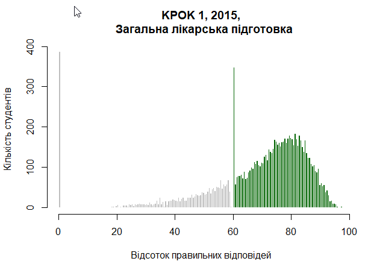
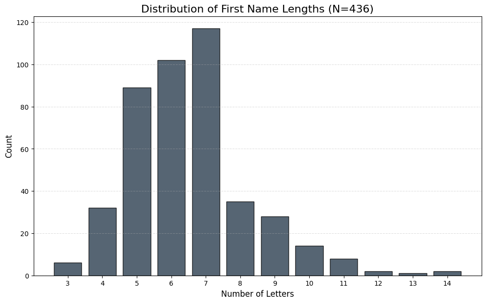

## Distribution of Sample Mean
 

::: {.callout-important}
## Main question
what and how can we learn abouth the population mean ($\mu$) from a simple random sample?
:::

**Example**: 

If we have a sample of size $n=20$ of heights of students, naturally we can compute sample mean $\bar{x}$. How is it related to the population mean $\mu$? 

* Clearly they dont have to be equal.
* Every new sample may result in a different value of $\bar{x}$.
* Given that $\bar{x}$ is random, how close it tends to be to the true mean?

**Key observation:
**

We need to understand properties of $\bar{x}$ as a random variable, i.e. understand its probability distribution. Of course, it depends on:

* the distribution of underlying population (unknown!!)
* the sample size $n$

Lets explore the properties of $\bar{x}$ assuming for now that we know what is the distribution of population.

## Simple Example: Uniform distribution of population

Suppose the population generated by a a throw of a die, i.e the is pmf is:

\begin{equation}
P(X_i = x) = 
\begin{cases} 
\frac{1}{6} & \text{if } x \in \{1, 2, 3, 4, 5, 6\} \\
0 & \text{otherwise}
\end{cases}
\end{equation}

**Note:**

Recall that we treat population as a probability distribution from where we draw the sample. So, our sample $X_1,\dots, X_n$ consists of iid random variables distributed as above.

If we were to draw a histogram of values in population it will look like a theoretical pmf: 
%20copy.png)
We shall derive distribution of $\bar{x}=\frac{\sum X_i}{n}$ for couple of values of $n$.

**$n=1$**

One observation has the same distribution as population: $X_1\sim DUnif$.

**$n=2$**

Support of the Sample Mean for $n=2$ independent die rolls is the set of all possible values the average $\bar{X} = \frac{X_1 + X_2}{2}$ can take. The support is:$$\text{Supp}(\bar{X}) = \{1, 1.5, 2, 2.5, 3, 3.5, 4, 4.5, 5, 5.5, 6\}.$$

Lets derive some of the probabilities.
   
To find $P(\bar{X} = 1)$: The sum must be $2\bar{x} = 2$. The only outcome $\{(1,1)\}$. Hence:
   
$P(\bar{X} = 1) = \frac{1}{36}$

To find $P(\bar{X} = 3)$: The sum must be $2\bar{x} = 6$. Favorable outcomes: $\{(1,5), (2,4), (3,3), (4,2), (5,1)\}$. Hence:

$P(\bar{X} = 3) = \frac{5}{36}$

Generally we get the following pmf:

%20copy.png)

**n=3**

Similar computations result in the pmf:
%20copy%202.png)

**n=4**
%20copy%202.png)

**Interesting:
**

* For each n distribution is different! Supports different, probabilites different.
* But the pattern that arisses! Concentrates around the mean, tails die down. 
* Shape stabilizes! 

Abobe are theoretically derived pmfs. For large n these are hard to derive. But we can simulate. Below we used Python (and Gemini!) to simulate taking 1000 samples of size n=20 and n=200. For each of the samples we compute $\bar{x}$ and here is the histograms of its values:

%20copy%202.png)

%20copy%203.png)

**Main observations:**

1. All distributions are symmetric and centered around population mean $\mu=3.5$
2. The variance seams decreasing in a sample size $n$: the higher $n$ the more closer $\bar{x}$ tend to be to the population mean $\mu=3.5$
3. Distributions tend to be bell-shaped for higher sample sizes $n$

**Theoretical proof for (1) and (2)**

1. $E(\bar{x})=E(\frac{\sum X_i}{n})=\frac{1}{n}\sum E(X_i)=\frac{n\mu}{n}=\mu$=Population mean
   
2. $Var(\bar{x})=Var(\frac{\sum X_i}{n})=\frac{Var(X_i)}{n}$=Population variance divided by $n$=$\sigma^2/n$
   
The above derivations work for any distribution of population! 

::: {.callout-important}
## Properties of Sample Mean
For any population and sample size $n$ we have $E(\bar{x})=\mu$ and $Var(\bar{x})=\sigma^2/n$
:::

The third observation is in fact also independent of the specific example and is one of the main results in the whole of probability theory - Central Limit Theorem.

::: {.callout-important}
## Central Limit Theorem
Let $X_1, X_2, \dots, X_n$ be a sequence of independent and identically distributed (iid) random variables with a finite mean $E[X_i] = \mu$ and a finite variance $Var(X_i) = \sigma^2$. As the sample size $n$ approaches infinity ($n \to \infty$), the distribution of the sample mean $\bar{X}_n$ converges to a Normal distribution:

$$\bar{X}_n \xrightarrow{d} N\left(\mu, \frac{\sigma^2}{n}\right)$$
:::

Normal distribution is a continuous probability distribution with two parameters, mean and variance (or standard deviation). Lets see how its pdf looks like!

```{ojs}
//| echo: false

// 1. Define the sliders
viewof mu = Inputs.range([-5, 5], {value: 0, step: 0.1, label: "Mean (μ)"})
viewof sigma = Inputs.range([0.1, 5], {value: 1, step: 0.1, label: "Std Dev (σ)"})

// 2. Draw the graph
Plot.plot({
  grid: true,
  y: {domain: [0, 0.5]},
  marks: [
    Plot.line(d3.range(-4, 4, 0.1).map(x => [x, (1/(sigma * Math.sqrt(2 * Math.PI))) * Math.exp(-0.5 * Math.pow((x - mu)/sigma, 2))]), {stroke: "steelblue", strokeWidth: 3})
  ]
})
```

Coming back to our example with 1000 simulations of sample mean for n=200 we can see that it is indeed very close to theoretical normal pdf.!

%20copy%204.png)

So summurize our main result so far which will be a foundation of the entire statistical analysis:

::: {.callout-tip}
No matter the distribution of population the shape of the distribution of sample mean for large sample size $n$ is Normal.
:::

## Normal distribution
### The Standard Normal Distribution

The Standard Normal is a special case of the Normal distribution where the variable is already centered and scaled, denoted as $Z \sim N(0, 1)$.

#### 1. The Probability Density Function (PDF)
The PDF of the standard normal distribution defines the classic "bell curve" shape with a mean of 0 and a standard deviation of 1. It is denoted by the lowercase Greek letter $\phi$:

$$\phi(z) = \frac{1}{\sqrt{2\pi}} e^{-\frac{1}{2}z^2}$$

#### 2. The Cumulative Distribution Function (CDF)
The integral of the Normal PDF does not have a "closed-form" algebraic solution (meaning it cannot be written using basic operations or polynomials). We represent the area under the curve using the uppercase Greek letter **$\Phi$ (Phi)**:

$$\Phi(z) = P(Z \le z) = \int_{-\infty}^{z} \frac{1}{\sqrt{2\pi}} e^{-\frac{1}{2}t^2} dt$$

In practice, these values are obtained using statistical tables, Excel, or Python (`scipy.stats.norm.cdf`).

#### 3. Core Properties

* **Mean and Variance:** By construction, the mean is **0** and the variance (and standard deviation) is **1**.
* **Symmetry:** The distribution is perfectly symmetric around $z=0$. This leads to two useful rules:
    * $\Phi(0) = 0.5$ (exactly half the area lies on either side of the center).
    * $\Phi(-z) = 1 - \Phi(z)$ (the area to the left of a negative value equals the area to the right of its positive counterpart).
* **Total Area:** Like all valid probability distributions, the total area under the curve is exactly **1**. The constant $\frac{1}{\sqrt{2\pi}}$ exists specifically to ensure this unit area.

### The General Normal Distribution

While the Standard Normal is a useful baseline, most real-world data follows a **General Normal Distribution**, denoted as $X \sim N(\mu, \sigma^2)$.

#### 1. Location-Scale Transformation
We can transform any Standard Normal variable $Z$ into a General Normal variable $X$ using a simple linear equation:

$$X = \mu + \sigma Z$$

* **Location ($\mu$):** Shifts the center of the bell curve.
* **Scale ($\sigma$):** Stretches or shrinks the spread of the curve.

To go the other direction (from data to a z-score), we use **Standardization**:

$$Z = \frac{X - \mu}{\sigma}$$

#### 2. The Probability Density Function (PDF)
The general formula for the normal curve is:

$$f(x) = \frac{1}{\sigma\sqrt{2\pi}} e^{-\frac{1}{2}\left(\frac{x-\mu}{\sigma}\right)^2}$$

#### 3. Key Properties

* **Symmetry:** The distribution is symmetric around the mean $\mu$. In a normal distribution, the **mean = median = mode**.
* **Parameters:** * The first parameter $\mu$ is the **expected value** ($E[X]$).
    * The second parameter $\sigma^2$ is the **variance** ($Var(X)$).
* **The 68-95-99.7 Rule:**
    * ~68% of observations fall within $\pm 1\sigma$ of the mean.
    * ~95% of observations fall within $\pm 2\sigma$ of the mean.
    * ~99.7% of observations fall within $\pm 3\sigma$ of the mean.

::: {.callout-tip}
If we need probabilities for general Normal, we can simply express them using a standard Normal:
$$P(X<x)=P(\mu+\sigma Z<x)=P(Z<\frac{x-\mu}{\sigma})=\Phi(\frac{x-\mu}{\sigma})$$
:::

### Normal in Real Life

This is the histogram of proportion of heads in simulation of 1,000 coin tosses repeated 10,000 times. 
%20copy%205.png)

In 1885 Francis Galton collected a dataset which is one of the most famous examples in the history of statistics. It demonstrates that human height follows a Normal distribution, providing a biological illustration of the Central Limit Theorem (where height is the result of many small, independent genetic and environmental factors added together). 

Below is Height Distribution of ECON211 Female Students ($n=185$). Mean ($\mu$): $165.9$ cm; Standard Deviation ($\sigma$): $5.7$ cm.

%20copy%206.png)

%20copy%207.png)


Some exams,like SAT, are specifically designed to have the Normal distribution of scores, so SAT scores are exactly normal. Below is the distribution for 2023 with 1.9 million test-takers. For example, a student with a score of 1550 will be higher than 0.9935 fraction of test takers. That is a score of 1550 is in the 99.35th percentile. In a room of 1,000 students, only about 6 or 7 would be expected to have a higher score.

%20copy%208.png)

Here is the screenshot from Garmin app with distribution of sleeping times for the users.


And the distribution of steps per day. Notice the **right skew** (positive skew) in the distribution of daily steps. Unlike height or SAT scores, this data is not exactly Normal; the right tail is "heavier," extending much further from the mean than the left tail.


Ukrainian medical students are passing KROK test since 1999. Here are some fishy-looking results from 2015. Can you guess the issue?  


Below is the histogram of first names lengths of students in this class for a couple of years. Again, notice the scew.



### Using Normal distribution to find approximate probabilities

#### Example: Approximating Coin Toss Proportions

In this problem, we compare the exact probability using the Binomial distribution with the approximation provided by the Central Limit Theorem.

##### The Setup
* **Trial:** Flip a fair coin $n = 1000$ times.
* **Random Variable:** Let $X_i = 1$ if Heads, $0$ if Tails. $X_i \sim \text{Bernoulli}(p=0.5)$.
* **Sample Mean:** The proportion of heads is $\hat{p} = \frac{1}{n}\sum X_i$.

**Goal:** Find the probability that the proportion of heads is less than $0.45$.

---

##### 1. Exact Solution: Binomial Distribution
The number of heads $k$ follows a Binomial distribution $B(1000, 0.5)$. A proportion of $\hat{p} < 0.45$ corresponds to $k < 450$ heads (i.e., $k \le 449$).

$$P(K \le 449) = \sum_{k=0}^{449} \binom{1000}{k} (0.5)^k (0.5)^{1000-k}$$

**Exact Probability $\approx 0.000635$**

---

##### 2. Normal Approximation
The Central Limit Theorem applies here because **the proportion of heads is the sum (and average) of $n=1000$ iid Bernoulli variables.** Even though a single coin toss is not Normal, their average is.

**Step A: Define Parameters**

* Mean: $\mu_{\hat{p}} = p = 0.5$
* Variance: $\sigma^2_{\hat{p}} = \frac{p(1-p)}{n} = \frac{0.5(0.5)}{1000} = 0.00025$
* Standard Error: $SE = \sqrt{0.00025} \approx 0.0158$

**Step B: Calculate Z-score**
We transform our target proportion ($0.45$) into a Standard Normal $Z$-score:

$$Z = \frac{0.45 - 0.5}{0.0158} = \frac{-0.05}{0.0158} \approx -3.16$$

**Step C: Find Probability**
Using the symmetry of the Normal curve:
$$P(\hat{p} < 0.45) \approx \Phi(-3.16) = 1 - \Phi(3.16)$$

**Approximate Probability $\approx 0.000789$**


---

#### Comparison Summary

| Method | Probability | Context |
| :--- | :--- | :--- |
| **Binomial (Exact)** | $0.000635$ | Mathematically precise but requires high computing power for large sums. |
| **Normal (CLT)** | $0.000789$ | Highly accurate for $n=1000$ and easy to solve with a Z-table. |


::: {.callout-tip}
If a random variable can be expressed as the **sum (or average)** of a large number of **independent and identically distributed (i.i.d.)** variables, the **Central Limit Theorem (CLT)** allows us to approximate its distribution using the **Normal distribution**, regardless of the underlying distribution of the individual variables."
:::

::: {.callout-note}
The Normal distribution is continuous, so $P(\hat{p} = a) = 0$. To approximate an exact discrete value, we apply a **continuity correction** by adding and subtracting $0.5$ to the success count $k$. This creates a small interval around the proportion:
$$P\left( \frac{k - 0.5}{n} \leq \hat{p} \leq \frac{k + 0.5}{n} \right)$$
Using the Normal CDF over this range approximates the probability of the exact discrete outcome.
:::

%20copy%202.png)

