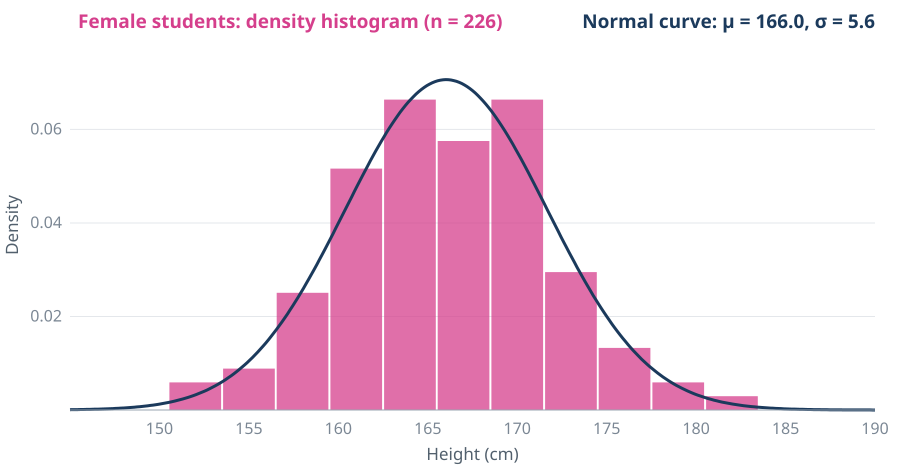
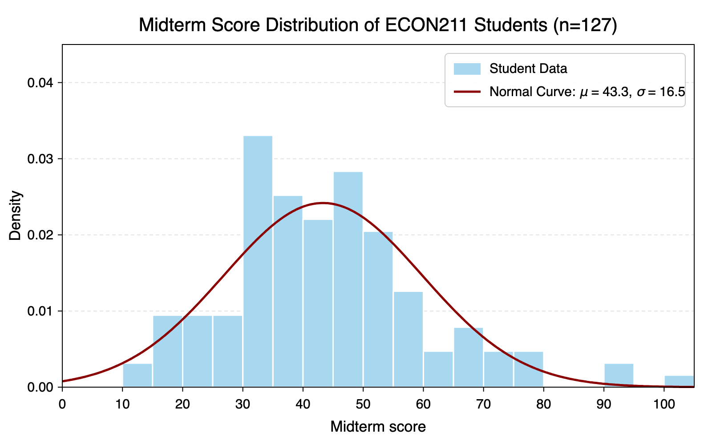
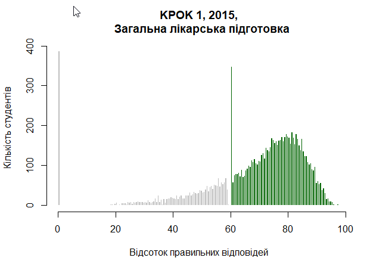
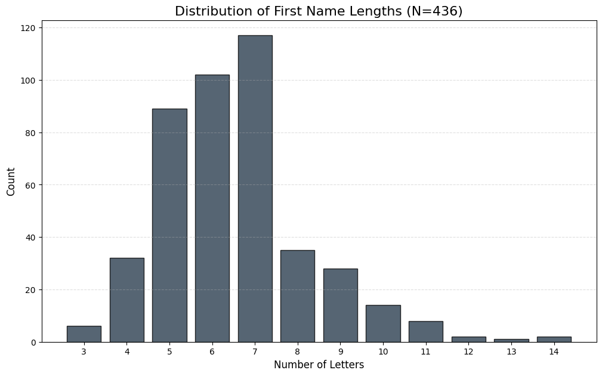

## Main question

::: {.box .key}
<span class="tag">Main question</span>
What can we learn about the population mean $\mu$ from a simple random sample?
:::

. . .

::: {.box}
Take a sample of $n=20$ student heights. We can compute the sample mean $\bar{x}$.

**How is $\bar{x}$ related to $\mu$?**
:::

## Predict first

::: {.box .key}
<span class="tag">Write down your answers</span>
Population: heights of **373 students** from our class surveys. We draw random samples and compute the sample mean.
:::

::: {.incremental}
1. What is the **average height** $\mu$ of all 373 students?
2. For a sample of $n=20$, how far is $\bar{x}$ from $\mu$, typically: about **0.5, 2, 5 or 10 cm**?
3. With $n=5$ instead of $n=20$: is the histogram of $\bar{x}$ **wider or narrower**? By how much?
4. The heights of girls and boys form **two humps**. Will the histogram of $\bar{x}$ also have two humps?
:::

## Try it: sample student heights

::: {.cap}
Population: **373 student heights** from our class surveys (cm). Draws are random, with replacement.
:::

```{=html}
<div class="ctl" style="gap:0.6em;font-size:0.72em">
  <span class="seg" id="hs-grp" style="margin-left:0">
    <button data-v="all" class="on">All</button><button data-v="girls">Girls</button><button data-v="boys">Boys</button>
  </span>
  <span class="seg" id="hs-n" style="margin-left:0">
    <button data-v="5">n = 5</button><button data-v="20" class="on">n = 20</button>
  </span>
  <button class="act" id="hs-add1">Draw sample</button>
  <button class="act" id="hs-add10">+ 10</button>
  <button class="act" id="hs-add1000">+ 1000</button>
  <button class="act ghost" id="hs-reset">Reset</button>
  <label><input type="checkbox" id="hs-mu"> Reveal μ</label>
  <label><input type="checkbox" id="hs-thr"> x̄ &gt; 175</label>
</div>
<div id="hs-grid" style="font-size:0.78em;min-height:2.6em;margin:0.2em 0;line-height:1.5"></div>
<svg id="hs-svg" viewBox="0 0 900 345" style="width:100%;height:auto;display:block"></svg>
<div class="readout" id="hs-out"></div>
<script>
(function(){
  var DATA=[168,162,180,170,169,163,165,179,162,166,183,163,163,190,184,171,169,190,174,186,188,170,174,183,162,175,163,165,172,178,158,165,163,170,181,176,175,180,186,160,165,184,164,155,188,160,173,182,168,168,175,169,160,170,170,162,165,163,161,178,168,159,162,162,158,170,164,160,168,173,162,170,170,167,163,167,170,162,167,163,178,167,184,165,165,161,185,170,177,176,170,153,178,173,166,155,183,180,173,180,165,170,183,165,173,157,172,173,163,170,174,157,171,180,170,168,170,163,155,158,175,173,168,170,174,178,168,179,173,186,189,182,172,157,179,188,165,167,170,174,181,162,156,181,170,175,170,168,167,168,170,165,172,177,175,166,164,159,160,178,183,164,165,168,184,176,168,183,180,177,160,175,168,180,181,173,176,167,163,160,173,175,178,186,163,178,162,173,180,159,153,169,178,171,186,158,157,169,170,160,189,183,165,172,173,181,169,197,178,168,164,170,180,186,175,158,162,184,186,172,160,183,163,158,170,175,185,183,170,171,165,186,175,189,173,167,169,182,183,160,185,173,163,167,169,160,177,170,162,165,170,178,197,163,177,177,169,167,190,165,175,175,168,165,169,176,168,162,163,174,182,168,163,175,159,171,175,175,183,174,170,158,192,155,153,173,167,159,180,181,173,185,172,173,178,165,160,166,181,165,163,152,180,168,173,160,169,161,192,183,193,175,171,170,172,185,183,183,172,180,175,167,182,163,173,158,180,169,178,169,167,175,172,180,170,164,160,170,178,167,174,170,171,168,163,185,155,167,173,175,160,179,180,175,161,170,162,168,180,182,171,172,180,160,170,164,165,185,168,160,165,165,178];
  var SEX=[1,1,0,1,1,1,1,0,1,1,0,1,0,0,0,1,0,0,0,0,0,1,0,0,1,0,1,1,1,1,1,1,1,0,0,0,0,0,0,1,1,0,1,1,0,1,0,0,1,1,0,1,1,1,1,1,1,1,1,0,1,1,1,1,1,1,1,1,1,1,1,1,1,1,1,1,1,1,1,1,1,1,0,1,1,1,0,0,0,0,0,1,0,0,1,1,0,0,0,0,1,1,0,1,0,1,1,1,1,1,0,1,1,0,1,1,1,1,1,1,0,1,1,0,1,0,1,0,1,0,0,0,0,1,0,0,1,1,1,0,0,1,1,0,1,0,0,1,1,1,1,0,1,0,0,1,1,1,1,0,0,1,1,1,0,0,1,0,0,1,1,0,1,1,0,1,0,1,1,1,0,0,1,0,1,0,1,1,0,1,1,1,0,1,0,1,1,1,1,1,0,0,1,1,0,0,1,0,0,1,1,1,0,0,1,1,1,0,0,0,1,0,1,1,1,1,0,0,1,1,1,0,0,0,1,1,1,1,0,1,0,1,1,1,1,1,0,1,1,1,1,0,0,1,0,0,1,1,0,0,1,0,1,1,1,0,1,1,1,0,0,1,1,0,1,0,1,0,0,0,1,1,0,1,1,1,1,1,0,1,0,0,0,1,0,1,1,1,0,1,1,1,0,1,1,1,1,1,0,0,0,1,1,0,1,0,0,0,1,0,1,1,0,1,1,1,0,1,0,1,1,1,1,0,1,1,1,1,0,1,0,1,1,0,1,0,1,1,0,1,1,0,0,0,1,1,1,1,0,0,0,0,0,1,1,0,1,0,1,1,1,1,0]; // 1 = woman, 0 = man (same order as DATA)
  var n=20, N0=DATA.length, MU, pool=DATA, grp='all', COL={all:'#63b3ed',girls:'#d53f8c',boys:'#319795'};
  function setGroup(g){
    grp=g; pool=DATA.filter(function(v,i){return g==='all'||(g==='girls'?SEX[i]===1:SEX[i]===0);});
    MU=pool.reduce(function(a,b){return a+b;},0)/pool.length;
  }
  setGroup('all');
  var svg=document.getElementById('hs-svg'), out=document.getElementById('hs-out'), grid=document.getElementById('hs-grid'), muBox=document.getElementById('hs-mu'), thrBox=document.getElementById('hs-thr'), THR=175;
  var W=900,L=50,R=20, X0=145, X1=205, BWP=3, PB0=147.5, BWM=0.5;
  var P1={t:14,b:120}, P2={t:175,b:315};
  function sx(x){return L+(x-X0)/(X1-X0)*(W-L-R);}
  function binCounts(arr){var c=new Array(19).fill(0); arr.forEach(function(v){var b=Math.floor((v-PB0)/BWP); if(b>=0&&b<c.length)c[b]++;}); return c;}
  var popCounts=binCounts(DATA);
  var NB=(X1-X0)/BWM, counts, N, sum, sumsq, above, last=null;
  function reset(){counts=new Array(NB).fill(0);N=0;sum=0;sumsq=0;above=0;last=null;render();}
  function one(keep){
    var tot=0, arr=keep?[]:null;
    for(var j=0;j<n;j++){var v=pool[Math.floor(Math.random()*pool.length)]; tot+=v; if(arr)arr.push(v);}
    var m=tot/n, b=Math.floor((m-X0)/BWM); if(b>=0&&b<NB)counts[b]++;
    N++; sum+=m; sumsq+=m*m; if(m>THR) above++;
    if(keep) last={xs:arr,mean:m};
  }
  function add(k,keep){for(var i=0;i<k;i++) one(keep&&i===k-1); if(!keep) last=null; render();}
  function axis(h,y){
    h+='<line x1="'+L+'" x2="'+(W-R)+'" y1="'+y+'" y2="'+y+'" stroke="#9aa5b1"/>';
    for(var t=150;t<=X1-5;t+=10) h+='<text x="'+sx(t)+'" y="'+(y+22)+'" text-anchor="middle" font-size="16" fill="#7b8794">'+t+'</text>';
    return h;
  }
  function render(){
    var h='', i;
    var dp=popCounts.map(function(c){return c/(N0*BWP);}), pm=Math.max.apply(null,dp)*1.12;
    function sy1(v){return P1.b-v/pm*(P1.b-P1.t);}
    var gc=grp==='all'?null:binCounts(pool), gcol=COL[grp];
    function bar(k,v,fill,stroke,op){ if(!v)return ''; return '<rect x="'+(sx(PB0+k*BWP)+1)+'" y="'+sy1(v)+'" width="'+(sx(X0+BWP)-sx(X0)-2)+'" height="'+(P1.b-sy1(v))+'" fill="'+fill+'" stroke="'+stroke+'"'+(op?' fill-opacity="'+op+'"':'')+'/>'; }
    dp.forEach(function(v,k){ h+=gc?bar(k,v,'#eef0f2','#d3d9df'):bar(k,v,'#e4e7eb','#7b8794'); });
    if(gc) gc.forEach(function(c,k){ h+=bar(k,c/(N0*BWP),gcol,gcol,0.85); });
    h=axis(h,P1.b);
    h+='<text x="'+(L+6)+'" y="'+(P1.t+14)+'" font-size="17" font-weight="700" fill="'+(gc?gcol:'#52606d')+'">Population: '+(gc?(grp==='girls'?'girls, ':'boys, ')+pool.length+' of ':'')+'373 heights (density histogram)</text>';
    if(muBox.checked) h+='<line x1="'+sx(MU)+'" x2="'+sx(MU)+'" y1="'+P1.t+'" y2="'+P1.b+'" stroke="#dd6b20" stroke-width="2" stroke-dasharray="6,4"/>';
    if(last){
      var seen={};
      last.xs.forEach(function(v){var c=seen[v]=(seen[v]||0)+1; h+='<circle cx="'+sx(v).toFixed(1)+'" cy="'+(P1.b-7-(c-1)*9)+'" r="4.5" fill="'+(gc?gcol:'#2b6cb0')+'" fill-opacity="0.85"/>';});
      h+='<path d="M'+sx(last.mean)+' '+(P1.b+2)+' l-8 -13 h16 z" fill="#dd6b20"/>';
    }
    var dens=counts.map(function(c){return N?c/(N*BWM):0;});
    var ym=Math.max(Math.max.apply(null,dens),0.05)*1.15;
    function sy2(v){return P2.b-v/ym*(P2.b-P2.t);}
    h=axis(h,P2.b);
    h+='<text x="'+(L+6)+'" y="'+(P2.t-6)+'" font-size="17" font-weight="700" fill="'+(gc?gcol:'#2b6cb0')+'">Sample means x̄ (n = '+n+')'+(gc?', '+(grp==='girls'?'girls':'boys'):'')+', density histogram</text>';
    dens.forEach(function(v,k){ if(!v)return; h+='<rect x="'+(sx(X0+k*BWM)+0.5)+'" y="'+sy2(v)+'" width="'+(sx(X0+BWM)-sx(X0)-1)+'" height="'+(P2.b-sy2(v))+'" fill="'+(thrBox.checked&&X0+k*BWM>=THR?'#dd6b20':COL[grp])+'" fill-opacity="0.85"/>'; });
    if(thrBox.checked) h+='<line x1="'+sx(THR)+'" x2="'+sx(THR)+'" y1="'+P2.t+'" y2="'+P2.b+'" stroke="#dd6b20" stroke-width="2"/>';
    if(muBox.checked){
      h+='<line x1="'+sx(MU)+'" x2="'+sx(MU)+'" y1="'+P2.t+'" y2="'+P2.b+'" stroke="#dd6b20" stroke-width="2" stroke-dasharray="6,4"/>';
      h+='<text x="'+(sx(MU)+8)+'" y="'+(P2.t+16)+'" font-size="17" fill="#dd6b20" font-weight="700">μ = '+MU.toFixed(2)+'</text>';
    }
    if(last) h+='<path d="M'+sx(last.mean)+' '+(P2.b+2)+' l-8 -13 h16 z" fill="#dd6b20"/>';
    svg.innerHTML=h;
    if(last){
      var s=last.xs.slice().sort(function(a,b){return a-b;});
      grid.innerHTML=s.map(function(v){return '<span style="display:inline-block;background:'+(grp==='girls'?'#fbe4ef':grp==='boys'?'#dff3f2':'#ebf4fc')+';border-radius:6px;padding:0 7px;margin:2px 3px">'+v+'</span>';}).join('')
        +' &nbsp;⇒&nbsp; <b>x̄ = '+last.mean.toFixed(2)+'</b>';
    } else grid.innerHTML='<i style="color:#7b8794">Press <b>Draw sample</b> to pick '+n+' students.</i>';
    if(N){var m=sum/N, sd=Math.sqrt(Math.max(0,sumsq/N-m*m));
      out.innerHTML='<b>'+N.toLocaleString()+'</b> sample'+(N>1?'s':'')+' &nbsp;|&nbsp; mean of x̄ = <b>'+m.toFixed(2)+'</b> &nbsp;|&nbsp; SD of x̄ = <b>'+sd.toFixed(2)+'</b>'+(muBox.checked?' &nbsp;|&nbsp; μ = '+MU.toFixed(2):'')+(thrBox.checked?' &nbsp;|&nbsp; share x̄ &gt; 175: <b>'+(100*above/N).toFixed(1)+'%</b>':'');
    } else out.innerHTML='';
  }
  document.getElementById('hs-add1').onclick=function(){add(1,true);};
  document.getElementById('hs-add10').onclick=function(){add(10,true);};
  document.getElementById('hs-add1000').onclick=function(){add(1000,false);};
  document.getElementById('hs-reset').onclick=reset;
  var nEl=document.getElementById('hs-n');
  nEl.addEventListener('click',function(e){var b=e.target.closest('button'); if(!b)return; nEl.querySelectorAll('button').forEach(function(x){x.classList.remove('on');}); b.classList.add('on'); n=+b.dataset.v; reset();});
  var gEl=document.getElementById('hs-grp');
  gEl.addEventListener('click',function(e){var b=e.target.closest('button'); if(!b)return; gEl.querySelectorAll('button').forEach(function(x){x.classList.remove('on');}); b.classList.add('on'); setGroup(b.dataset.v); reset();});
  muBox.addEventListener('change',render);
  thrBox.addEventListener('change',render);
  reset();
})();
</script>
```

## $\bar{x}$ is not $\mu$

::: {.incremental}
- They **don't have to be equal**
- Every new sample gives a **different** $\bar{x}$
- Before we take the sample, the sample mean is a **random variable** $\bar{X}$; after, we observe a number $\bar{x}$
- **How close is it to the true mean?**
:::

## Key observation

::: {.box .key}
To answer, we need the **probability distribution** of $\bar{X}$.
:::

. . .

It depends on two things:

::: {.cards}
::: {.box .c .fragment}
**The population distribution**<br>unknown!
:::
::: {.box .c .fragment}
**The sample size $n$**<br>chosen by us
:::
:::

. . .

::: {.cap}
For now, assume we know the population distribution.
:::

# Example: rolling a die {.section-slide}

Population = a die. Sample = $n$ rolls.

## The population

$$
P(X_i = x) = \tfrac{1}{6}, \qquad x \in \{1,2,3,4,5,6\}
$$

. . .

::: {.box}
The population is a **probability distribution** we draw from. The sample $X_1,\dots,X_n$ is independent draws from it. Hence, $X_1,\dots,X_n$ are **i.i.d.** r.v.'s with the same distribution as the population.
:::

. . .

::: {.box .key}
**Goal:** find the distribution of $\;\bar{X}=\frac{X_1+\dots+X_n}{n}$
:::

## Histogram of the population

::: {.figure-slide}
%20copy.png){fig-align="center"}
:::

::: {.cap}
It looks exactly like the theoretical pmf
:::

## Mean of one roll and of two rolls

::: {.box}
<span class="tag">n = 1</span>
One observation has the population distribution: $X_1\sim DUnif$
:::

. . .

::: {.box}
<span class="tag">n = 2</span>
$\bar{X}=\frac{X_1+X_2}{2}$ takes the values $1,\ 1.5,\ 2,\ \dots,\ 5.5,\ 6$
:::

## Deriving probabilities for $n=2$

::: {.cards}
::: {.box}
<span class="tag">$\bar{X}=1$</span>
Sum must be 2: only $(1,1)$

$$P(\bar{X}=1)=\tfrac{1}{36}$$
:::
::: {.box .key .fragment}
<span class="tag">$\bar{X}=3$</span>
Sum must be 6: five outcomes, $(1,5),(2,4),(3,3),(4,2),(5,1)$

$$P(\bar{X}=3)=\tfrac{5}{36}$$
:::
:::

## pmf of $\bar{X}$ for $n=2$

::: {.figure-slide}
%20copy.png){fig-align="center"}
:::

## pmf of $\bar{X}$ for $n=3$

::: {.figure-slide}
%20copy%202.png){fig-align="center"}
:::

## pmf of $\bar{X}$ for any $n$

Move the slider and watch the shape.

```{=html}
<div class="ctl">
  <span>Number of rolls <b>n = <span id="pmf-n">4</span></b></span>
  <input type="range" id="pmf-r" min="1" max="30" value="4">
</div>
<svg id="pmf-svg" viewBox="0 0 900 340" style="width:100%;height:auto;display:block"></svg>
<script>
(function(){
  var svg=document.getElementById('pmf-svg'), r=document.getElementById('pmf-r'), out=document.getElementById('pmf-n');
  var W=900,H=340,L=70,R=20,T=15,B=50,ymax=0.18;
  function sx(x){return L+(x-1)/5*(W-L-R);} function sy(p){return H-B-p/ymax*(H-T-B);}
  function draw(){
    var n=+r.value; out.textContent=n;
    var dist=new Array(6*n+1).fill(0); dist[0]=1;
    for(var i=0;i<n;i++){var nx=new Array(6*n+1).fill(0);
      for(var s=0;s<=6*i;s++) if(dist[s]) for(var f=1;f<=6;f++) nx[s+f]+=dist[s]/6; dist=nx;}
    var h='';
    [0,0.05,0.1,0.15].forEach(function(p){h+='<line x1="'+L+'" x2="'+(W-R)+'" y1="'+sy(p)+'" y2="'+sy(p)+'" stroke="#e4e7eb"/><text x="'+(L-8)+'" y="'+(sy(p)+5)+'" text-anchor="end" font-size="16" fill="#7b8794">'+p.toFixed(2)+'</text>';});
    for(var t=1;t<=6;t++) h+='<text x="'+sx(t)+'" y="'+(H-B+24)+'" text-anchor="middle" font-size="16" fill="#7b8794">'+t+'</text>';
    h+='<text x="'+((L+W-R)/2)+'" y="'+(H-6)+'" text-anchor="middle" font-size="17" fill="#52606d">sample mean x̄   (orange line: μ = 3.5)</text>';
    h+='<line x1="'+sx(3.5)+'" x2="'+sx(3.5)+'" y1="'+T+'" y2="'+(H-B)+'" stroke="#dd6b20" stroke-width="2" stroke-dasharray="6,4"/>';
    var rad=n>12?3:5, sw=n>12?2:3;
    for(var s=n;s<=6*n;s++){ if(!dist[s]) continue; var x=sx(s/n), y=sy(dist[s]);
      h+='<line x1="'+x+'" x2="'+x+'" y1="'+sy(0)+'" y2="'+y+'" stroke="#2b6cb0" stroke-width="'+sw+'"/><circle cx="'+x+'" cy="'+y+'" r="'+rad+'" fill="#2b6cb0"/>'; }
    svg.innerHTML=h;
  }
  r.addEventListener('input',draw); draw();
})();
</script>
```

## What do we see?

::: {.box .fragment}
Each $n$ gives a **different** distribution: supports and probabilities change.
:::

::: {.box .good .fragment}
But a **pattern** emerges: it concentrates around the mean and the tails die down.
:::

::: {.box .key .fragment}
The **shape stabilizes**.
:::

## Too hard to derive? Simulate!

::: {.box}
Draw 1000 samples of size $n$, compute $\bar{x}$ for each, and plot the histogram.
:::

## Simulation: $n=20$

::: {.figure-slide}
%20copy%202.png){fig-align="center"}
:::

## Simulation: $n=200$

::: {.figure-slide}
%20copy%203.png){fig-align="center"}
:::

## Three main observations

::: {.cards}
::: {.box .fragment}
<span class="tag">1 · Center</span>
All distributions are **symmetric** and centered at $\mu=3.5$.
:::
::: {.box .key .fragment}
<span class="tag">2 · Spread</span>
The **spread shrinks** as $n$ grows: $\bar{X}$ lands closer to $\mu$.
:::
::: {.box .good .fragment}
<span class="tag">3 · Shape</span>
For large $n$ the shape becomes **bell-like**.
:::
:::

## Proof of (1): the center

$$
E(\bar{X}) = E\!\left(\frac{\sum X_i}{n}\right)
$$

. . .

$$
= \frac{1}{n}\sum E(X_i)
$$

. . .

$$
= \frac{n\mu}{n} = \boxed{\mu}
$$

. . .

::: {.cap}
On average, the sample mean equals the population mean.
:::

## Predict: how much more data?

::: {.quiz data-answer="b"}
To cut the **standard deviation** of $\bar{X}$ in half, you need:

1. $2\times$ the data
2. $4\times$ the data
3. $\sqrt{2}\times$ the data
4. $10\times$ the data

::: {.expl}
$SD(\bar{X})=\sigma/\sqrt{n}$, and $\sqrt{4n}=2\sqrt{n}$. Doubling $n$ halves the **variance**, not the SD. Let's prove it.
:::
:::

## Proof of (2): the spread

$$
Var(\bar{X}) = Var\!\left(\frac{\sum X_i}{n}\right)
$$

. . .

$$
= \frac{1}{n^2}\sum Var(X_i)
$$

. . .

$$
= \frac{n\sigma^2}{n^2} = \boxed{\frac{\sigma^2}{n}}
$$

. . .

::: {.cap}
The variance of one observation divided by $n$.
:::

## Properties of the sample mean

::: {.cards}
::: {.box .key}
<span class="tag">Center</span>
$$E(\bar{X})=\mu$$
The sample mean is **right on average**.
:::
::: {.box .key}
<span class="tag">Spread</span>
$$Var(\bar{X})=\frac{\sigma^2}{n}$$
More data means a **tighter** distribution: $SD(\bar{X})=\sigma/\sqrt{n}$, so $4\times$ the data halves the SD.
:::
:::

::: {.box .fragment}
True for **any** population and **any** $n$: the derivation never used the shape.
:::

## Quick check

::: {.quiz .compact data-answer="c"}
A fair die has $\mu=3.5$ and $\sigma\approx1.71$. You roll it $n=25$ times. What is $SD(\bar{X})$?

1. $1.71$
2. $2.92$
3. $0.34$
4. $0.12$

::: {.expl}
$\sigma/\sqrt{n}=1.71/5\approx0.34$. $0.12=\sigma^2/n$ is the **variance**, and $1.71$ is the SD of a single roll.
:::
:::

::: {.quiz .compact data-answer="c"}
Which of these changes when the sample size $n$ grows?

1. The population distribution
2. The population mean $\mu$
3. The distribution of $\bar{X}$
4. The population SD $\sigma$

::: {.expl}
The population is fixed. Only the distribution of $\bar{X}$ depends on $n$.
:::
:::

## Central Limit Theorem

::: {.box .key}
<span class="tag">In words</span>
Draw a **large random sample** from **any** population (finite mean and variance). Then the sample mean is **approximately Normal**: centered at $\mu$, with spread $\sigma/\sqrt{n}$.
:::

. . .

::: {.cards}
::: {.box .c}
<span class="tag">In symbols</span>
If $X_1,\dots,X_n$ are i.i.d. with mean $\mu$ and variance $\sigma^2$, then
$$\bar{X}\ \approx\ N\!\left(\mu,\ \frac{\sigma^2}{n}\right)$$
:::
::: {.box .c .good}
<span class="tag">The bigger the $n$</span>
the better the Normal approximation
:::
:::

## The Normal pdf

Two parameters: mean and standard deviation.

```{=html}
<div class="ctl">
  <span>Mean μ = <b id="nm-mu-v">0.0</b> <input type="range" id="nm-mu" min="-5" max="5" step="0.1" value="0"></span>
  <span>Std dev σ = <b id="nm-sg-v">1.0</b> <input type="range" id="nm-sg" min="0.3" max="5" step="0.1" value="1"></span>
</div>
<svg id="nm-svg" viewBox="0 0 900 330" style="width:100%;height:auto;display:block"></svg>
<script>
(function(){
  var svg=document.getElementById('nm-svg'), rm=document.getElementById('nm-mu'), rs=document.getElementById('nm-sg');
  var W=900,H=330,L=60,R=20,T=15,B=40,ymax=0.5;
  function sx(x){return L+(x+10)/20*(W-L-R);} function sy(p){return H-B-p/ymax*(H-T-B);}
  function draw(){
    var mu=+rm.value, sg=+rs.value;
    document.getElementById('nm-mu-v').textContent=mu.toFixed(1); document.getElementById('nm-sg-v').textContent=sg.toFixed(1);
    var h='';
    [0,0.1,0.2,0.3,0.4,0.5].forEach(function(p){h+='<line x1="'+L+'" x2="'+(W-R)+'" y1="'+sy(p)+'" y2="'+sy(p)+'" stroke="#e4e7eb"/><text x="'+(L-8)+'" y="'+(sy(p)+5)+'" text-anchor="end" font-size="16" fill="#7b8794">'+p.toFixed(1)+'</text>';});
    for(var t=-10;t<=10;t+=2) h+='<text x="'+sx(t)+'" y="'+(H-B+24)+'" text-anchor="middle" font-size="16" fill="#7b8794">'+t+'</text>';
    var d='';
    for(var x=-10;x<=10.001;x+=0.1){var y=Math.exp(-0.5*Math.pow((x-mu)/sg,2))/(sg*Math.sqrt(2*Math.PI)); d+=(d?'L':'M')+sx(x).toFixed(1)+' '+sy(Math.min(y,ymax)).toFixed(1);}
    h+='<line x1="'+sx(mu)+'" x2="'+sx(mu)+'" y1="'+sy(0)+'" y2="'+T+'" stroke="#dd6b20" stroke-dasharray="6,4" stroke-width="1.5"/>';
    h+='<path d="'+d+'" fill="none" stroke="#2b6cb0" stroke-width="3.5"/>';
    svg.innerHTML=h;
  }
  rm.addEventListener('input',draw); rs.addEventListener('input',draw); draw();
})();
</script>
```

## CLT in our dice example

::: {.figure-slide}
%20copy%204.png){fig-align="center"}
:::

::: {.cap}
1000 simulated sample means with $n=200$ match the theoretical Normal curve
:::

## The foundation of statistics

::: {.box .good}
<span class="tag">Takeaway</span>
No matter what the population looks like, for a large sample the sample mean follows a **Normal** distribution.
:::

## Simulate the CLT

```{=html}
<div class="ctl">
  <span>Population:
    <span class="seg" id="cs-pop">
      <button data-v="normal" class="on">Normal</button><button data-v="bimodal">Bimodal</button><button data-v="triangular">Triangular</button>
    </span></span>
  <span>Sample size n:
    <span class="seg" id="cs-n">
      <button data-v="1">1</button><button data-v="2">2</button><button data-v="10" class="on">10</button><button data-v="30">30</button>
    </span></span>
</div>
<div class="ctl">
  <button class="act" id="cs-add1">+ 1 sample</button>
  <button class="act" id="cs-add10">+ 10 samples</button>
  <button class="act" id="cs-add1000">+ 1000 samples</button>
  <button class="act ghost" id="cs-reset">Reset</button>
  <label><input type="checkbox" id="cs-norm"> Show theoretical Normal</label>
</div>
<svg id="cs-svg" viewBox="0 0 900 390" style="width:100%;height:auto;display:block"></svg>
<div class="readout" id="cs-out"></div>
<script>
(function(){
  var svg=document.getElementById('cs-svg'), out=document.getElementById('cs-out'), normBox=document.getElementById('cs-norm');
  var W=900,H=390,L=50,R=20, X0=0, X1=10, NB=40, BW=(X1-X0)/NB;
  var P1={t:12,b:122}, P2={t:160,b:340};
  function sx(x){return L+(x-X0)/(X1-X0)*(W-L-R);}
  function nd(x,m,s){return Math.exp(-0.5*Math.pow((x-m)/s,2))/(s*Math.sqrt(2*Math.PI));}
  function gauss(){var u=1-Math.random(),v=Math.random();return Math.sqrt(-2*Math.log(u))*Math.cos(2*Math.PI*v);}
  var POP={
    bimodal:{mu:5,sd:Math.sqrt(9.36),pdf:function(x){return 0.5*nd(x,2,0.6)+0.5*nd(x,8,0.6);},draw:function(){return (Math.random()<0.5?2:8)+0.6*gauss();}},
    triangular:{mu:10/3,sd:Math.sqrt(100/18),pdf:function(x){return x<0||x>10?0:2*(10-x)/100;},draw:function(){return 10*(1-Math.sqrt(1-Math.random()));}},
    normal:{mu:5,sd:1.5,pdf:function(x){return nd(x,5,1.5);},draw:function(){return 5+1.5*gauss();}}
  };
  var pop='normal', n=10, counts, N, sum, sumsq, lastDraws=null, lastMean=null;
  function reset(){counts=new Array(NB).fill(0);N=0;sum=0;sumsq=0;lastDraws=null;lastMean=null;draw();}
  function addSamples(k,keep){
    var p=POP[pop], ds=null;
    for(var i=0;i<k;i++){
      var tot=0, arr=keep?[]:null;
      for(var j=0;j<n;j++){var v=p.draw(); tot+=v; if(arr)arr.push(v);}
      var m=tot/n; lastMean=m; if(arr)ds=arr;
      var b=Math.floor((m-X0)/BW); if(b>=0&&b<NB)counts[b]++;
      N++; sum+=m; sumsq+=m*m;
    }
    lastDraws=ds; draw();
  }
  function axis(h,y,ticks){
    h+='<line x1="'+L+'" x2="'+(W-R)+'" y1="'+y+'" y2="'+y+'" stroke="#9aa5b1"/>';
    return h;
  }
  function draw(){
    var p=POP[pop], h='', i, d;
    // population panel
    var pm=0; for(i=0;i<=200;i++) pm=Math.max(pm,p.pdf(X0+i*(X1-X0)/200)); pm*=1.12;
    function sy1(v){return P1.b-v/pm*(P1.b-P1.t);}
    d='M'+sx(X0)+' '+sy1(0); for(i=0;i<=200;i++){var x=X0+i*(X1-X0)/200; d+='L'+sx(x).toFixed(1)+' '+sy1(p.pdf(x)).toFixed(1);} 
    h+='<path d="'+d+'L'+sx(X1)+' '+sy1(0)+'Z" fill="#e4e7eb" stroke="#7b8794" stroke-width="2"/>';
    h=axis(h,P1.b);
    h+='<text x="'+(L+6)+'" y="'+(P1.t+14)+'" font-size="17" font-weight="700" fill="#52606d">Population</text>';
    if(lastDraws){
      lastDraws.forEach(function(v,k){ if(v<X0||v>X1)return; h+='<circle cx="'+sx(v).toFixed(1)+'" cy="'+(P1.b-8-(k%4)*9)+'" r="4.5" fill="#2b6cb0" fill-opacity="0.85"/>'; });
      if(lastMean!==null) h+='<path d="M'+sx(lastMean)+' '+(P1.b+2)+' l-8 -13 h16 z" fill="#dd6b20"/>';
    }
    // sample-mean panel
    var dens=counts.map(function(c){return N?c/(N*BW):0;});
    var se=p.sd/Math.sqrt(n), tmax=nd(0,0,se);
    var ym=Math.max(Math.max.apply(null,dens), normBox.checked?tmax:0, 0.05)*1.15;
    function sy2(v){return P2.b-v/ym*(P2.b-P2.t);}
    h=axis(h,P2.b);
    var gl=[0.25,0.5,0.75,1].map(function(f){return f*ym/1.15;});
    h+='<text x="'+(L+6)+'" y="'+(P2.t-6)+'" font-size="17" font-weight="700" fill="#2b6cb0">Distribution of the sample mean, n = '+n+'</text>';
    dens.forEach(function(v,k){ if(!v)return; h+='<rect x="'+(sx(X0+k*BW)+1)+'" y="'+sy2(v)+'" width="'+(sx(X0+BW)-sx(X0)-2)+'" height="'+(P2.b-sy2(v))+'" fill="#63b3ed" fill-opacity="0.85"/>'; });
    if(normBox.checked){
      d=''; for(i=0;i<=300;i++){var x=X0+i*(X1-X0)/300; d+=(d?'L':'M')+sx(x).toFixed(1)+' '+sy2(nd(x,p.mu,se)).toFixed(1);}
      h+='<path d="'+d+'" fill="none" stroke="#c53030" stroke-width="3"/>';
    }
    h+='<line x1="'+sx(p.mu)+'" x2="'+sx(p.mu)+'" y1="'+P2.t+'" y2="'+P2.b+'" stroke="#dd6b20" stroke-width="2" stroke-dasharray="6,4"/>';
    if(N){var avg=sum/N, lx=Math.min(Math.max(avg,X0),X1);
      h+='<line x1="'+sx(lx)+'" x2="'+sx(lx)+'" y1="'+P2.t+'" y2="'+P2.b+'" stroke="#2b6cb0" stroke-width="3"/>';
      h+='<text x="'+sx(lx)+'" y="'+(P2.b+46)+'" text-anchor="middle" font-size="17" font-weight="700" fill="#2b6cb0">avg of x\u0304 = '+avg.toFixed(2)+'</text>';}
    for(var t=0;t<=10;t++) h+='<text x="'+sx(t)+'" y="'+(P2.b+24)+'" text-anchor="middle" font-size="16" fill="#7b8794">'+t+'</text>';
    h+='<text x="'+(sx(p.mu)+8)+'" y="'+(P2.t+16)+'" font-size="17" fill="#dd6b20" font-weight="700">μ = '+p.mu.toFixed(2)+'</text>';
    svg.innerHTML=h;
    if(N){var m=sum/N, sdv=Math.sqrt(Math.max(0,sumsq/N-m*m));
      out.innerHTML='<b>'+N.toLocaleString()+'</b> sample'+(N>1?'s':'')+' of size '+n+' &nbsp;|&nbsp; mean of x̄ = <b>'+m.toFixed(2)+'</b> (μ = '+p.mu.toFixed(2)+') &nbsp;|&nbsp; SD of x̄ = <b>'+sdv.toFixed(2)+'</b> (σ/√n = '+se.toFixed(2)+')';
    } else out.innerHTML='Press <b>+ 1 sample</b> to draw '+n+' observation'+(n>1?'s':'')+' and record their mean.';
  }
  function seg(id,cb){var el=document.getElementById(id); el.addEventListener('click',function(e){var b=e.target.closest('button'); if(!b)return; el.querySelectorAll('button').forEach(function(x){x.classList.remove('on');}); b.classList.add('on'); cb(b.dataset.v);});}
  seg('cs-pop',function(v){pop=v;reset();}); seg('cs-n',function(v){n=+v;reset();});
  document.getElementById('cs-add1').onclick=function(){addSamples(1,true);};
  document.getElementById('cs-add10').onclick=function(){addSamples(10,false);};
  document.getElementById('cs-add1000').onclick=function(){addSamples(1000,false);};
  document.getElementById('cs-reset').onclick=reset;
  normBox.addEventListener('change',draw);
  reset();
})();
</script>
```

::: {.cap}
Blue line: average of all sample means so far. Try the bimodal population: $n=1$ is bimodal, $n=30$ is bell-shaped.
:::

# The Normal distribution {.section-slide}

## The standard Normal

::: {.box}
<span class="tag">Definition</span>
$Z\sim N(0,1)$: the Normal that is already **centered at 0** and **scaled to spread 1**.
:::

. . .

::: {.cards}
::: {.box .c}
<span class="tag">pdf: the bell curve</span>
$$\phi(z)=\frac{1}{\sqrt{2\pi}}e^{-z^2/2}$$
:::
::: {.box .c .key}
<span class="tag">cdf: area to the left</span>
$$\Phi(z)=P(Z\le z)$$
:::
:::

. . .

::: {.box .warn}
$\Phi$ has no closed form: use tables, Excel, or `scipy.stats.norm.cdf`.
:::

## Core properties of $Z$

::: {.cards}
::: {.box .c .fragment}
<span class="tag">Center</span>
**Mean = 0**

the curve is centered at zero
:::
::: {.box .c .key .fragment}
<span class="tag">Spread</span>
**Variance = SD = 1**

one unit = one standard deviation
:::
::: {.box .c .good .fragment}
<span class="tag">Total area</span>
**Area = 1**

the constant $\tfrac{1}{\sqrt{2\pi}}$ makes it so
:::
:::

## Symmetry: left tail = right tail

```{=html}
<div class="ctl">
  <span>z = <b id="sy-z-v">1.00</b> <input type="range" id="sy-z" min="0" max="3.5" step="0.05" value="1"></span>
</div>
<svg id="sy-svg" viewBox="0 0 900 270" style="width:100%;height:auto;display:block"></svg>
<div class="readout" id="sy-out"></div>
<script>
(function(){
  var svg=document.getElementById('sy-svg'), rz=document.getElementById('sy-z');
  var W=900,H=270,L=30,R=30,T=10,B=40;
  function sx(x){return L+(x+4)/8*(W-L-R);} function sy(p){return H-B-p/0.42*(H-T-B);}
  function area(a,b,fill){var d='M'+sx(a)+' '+sy(0);for(var x=a;x<=b+1e-9;x+=0.02)d+='L'+sx(x).toFixed(1)+' '+sy(SD.phi(x)).toFixed(1);return '<path d="'+d+'L'+sx(b)+' '+sy(0)+'Z" fill="'+fill+'"/>';}
  function draw(){
    var z=+rz.value; document.getElementById('sy-z-v').textContent=z.toFixed(2);
    var h=area(-4,-z,'#dd6b20')+area(z,4,'#2b6cb0'), d='';
    for(var x=-4;x<=4.001;x+=0.02)d+=(d?'L':'M')+sx(x).toFixed(1)+' '+sy(SD.phi(x)).toFixed(1);
    h+='<path d="'+d+'" fill="none" stroke="#1b3a5c" stroke-width="2.5"/>';
    h+='<line x1="'+L+'" x2="'+(W-R)+'" y1="'+sy(0)+'" y2="'+sy(0)+'" stroke="#9aa5b1"/>';
    h+='<line x1="'+sx(0)+'" x2="'+sx(0)+'" y1="'+sy(0)+'" y2="'+sy(0.42)+'" stroke="#9aa5b1" stroke-dasharray="5,4"/>';
    for(var t=-4;t<=4;t++) h+='<text x="'+sx(t)+'" y="'+(H-B+26)+'" text-anchor="middle" font-size="16" fill="#52606d">'+t+'</text>';
    svg.innerHTML=h;
    document.getElementById('sy-out').innerHTML='<span style="color:#dd6b20;font-weight:700">Φ(−z) = '+SD.Phi(-z).toFixed(4)+'</span> &nbsp;=&nbsp; <span style="color:#2b6cb0;font-weight:700">1 − Φ(z) = '+(1-SD.Phi(z)).toFixed(4)+'</span>';
  }
  rz.addEventListener('input',draw); draw();
})();
</script>
```

::: {.cards}
::: {.box .c}
$\Phi(0)=0.5$: half the area on each side
:::
::: {.box .c .key}
$\Phi(-z)=1-\Phi(z)$
:::
:::

## General Normal: $X\sim N(\mu,\sigma^2)$

::: {.box}
Any Normal is a **shifted and stretched** standard Normal.
:::

::: {.cards}
::: {.box .c .fragment}
<span class="tag">Location–scale</span>
$$X=\mu+\sigma Z$$
$\mu$ shifts, $\sigma$ stretches
:::
::: {.box .c .key .fragment}
<span class="tag">Standardization</span>
$$Z=\frac{X-\mu}{\sigma}$$
the z-score: how many SDs from the mean
:::
:::

## See the transformation $X=\mu+\sigma Z$

```{=html}
<div class="ctl">
  <span>μ = <b id="tr-mu-v">2.0</b> <input type="range" id="tr-mu" min="-5" max="5" step="0.1" value="2"></span>
  <span>σ = <b id="tr-sg-v">1.5</b> <input type="range" id="tr-sg" min="0.5" max="3" step="0.1" value="1.5"></span>
  <span>z = <b id="tr-z-v">1.0</b> <input type="range" id="tr-z" min="-3" max="3" step="0.1" value="1"></span>
</div>
<svg id="tr-svg" viewBox="0 0 900 290" style="width:100%;height:auto;display:block"></svg>
<div class="readout" id="tr-out"></div>
<script>
(function(){
  var svg=document.getElementById('tr-svg'), rm=document.getElementById('tr-mu'), rs=document.getElementById('tr-sg'), rz=document.getElementById('tr-z');
  var W=900,H=290,L=30,R=30,T=10,B=36;
  function sx(x){return L+(x+12)/24*(W-L-R);}
  function draw(){
    var mu=+rm.value, sg=+rs.value, z=+rz.value, x0=mu+sg*z, ymax=0.85;
    function sy(p){return H-B-p/ymax*(H-T-B);}
    document.getElementById('tr-mu-v').textContent=mu.toFixed(1); document.getElementById('tr-sg-v').textContent=sg.toFixed(1); document.getElementById('tr-z-v').textContent=z.toFixed(1);
    function fz(x){return SD.phi(x);} function fx(x){return SD.phi((x-mu)/sg)/sg;}
    function area(f,a,b,fill){var d='M'+sx(a)+' '+sy(0);for(var x=a;x<=b+1e-9;x+=0.05)d+='L'+sx(x).toFixed(1)+' '+sy(f(x)).toFixed(1);return '<path d="'+d+'L'+sx(b)+' '+sy(0)+'Z" fill="'+fill+'"/>';}
    function line(f,col,sw){var d='';for(var x=-12;x<=12.001;x+=0.05)d+=(d?'L':'M')+sx(x).toFixed(1)+' '+sy(f(x)).toFixed(1);return '<path d="'+d+'" fill="none" stroke="'+col+'" stroke-width="'+sw+'"/>';}
    var h='<line x1="'+L+'" x2="'+(W-R)+'" y1="'+sy(0)+'" y2="'+sy(0)+'" stroke="#9aa5b1"/>';
    h+=area(fz,-12,z,'#cbd2d9')+area(fx,-12,x0,'#90cdf4');
    h+=line(fz,'#7b8794',3)+line(fx,'#2b6cb0',3.5);
    h+='<line x1="'+sx(z)+'" x2="'+sx(z)+'" y1="'+sy(0)+'" y2="'+sy(fz(z))+'" stroke="#52606d" stroke-width="2" stroke-dasharray="5,4"/>';
    h+='<line x1="'+sx(x0)+'" x2="'+sx(x0)+'" y1="'+sy(0)+'" y2="'+sy(fx(x0))+'" stroke="#2b6cb0" stroke-width="2" stroke-dasharray="5,4"/>';
    h+='<circle cx="'+sx(z)+'" cy="'+sy(fz(z))+'" r="6" fill="#52606d"/><circle cx="'+sx(x0)+'" cy="'+sy(fx(x0))+'" r="6" fill="#2b6cb0"/>';
    for(var t=-12;t<=12;t+=2) h+='<text x="'+sx(t)+'" y="'+(H-B+24)+'" text-anchor="middle" font-size="16" fill="#7b8794">'+t+'</text>';
    h+='<text x="'+sx(-11.8)+'" y="'+(T+18)+'" font-size="17" font-weight="700" fill="#52606d">gray: Z ~ N(0,1)</text>';
    h+='<text x="'+sx(-11.8)+'" y="'+(T+40)+'" font-size="17" font-weight="700" fill="#2b6cb0">blue: X = μ + σZ</text>';
    svg.innerHTML=h;
    document.getElementById('tr-out').innerHTML='z = '+z.toFixed(1)+' maps to x = μ + σz = <b>'+x0.toFixed(2)+'</b>. &nbsp; The shaded areas are equal: P(Z ≤ z) = P(X ≤ x) = <b>'+SD.Phi(z).toFixed(3)+'</b>';
  }
  [rm,rs,rz].forEach(function(e){e.addEventListener('input',draw);}); draw();
})();
</script>
```

## From $Z$ to the pdf of $X$: step 1

::: {.box}
<span class="tag">cdf of X</span>
$$F_X(x)=P(X\le x)=P(\mu+\sigma Z\le x)$$
:::

. . .

::: {.box}
$$=P\!\left(Z\le\frac{x-\mu}{\sigma}\right)$$
:::

. . .

::: {.box .key}
$$F_X(x)=\Phi\!\left(\frac{x-\mu}{\sigma}\right)$$
:::

## From $Z$ to the pdf of $X$: step 2

::: {.box}
<span class="tag">pdf = derivative of the cdf</span>
$$f_X(x)=\frac{d}{dx}\,\Phi\!\left(\frac{x-\mu}{\sigma}\right)$$
:::

. . .

::: {.box}
<span class="tag">chain rule, with $\Phi'=\phi$</span>
$$=\phi\!\left(\frac{x-\mu}{\sigma}\right)\cdot\frac{1}{\sigma}$$
:::

. . .

::: {.box .key}
$$f_X(x)=\frac{1}{\sigma\sqrt{2\pi}}\,e^{-\frac{1}{2}\left(\frac{x-\mu}{\sigma}\right)^2}$$
:::

## Why the factor $1/\sigma$?

::: {.box}
Stretching by $\sigma$ spreads the **same total area** over a $\sigma$ times wider range.
:::

. . .

::: {.box .key}
So the curve gets $\sigma$ times **lower**: height $\propto 1/\sigma$. The area stays 1.
:::

## Key properties of the Normal

::: {.cards}
::: {.box .c .fragment}
<span class="tag">Parameters</span>
$\mu=E[X]$

$\sigma^2=Var(X)$
:::
::: {.box .c .key .fragment}
<span class="tag">Symmetry</span>
around $\mu$

mean = median = mode
:::
::: {.box .c .good .fragment}
<span class="tag">Shape</span>
$\mu$ moves the curve,

$\sigma$ sets its width
:::
:::

## The 68–95–99.7 rule

```{=html}
<svg id="rule-svg" viewBox="0 0 900 360" style="width:100%;height:auto;display:block"></svg>
<script>
(function(){
  var svg=document.getElementById('rule-svg'), W=900,H=360,L=30,R=30,T=15,B=50;
  function sx(x){return L+(x+4)/8*(W-L-R);} function sy(p){return H-B-p/0.42*(H-T-B);}
  function f(x){return SD.phi(x);}
  function band(k,fill){var d='M'+sx(-k)+' '+sy(0);for(var x=-k;x<=k+1e-9;x+=0.02)d+='L'+sx(x).toFixed(1)+' '+sy(f(x)).toFixed(1);return '<path d="'+d+'L'+sx(k)+' '+sy(0)+'Z" fill="'+fill+'"/>';}
  var h=band(3,'#bee3f8')+band(2,'#63b3ed')+band(1,'#2b6cb0');
  var d='';for(var x=-4;x<=4.001;x+=0.02)d+=(d?'L':'M')+sx(x).toFixed(1)+' '+sy(f(x)).toFixed(1);
  h+='<path d="'+d+'" fill="none" stroke="#1b3a5c" stroke-width="2.5"/>';
  h+='<line x1="'+L+'" x2="'+(W-R)+'" y1="'+sy(0)+'" y2="'+sy(0)+'" stroke="#9aa5b1"/>';
  for(var t=-4;t<=4;t++){var lab=t===0?'μ':(t>0?'+':'−')+Math.abs(t)+'σ'; h+='<text x="'+sx(t)+'" y="'+(H-B+26)+'" text-anchor="middle" font-size="18" fill="#52606d">'+lab+'</text>';}
  h+='<text x="'+sx(0)+'" y="'+sy(0.2)+'" text-anchor="middle" font-size="26" font-weight="700" fill="#fff">68%</text>';
  [-1.5,1.5].forEach(function(x){h+='<text x="'+sx(x)+'" y="'+sy(0.07)+'" text-anchor="middle" font-size="20" font-weight="700" fill="#fff">95%</text>';});
  [-2.55,2.55].forEach(function(x){h+='<text x="'+sx(x)+'" y="'+sy(0.06)+'" text-anchor="middle" font-size="16" font-weight="700" fill="#1b3a5c">99.7%</text>';});
  svg.innerHTML=h;
})();
</script>
```

::: {.cap}
Share of observations within $\pm1\sigma$, $\pm2\sigma$, $\pm3\sigma$ of the mean
:::

## Probabilities for any Normal

::: {.box}
**Recipe:** convert to a z-score, then look up $\Phi$.
:::

. . .

::: {.box .key}
$$P(X<x)=P\!\left(Z<\frac{x-\mu}{\sigma}\right)=\Phi\!\left(\frac{x-\mu}{\sigma}\right)$$
:::

## Back to heights: $P(\bar{X}>175)$

::: {.box}
Population: $\mu=171.24$ cm, $\sigma=8.76$ cm. Sample $n=20$ students. **How likely is a sample average above 175 cm?**
:::

::: {.cards}
::: {.box .c .fragment}
<span class="tag">CLT</span>
$\bar{X}\approx N\!\left(\mu,\ \frac{\sigma^2}{n}\right)$
:::
::: {.box .c .key .fragment}
<span class="tag">SD of $\bar{X}$</span>
$\frac{8.76}{\sqrt{20}}\approx1.96$
:::
::: {.box .c .good .fragment}
<span class="tag">z-score</span>
$\frac{175-171.24}{1.96}\approx1.92$
:::
:::

::: {.box .key .fragment}
<span class="tag">Probability</span>
$$P(\bar{X}>175)\approx 1-\Phi(1.92)\approx 1-0.9726=0.027$$
:::

## One student vs. an average of 20

::: {.cards}
::: {.box .c}
<span class="tag">One student</span>
$z=\frac{175-171.24}{8.76}\approx0.43$

$P(X>175)\approx0.33$
:::
::: {.box .c .key}
<span class="tag">Average of 20</span>
$z=\frac{175-171.24}{1.96}\approx1.92$

$P(\bar{X}>175)\approx0.027$
:::
:::

. . .

::: {.box .good}
<span class="tag">Check it yourself</span>
Go back to the heights widget: **All**, $n=20$, tick **$\bar{x}>175$**, press **+ 1000** a few times. The share should settle near $2.7\%$.
:::

::: {.cap}
A tall student is common. A tall **average** of 20 students is rare: averaging cancels out the extremes.
:::

## Practice: z-scores

```{=html}
<div class="ctl" style="gap:0.8em">
  <button class="act" id="zp-new">New problem</button>
  <span>Your answer: <input id="zp-in" type="text" inputmode="decimal" placeholder="0.123" style="width:6.5em;font:inherit;padding:2px 6px;border:2px solid #d9e2ec;border-radius:7px"></span>
  <button class="act" id="zp-check">Check</button>
  <button class="act ghost" id="zp-sol">Show solution</button>
</div>
<div class="box" id="zp-q" style="font-size:0.95em;min-height:3.2em"></div>
<div id="zp-fb" style="font-size:0.85em;min-height:1.4em;font-weight:700"></div>
<div class="box good" id="zp-s" style="display:none;font-size:0.85em"></div>
<script>
(function(){
  var CTX=[
    {what:'height', one:'a randomly chosen student is', unit:'cm', mu:171, sd:9, avg:'the average height of', who:'students', step:1},
    {what:'a SAT score', one:'a randomly chosen test-taker scores', unit:'points', mu:1030, sd:200, avg:'the average SAT score of', who:'test-takers', step:10},
    {what:'a midterm score', one:'a randomly chosen student scores', unit:'points', mu:43, sd:16, avg:'the average midterm score of', who:'students', step:1},
    {what:'nightly sleep', one:'sleep on a random night is', unit:'hours', mu:7, sd:1.2, avg:'the average nightly sleep over', who:'nights', step:0.1}
  ];
  var q=document.getElementById('zp-q'), fb=document.getElementById('zp-fb'), sol=document.getElementById('zp-s'), inp=document.getElementById('zp-in');
  var cur=null;
  function pick(a){return a[Math.floor(Math.random()*a.length)];}
  function rnd(x,st){return Math.round(x/st)*st;}
  function fmt(x,st){return st<1?x.toFixed(1):String(Math.round(x));}
  function make(){
    var c=pick(CTX), isMean=Math.random()<0.5, n=isMean?pick([4,9,16,25,36,100]):1;
    var se=c.sd/Math.sqrt(n), type=pick(['lt','gt','gt','btw']);
    var a=rnd(c.mu+(Math.random()*2.6-1.3)*se, c.step), b=rnd(c.mu+(0.3+Math.random()*1.5)*se, c.step);
    if(type==='btw'){a=rnd(c.mu-(0.3+Math.random()*1.5)*se,c.step);}
    if(a===c.mu) a+=c.step;
    var za=Math.round((a-c.mu)/se*100)/100, zb=Math.round((b-c.mu)/se*100)/100, ans;
    if(type==='lt') ans=SD.Phi(za); else if(type==='gt') ans=1-SD.Phi(za); else ans=SD.Phi(zb)-SD.Phi(za);
    cur={c:c,isMean:isMean,n:n,se:se,type:type,a:a,b:b,za:za,zb:zb,ans:ans};
    var pop='In a population, '+c.what+' has mean μ = '+fmt(c.mu,c.step)+' and SD σ = '+c.sd+' '+c.unit+'. ';
    var rv=isMean?(c.avg+' a random sample of n = '+n+' '+c.who+' is'):c.one;
    var ev=type==='lt'?'below '+fmt(a,c.step):type==='gt'?'above '+fmt(a,c.step):'between '+fmt(a,c.step)+' and '+fmt(b,c.step);
    q.innerHTML=pop+'<br><b>Find the probability that '+rv+' '+ev+' '+c.unit+'.</b>'+(isMean?' <span style="color:#7b8794">(use the CLT)</span>':'');
    fb.innerHTML=''; sol.style.display='none'; inp.value='';
  }
  function solution(){
    var c=cur.c, h='';
    if(cur.isMean) h+='SD of the mean: σ/√n = '+c.sd+'/√'+cur.n+' = <b>'+cur.se.toFixed(3)+'</b><br>';
    var s=cur.isMean?cur.se.toFixed(3):String(c.sd);
    h+='z = ('+fmt(cur.a,c.step)+' − '+fmt(c.mu,c.step)+')/'+s+' = <b>'+cur.za.toFixed(2)+'</b>';
    if(cur.type==='btw') h+=', &nbsp; z = ('+fmt(cur.b,c.step)+' − '+fmt(c.mu,c.step)+')/'+s+' = <b>'+cur.zb.toFixed(2)+'</b>';
    h+='<br>';
    if(cur.type==='lt') h+='P = Φ('+cur.za.toFixed(2)+')';
    else if(cur.type==='gt') h+='P = 1 − Φ('+cur.za.toFixed(2)+') = 1 − '+SD.Phi(cur.za).toFixed(4);
    else h+='P = Φ('+cur.zb.toFixed(2)+') − Φ('+cur.za.toFixed(2)+') = '+SD.Phi(cur.zb).toFixed(4)+' − '+SD.Phi(cur.za).toFixed(4);
    h+=' = <b>'+cur.ans.toFixed(4)+'</b>';
    sol.innerHTML=h; sol.style.display='block';
  }
  document.getElementById('zp-new').onclick=make;
  document.getElementById('zp-sol').onclick=solution;
  document.getElementById('zp-check').onclick=function(){
    var v=parseFloat(inp.value.replace(',','.'));
    if(isNaN(v)){fb.innerHTML='<span style="color:#c53030">Type a probability, e.g. 0.123</span>';return;}
    if(Math.abs(v-cur.ans)<=0.005) fb.innerHTML='<span style="color:#2f855a">Correct! ('+cur.ans.toFixed(4)+')</span>';
    else fb.innerHTML='<span style="color:#c53030">Not quite. Check your z-score'+(cur.isMean?' and the SD of the mean':'')+', then try again.</span>';
  };
  inp.addEventListener('keydown',function(e){e.stopPropagation(); if(e.key==='Enter')document.getElementById('zp-check').click();});
  make();
})();
</script>
```

::: {.cap}
Half the problems are about one observation, half about a **sample mean** (use $\sigma/\sqrt{n}$). Answers within $\pm0.005$ count as correct.
:::

## Quick check

::: {.quiz .compact data-answer="c"}
$X\sim N(170,\ 8^2)$. Approximately, $P(X>186)=$

1. $0.50$
2. $0.16$
3. $0.025$
4. $0.0015$

::: {.expl}
$186$ is $2\sigma$ above the mean. By the 68–95–99.7 rule, $5\%$ is outside $\pm2\sigma$, so $2.5\%$ is above.
:::
:::

::: {.quiz .compact data-answer="b"}
Heights: $\sigma=8.76$. Compared with $n=20$, the SD of $\bar{X}$ for $n=80$ is:

1. $4\times$ smaller
2. $2\times$ smaller
3. the same
4. $2\times$ larger

::: {.expl}
$\sigma/\sqrt{80}=\sigma/(2\sqrt{20})$: four times the data halves the SD.
:::
:::

# Normal in real life {.section-slide}

## Coin tosses

::: {.figure-slide}
%20copy%205.png){fig-align="center"}
:::

::: {.cap}
Proportion of heads in 1,000 tosses, repeated 10,000 times
:::

## Human height

::: {.figure-slide}
{fig-align="center" height="440"}
:::

::: {.cap}
ECON211 female students, $n=226$, $\mu=166.0$ cm, $\sigma=5.6$ cm.<br>Galton (1885): height is the sum of many small independent factors, so the **CLT** is at work.
:::

## Weight

::: {.figure-slide}
%20copy%207.png){fig-align="center"}
:::

## SAT scores (2023)

::: {.figure-slide}
%20copy%208.png){fig-align="center"}
:::

::: {.cap}
1.9 million test-takers. A score of 1550 is the **99.35th percentile**: about 6–7 in 1000 score higher.
:::

## Our midterm scores

::: {.figure-slide}
{fig-align="center"}
:::

::: {.cap}
ECON211 midterm, $n=127$, mean $43.3$, SD $16.5$. Roughly bell-shaped; a few high scores stretch the right tail.
:::

## Sleep (Garmin)

::: {.figure-slide}
{fig-align="center"}
:::

## Steps per day: not Normal

::: {.figure-slide}
{fig-align="center"}
:::

::: {.cap}
**Right skew**: the right tail is much heavier than the left.
:::

## Something fishy: KROK 2015

::: {.figure-slide}
{fig-align="center"}
:::

::: {.cap}
Ukrainian medical students' exam results. Can you guess the issue?
:::

## First-name lengths in this class

::: {.figure-slide}
{fig-align="center"}
:::

::: {.cap}
Again: notice the skew.
:::

## Normal at the gym

::: {.figure-slide}
{fig-align="center" height="500"}
:::

# Using the Normal to approximate probabilities {.section-slide}

## Example: coin toss proportions

::: {.box}
Flip a fair coin $n=1000$ times. $X_i\sim \text{Bernoulli}(0.5)$ and $\hat{p}=\frac{1}{n}\sum X_i$.
:::

. . .

::: {.box .key}
<span class="tag">Goal</span>
$$P(\hat{p}<0.45)=\ ?$$
:::

## Exact solution: Binomial

::: {.box}
The number of heads $k\sim B(1000,0.5)$, and $\hat{p}<0.45 \iff k\le 449$.
$$P(K\le 449)=\sum_{k=0}^{449}\binom{1000}{k}(0.5)^{1000}$$
:::

. . .

::: {.box .good}
<span class="tag">Exact</span>
$$P\approx 0.000696$$
:::

## Normal approximation: Step A

::: {.box}
The CLT applies: $\hat{p}$ is an average of $n=1000$ iid Bernoulli variables.
:::

::: {.cards}
::: {.box .c .fragment}
<span class="tag">Mean</span>
$\mu_{\hat p}=p=0.5$
:::
::: {.box .c .key .fragment}
<span class="tag">Variance</span>
$\frac{p(1-p)}{n}=0.00025$
:::
::: {.box .c .good .fragment}
<span class="tag">Standard error</span>
$\sqrt{0.00025}\approx0.0158$
:::
:::

## Normal approximation: Steps B and C

::: {.box}
<span class="tag">B · z-score</span>
$$Z=\frac{0.45-0.5}{0.0158}\approx -3.16$$
:::

. . .

::: {.box .key}
<span class="tag">C · probability</span>
$$P(\hat{p}<0.45)\approx\Phi(-3.16)\approx 0.00079$$
:::

## Exact vs. approximate

| Method | Probability | Comment |
|:--|:-:|:--|
| **Binomial** (exact) | $0.000696$ | precise, heavy to compute |
| **Normal** (CLT) | $0.00079$ | right order of magnitude, about 13% too high |
| **Normal, continuity correction** | $0.00070$ | almost exact; see next slides |

. . .

::: {.box .good}
A sum or average of many iid variables is approximately **Normal**, whatever the individual distribution.
:::

## Continuity correction

::: {.box}
Flip a fair coin $n=20$ times. $K$ = number of heads, so $K\sim B(20,\,0.5)$.
:::

::: {.box .key}
<span class="tag">Goal</span>
$$P(K=12)=\ ?$$
:::

. . .

::: {.box}
The Normal is continuous: $P(X=12)=0$. Fix: the integer $k$ occupies the interval $[k-0.5,\ k+0.5]$:
$$P(K=k)\approx P\big(k-0.5\le X\le k+0.5\big),\qquad X\sim N\big(np,\ np(1-p)\big)$$
Here $k$ is the specific number of heads we ask about ($k=12$).
:::

::: {.cap}
In terms of $\hat p=K/n$: $\ P\!\left(\hat p=\tfrac{k}{n}\right)\approx P\!\left(\tfrac{k-0.5}{n}\le\hat p\le\tfrac{k+0.5}{n}\right)$ with $\hat p\sim N\!\left(p,\tfrac{p(1-p)}{n}\right)$.
:::

## Continuity correction: the picture

::: {.figure-slide}
%20copy%202.png){fig-align="center" height="520"}
:::

## Exact: $P(K=12)$

::: {.box .good}
<span class="tag">Exact (Binomial)</span>
$$P(K=12)=\binom{20}{12}(0.5)^{20}=\frac{125970}{1048576}\approx 0.1201$$
:::

## Normal approximation with correction

::: {.cards}
::: {.box .c}
<span class="tag">Mean</span>
$\mu=np=10$
:::
::: {.box .c .key}
<span class="tag">Variance</span>
$np(1-p)=5$
:::
::: {.box .c .good}
<span class="tag">Std. deviation</span>
$\sigma=\sqrt5\approx2.236$
:::
:::

. . .

::: {.box}
<span class="tag">z-scores</span>
$$z_1=\frac{11.5-10}{2.236}\approx0.671,\qquad z_2=\frac{12.5-10}{2.236}\approx1.118$$
:::

. . .

::: {.box .key}
<span class="tag">Probability</span>
$$P(z_1\le Z\le z_2)\approx 0.8682-0.7488=0.1194$$
:::

## Exact vs. Normal for $P(K=12)$

| Method | $P(K=12)$ |
|:--|:-:|
| **Binomial** (exact) | $0.1201$ |
| **Normal, with correction** | $0.1194$ |
| **Normal, no correction** | $0$ |

. . .

::: {.box .good}
With the correction the Normal is within $0.001$ of the exact answer, even for $n=20$.
:::

## Exit ticket

::: {.quiz .compact data-answer="b"}
Steps per day are **right-skewed**. You average steps over $n=100$ random days. The distribution of $\bar{X}$ is approximately:

1. right-skewed, like the population
2. Normal
3. uniform
4. impossible to say

::: {.expl}
CLT: for large $n$, $\bar{X}$ is approximately Normal whatever the population looks like.
:::
:::

::: {.quiz .compact data-answer="b"}
$K\sim B(20,\,0.5)$. With the continuity correction, $P(K\le 8)\approx$

1. $P(X\le 8)$
2. $P(X\le 8.5)$
3. $P(X\le 7.5)$
4. $P(X\le 9.5)$

::: {.expl}
The value $8$ occupies $[7.5,\ 8.5]$, so "$\le 8$" ends at $8.5$.
:::
:::

## Exit ticket (continued)

::: {.quiz .compact data-answer="b"}
"$E(\bar{X})=\mu$ holds only for large $n$."

1. True: it comes from the CLT
2. False: it holds for any $n$

::: {.expl}
The proof only used linearity of expectation; the CLT is about the **shape**.
:::
:::

::: {.quiz .compact data-answer="b"}
With $n=50$, $SD(\bar{X})=2$ cm. With $n=200$ from the same population it becomes:

1. $0.5$ cm
2. $1$ cm
3. $2$ cm
4. $4$ cm

::: {.expl}
$4\times$ the data: $SD(\bar{X})=\sigma/\sqrt{n}$ falls by $\sqrt4=2$.
:::
:::
